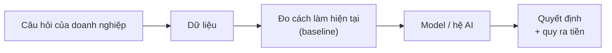

# 5 · Dữ liệu luyện tập

Mỗi nhóm bài toán có **một dự án luyện tập**: một bài toán doanh nghiệp thu nhỏ, làm trọn từ dữ liệu thô tới kết quả mà
người quản lý dùng được. Với từng nhóm, trang này trả lời bốn câu hỏi:

1. **Doanh nghiệp đang gặp chuyện gì?** — câu chuyện, kể bằng lời thường.
2. **Dự án làm gì?** — làm ra cái gì, ai dùng, dùng để quyết định việc gì.
3. **Làm xong đạt được gì?** — mục tiêu đo bằng con số, để biết khi nào là xong.
4. **Dùng dữ liệu nào?** — bộ dữ liệu thuộc lĩnh vực gì, bên trong có gì, vì sao chọn, giấy phép, cách tải.

Mọi bộ dữ liệu ở đây đều công khai hoặc tự tạo. Luôn **đọc giấy phép/điều khoản** trước khi dùng, nhất là khi đưa kết
quả vào tài liệu công ty. Dữ liệu tải về đặt trong `data/` và **không bao giờ vào Git**
([data/README.md](../../data/README.md)).

## Đọc nhanh: 9 dự án, 9 bộ dữ liệu

| Nhóm | Doanh nghiệp hỏi | Dự án luyện tập | Dữ liệu · lĩnh vực | Đích đến |
|---|---|---|---|---|
| [1 · Bảng](#g1) | "Gọi ai để giữ được nhiều khách nhất?" | Danh sách 500 khách nên gọi giữ chân mỗi tháng, kèm lý do | Nhà mạng Sóng Xanh (mô phỏng) + Telco Customer Churn · viễn thông | Gọi trúng nhiều người sắp rời hơn danh sách hiện tại, quy ra lợi nhuận tăng thêm |
| [2 · Chuỗi thời gian](#g2) | "Tháng sau mỗi cửa hàng bán được bao nhiêu?" | Dự báo 28 ngày tới cho từng mặt hàng ở từng cửa hàng | M5 – Walmart · bán lẻ | Sai số thấp hơn ít nhất 10% so với cách "lấy lại số tuần trước" |
| [3 · Bất thường](#g3) | "Giao dịch nào đáng ngờ?" | Chấm điểm rủi ro từng giao dịch thẻ, cảnh báo vừa sức đội điều tra | Credit Card Fraud Detection · ngân hàng | Cùng số cảnh báo mỗi ngày, bắt được nhiều gian lận hơn luật đơn giản |
| [4 · Gợi ý](#g4) | "Nên gợi ý phim nào cho người này?" | 10 phim gợi ý riêng cho từng người dùng | MovieLens · giải trí | Gợi ý trúng hơn "10 phim phổ biến nhất" |
| [5 · Ảnh và tài liệu](#g5) | "Hoá đơn này ghi gì?" | Đọc ngày, tổng tiền, mã số thuế từ ảnh hoá đơn | Hoá đơn bán lẻ tiếng Việt (MC-OCR) + hoá đơn tự chụp · kế toán | Đúng ≥ 95% trên phần tự động, phần không chắc chuyển người kiểm tra |
| [6 · LLM và RAG](#g6) | "Quy định nói gì về chuyện này?" | Trợ lý hỏi đáp có trích điều luật làm căn cứ | Bộ luật Lao động 2019 · pháp luật, nhân sự | Trả lời đúng ≥ 85%, 100% có trích dẫn, không bịa |
| [7 · Agent](#g7) | "Làm giúp tôi cả chuỗi việc báo giá" | Agent đọc email → tra giá → soạn báo giá → chờ người duyệt | Email và bảng giá tự tạo · bán hàng B2B | Đúng ≥ 90% email, không bịa giá, không gửi khi chưa duyệt |
| [8 · Tối ưu và nhân quả](#g8) | "Xe đi tuyến nào? Gửi khuyến mãi cho ai?" | Xếp tuyến giao hàng; đo tác động thật của email khuyến mãi | Toạ độ tự sinh + Hillstrom · logistics, marketing | Quãng đường ngắn hơn ≥ 15%; chọn khách để gửi mà lãi hơn gửi cho tất cả |
| [9 · Tạo nội dung](#g9) | "Làm giúp video dạy chữ cái cho bé" | Video 3 phút dạy 29 chữ cái trên nền nhạc, hai nhân vật cử động đứng hai góc bảng học, dựng bằng code | Kịch bản và video nhân vật tự tạo, Noto Emoji, giọng Piper vi_VN · giáo dục | Dựng lại bằng một lệnh; ≥ 90% câu đọc được máy nghe lại đúng; 100% chữ đúng chính tả |

Dự án nào cũng đi cùng một con đường — **ĐÚNG → NHANH → CHÍNH XÁC → THUYẾT PHỤC**: hỏi đúng câu hỏi, đo cách làm hiện
tại trước, cải tiến tới khi hơn rõ ràng, rồi quy kết quả ra tiền hoặc thời gian cho người quyết định.



### Vài từ sẽ gặp

- **Bộ dữ liệu (dataset):** tập dữ liệu dùng để dạy và kiểm tra model.
- **Nhãn:** đáp án đúng của từng dòng — ví dụ khách đã rời mạng hay chưa, giao dịch có phải gian lận không. Model học
  từ những dòng đã có nhãn.
- **Baseline:** cách làm đơn giản nhất, hoặc cách doanh nghiệp đang làm. Model chỉ đáng dùng khi hơn baseline rõ ràng.
- **Bộ đánh giá đóng băng (golden set):** phần dữ liệu cất riêng từ đầu, chỉ dùng để chấm điểm lần cuối — như đề thi
  không được xem trước.
- **Metric:** con số dùng để chấm. Chọn metric gắn với quyết định thật (ví dụ "trong 500 người được gọi có bao nhiêu
  người sắp rời"), không chọn con số chỉ để trông đẹp.

<a id="g1"></a>

## Nhóm 1 · Dữ liệu bảng — gọi ai để giữ khách?

**Câu chuyện.** Một nhà mạng internet mất khoảng 2% khách mỗi tháng. Đội chăm sóc khách hàng (CSKH) chỉ gọi được 500
khách mỗi tháng và đang gọi theo kinh nghiệm: "sắp hết hợp đồng", "hay báo lỗi mạng". Giữ lại được một khách đáng hơn
một triệu đồng lợi nhuận; gọi nhầm thì tốn tiền và làm phiền khách.

**Dự án làm gì.** Mỗi tháng, chấm điểm khả năng rời mạng của từng khách dựa trên lịch sử dùng mạng, hoá đơn và yêu cầu
hỗ trợ. Chọn ra 500 khách đáng gọi nhất, mỗi người kèm 3 lý do dễ hiểu (ví dụ: lượng dùng giảm mạnh mấy tháng gần đây,
vừa báo mất mạng nhiều lần) và việc nên làm khi gọi. Kết quả phục vụ qua API chạy trong Docker và một báo cáo 1 trang cho
trưởng phòng. **Dự án này đã làm xong**: đây là real case của [Giai đoạn A](../03-giai-doan-a-nen-tang/README.md), code
ở [`projects/g1-churn-telco/`](../../projects/g1-churn-telco/README.md).

**Mục tiêu đạt được**

- Trong 500 người được gọi, số người **thật sự sắp rời** nhiều hơn rõ rệt so với danh sách hiện tại, đo trên 3 tháng
  model chưa từng thấy, có khoảng tin cậy. *Dự án mẫu: 140 người mỗi tháng thay vì 37.*
- Quy ra tiền: lợi nhuận ròng tăng thêm mỗi tháng sau chi phí gọi và ưu đãi. *Dự án mẫu: thêm 44,5 triệu đ/tháng.*
- Mỗi khách có lý do bằng tiếng Việt; API có khoá truy cập, chạy trong Docker; dựng lại toàn bộ từ dữ liệu thô bằng một
  lệnh.
- Làm xong, bạn đạt mức **Trung cấp** của [Nhóm 1](../02-skill-map/generated/nhom/g1-du-lieu-bang.md).

**Dữ liệu chính — nhà mạng Sóng Xanh (mô phỏng)**

- **Lĩnh vực:** viễn thông, internet cáp quang.
- **Bên trong có gì:** khoảng 20.000 khách ở 10 tỉnh, lịch sử 2 năm (2024–2025), nằm trong 8 bảng của 4 hệ thống:
  khách hàng (CRM), gói cước và hoá đơn (Billing), lượng dùng mạng hằng tháng, yêu cầu hỗ trợ và yêu cầu huỷ. Thêm một
  file lịch khuyến mãi của đối thủ do phòng marketing giữ.
- **Giống dữ liệu thật ở chỗ:** có dấu thời gian và "bẩn" như file export thật: trùng dòng, tên tỉnh viết 43 kiểu, yêu
  cầu hỗ trợ vào hệ thống trễ vài ngày, giá cước đổi giữa chừng.
- **Dùng để:** học trọn quy trình ở doanh nghiệp: ghép nhiều bảng, dựng bảng học đúng thời điểm, bắt rò rỉ dữ liệu, chọn
  ngưỡng theo chi phí.
- **Vì sao mô phỏng:** dữ liệu khách thật không được đưa lên Git; bộ công khai không có dấu thời gian; biết cách dữ liệu
  được sinh ra nên kiểm tra được model học đúng hay sai.
- **Tạo dữ liệu:** `cd projects/g1-churn-telco && make setup && make data` — cố định theo seed, ai chạy cũng ra cùng
  một bộ dữ liệu.

**Dữ liệu luyện thêm — Telco Customer Churn (IBM, Kaggle)**

- **Lĩnh vực:** viễn thông — một nhà mạng hư cấu, dữ liệu mẫu của IBM.
- **Bên trong có gì:** 7.043 khách × 21 cột, mỗi dòng là một khách: thông tin cơ bản (giới tính, người cao tuổi, có gia
  đình), dịch vụ đang dùng (điện thoại, internet DSL/cáp quang, bảo mật, TV), loại hợp đồng (theo tháng, 1 năm, 2 năm),
  cách thanh toán, cước tháng, tổng cước, số tháng đã dùng, và cột **Churn** (đã rời mạng hay chưa): 1.869 khách rời mạng
  (26,5%).
- **Dùng để:** bài tập chuyển giao — chạy lại quy trình của Sóng Xanh (baseline, LightGBM, ngưỡng theo chi phí, giải
  thích) trên một bộ dữ liệu khác, để chắc là bạn hiểu thật chứ không chỉ chép lại.
- **Hạn chế:** chỉ là một bảng chụp ở một thời điểm, không có ngày tháng nên không chia train/test theo thời gian được;
  tỷ lệ rời mạng cao hơn nhiều so với một nhà mạng thật.
- **Giấy phép:** dữ liệu mẫu của IBM đăng lại trên Kaggle; kiểm tra điều khoản trên trang Kaggle.
- **Tải về:** `blastchar/telco-customer-churn` — lệnh ở mục [tải dữ liệu Kaggle](#tai-kaggle).

<a id="g2"></a>

## Nhóm 2 · Chuỗi thời gian — tháng sau mỗi cửa hàng bán được bao nhiêu?

**Câu chuyện.** Một chuỗi siêu thị phải đặt hàng trước cho hàng nghìn mặt hàng ở từng cửa hàng. Đặt thiếu thì hết hàng,
mất doanh thu; đặt thừa thì tồn kho, hàng hết hạn. Người phụ trách đang đặt hàng "theo số tuần trước".

**Dự án làm gì.** Dự báo số lượng bán từng ngày trong 28 ngày tới cho mỗi mặt hàng ở mỗi cửa hàng, bằng một model chung
(LightGBM) học từ mọi mặt hàng cùng lúc. So với cách "lấy lại số bán của cùng ngày tuần trước" (gọi là *seasonal naive*).
Kiểm chứng bằng **backtest cuốn chiếu**: giả vờ đứng ở nhiều thời điểm trong quá khứ, dự báo 28 ngày tiếp theo rồi so với
số bán thật.

**Mục tiêu đạt được**

- Sai số dự báo (WAPE — tổng độ lệch so với số bán thật, chia cho tổng số bán) **thấp hơn ít nhất 10%** so với seasonal
  naive, và giữ được qua ít nhất 3 lần backtest ở các thời điểm khác nhau.
- Chỉ ra dự báo kém ở đâu — mặt hàng bán lẻ tẻ (nhiều ngày bán 0), ngày lễ, tuần đổi giá — và cách xử lý từng loại.
- Quy ra hàng hoá: nếu đặt hàng theo dự báo thì số ngày hết hàng và lượng tồn thừa thay đổi ra sao (ước tính đơn giản).
- Làm xong, bạn đạt mức **Trung cấp** của [Nhóm 2](../02-skill-map/generated/nhom/g2-chuoi-thoi-gian.md).

**Dữ liệu — M5 Forecasting – Accuracy (Walmart, Kaggle 2020)**

- **Lĩnh vực:** bán lẻ — chuỗi siêu thị Walmart ở Mỹ.
- **Bên trong có gì:** số lượng bán **từng ngày** của 3.049 mặt hàng ở 10 cửa hàng thuộc 3 bang (California, Texas,
  Wisconsin), từ 29/01/2011 tới 22/05/2016 (1.941 ngày). Mặt hàng chia thành 3 ngành (thực phẩm, đồ gia dụng, đồ sở
  thích) và 7 nhóm hàng. Kèm theo lịch (ngày lễ, sự kiện thể thao, ngày phát tem phiếu thực phẩm) và giá bán từng tuần.
- **Các file:** `sales_train_evaluation.csv` — mỗi dòng là một mặt hàng ở một cửa hàng (30.490 dòng), mỗi cột là một
  ngày; `calendar.csv` — thông tin từng ngày; `sell_prices.csv` — giá theo tuần. Tổng cộng vài trăm MB.
- **Dùng để:** luyện dự báo cho hàng chục nghìn chuỗi cùng lúc, tạo feature theo lịch và giá, backtest đúng cách, dự báo
  theo nhiều cấp (mặt hàng → cửa hàng → toàn chuỗi).
- **Vì sao chọn:** dữ liệu thật, đủ lớn, nhiều mặt hàng bán lẻ tẻ, có ngày lễ và thay đổi giá — giống bài toán đặt hàng
  của siêu thị ở Việt Nam. Đây là cuộc thi dự báo nổi tiếng nên có nhiều lời giải để đối chiếu.
- **Mẹo:** bắt đầu với 1 cửa hàng hoặc 1 ngành hàng để chạy nhanh trên laptop; quy trình chạy đúng rồi mới mở rộng.
- **Giấy phép:** dữ liệu của một cuộc thi Kaggle — phải đăng nhập và bấm chấp nhận luật thi trước khi tải; đọc phần
  quy định về quyền dùng dữ liệu trong luật thi.

<a id="g3"></a>

## Nhóm 3 · Phát hiện bất thường — giao dịch nào đáng ngờ?

**Câu chuyện.** Ngân hàng xử lý hơn một trăm nghìn giao dịch thẻ mỗi ngày, nhưng chỉ khoảng 2 trên 1.000 giao dịch là
gian lận. Đội điều tra mỗi ngày chỉ kiểm tra được vài trăm giao dịch. Cảnh báo quá nhiều thì đội bỏ qua, quá ít thì mất
tiền.

**Dự án làm gì.** Chấm điểm rủi ro cho từng giao dịch, rồi chọn ngưỡng cảnh báo sao cho số cảnh báo mỗi ngày vừa với
năng lực đội điều tra (ví dụ 500 giao dịch mỗi ngày) mà vẫn chặn được nhiều tiền gian lận nhất. Học trên ngày thứ nhất,
kiểm tra trên ngày thứ hai — đúng như cách hệ thống chạy thật.

**Mục tiêu đạt được**

- Với **cùng số cảnh báo mỗi ngày**, bắt được nhiều gian lận hơn rõ rệt so với một luật đơn giản (ví dụ "số tiền lớn bất
  thường"), đo bằng tỷ lệ gian lận bắt được ở mức cảnh báo đó và PR-AUC.
- Quy ra tiền: số tiền gian lận chặn được mỗi ngày so với chi phí kiểm tra.
- Giải thích được vì sao "độ chính xác 99,8%" vô nghĩa ở bài này: đoán "không gian lận" cho mọi giao dịch đã đúng
  99,83%.
- Làm xong, bạn đạt mức **Trung cấp** của [Nhóm 3](../02-skill-map/generated/nhom/g3-bat-thuong.md).

**Dữ liệu — Credit Card Fraud Detection (ULB + Worldline, Kaggle)**

- **Lĩnh vực:** ngân hàng — giao dịch thẻ tín dụng của chủ thẻ ở châu Âu.
- **Bên trong có gì:** 284.807 giao dịch trong 2 ngày của tháng 9/2013, trong đó **492 giao dịch gian lận (0,172%)**.
  Mỗi dòng là một giao dịch: `Time` (số giây tính từ giao dịch đầu tiên), `Amount` (số tiền), 28 cột `V1`–`V28` và
  `Class` (1 là gian lận). Một file CSV khoảng 150 MB.
- **Điều đặc biệt:** `V1`–`V28` là thông tin giao dịch đã được **mã hoá** (bằng PCA) để giấu dữ liệu của khách — không
  ai biết cột nào là gì. Vì vậy bộ này hợp để luyện chọn ngưỡng và đánh giá trên dữ liệu cực kỳ lệch, không hợp để luyện
  tạo feature theo hiểu biết nghiệp vụ.
- **Dùng để:** luyện model cho sự kiện hiếm, chọn ngưỡng theo năng lực xử lý, đánh giá đúng khi 99,8% dữ liệu là "bình
  thường".
- **Vì sao chọn:** giao dịch thật, có thời gian để chia train/test đúng thứ tự, là bộ chuẩn nên dễ so với các bài viết.
- **Giấy phép:** Database Contents License (DbCL) v1.0 theo trang Kaggle; ghi nguồn Machine Learning Group của Đại học
  ULB (Bỉ) khi công bố.
- **Tải về:** `mlg-ulb/creditcardfraud` — lệnh ở mục [tải dữ liệu Kaggle](#tai-kaggle).

<a id="g4"></a>

## Nhóm 4 · Gợi ý và xếp hạng — nên gợi ý gì cho người này?

**Câu chuyện.** Một ứng dụng xem phim có hàng nghìn phim, nhưng trang đầu chỉ đủ chỗ cho khoảng 10 phim. Gợi ý đúng gu
thì người xem ở lại lâu hơn; gợi ý giống nhau cho mọi người thì phí chỗ hiển thị.

**Dự án làm gì.** Dựa trên lịch sử chấm điểm phim của mọi người, gợi ý 10 phim cho từng người dùng bằng cách "lọc cộng
tác" (ALS — tìm những người có gu giống nhau để gợi ý chéo). So với cách đơn giản nhất: gợi ý cho ai cũng là 10 phim
được xem nhiều nhất.

**Mục tiêu đạt được**

- Trên các lượt chấm điểm **gần nhất** của mỗi người (chia theo thời gian), gợi ý trúng hơn "phim phổ biến nhất" một cách
  có ý nghĩa thống kê. Đo bằng **Recall@10**: trong những phim người đó thật sự xem sau này, bao nhiêu phần trăm nằm
  trong 10 gợi ý. Và **NDCG@10**: giống Recall@10 nhưng thưởng thêm khi phim đúng nằm ở đầu danh sách.
- Không chỉ gợi ý phim bom tấn: đo độ phủ — bao nhiêu phần trăm số phim từng được gợi ý cho ít nhất một người.
- Có cách gợi ý cho người dùng mới chưa có lịch sử.
- Làm xong, bạn đạt mức **Trung cấp** của [Nhóm 4](../02-skill-map/generated/nhom/g4-goi-y-xep-hang.md).

**Dữ liệu — MovieLens latest-small (GroupLens, Đại học Minnesota)**

- **Lĩnh vực:** giải trí — người dùng trang MovieLens chấm điểm phim.
- **Bên trong có gì:** 100.836 lượt chấm điểm (từ 0,5 đến 5 sao) và 3.683 thẻ mô tả, do 610 người dùng đặt cho 9.742
  phim, từ 29/03/1996 đến 24/09/2018. Các file: `ratings.csv` (người dùng, phim, số sao, thời điểm), `movies.csv` (tên
  phim, thể loại), `tags.csv`, `links.csv` (mã phim trên IMDb, TMDb). Khoảng 1 MB.
- **Dùng để:** luyện dựng bộ đánh giá cho bài gợi ý, baseline "phổ biến nhất", lọc cộng tác, metric xếp hạng.
- **Vì sao chọn:** nhỏ, sạch, chạy vài giây trên laptop. Cấu trúc "người dùng × sản phẩm × tương tác" giống hệt dữ liệu
  mua hàng, đọc tin, nghe nhạc của doanh nghiệp.
- **Lưu ý:** bản *latest* có thể được cập nhật theo thời gian — ghi lại ngày tải. Muốn so số liệu với bài báo thì dùng
  bản cố định như MovieLens 25M.
- **Giấy phép:** dùng cho nghiên cứu và học tập; dùng vào việc thương mại phải xin phép GroupLens; trích dẫn khi công
  bố.

<a id="g5"></a>

## Nhóm 5 · Ảnh và tài liệu — hoá đơn này ghi gì?

**Câu chuyện.** Phòng kế toán nhận hàng trăm hoá đơn (giấy, ảnh chụp) mỗi tháng và gõ tay ngày, tổng tiền, mã số thuế
vào phần mềm — chậm và dễ sai.

**Dự án làm gì.** Từ ảnh hoá đơn, tự động lấy ra **ngày, tổng tiền và mã số thuế người bán**. So hai cách: (1) đọc chữ
trong ảnh (OCR) rồi dùng luật để tìm đúng trường; (2) cho một model đọc ảnh trực tiếp (VLM — mô hình ngôn ngữ nhìn được
ảnh). So độ chính xác, thời gian và chi phí mỗi hoá đơn. Hoá đơn nào hệ thống không chắc chắn thì chuyển người kiểm
tra.

**Mục tiêu đạt được**

- Trên phần hoá đơn hệ thống tự xử lý, mỗi trường đúng **≥ 95%**; phần còn lại được đánh dấu để người kiểm tra.
- Bảng so sánh hai cách — độ chính xác, thời gian, chi phí mỗi hoá đơn — kèm khuyến nghị nên dùng cách nào.
- Bộ đánh giá cố định ít nhất 100 hoá đơn có đáp án do người kiểm tra.
- Làm xong, bạn đạt mức **Trung cấp** của [Nhóm 5](../02-skill-map/generated/nhom/g5-anh-tai-lieu.md).

**Dữ liệu**

- **Hoá đơn tự chụp (nên có nhất):** 50–100 hoá đơn thật (hoá đơn VAT, siêu thị, nhà hàng) — giống nhất dữ liệu của công
  ty. **Che** tên, số điện thoại người mua trước khi gán nhãn; tự ghi đáp án ngày, tổng tiền, mã số thuế; không đưa ảnh
  gốc lên Git.
- **MC-OCR 2021 — hoá đơn bán lẻ tiếng Việt:**
  - *Lĩnh vực:* bán lẻ, kế toán — hoá đơn của siêu thị, cửa hàng ở Việt Nam, chụp bằng điện thoại.
  - *Bên trong có gì:* 2.436 ảnh hoá đơn, mỗi ảnh gán nhãn 4 trường: tên người bán, địa chỉ người bán, thời gian, tổng
    tiền; kèm bài chấm chất lượng ảnh (mờ, nghiêng, thiếu sáng).
  - *Dùng để:* luyện OCR tiếng Việt và trích thông tin trên ảnh chụp thật — nhăn, nghiêng, nhiều mẫu hoá đơn khác nhau.
  - *Lưu ý:* không có mã số thuế — tự gán thêm cho một phần, hoặc dùng hoá đơn tự chụp cho trường này.
  - *Nguồn:* cuộc thi MC-OCR tại hội nghị RIVF 2021, tổ chức trên CodaLab; dùng theo điều khoản của ban tổ chức.
- **SROIE (ICDAR 2019):** khoảng 1.000 ảnh hoá đơn scan tiếng Anh, nhãn 4 trường (công ty, ngày, địa chỉ, tổng tiền);
  cách chia hay dùng là 626 ảnh để học, 347 ảnh để kiểm tra. Dùng để so kết quả với các bài báo. Tải trên trang Robust
  Reading Competition (cần đăng ký).

<a id="g6"></a>

## Nhóm 6 · Ngôn ngữ, LLM và RAG — quy định nói gì về chuyện này?

**Câu chuyện.** Phòng nhân sự trả lời đi trả lời lại những câu như "làm đủ năm được nghỉ phép mấy ngày?", "làm thêm giờ
ngày lễ được trả lương thế nào?". Trả lời sai quy định có thể dẫn tới tranh chấp.

**Dự án làm gì.** Một trợ lý hỏi đáp trên bộ văn bản quy định: tìm đúng đoạn liên quan rồi mới trả lời (RAG — "tra cứu
rồi trả lời"), trả lời bằng tiếng Việt và **trích điều luật làm căn cứ**. Không tìm thấy căn cứ thì nói rõ "tài liệu
không đề cập" thay vì bịa.

**Mục tiêu đạt được**

- Golden set khoảng 100 câu hỏi thật, kèm đáp án và điều luật đúng, do người kiểm tra.
- Tìm đúng căn cứ: điều luật đúng nằm trong 5 đoạn được lấy ra ở **≥ 90%** câu hỏi.
- Trả lời đúng **≥ 85%** câu; **100%** câu trả lời có trích dẫn; câu hỏi ngoài tài liệu được từ chối đúng.
- Biết chi phí và thời gian trả lời mỗi câu; giảm số token mà không giảm chất lượng.
- Làm xong, bạn đạt mức **Trung cấp** của [Nhóm 6](../02-skill-map/generated/nhom/g6-llm-rag.md) — đây là mốc của giai
  đoạn B.

**Dữ liệu — Bộ luật Lao động 2019 (hoặc sổ tay, quy chế công khai của một tổ chức)**

- **Lĩnh vực:** pháp luật, nhân sự.
- **Bên trong có gì:** Bộ luật Lao động số 45/2019/QH14, hiệu lực từ 01/01/2021, gồm 17 chương, 220 điều: hợp đồng lao
  động, tiền lương, thời giờ làm việc và nghỉ ngơi, kỷ luật lao động, lao động nữ... Ví dụ: hỏi "làm đủ 12 tháng thì
  được nghỉ phép năm bao nhiêu ngày?" — căn cứ Điều 113: 12 ngày làm việc với công việc trong điều kiện bình thường.
- **Dùng để:** luyện chia văn bản theo chương – điều – khoản, tìm kiếm (theo từ khoá và theo nghĩa), trích dẫn chính
  xác, chấm điểm câu trả lời bằng golden set.
- **Vì sao chọn:** tiếng Việt, công khai, cấu trúc rõ ràng, câu hỏi dễ nghĩ ra từ đời thật — và giống hệt bài toán "hỏi
  đáp trên quy chế nội bộ" của doanh nghiệp.
- **Nguồn:** bản chính thức trên Cơ sở dữ liệu quốc gia về văn bản pháp luật (vbpl.vn) hoặc Cổng thông tin điện tử
  Chính phủ. Văn bản pháp luật là thông tin công khai; ghi rõ nguồn và ngày tải, vì luật có thể được sửa đổi.

<a id="g7"></a>

## Nhóm 7 · AI Agent — làm giúp cả chuỗi việc báo giá

**Câu chuyện.** Nhân viên kinh doanh mỗi ngày nhận hàng chục email hỏi giá. Với mỗi email phải đọc, tra bảng giá, tính
chiết khấu theo số lượng, soạn báo giá — việc lặp lại và dễ sai giá.

**Dự án làm gì.** Một agent đọc email yêu cầu báo giá → nhận ra khách cần mặt hàng nào, số lượng bao nhiêu → dùng công
cụ tra bảng giá → soạn báo giá → **dừng lại chờ người duyệt** rồi mới gửi. Email thiếu thông tin thì agent soạn câu hỏi
lại cho khách thay vì đoán.

**Mục tiêu đạt được**

- Lấy đúng mặt hàng và số lượng ở **≥ 90%** email (so với đáp án tự gán).
- **100%** đơn giá lấy từ bảng giá (không bịa giá); **không** báo giá nào được gửi khi chưa có người duyệt.
- Mọi bước (đọc gì, gọi công cụ nào, kết quả ra sao) đều có nhật ký để kiểm tra lại; biết chi phí xử lý mỗi email.
- Làm xong, bạn đạt mức **Trung cấp** của [Nhóm 7](../02-skill-map/generated/nhom/g7-agent-tu-dong-hoa.md).

**Dữ liệu — tự tạo**

- **Lĩnh vực:** bán hàng B2B — ví dụ một công ty bán văn phòng phẩm hoặc vật tư.
- **Bên trong có gì:** 30–50 email hỏi giá bằng tiếng Việt với đủ kiểu tình huống (rõ ràng; thiếu số lượng; viết tắt,
  sai chính tả; hỏi mặt hàng không có; hỏi nhiều mặt hàng một lúc), một file bảng giá CSV (50–200 mặt hàng: mã, tên,
  đơn vị, đơn giá, chiết khấu theo số lượng) và một file đáp án cho từng email.
- **Dùng để:** luyện gọi công cụ, workflow có người duyệt, chấm điểm agent bằng bộ đáp án cố định.
- **Vì sao tự tạo:** email thật của công ty thường không được chia sẻ; tự tạo giúp chủ động đưa vào các tình huống khó.
  Có thể nhờ LLM viết nháp email, nhưng **tự đọc lại và tự gán đáp án**.
- **Gợi ý cấu trúc:** `data/raw/quote-emails/` gồm `emails/*.txt`, `price_list.csv`, `answers.jsonl`.

<a id="g8"></a>

## Nhóm 8 · Tối ưu hoá và nhân quả — xe đi tuyến nào, gửi khuyến mãi cho ai?

Nhóm này biến dự đoán thành **quyết định**. Dự án gồm hai bài nhỏ.

**Bài 1 — xếp tuyến giao hàng**

- **Câu chuyện:** một kho, mỗi ngày 20 điểm giao, vài xe có tải trọng giới hạn, khách hẹn khung giờ nhận hàng. Xếp tuyến
  bằng tay thì xe đi vòng, giao trễ giờ.
- **Dự án làm gì:** dùng OR-Tools (thư viện tối ưu của Google) tìm tuyến cho từng xe sao cho tổng quãng đường ngắn nhất,
  đúng tải trọng và khung giờ. So với tuyến hiện tại, ví dụ đi theo thứ tự đơn hàng hoặc luôn tới điểm gần nhất tiếp
  theo.
- **Mục tiêu đạt được:** tổng quãng đường ngắn hơn **≥ 15%** so với tuyến hiện tại; **100%** đúng tải trọng và khung
  giờ; giải xong trong vài giây; báo cáo bằng số km, tiền xăng, giờ công tiết kiệm được.
- **Dữ liệu:** toạ độ tự sinh (cố định theo seed) hoặc lấy từ bản đồ; khoảng cách tính từ toạ độ. Lĩnh vực: logistics,
  giao hàng. Có thể bắt đầu từ ví dụ bài toán định tuyến trong tài liệu OR-Tools.

**Bài 2 — gửi email khuyến mãi cho ai**

- **Câu chuyện:** gửi khuyến mãi cho mọi khách thì tốn tiền ưu đãi cho cả những người đằng nào cũng mua. Cần biết email
  **thật sự** làm tăng mua hàng bao nhiêu, và tăng ở nhóm khách nào.
- **Dự án làm gì:** đo tác động của email bằng thí nghiệm ngẫu nhiên có sẵn trong dữ liệu, rồi dựng model *uplift* để
  chọn ra những khách bị email thuyết phục. So với "gửi cho tất cả".
- **Mục tiêu đạt được:** ước lượng email làm tăng tỷ lệ mua bao nhiêu, kèm khoảng tin cậy; chọn nhóm khách để gửi sao
  cho lợi nhuận cao hơn gửi cho tất cả.
- **Dữ liệu — Hillstrom Email Marketing (MineThatData, 2008):** 64.000 khách đã mua hàng trong 12 tháng gần nhất, được
  chia **ngẫu nhiên** thành 3 nhóm bằng nhau: nhận email hàng nam, nhận email hàng nữ, không nhận email. Sau đó theo dõi
  2 tuần: có vào website không, có mua không, chi bao nhiêu. Kèm thông tin khách: lần mua gần nhất cách đây bao lâu, đã
  chi bao nhiêu trong năm, từng mua hàng nam hay nữ, mua qua kênh nào, ở khu vực thành thị hay nông thôn. Lĩnh vực: bán
  lẻ online, marketing. Tải bằng thư viện scikit-uplift (hàm `fetch_hillstrom`) hoặc từ blog MineThatData của Kevin
  Hillstrom.

Làm xong cả hai bài, bạn đạt mức **Trung cấp** của [Nhóm 8](../02-skill-map/generated/nhom/g8-toi-uu-nhan-qua.md).

<a id="g9"></a>

## Nhóm 9 · Tạo nội dung đa phương tiện — làm giúp video dạy chữ cái cho bé

- **Câu chuyện:** giáo viên muốn một video ngắn, vui, có nhạc để dạy bảng chữ cái, dùng đúng nhân vật của lớp. Ghép
  slide, ảnh, nhạc bằng tay mất vài giờ, sửa một chữ là làm lại từ đầu. Công cụ tạo video bằng AI thì hay viết sai dấu
  tiếng Việt và làm nhân vật lệch nét giữa các cảnh.
- **Dự án làm gì:** viết kịch bản 29 chữ cái thành một file YAML, rồi để code làm hết phần còn lại: giọng đọc tiếng Việt
  chạy offline, nhạc nền tự tổng hợp, tách nhân vật khỏi video ngắn thành ảnh động nền trong suốt, vẽ từng khung hình
  (bảng học ở giữa, nhân vật hai góc nhún theo nhịp và theo lời, hình minh họa, phụ đề chạy theo lời) và ghép thành MP4
  bằng ffmpeg. Máy nhận dạng giọng nói (ASR) nghe lại từng câu để báo câu cần sửa. So với
  cách làm tay: thời gian làm một video và số lỗi chữ, lỗi đọc.
- **Mục tiêu đạt được:** một lệnh dựng lại cả video (~3 phút, không tốn phí API); **≥ 90%** câu đọc được máy nghe lại
  đúng cả khi có nhạc; **100%** chữ trên hình đúng chính tả; giáo viên nghe duyệt trước khi dùng.
- **Dữ liệu:** tự tạo — kịch bản (chữ cái, cách đọc âm, từ ví dụ) và video nhân vật (Gemini); hình minh họa Noto Emoji (Apache 2.0);
  giọng Piper vi_VN vais1000, huấn luyện trên dữ liệu VAIS-1000 (CC BY 4.0, phải ghi nguồn). Bộ đánh giá là chính 31 câu
  của kịch bản. Lĩnh vực: giáo dục.

Đã có bản chạy được: [dự án g9-video-chu-cai](../../projects/g9-video-chu-cai/README.md) (video 3 phút, máy nghe đúng
28/29 câu chữ cái). Làm lại cho bài học khác là đạt mức **Trung cấp** của [Nhóm 9](../02-skill-map/generated/nhom/g9-tao-noi-dung.md).

<a id="tai-kaggle"></a>

## Tải dữ liệu Kaggle bằng dòng lệnh

Điền `KAGGLE_USERNAME`, `KAGGLE_KEY` vào `.env` (hoặc đặt file `~/.kaggle/kaggle.json`), rồi:

```bash
set -a; source .env; set +a      # nạp biến từ .env vào shell hiện tại

uv run --with kaggle kaggle datasets download -d blastchar/telco-customer-churn -p data/raw/telco --unzip
uv run --with kaggle kaggle datasets download -d mlg-ulb/creditcardfraud -p data/raw/creditcard --unzip
uv run --with kaggle kaggle competitions download -c m5-forecasting-accuracy -p data/raw/m5
```

MovieLens:

```bash
mkdir -p data/raw/movielens && cd data/raw/movielens
curl -LO https://files.grouplens.org/datasets/movielens/ml-latest-small.zip && unzip ml-latest-small.zip
```

## Golden set — bộ đánh giá cố định

Với mỗi dự án, **trước khi** thử model đầu tiên, tách và đóng băng một bộ đánh giá (kỹ năng BIZ-02):

- Dữ liệu bảng/thời gian: tập test theo **thời gian** (giai đoạn cuối), không xáo trộn.
- LLM/RAG/Document AI: ≥ 100 mẫu thật có đáp án do người kiểm tra; lưu dạng JSONL trong
  `projects/<dự-án>/eval/` (nếu dữ liệu công khai) hoặc `data/processed/` (nếu nhạy cảm).
- Ghi lại phiên bản golden set; khi sửa golden set thì tăng phiên bản và chạy lại baseline.

Cấu trúc thư mục `data/`: xem [data/README.md](../../data/README.md). Danh sách dự án và trạng thái:
[projects/README.md](../../projects/README.md).

Tiếp theo: [6 · Xử lý sự cố](06-xu-ly-su-co.md) — hoặc bắt đầu học: [bản đồ kỹ năng](../02-skill-map/README.md).
