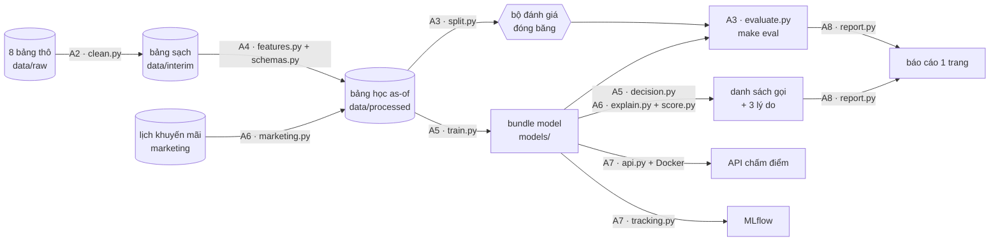

# Giai đoạn A · Nền tảng — học bằng một dự án thật, từ dữ liệu thô tới API

8 bài cho 8 tuần đầu của [lộ trình](../02-skill-map/generated/lo-trinh.md#giai-doan-a). Mỗi bài có **lý thuyết vừa đủ**
xen với **lab làm tới đâu giải thích tới đó**. Cả 8 bài cùng xây **một** dự án:
[`projects/g1-churn-telco/`](../../projects/g1-churn-telco/README.md) — dự đoán khách sắp rời mạng cho một nhà mạng.
Dự án đi từ 8 bảng dữ liệu vận hành còn "bẩn" tới API chấm điểm trong Docker và báo cáo 1 trang cho trưởng phòng.

> Mọi khối code có nhãn **File: `…`** trong các bài là bản chép **nguyên văn** của code trong repo (test
> `tests/test_doc_sync.py` của dự án bảo đảm điều đó). Mọi con số trong bài là kết quả chạy thật; dữ liệu sinh cố định
> theo seed nên bạn chạy lại sẽ ra đúng các con số đó.

## Real case: nhà mạng Sóng Xanh

**Sóng Xanh** (tên hư cấu) bán internet cáp quang cho khoảng 20.000 khách ở 10 tỉnh. Mỗi tháng khoảng **2%** khách
gửi yêu cầu hủy. Đội chăm sóc khách hàng (CSKH) gọi giữ chân được **500 khách mỗi tháng**. Hiện tại họ gọi theo
danh sách "sắp hết hợp đồng, hay báo lỗi mạng". Trưởng phòng CSKH hỏi:

> *"Mỗi tháng tôi chỉ gọi được 500 người. Gọi ai thì giữ được nhiều khách nhất — và tôi nói gì với họ?"*

Dữ liệu có sẵn là 8 bảng export từ 4 hệ thống, cộng một file của phòng marketing mà ta chỉ biết tới ở bài A6:

| Bảng | Hệ thống | Nội dung | Lỗi thật sự có trong dữ liệu |
|---|---|---|---|
| `customers` | CRM | khách, tỉnh, kênh, ngày vào mạng, trạng thái **tại ngày export** | trùng dòng, tỉnh viết 43 kiểu, ngày sinh "1900-01-01", có tên/SĐT/email |
| `subscriptions` | Billing | các kỳ thuê bao: gói, hợp đồng 0/12/24 tháng, cách trả tiền | thay đổi theo thời gian — phải lấy đúng kỳ đang hiệu lực |
| `plans`, `plan_prices` | Billing | gói cước và bảng giá theo ngày hiệu lực | giá SX50, SX150 tăng 10% từ 01/04/2025 |
| `invoices` | Kho dữ liệu | hoá đơn tháng, ngày đến hạn, ngày trả | dòng điều chỉnh âm, export trùng |
| `usage` | Đo mạng | GB dùng, giờ xem TV, phút mất mạng theo tháng | thiếu tháng (thiết bị lỗi) |
| `tickets` | Helpdesk | yêu cầu hỗ trợ, loại, thời điểm tạo, **thời điểm vào hệ thống**, CSAT | loại ticket gõ tay, ticket vào hệ thống trễ vài ngày |
| `cancellations` | CRM | yêu cầu hủy, ngày, lý do, trạng thái | yêu cầu "đã hoàn tác" (khách đổi ý) |
| `competitor_promotions` | Marketing | lịch khuyến mãi của đối thủ theo tỉnh | không nằm trong hệ thống nào — phải đi hỏi |

**Vì sao dùng dữ liệu mô phỏng?**

1. Dữ liệu khách thật không bao giờ được đưa lên Git (bài A7).
2. Bộ Telco Churn công khai chỉ là *một bảng phẳng chụp ở một thời điểm*, không có dấu thời gian. Với bộ đó không học
   được việc quan trọng nhất ở doanh nghiệp: dựng bảng học đúng thời điểm từ nhiều bảng vận hành và bắt rò rỉ dữ liệu
   (bài A4).
3. Vì biết cơ chế sinh dữ liệu, ta kiểm tra được model học đúng hay sai (bài A6 mở cơ chế ra).

Quy trình thì dùng nguyên vẹn được cho dữ liệu thật.

**Đích đến — kết quả đo trên 3 tháng model chưa từng thấy** (chi tiết ở [báo cáo 1 trang](../../projects/g1-churn-telco/reports/README.md)):

| Mỗi tháng, 500 cuộc gọi | Danh sách hiện tại | Model | Chênh lệch (KTC 95%) |
|---|---|---|---|
| Số người sắp rời được gọi trúng | 37 | 140 | +103 (90 … 114) |
| Số khách giữ được (giả định 30% đồng ý ở lại) | 11 | 42 | +31 (27 … 34) |
| Lợi nhuận ròng sau chi phí gọi và ưu đãi | 2,9 triệu đ | 47,5 triệu đ | +44,5 triệu đ (39,0 … 49,6 triệu đ) |

## Lộ trình 8 bài

| Bài | Tuần | Trọng tâm lý thuyết | Lab | File dự án viết trong bài | Sản phẩm |
|---|---|---|---|---|---|
| [A1 · Python, Git và framing](a1-python-git-framing.md) | 1 | framing, giá trị kỳ vọng, module Python, uv, Git | [biz-01](../../labs/biz-01-co-ban-framing-churn/README.md) | `pyproject.toml`, `config.py`, `Makefile`, `.gitignore` | framing 1 trang + repo một lệnh setup |
| [A2 · SQL, pandas và thống kê mô tả](a2-sql-pandas-thong-ke.md) | 2 | DuckDB, JOIN/FILTER/ASOF, làm sạch, Unicode, phân phối lệch | [data-01](../../labs/data-01-co-ban-kham-pha-du-lieu/README.md) | `clean.py` | EDA với 5 nhận xét có số liệu |
| [A3 · Baseline và bộ đánh giá cố định](a3-baseline-bo-danh-gia.md) | 3 | chia theo thời gian, metric khi năng lực có hạn, bootstrap | [stat-02](../../labs/stat-02-co-ban-bootstrap/README.md) | `split.py`, `metrics.py`, `baselines.py`, `evaluate.py` | `make eval` có khoảng tin cậy |
| [A4 · Dữ liệu đúng thời điểm và feature](a4-feature-as-of-ro-ri.md) | 4 | as-of, rò rỉ dữ liệu, feature hành vi, data contract | [data-03](../../labs/data-03-trung-cap-ro-ri-du-lieu/README.md) | `features.py`, `schemas.py` | bảng học + test chứng minh không rò rỉ |
| [A5 · LightGBM, mất cân bằng, ngưỡng theo chi phí](a5-lightgbm-nguong-chi-phi.md) | 5 | boosting, PR-AUC, hiệu chỉnh, EV, năng lực | [stat-05](../../labs/stat-05-trung-cap-nguong-chi-phi/README.md) | `train.py`, `decision.py` | so với baseline có KTC + đường coverage–precision |
| [A6 · Phân tích lỗi, giải thích và kiểm thử](a6-phan-tich-loi-shap-test.md) | 6 | đọc ca sai, cải tiến bằng dữ liệu, SHAP, test pipeline | [biz-03](../../labs/biz-03-trung-cap-phan-tich-loi/README.md) | `marketing.py`, `explain.py`, `score.py`, `tests/` | bảng nhóm lỗi + top 500 kèm 3 lý do |
| [A7 · API, Docker, MLflow và bảo mật](a7-api-docker-mlflow-bao-mat.md) | 7 | phục vụ model, container, theo dõi thực nghiệm, PII/secret | [ops-01](../../labs/ops-01-co-ban-dong-goi-api/README.md) | `api.py`, `Dockerfile`, `tracking.py` | `docker compose up` ra API |
| [A8 · Trình bày kết quả — mốc giai đoạn A](a8-trinh-bay-ket-qua.md) | 8 | báo cáo cho người ngoài ngành, độ nhạy, quy trình nhóm | [biz-04](../../labs/biz-04-co-ban-trinh-bay/README.md) | `report.py`, CI | báo cáo 1 trang + demo |

## Dự án sau 8 bài



```text
projects/g1-churn-telco/
├── pyproject.toml, uv.lock, Makefile, .gitignore, .env.example     ← A1
├── src/churn_telco/
│   ├── config.py                                                   ← A1  đường dẫn, mốc thời gian, giả định nghiệp vụ
│   ├── simulate.py                                                 ← A2  hệ nguồn giả lập (chép, không phải viết)
│   ├── clean.py                                                    ← A2
│   ├── split.py, metrics.py, baselines.py, evaluate.py             ← A3
│   ├── features.py, schemas.py                                     ← A4
│   ├── train.py, decision.py                                       ← A5
│   ├── marketing.py, explain.py, score.py                          ← A6
│   ├── api.py, demo.html, tracking.py                              ← A7
│   └── report.py                                                   ← A8
├── tests/                                                          ← A3–A8 (viết tới đâu test tới đó)
├── eval/manifest.json                                              ← A3  bộ đánh giá đóng băng (có commit)
├── reports/                                                        ← A3, A8
├── Dockerfile, docker-compose.yml, .dockerignore                   ← A7
└── data/ models/ mlruns/                                           ← sinh ra khi chạy, KHÔNG commit
```

## Cách học một bài

1. **Đọc mục tiêu** và tiêu chí "Đạt khi" của thẻ kỹ năng ở đầu bài — đó là thước đo cuối bài.
2. **Đọc lý thuyết và làm ví dụ bằng tay** (giấy, máy tính bỏ túi). Ví dụ đều nhỏ, có đáp số để tự kiểm tra.
3. **Làm lab**: gõ lại code thay vì chép cả file. Đọc phần giải thích ngay dưới mỗi khối, chạy lệnh, rồi so output
   của bạn với output trong bài.
4. **Kiểm tra kết quả** theo danh sách cuối bài, làm ít nhất một bài tập, rồi commit.

Có hai cách theo khoá học:

- **Xây từ đầu** (khuyến nghị) — tạo repo của riêng bạn và viết lần lượt từng file theo bài. Khi kẹt, so với
  `projects/g1-churn-telco/`.
- **Đọc và chạy** — dùng dự án có sẵn, đọc bài, chạy từng lệnh `make`, làm lab và bài tập.

Muốn thấy đích đến trước khi bắt đầu (khoảng 2 phút):

```bash
cd projects/g1-churn-telco
make setup      # cài đúng môi trường theo uv.lock
make all        # dữ liệu → feature → train → đánh giá → danh sách gọi → MLflow → báo cáo
make test       # 157 test trên dữ liệu nhỏ tự sinh, khoảng 1–2 phút
```

Cần có: Python 3.12, [uv](https://docs.astral.sh/uv/), Git, `make`, và Docker (từ bài A7). Không tốn chi phí API.

## Tự đánh giá cuối giai đoạn

| Kỹ năng | Mức | Đạt khi (thẻ kỹ năng) | Bằng chứng trong dự án |
|---|---|---|---|
| [PY-01](../02-skill-map/generated/mang/py.md#py-01) | Cơ bản | Module có type hints, logging, CLI, người khác chạy được bằng README | `src/churn_telco/*.py`, `python -m churn_telco.<bước>` |
| [PY-02](../02-skill-map/generated/mang/py.md#py-02) | Trung cấp | Clone sạch, một lệnh setup ra môi trường giống hệt, mọi thay đổi qua PR | `uv.lock`, `make setup`, CI (A8) |
| [PY-03](../02-skill-map/generated/mang/py.md#py-03) | Trung cấp | Test tự động; thay đổi làm giảm chất lượng bị CI bắt | `tests/` (A6), job CI |
| [BIZ-01](../02-skill-map/generated/mang/biz.md#biz-01) | Cơ bản | "Giảm churn" → "precision@500 mỗi tháng cho CSKH" | framing trong README dự án (A1) |
| [BIZ-02](../02-skill-map/generated/mang/biz.md#biz-02) | Cơ bản | Ngày thứ 2 đã có baseline và một lệnh tái tạo | `make eval` (A3) |
| [BIZ-03](../02-skill-map/generated/mang/biz.md#biz-03) | Trung cấp | Bảng "nhóm lỗi – số ca – đã sửa – metric trước/sau" | bài A6 |
| [BIZ-04](../02-skill-map/generated/mang/biz.md#biz-04) | Cơ bản | Người ngoài ngành quyết định được sau 10 phút | `reports/README.md` (A8) |
| [DATA-01](../02-skill-map/generated/mang/data.md#data-01) | Cơ bản | Truy vấn tạo bảng học theo mốc thời gian, khớp số liệu báo cáo | `FEATURE_SQL` (A4) |
| [DATA-02](../02-skill-map/generated/mang/data.md#data-02) | Cơ bản | Không sinh dòng trùng sau khi ghép | `validate="one_to_one"`, schema `unique` |
| [DATA-03](../02-skill-map/generated/mang/data.md#data-03) | Trung cấp | Offline và chạy thật lệch trong biên sai số, không "đẹp bất thường" | test đúng thời điểm (A4) |
| [DATA-04](../02-skill-map/generated/mang/data.md#data-04) | Cơ bản | Feature mới cải thiện metric trên backtest theo thời gian | feature marketing (A6) |
| [DATA-05](../02-skill-map/generated/mang/data.md#data-05) | Cơ bản | Pipeline tự dừng, báo lỗi rõ khi sai schema hoặc lệch phân phối | `schemas.py` (A4) |
| [STAT-01](../02-skill-map/generated/mang/stat.md#stat-01) | Cơ bản | Giải thích được vì sao "99% chính xác" có thể vô giá trị | bài A2, A5 |
| [STAT-02](../02-skill-map/generated/mang/stat.md#stat-02) | Cơ bản | Mọi bảng so sánh có KTC, quyết định dựa trên nó | `metrics.bootstrap` (A3) |
| [STAT-05](../02-skill-map/generated/mang/stat.md#stat-05) | Trung cấp | Đường coverage–accuracy và mức tự động hoá đạt mục tiêu | `decision.profit_curve` (A5) |
| [ML-01](../02-skill-map/generated/mang/ml.md#ml-01) | Cơ bản | Baseline trong 1–2 ngày, mọi thí nghiệm so trên cùng một tập cố định | `evaluate.py` (A3) |
| [ML-02](../02-skill-map/generated/mang/ml.md#ml-02) | Trung cấp | LightGBM vượt baseline có ý nghĩa thống kê theo thời gian | bài A5 |
| [ML-03](../02-skill-map/generated/mang/ml.md#ml-03) | Trung cấp | Báo cáo theo năng lực đội vận hành (precision@k) | bài A3, A5 |
| [ML-04](../02-skill-map/generated/mang/ml.md#ml-04) | Trung cấp | Top khách cho CSKH kèm 3 lý do dễ hiểu | `explain.py` (A6) |
| [OPS-01](../02-skill-map/generated/mang/ops.md#ops-01) | Cơ bản | `docker compose up` ra API có health check và version | bài A7 |
| [OPS-02](../02-skill-map/generated/mang/ops.md#ops-02) | Cơ bản | Tái tạo metric của thí nghiệm cũ trong 10 phút | `bundle.json` + MLflow (A7) |
| [OPS-08](../02-skill-map/generated/mang/ops.md#ops-08) | Cơ bản | Không secret/dữ liệu thật trong Git; biết dữ liệu nào được gửi ra ngoài | `security_check.py` (A7) |
