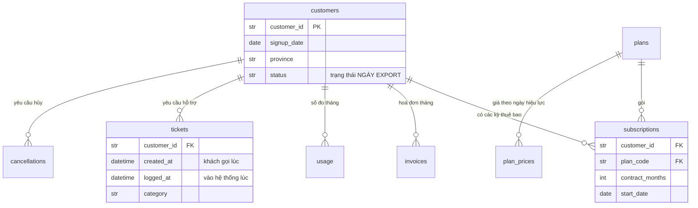
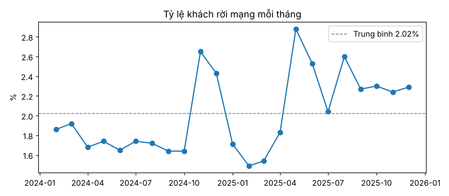
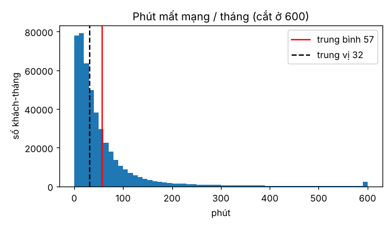

# A2 · SQL, xử lý bảng và thống kê mô tả

**Tuần 2** · Kỹ năng: [DATA-01](../02-skill-map/generated/mang/data.md#data-01) Cơ bản,
[DATA-02](../02-skill-map/generated/mang/data.md#data-02) Cơ bản, [STAT-01](../02-skill-map/generated/mang/stat.md#stat-01) Cơ bản ·
Lab: [`labs/data-01-co-ban-kham-pha-du-lieu/`](../../labs/data-01-co-ban-kham-pha-du-lieu/README.md) ·
Sản phẩm: dữ liệu sạch có quy tắc + EDA với 5 nhận xét có số liệu

Dữ liệu ở doanh nghiệp không đến dưới dạng một bảng sạch. Nó đến dưới dạng 8 file export từ 4 hệ thống, mỗi hệ thống
có lỗi riêng. Bài này làm ba việc: hiểu cấu trúc dữ liệu vận hành, làm sạch có quy tắc (chạy lại được, có test), rồi
khám phá bằng SQL và thống kê mô tả để biết feature nào đáng dựng ở bài A4.

**Sau bài này bạn làm được:**

- Đọc thẳng file CSV/parquet bằng DuckDB và viết truy vấn phân tích: `JOIN`, `GROUP BY`, `FILTER`, `EXISTS`, cửa
  sổ thời gian, `ASOF JOIN`.
- Làm sạch bằng pandas có quy tắc rõ ràng: khử trùng, chuẩn hoá tên tỉnh tiếng Việt (NFC/NFD), giá trị mặc định giả,
  bỏ PII ngay bước đầu.
- Tính tỷ lệ nền, so tỷ lệ giữa các nhóm, mô tả phân phối lệch bằng trung vị và phân vị.
- Viết 5 nhận xét, mỗi câu có một con số tính từ dữ liệu.

---

## 1 · Lý thuyết: dữ liệu vận hành trông như thế nào

### 1.1 Tám bảng, bốn hệ thống, hai loại cột thời gian



Hãy để ý **hai loại cột thời gian**, vì bài A4 xoay quanh chúng:

- **Thời điểm sự kiện xảy ra**: `created_at` của ticket (khách gọi lúc nào), `month` của số đo, `request_date` của
  yêu cầu hủy.
- **Thời điểm dữ liệu có trong hệ thống**: `logged_at` của ticket (nhân viên nhập lúc nào; có khi trễ vài ngày),
  hoặc ngày export CRM. Một model chạy ngày 1 tháng 7 chỉ thấy được những gì *đã có trong hệ thống* trước ngày đó.

Nhiều bảng **thay đổi theo thời gian**: một khách có nhiều kỳ thuê bao (đổi gói, gia hạn), và giá cước có nhiều mức
theo ngày hiệu lực. Muốn biết "khách dùng gói nào *vào ngày t*" thì phải ghép đúng kỳ đang hiệu lực. Đó là việc của
`ASOF JOIN` (mục 2.2).

### 1.2 Ba tầng dữ liệu: raw → interim → processed

| Tầng | Nội dung | Quy tắc |
|---|---|---|
| `data/raw/` | bản export y nguyên | **không bao giờ sửa** — là bằng chứng để đối chiếu |
| `data/interim/` | bản đã làm sạch, mỗi bảng một file parquet | sinh lại được bằng `make clean-data` |
| `data/processed/` | bảng học (feature + nhãn) | bài A4 |

Làm sạch bằng code (không sửa tay trong Excel) để tháng sau chạy lại được, và để người khác review được *từng quy tắc*.

### 1.3 Dữ liệu bẩn có quy luật — xử lý mỗi loại một quy tắc

| Loại lỗi | Ví dụ trong dữ liệu Sóng Xanh | Quy tắc xử lý |
|---|---|---|
| Trùng dòng do export lại | 443 dòng khách trùng mã | giữ bản `updated_at` mới nhất |
| Cùng một giá trị, nhiều cách viết | "TP.HCM", "Ho Chi Minh", "Hồ Chí Minh"… (43 kiểu cho 10 tỉnh) | chuẩn hoá về một khoá so khớp, ánh xạ về tên chuẩn |
| Giá trị mặc định giả | ngày sinh 1900-01-01 khi nhân viên bỏ trống | coi là thiếu (`NaT`), không phải người 125 tuổi |
| Thiếu giá trị | 899 khách không có kênh bán | gán "Không rõ" — thiếu cũng là thông tin |
| Dòng điều chỉnh | hoá đơn `-ADJ` có số tiền âm (hoàn tiền khi mất mạng) | giữ lại nhưng gắn cờ `is_adjustment` |
| Gõ tay | "Mang cham", "MẤT KẾT NỐI", "Mất kết nối " | chuẩn hoá như tên tỉnh |
| Dữ liệu cá nhân | tên, số điện thoại, email trong bảng khách | **bỏ ngay bước đầu** — model không cần |

Nguyên tắc quan trọng nhất: **không đoán bừa**. Giá trị không chuẩn hoá được thì giữ nguyên và *báo ra*
(`unknown_values`), không ép vào nhóm "gần nhất".

---

## 2 · Lý thuyết: SQL phân tích với DuckDB

### 2.1 Vì sao DuckDB

DuckDB là cơ sở dữ liệu phân tích chạy ngay trong tiến trình Python, không cần cài server. Nó đọc thẳng
`read_csv(...)`/`read_parquet(...)`, xử lý vài chục triệu dòng trên laptop trong vài giây, và trả kết quả về pandas
bằng `.df()`. SQL bạn viết ở đây chạy được gần như nguyên vẹn trên PostgreSQL hay BigQuery khi lên production.

### 2.2 Năm mẫu truy vấn dùng suốt khoá học

**(1) Đếm có điều kiện — `FILTER`** thay cho nhiều truy vấn con:

```sql
SELECT count(*)                                    AS so_dong,
       count(*) FILTER (WHERE channel IS NULL)     AS thieu_kenh,
       count(*) - count(DISTINCT customer_id)      AS dong_trung
FROM read_csv('data/raw/customers.csv')
```

**(2) Còn tồn tại hay không — `EXISTS` / `NOT EXISTS`**: "khách còn hoạt động đầu tháng m" là khách đã vào mạng
trước m và **chưa có** yêu cầu hủy nào trước m:

```sql
SELECT m, c.customer_id
FROM months JOIN customers c ON c.signup_date < m
WHERE NOT EXISTS (SELECT 1 FROM done d WHERE d.customer_id = c.customer_id AND d.request_date < m)
```

**(3) Cửa sổ thời gian — `INTERVAL`**: số ticket trong 30 ngày trước t là
`count(*) FILTER (WHERE logged_at >= t - INTERVAL 30 DAY AND logged_at < t)`.

**(4) Ghép trái giữ đủ dòng — `LEFT JOIN`**: khách không có ticket nào vẫn phải có mặt với số đếm 0. `count(cột)`
không đếm NULL, nên khách không có ticket ra 0, không ra 1.

**(5) Ghép theo thời điểm — `ASOF JOIN`**: lấy *dòng gần nhất trước hoặc đúng thời điểm* ở bảng kia. Ví dụ một khách
có 3 kỳ thuê bao:

| start_date | plan_code | contract_months |
|---|---|---|
| 2023-03-10 | SX150 | 12 |
| 2024-03-05 | SX150 | 12 |
| 2025-02-20 | SX300 | 0 |

```sql
SELECT p.m, s.plan_code, s.contract_months
FROM panel p ASOF LEFT JOIN subscriptions s
    ON p.customer_id = s.customer_id AND p.m >= s.start_date
```

Với `m = 2025-01-01`, DuckDB chọn kỳ bắt đầu 2024-03-05 (gần nhất mà vẫn ≤ m) → SX150, hợp đồng 12 tháng. Với
`m = 2025-03-01` thì chọn kỳ 2025-02-20 → SX300, không kỳ hạn. Một JOIN thường (`=`) không làm được việc này. Một JOIN
`>=` thường thì nhân bản dòng (khớp cả ba kỳ).

### 2.3 NULL — logic ba trạng thái

`NULL = NULL` không phải TRUE mà là NULL, và `WHERE` chỉ giữ dòng TRUE. Hệ quả hay gặp:

- `WHERE resolved_at >= t` bỏ mất ticket **chưa xử lý** (`resolved_at` NULL). Muốn đếm ticket còn mở tại t thì viết
  `resolved_at IS NULL OR resolved_at >= t`.
- `avg`, `min`, `max`, `count(cột)` bỏ qua NULL; `count(*)` thì không.
- `a / nullif(b, 0)` tránh lỗi chia cho 0: mẫu số bằng 0 thì kết quả là NULL.

---

## 3 · Lý thuyết: pandas để làm sạch, và tiếng Việt trong máy tính

### 3.1 Các thao tác làm sạch

| Việc | pandas | Lưu ý |
|---|---|---|
| Khử trùng, giữ bản mới nhất | `df.sort_values("updated_at").drop_duplicates("customer_id", keep="last")` | sort **trước** rồi mới drop |
| Ánh xạ giá trị | `df["province"].map(normalize_province)` | hàm thuần, test được từng ca |
| Điền thiếu | `df["channel"].fillna("Không rõ")` | chỉ khi "thiếu" có nghĩa riêng |
| Gán theo điều kiện | `df.loc[mask, "date_of_birth"] = pd.NaT` | dùng `.loc`, tránh chained assignment |
| Ghép bảng có kiểm tra | `a.merge(b, on=keys, validate="one_to_one")` | ghép sinh dòng trùng thì báo lỗi ngay (bài A4) |

pandas 3 có hai thay đổi bạn sẽ gặp. Chuỗi mặc định là kiểu `str`, không còn là `object`. Cột ngày giờ giữ đơn vị
của nguồn (`datetime64[ms]`, `[us]`…), không ép hết về `[ns]`. Đừng viết code phụ thuộc vào đơn vị cụ thể.

### 3.2 "Đà Nẵng" có thể là hai chuỗi khác nhau

Chữ "ẵ" lưu được theo hai cách. **NFC** dùng *một* ký tự dựng sẵn (U+1EB5). **NFD** dùng chữ "a" cộng hai dấu
tổ hợp (U+0103 + U+0303). Hai chuỗi trông giống hệt nhưng `==` trả về `False`, nên group by sẽ ra hai tỉnh "Đà Nẵng".
Thêm vào đó là dấu đặt kiểu cũ/mới ("Khánh Hoà" / "Khánh Hòa"), không dấu ("Khanh Hoa") và viết tắt ("HN").

Cách làm bền là tạo một **khoá so khớp**: chuẩn hoá NFC → tách dấu (NFD) → bỏ dấu → `đ`→`d` → chữ thường → bỏ mọi ký
tự không phải chữ/số → bỏ tiền tố "tp". Mọi biến thể của cùng một tỉnh cho ra cùng một khoá. Từ khoá đó ánh xạ về
**tên chuẩn** (NFC, có dấu). Khoá chỉ dùng để so khớp; tên hiển thị vẫn là tên chuẩn có dấu.

---

## 4 · Lý thuyết: thống kê mô tả cần cho bài toán này

### 4.1 Tỷ lệ nền và nghịch lý accuracy

**Tỷ lệ nền** (base rate) là tỷ lệ sự kiện trong tổng thể, ở đây là số khách rời mạng trong tháng chia cho số khách
đang hoạt động đầu tháng. Nó là:

- *mức sàn* của precision: chọn ngẫu nhiên 500 người thì precision ≈ tỷ lệ nền;
- lý do accuracy vô dụng: tỷ lệ nền 2% thì "đoán không ai rời" đạt accuracy 98%.

### 4.2 Phân phối lệch: trung bình đánh lừa

Phút mất mạng mỗi tháng có rất nhiều khách ở mức thấp và một ít khách mất mạng cả ngày. Phân phối kiểu này **lệch
phải**: trung bình bị kéo lên bởi phần đuôi. Hãy báo cáo bằng **trung vị** (50% khách dưới mức này) và **phân vị**
p90/p99 (10%/1% khách tệ nhất). Biểu đồ histogram cho thấy hình dạng; nên cắt đuôi khi vẽ để phần thân không bị ép
dẹt.

### 4.3 So sánh nhóm — và cái bẫy nhân quả

"Khách không kỳ hạn rời nhiều gấp 2,3 lần" là một **tương quan**. Có thể vì không kỳ hạn thì dễ rời. Cũng có thể vì
khách vốn đã định đi thì không ký hợp đồng. EDA chỉ trả lời *ai rời nhiều*, không trả lời *vì sao*. Muốn biết "ép ký
hợp đồng có giảm churn không" thì phải làm thí nghiệm (STAT-03, STAT-06 ở giai đoạn C). Khi so nhóm, luôn ghi kèm
**cỡ mẫu**: tỷ lệ 4% trên 50 khách khác hẳn 4% trên 5.000 khách.

---

## 5 · Lab A2

### A2.1 Sinh dữ liệu của các hệ thống nguồn

`simulate.py` đóng vai *các hệ thống của Sóng Xanh*. Nó sinh 24 tháng hoạt động của khoảng 30.000 khách và export ra
file y như thật, kể cả lỗi. Đây **không phải code bạn viết** trong khoá học. Hãy chép file
[`src/churn_telco/simulate.py`](../../projects/g1-churn-telco/src/churn_telco/simulate.py) từ repo vào dự án của bạn.
Đừng đọc phần cơ chế churn trong đó: bài A6 mới mở ra để đối chiếu với điều model học được. Đọc trước thì bạn sẽ "biết
đáp án" khi làm feature.

```bash
make data
```

```text
INFO churn_telco.simulate: customers                 29963 dòng
INFO churn_telco.simulate: subscriptions             44730 dòng
INFO churn_telco.simulate: plans                         6 dòng
INFO churn_telco.simulate: plan_prices                   8 dòng
INFO churn_telco.simulate: invoices                 481155 dòng
INFO churn_telco.simulate: usage                    466768 dòng
INFO churn_telco.simulate: tickets                  105903 dòng
INFO churn_telco.simulate: cancellations              9558 dòng
INFO churn_telco.simulate: competitor_promotions         3 dòng
```

Bảng CRM/billing ra CSV (`data/raw/*.csv`), bảng lớn của kho dữ liệu ra parquet. Lịch khuyến mãi của đối thủ nằm
riêng ở `data/marketing/`: tạm thời coi như chưa biết nó tồn tại.

### A2.2 Nhìn tận mắt trước khi viết code

```bash
uv run python -c "import pandas as pd; print(pd.read_csv('data/raw/customers.csv').head(3).to_string())"
```

```text
  customer_id        full_name      phone                  email date_of_birth        province           segment   channel signup_date          status cancel_date  updated_at
0    KH014889  Nguyễn Hữu Hạnh  987520173  kh014889@mail.example    1986-09-15         Đà Nẵng  Doanh nghiệp nhỏ  Cửa hàng  2019-02-15          Đã hủy  2024-09-11  2025-03-13
1    KH028005  Hoàng Hoàng Lan  905343503  kh028005@mail.example    1991-03-15     Hồ Chí Minh       Hộ gia đình    Online  2025-09-08  Đang hoạt động         NaN  2025-06-07
2    KH010096     Hoàng Thu An  961144799  kh010096@mail.example    1983-11-15  Thừa Thiên Huế       Hộ gia đình  Cửa hàng  2020-04-23  Đang hoạt động         NaN  2025-05-03
```

Ba dòng mà đã thấy bốn vấn đề:

1. Có **dữ liệu cá nhân** (tên, số điện thoại, email). Model không cần chúng.
2. Số điện thoại **mất số 0 đầu** (`987520173`) vì pandas đọc thành số nguyên. Đây là lỗi kinh điển khi mở CSV.
3. "Hồ Chí Minh" là một cách viết khác của "TP. Hồ Chí Minh".
4. Cột `status`/`cancel_date` là trạng thái **tại ngày export**. Khách dòng 0 có `status = Đã hủy` từ 2024-09-11. Nếu
   dựng bảng học cho tháng 06/2024 mà dùng cột này, ta đã "nhìn thấy tương lai" (bài A4).

Loại ticket còn tệ hơn:

```text
category
Mạng chậm          34716
Mất kết nối        34111
...
mạng chậm           1923
Mang cham           1908
mất kết nối         1455
Mất kết nối         1445      ← có dấu cách ở cuối
MẤT KẾT NỐI         1421
```

### A2.3 `clean.py` — làm sạch có quy tắc

Viết từng phần, chạy thử từng phần trong `uv run python` trước khi viết tiếp.

**File: `src/churn_telco/clean.py` · `đầu file`**

```python
"""Làm sạch bảng thô (A2): data/raw → data/interim. Mỗi quy tắc đều có lý do ghi ngay cạnh, và có test.

Nguyên tắc:
- Không sửa data/raw (bằng chứng gốc); mọi thay đổi nằm ở đây, chạy lại được.
- Bỏ PII (tên, số điện thoại, email) NGAY ở bước đầu tiên: model không cần, log và file trung gian không chứa (OPS-08).
- Không đoán bừa: giá trị không chuẩn hoá được thì giữ nguyên và báo ra, không ép vào nhóm gần nhất.

    uv run python -m churn_telco.clean        # data/raw → data/interim
"""

from __future__ import annotations

import logging
import re
import unicodedata
from pathlib import Path

import pandas as pd

from churn_telco import config
```

Docstring ghi ba nguyên tắc của module. Người review chỉ cần đọc đoạn này là biết module được phép làm gì.

**File: `src/churn_telco/clean.py` · `PII_COLUMNS…TICKET_CATEGORIES`**

```python
PII_COLUMNS = ["full_name", "phone", "email"]
CANONICAL_PROVINCES = [
    "TP. Hồ Chí Minh",
    "Hà Nội",
    "Đà Nẵng",
    "Hải Phòng",
    "Cần Thơ",
    "Bình Dương",
    "Đồng Nai",
    "Khánh Hòa",
    "Thừa Thiên Huế",
    "Nghệ An",
]
PROVINCE_ALIASES = {"hcm": "TP. Hồ Chí Minh", "hochiminh": "TP. Hồ Chí Minh", "hn": "Hà Nội", "hue": "Thừa Thiên Huế"}
TICKET_CATEGORIES = ["Mất kết nối", "Mạng chậm", "Cước phí", "Chuyển địa điểm", "Yêu cầu hủy", "Khác"]
```

Danh sách **giá trị chuẩn** viết ra tường minh. Đây là "hợp đồng": sau khi làm sạch, tỉnh phải thuộc
`CANONICAL_PROVINCES`, loại ticket phải thuộc `TICKET_CATEGORIES`. `PROVINCE_ALIASES` chứa các viết tắt mà quy tắc
bỏ dấu không suy ra được ("hcm", "hn", "hue").

**File: `src/churn_telco/clean.py` · `ascii_key`**

```python
def ascii_key(text: str) -> str:
    """Khoá so khớp: NFC → bỏ dấu → chữ thường → bỏ tiền tố 'tp' và mọi ký tự không phải chữ số/chữ cái.

    'TP.HCM', 'TP HCM' → 'hcm'; 'Khánh Hoà' (dấu đặt kiểu cũ) và 'Khánh Hòa' → 'khanhhoa'.
    """
    text = unicodedata.normalize("NFD", unicodedata.normalize("NFC", text))
    text = "".join(ch for ch in text if unicodedata.category(ch) != "Mn").replace("đ", "d").replace("Đ", "D")
    text = re.sub(r"[^a-z0-9]", "", text.lower())
    return text.removeprefix("tp")
```

Từng bước của khoá so khớp (mục 3.2): `normalize("NFC")` trước để mọi chuỗi về cùng dạng, rồi `NFD` để tách dấu thành
ký tự riêng. Bỏ các ký tự loại `Mn` (dấu tổ hợp), đổi `đ`→`d` (chữ "đ" không phải "d" + dấu nên `NFD` không tách),
chữ thường, bỏ mọi thứ không phải `a-z0-9`, cuối cùng bỏ tiền tố "tp". Thử ngay:

```bash
uv run python -c "from churn_telco.clean import ascii_key as k; print(k('TP.HCM'), k('Khánh Hoà'), k('Khanh Hoa'))"
```

```text
hcm khanhhoa khanhhoa
```

**File: `src/churn_telco/clean.py` · `_PROVINCE_KEYS…_TICKET_KEYS`**

```python
_PROVINCE_KEYS = {ascii_key(p): p for p in CANONICAL_PROVINCES} | PROVINCE_ALIASES
_TICKET_KEYS = {ascii_key(c): c for c in TICKET_CATEGORIES}
```

Hai từ điển *khoá → tên chuẩn* được dựng **từ chính danh sách chuẩn**: thêm một tỉnh vào `CANONICAL_PROVINCES` là tự
có khoá. Tiền tố `_` báo đây là chi tiết nội bộ của module.

**File: `src/churn_telco/clean.py` · `normalize_province…normalize_category`**

```python
def normalize_province(value: str | float) -> str | float:
    if not isinstance(value, str):
        return value
    return _PROVINCE_KEYS.get(ascii_key(value), unicodedata.normalize("NFC", value.strip()))


def normalize_category(value: str) -> str:
    return _TICKET_KEYS.get(ascii_key(value), unicodedata.normalize("NFC", value.strip()))
```

Không tìm thấy khoá thì trả về **chính giá trị đó** (đã NFC, bỏ khoảng trắng), không đoán. Giá trị lạ sẽ lộ ra ở
`unknown_values` bên dưới. `normalize_province` để nguyên giá trị không phải chuỗi (NaN): thiếu thì vẫn là thiếu.

**File: `src/churn_telco/clean.py` · `clean_customers`**

```python
def clean_customers(raw: pd.DataFrame) -> pd.DataFrame:
    df = raw.drop(columns=PII_COLUMNS)
    # export trùng: giữ bản cập nhật mới nhất của mỗi khách
    df = df.sort_values("updated_at").drop_duplicates("customer_id", keep="last")
    df["province"] = df["province"].map(normalize_province)
    df["channel"] = df["channel"].fillna("Không rõ")
    # 1900-01-01 là giá trị mặc định khi bỏ trống, không phải ngày sinh thật
    df.loc[df["date_of_birth"] == pd.Timestamp("1900-01-01"), "date_of_birth"] = pd.NaT
    # status/cancel_date là trạng thái TẠI NGÀY EXPORT: giữ lại để đối soát, KHÔNG dùng làm feature (A4)
    return df.sort_values("customer_id").reset_index(drop=True)
```

Thứ tự các dòng có chủ đích:

1. **Bỏ PII trước tiên.** Từ đây trở đi không file trung gian, log hay model nào chứa tên/số điện thoại (OPS-08,
   bài A7).
2. **Khử trùng giữ bản mới nhất**: `sort_values("updated_at")` rồi `keep="last"`.
3. Chuẩn hoá tỉnh, điền kênh "Không rõ", đổi ngày sinh mặc định thành `NaT`.
4. **Giữ** `status`/`cancel_date` để đối soát, nhưng ghi rõ không được dùng làm feature. Bài A4 có test bảo vệ quy
   tắc này.

**File: `src/churn_telco/clean.py` · `clean_invoices…clean_tickets`**

```python
def clean_invoices(raw: pd.DataFrame) -> pd.DataFrame:
    df = raw.drop_duplicates()  # export lại: trùng nguyên dòng
    df = df.assign(is_adjustment=df["invoice_id"].str.endswith("-ADJ"))  # dòng điều chỉnh giảm cước, amount < 0
    return df.reset_index(drop=True)


def clean_tickets(raw: pd.DataFrame) -> pd.DataFrame:
    return raw.assign(category=raw["category"].map(normalize_category))
```

`drop_duplicates()` không tham số chỉ bỏ dòng trùng **toàn bộ** cột (export lại). Hai hoá đơn khác nhau của cùng
khách cùng tháng vẫn giữ. Dòng điều chỉnh không bị xoá mà được gắn cờ: số hoàn tiền là thông tin hữu ích (khách vừa
bị mất mạng).

**File: `src/churn_telco/clean.py` · `read_raw`**

```python
def read_raw(raw_dir: Path = config.RAW) -> dict[str, pd.DataFrame]:
    dates = {
        "customers": ["date_of_birth", "signup_date", "cancel_date", "updated_at"],
        "subscriptions": ["start_date", "end_date"],
        "plan_prices": ["effective_from"],
        "tickets": ["created_at", "logged_at", "resolved_at"],
        "cancellations": ["request_date", "effective_date"],
    }
    tables = {name: pd.read_csv(raw_dir / f"{name}.csv", parse_dates=cols) for name, cols in dates.items()}
    tables["plans"] = pd.read_csv(raw_dir / "plans.csv")
    tables["invoices"] = pd.read_parquet(raw_dir / "invoices.parquet")
    tables["usage"] = pd.read_parquet(raw_dir / "usage.parquet")
    return tables
```

`parse_dates` khai báo **tường minh** cột nào là ngày. Để pandas tự đoán thì cột ngày có thể thành chuỗi mà không ai
hay, và mọi phép so sánh thời gian ở bài A4 sẽ sai lặng lẽ.

**File: `src/churn_telco/clean.py` · `clean_all…unknown_values`**

```python
def clean_all(raw_dir: Path = config.RAW, out_dir: Path = config.INTERIM) -> dict[str, pd.DataFrame]:
    raw = read_raw(raw_dir)
    clean = {
        **raw,
        "customers": clean_customers(raw["customers"]),
        "invoices": clean_invoices(raw["invoices"]),
        "tickets": clean_tickets(raw["tickets"]),
    }
    out_dir.mkdir(parents=True, exist_ok=True)
    for name, df in clean.items():
        df.to_parquet(out_dir / f"{name}.parquet", index=False)
    return clean


def unknown_values(clean: dict[str, pd.DataFrame]) -> dict[str, list[str]]:
    """Giá trị chưa chuẩn hoá được — phải bằng rỗng trước khi đi tiếp (có test)."""
    provinces = set(clean["customers"]["province"].dropna()) - set(CANONICAL_PROVINCES)
    categories = set(clean["tickets"]["category"]) - set(TICKET_CATEGORIES)
    return {"province": sorted(provinces), "category": sorted(categories)}
```

`clean_all` nhận đường dẫn làm tham số, với mặc định lấy từ `config`. Nhờ vậy test chạy được trên thư mục tạm.
`{**raw, "customers": ...}` giữ nguyên các bảng không cần làm sạch và thay ba bảng cần làm sạch. `unknown_values` là
**điều kiện để đi tiếp**: phải trả về rỗng.

**File: `src/churn_telco/clean.py` · `__main__`**

```python
if __name__ == "__main__":
    logging.basicConfig(level=logging.INFO, format="%(levelname)s %(name)s: %(message)s")
    log = logging.getLogger("churn_telco.clean")
    tables = clean_all()
    for name, df in tables.items():
        log.info("%-14s %8d dòng", name, len(df))
    unknown = unknown_values(tables)
    if any(unknown.values()):
        raise SystemExit(f"Còn giá trị chưa chuẩn hoá được: {unknown}")
```

Chạy được bằng `python -m churn_telco.clean`. Nếu còn giá trị lạ thì **thoát với lỗi** (`SystemExit`), để `make` dừng
lại thay vì đi tiếp với dữ liệu bẩn.

```bash
make clean-data
```

```text
INFO churn_telco.clean: customers         29520 dòng
INFO churn_telco.clean: subscriptions     44730 dòng
INFO churn_telco.clean: plan_prices           8 dòng
INFO churn_telco.clean: tickets          105903 dòng
INFO churn_telco.clean: cancellations      9558 dòng
INFO churn_telco.clean: plans                 6 dòng
INFO churn_telco.clean: invoices         478785 dòng
INFO churn_telco.clean: usage            466768 dòng
```

29.963 dòng khách thô còn 29.520 khách (bỏ 443 dòng trùng), 481.155 hoá đơn còn 478.785 (bỏ dòng export lại).

### A2.4 Test cho từng quy tắc làm sạch

Mỗi quy tắc là một hàm thuần, nên test rất ngắn. Ví dụ test chuẩn hoá tỉnh, mỗi biến thể một ca:

**File: `tests/test_simulate_clean.py` · `test_normalize_province`**

```python
@pytest.mark.parametrize(
    ("raw", "expected"),
    [
        ("TP.HCM", "TP. Hồ Chí Minh"),
        ("Ho Chi Minh", "TP. Hồ Chí Minh"),
        ("HN", "Hà Nội"),
        ("TP. Hà Nội", "Hà Nội"),
        ("Khánh Hoà", "Khánh Hòa"),  # dấu đặt kiểu cũ
        (unicodedata.normalize("NFD", "Đà Nẵng"), "Đà Nẵng"),  # cùng chữ, khác byte
        ("Huế", "Thừa Thiên Huế"),
    ],
)
def test_normalize_province(raw, expected):
    assert clean.normalize_province(raw) == expected
```

`parametrize` biến một hàm test thành 7 ca, mỗi ca báo đỏ/xanh riêng. Ca thứ sáu dùng `unicodedata.normalize("NFD",
...)` để tạo đúng loại chuỗi "trông giống mà khác byte". Bộ test đầy đủ của bài (dữ liệu thô có đúng các lỗi đã mô
tả, khử trùng giữ bản mới nhất, hoá đơn điều chỉnh…) ở
[`tests/test_simulate_clean.py`](../../projects/g1-churn-telco/tests/test_simulate_clean.py). Bài A6 giải thích
fixture `small` dùng chung cho mọi test.

### A2.5 Khám phá dữ liệu bằng SQL và pandas

Script lab chia thành ô `# %%`. Chạy cả file, hoặc mở bằng VS Code và chạy từng ô (Run Cell):

**File: `labs/data-01-co-ban-kham-pha-du-lieu/eda.py`**

```python
"""Lab A2 · DATA-01, DATA-02, STAT-01: khám phá dữ liệu nguồn bằng SQL (DuckDB) và pandas → 5 nhận xét có số liệu.

Chạy cả file, hoặc từng ô `# %%` trong VS Code (Run Cell) để xem kết quả từng bước. Biểu đồ ghi vào out/.

    cd labs/data-01-co-ban-kham-pha-du-lieu
    uv run --project ../../projects/g1-churn-telco python eda.py     # cần `make data clean-data` trong dự án trước
"""

# %% 0. Kết nối — DuckDB đọc thẳng file CSV/parquet, không cần "nạp vào database"
from pathlib import Path

import matplotlib

matplotlib.use("Agg")
import duckdb  # noqa: E402
import matplotlib.pyplot as plt  # noqa: E402
import pandas as pd  # noqa: E402
from churn_telco import config  # noqa: E402

OUT = Path(__file__).with_name("out")
OUT.mkdir(exist_ok=True)
pd.set_option("display.width", 140)
con = duckdb.connect()
for table in ["customers", "subscriptions", "usage", "tickets", "cancellations"]:  # mỗi bảng sạch là một view
    con.execute(f"CREATE VIEW {table} AS SELECT * FROM read_parquet('{config.INTERIM / table}.parquet')")
raw_customers = f"read_csv('{config.RAW / 'customers.csv'}')"

# %% 1. Dữ liệu thô "bẩn" tới mức nào? (đếm TRƯỚC khi làm sạch)
raw_quality = con.execute(f"""
    SELECT count(*)                                                AS so_dong,
           count(DISTINCT customer_id)                             AS so_khach,
           count(*) - count(DISTINCT customer_id)                  AS dong_trung,
           count(*) FILTER (WHERE channel IS NULL)                 AS thieu_kenh,
           count(*) FILTER (WHERE date_of_birth = DATE '1900-01-01') AS ngay_sinh_mac_dinh,
           count(DISTINCT province)                                AS cach_viet_tinh
    FROM {raw_customers}
""").df()
print("1) Bảng khách hàng thô:\n", raw_quality.to_string(index=False))

ticket_lag = con.execute("""
    SELECT date_diff('day', created_at::DATE, logged_at::DATE) AS tre_ngay, count(*) AS so_ticket
    FROM tickets GROUP BY ALL ORDER BY 1
""").df()
late_share = ticket_lag.loc[ticket_lag["tre_ngay"] > 0, "so_ticket"].sum() / ticket_lag["so_ticket"].sum()
print(f"\n   Ticket vào hệ thống trễ ≥ 1 ngày so với lúc khách gọi: {late_share:.1%}")

# %% 2. Bảng "khách-tháng": mỗi dòng = một khách đang hoạt động đầu tháng m, churn = gửi yêu cầu hủy trong tháng m
PANEL = """
WITH months AS (SELECT unnest(range(DATE '2024-02-01', DATE '2026-01-01', INTERVAL 1 MONTH)) AS m),
done AS (SELECT customer_id, request_date FROM cancellations WHERE status = 'Hoàn tất'),
panel AS (
    SELECT mo.m, c.customer_id, c.province, c.signup_date,
           EXISTS (SELECT 1 FROM done d WHERE d.customer_id = c.customer_id
                   AND d.request_date >= mo.m AND d.request_date < mo.m + INTERVAL 1 MONTH)::INT AS churn
    FROM months mo JOIN customers c ON c.signup_date < mo.m
    WHERE NOT EXISTS (SELECT 1 FROM done d WHERE d.customer_id = c.customer_id AND d.request_date < mo.m)
)
"""
monthly = con.execute(
    PANEL
    + """
    SELECT m AS thang, count(*) AS dang_hoat_dong, sum(churn)::INT AS roi_mang, round(100 * avg(churn), 2) AS ty_le_pct
    FROM panel GROUP BY ALL ORDER BY m
"""
).df()
print("\n2) Tỷ lệ rời mạng theo tháng:\n", monthly.to_string(index=False))
base_rate = monthly["roi_mang"].sum() / monthly["dang_hoat_dong"].sum()

fig, ax = plt.subplots(figsize=(8, 3.5))
ax.plot(monthly["thang"], monthly["ty_le_pct"], marker="o")
ax.axhline(100 * base_rate, color="grey", ls="--", lw=1, label=f"Trung bình {base_rate:.2%}")
ax.set(title="Tỷ lệ khách rời mạng mỗi tháng", ylabel="%")
ax.legend()
fig.tight_layout()
fig.savefig(OUT / "churn_theo_thang.png", dpi=110)

# %% 3. Theo loại hợp đồng — ASOF JOIN: kỳ thuê bao đang hiệu lực ở đầu mỗi tháng
by_contract = con.execute(
    PANEL
    + """
    SELECT s.contract_months AS hop_dong_thang, count(*) AS khach_thang, round(100 * avg(p.churn), 2) AS ty_le_pct
    FROM panel p ASOF LEFT JOIN subscriptions s ON p.customer_id = s.customer_id AND p.m >= s.start_date
    GROUP BY ALL ORDER BY 1
"""
).df()
print("\n3) Theo hợp đồng đang hiệu lực:\n", by_contract.to_string(index=False))

# %% 4. Theo tỉnh và quý — pivot bằng pandas
by_province = con.execute(
    PANEL
    + """
    SELECT province AS tinh, strftime(m, '%Y') || '-Q' || quarter(m) AS quy, avg(churn) AS ty_le FROM panel GROUP BY ALL
"""
).df()
pivot = by_province.pivot(index="tinh", columns="quy", values="ty_le").mul(100).round(1)
print("\n4) Tỷ lệ rời mạng (%) theo tỉnh × quý:\n", pivot.to_string())
peak = by_province.loc[by_province["ty_le"].idxmax()]

# %% 5. Dấu hiệu trước khi rời: data tháng ngay trước tháng rời / trung bình 3 tháng trước đó
usage_signal = con.execute(
    PANEL
    + """,
    ratio AS (
        SELECT p.churn,
               max(u.data_gb) FILTER (WHERE u.month = p.m - INTERVAL 1 MONTH)
               / avg(u.data_gb) FILTER (WHERE u.month < p.m - INTERVAL 1 MONTH) AS ty_le_dung
        FROM panel p JOIN usage u ON u.customer_id = p.customer_id
             AND u.month >= p.m - INTERVAL 4 MONTH AND u.month < p.m
        WHERE p.m >= DATE '2024-06-01'
        GROUP BY p.m, p.customer_id, p.churn
    )
    SELECT churn, count(*) AS so_dong, median(ty_le_dung) AS trung_vi,
           quantile_cont(ty_le_dung, 0.25) AS p25, avg((ty_le_dung < 0.75)::INT) AS ty_le_giam_manh
    FROM ratio WHERE ty_le_dung IS NOT NULL GROUP BY ALL ORDER BY churn
"""
).df()
print("\n5) Tỷ lệ dùng data (tháng trước / 3 tháng trước đó):\n", usage_signal.round(3).to_string(index=False))

# %% 6. Thống kê mô tả bằng pandas: phân phối lệch → trung bình đánh lừa, nhìn trung vị và phân vị
usage = pd.read_parquet(config.INTERIM / "usage.parquet")
outage = usage["outage_minutes"]
print("\n6) Phút mất mạng mỗi khách-tháng:\n", outage.describe(percentiles=[0.5, 0.9, 0.99]).round(1).to_string())
fig, ax = plt.subplots(figsize=(6, 3.5))
ax.hist(outage.clip(upper=600), bins=60)
ax.axvline(outage.mean(), color="red", label=f"trung bình {outage.mean():.0f}")
ax.axvline(outage.median(), color="black", ls="--", label=f"trung vị {outage.median():.0f}")
ax.set(title="Phút mất mạng / tháng (cắt ở 600)", xlabel="phút", ylabel="số khách-tháng")
ax.legend()
fig.tight_layout()
fig.savefig(OUT / "mat_mang_hist.png", dpi=110)

# %% 7. Năm nhận xét — mỗi câu một con số, tính từ kết quả ở trên (không gõ tay)
no_contract = by_contract.set_index("hop_dong_thang")["ty_le_pct"]
churn_row, stay_row = usage_signal.set_index("churn").loc[1], usage_signal.set_index("churn").loc[0]
notes = [
    f"Tỷ lệ rời mạng nền {base_rate:.2%}/tháng: model 'đoán không ai rời' đúng {1 - base_rate:.1%} — accuracy vô dụng.",
    f"Khách không kỳ hạn rời {no_contract[0]:.2f}%/tháng, gấp {no_contract[0] / no_contract[24]:.1f} lần khách hợp "
    f"đồng 24 tháng ({no_contract[24]:.2f}%).",
    f"Đỉnh bất thường: {peak['tinh']} quý {peak['quy']} rời {peak['ty_le']:.1%}/tháng — phải hỏi nghiệp vụ chuyện gì "
    "đã xảy ra.",
    f"Trước khi rời, {churn_row['ty_le_giam_manh']:.0%} khách dùng data giảm dưới 75% (khách ở lại: "
    f"{stay_row['ty_le_giam_manh']:.0%}) — dấu hiệu sớm, nhưng không phải ai giảm cũng rời.",
    f"Phút mất mạng lệch phải: trung bình {outage.mean():.0f} phút nhưng trung vị {outage.median():.0f}, "
    f"1% khách-tháng mất ≥ {outage.quantile(0.99):.0f} phút — báo cáo bằng trung vị/phân vị.",
]
print("\n7) Năm nhận xét:")
for i, note in enumerate(notes, 1):
    print(f"   {i}. {note}")
print(f"\nBiểu đồ: {sorted(p.name for p in OUT.glob('*.png'))}")
```

```bash
cd labs/data-01-co-ban-kham-pha-du-lieu
uv run --project ../../projects/g1-churn-telco python eda.py
```

Đi qua từng ô và kết quả của nó.

**Ô 0–1 — kết nối và đếm lỗi bảng thô.** Mỗi file parquet trong `data/interim/` được khai báo thành một **view**
(`CREATE VIEW customers AS SELECT * FROM read_parquet(...)`). View không chép dữ liệu, chỉ là một cái tên cho câu
truy vấn, nên truy vấn đọc thẳng file khi cần. Bảng thô thì đọc trực tiếp bằng `read_csv(...)` ngay trong câu SQL.

```text
1) Bảng khách hàng thô:
  so_dong  so_khach  dong_trung  thieu_kenh  ngay_sinh_mac_dinh  cach_viet_tinh
   29963     29520         443         899                 302              43

   Ticket vào hệ thống trễ ≥ 1 ngày so với lúc khách gọi: 20.8%
```

Một phần năm số ticket vào hệ thống trễ. Ghi nhớ con số này cho bài A4.

**Ô 2 — bảng "khách-tháng".** CTE `PANEL` tạo mỗi dòng là *một khách đang hoạt động đầu tháng m*; `churn = 1` nếu khách
gửi yêu cầu hủy (hoàn tất) trong tháng m. Đây là bản nháp của bảng học ở bài A4. `range(DATE ..., DATE ...,
INTERVAL 1 MONTH)` sinh danh sách tháng.

```text
2) Tỷ lệ rời mạng theo tháng:
      thang  dang_hoat_dong  roi_mang  ty_le_pct
2024-02-01           18480       343       1.86
...
2024-11-01           19831       526       2.65
2024-12-01           19785       480       2.43
...
2025-05-01           20389       587       2.88
2025-06-01           20282       513       2.53
...
2025-12-01           20326       466       2.29
```



Tỷ lệ nền khoảng 2% nhưng **không đứng yên**: có đỉnh 11–12/2024, 05–06/2025 và mức cao kéo dài từ 08/2025. Đỉnh nào
cũng là một câu hỏi cho nghiệp vụ. Model train trên một giai đoạn và chạy ở giai đoạn khác sẽ gặp các thay đổi này.

**Ô 3 — theo hợp đồng.** Lần đầu dùng `ASOF LEFT JOIN`: mỗi khách-tháng lấy kỳ thuê bao đang hiệu lực đầu tháng đó.

```text
3) Theo hợp đồng đang hiệu lực:
  hop_dong_thang  khach_thang  ty_le_pct
              0       265720       2.48
             12       103932       1.62
             24        84053       1.08
```

**Ô 4 — tỉnh × quý.** SQL tính tỷ lệ, pandas `pivot` xoay thành bảng tỉnh × quý cho dễ đọc:

```text
 quy              2024-Q1  2024-Q2  2024-Q3  2024-Q4  2025-Q1  2025-Q2  2025-Q3  2025-Q4
tinh
Bình Dương           1.9      2.3      1.5      1.6      1.6      2.4      3.7      2.0
Hà Nội               2.1      1.6      1.5      2.2      1.4      2.0      2.3      1.5
Khánh Hòa            1.5      2.4      1.9      4.1      2.2      2.5      1.7      4.5
Nghệ An              1.5      1.7      3.0      4.1      2.3      2.8      1.8      3.5
TP. Hồ Chí Minh      2.1      1.5      1.4      1.6      1.5      2.9      2.7      1.9
Thừa Thiên Huế       1.5      2.2      3.0      3.8      1.8      2.2      1.9      3.7
Đà Nẵng              1.7      1.4      1.8      4.0      1.9      2.0      1.6      4.8
...
```

Hai cụm bất thường: **miền Trung quý 4** (Đà Nẵng, Khánh Hòa, Huế, Nghệ An, cả hai năm) và **HCM, Bình Dương quý 2–3
năm 2025**. Ghi lại thành câu hỏi cho nghiệp vụ. Bài A4 sẽ dựng feature mất mạng (mùa bão). Cụm HCM, Bình Dương là
manh mối mà bài A6 sẽ lần theo.

**Ô 5 — dấu hiệu trước khi rời.** So lượng data của tháng ngay trước tháng rời với trung bình 3 tháng trước đó:

```text
  churn  so_dong  trung_vi   p25  ty_le_giam_manh
     0   356316     1.002 0.878            0.082
     1     7697     0.864 0.568            0.390
```

39% khách rời mạng có lượng dùng giảm dưới 75%, so với 8% ở khách ở lại. Đây là **dấu hiệu sớm** mạnh, nhưng chưa phải
lời giải: 8% của 356.316 dòng là khoảng 29.000 khách-tháng giảm mạnh mà *không* rời, nhiều hơn hẳn số người rời.

**Ô 6 — phân phối lệch.**

```text
6) Phút mất mạng mỗi khách-tháng:
mean         57.3
50%          32.0
90%         122.0
99%         447.0
max        4215.0
```



### A2.6 Năm nhận xét

Ô cuối viết nhận xét **từ biến** (không gõ tay con số), nên chạy lại trên dữ liệu tháng sau là câu chữ tự cập nhật:

```text
7) Năm nhận xét:
   1. Tỷ lệ rời mạng nền 2.02%/tháng: model 'đoán không ai rời' đúng 98.0% — accuracy vô dụng.
   2. Khách không kỳ hạn rời 2.48%/tháng, gấp 2.3 lần khách hợp đồng 24 tháng (1.08%).
   3. Đỉnh bất thường: Đà Nẵng quý 2025-Q4 rời 4.8%/tháng — phải hỏi nghiệp vụ chuyện gì đã xảy ra.
   4. Trước khi rời, 39% khách dùng data giảm dưới 75% (khách ở lại: 8%) — dấu hiệu sớm, nhưng không phải ai giảm cũng rời.
   5. Phút mất mạng lệch phải: trung bình 57 phút nhưng trung vị 32, 1% khách-tháng mất ≥ 447 phút — báo cáo bằng trung vị/phân vị.
```

Mỗi nhận xét dẫn tới một quyết định ở bài sau: (1) chọn precision@500 thay vì accuracy (A3); (2), (4), (5) là ứng viên
feature (hợp đồng, tỷ lệ dùng, mất mạng — A4); (3) và cụm HCM/BD là câu hỏi mở cho nghiệp vụ (A6).

---

## 6 · Kiểm tra kết quả

- [ ] `make clean-data` chạy hết, `unknown_values` rỗng (10 tỉnh chuẩn, 6 loại ticket chuẩn).
- [ ] `uv run pytest tests/test_simulate_clean.py` xanh.
- [ ] Không file nào trong `data/interim/` có cột `full_name`, `phone`, `email`.
- [ ] Bạn có 5 nhận xét, mỗi câu một con số tính bằng code, và 2 biểu đồ trong `out/`.
- [ ] Bạn giải thích được cho người ngoài ngành vì sao "98% chính xác" ở đây là vô giá trị (STAT-01).

## 7 · Lỗi thường gặp

| Triệu chứng | Nguyên nhân | Cách sửa |
|---|---|---|
| "Đà Nẵng" xuất hiện hai lần khi group by | chuỗi NFC và NFD lẫn lộn | chuẩn hoá qua khoá so khớp, ghi tên chuẩn NFC |
| Đếm ticket ra 1 cho khách không có ticket | `count(*)` sau `LEFT JOIN` đếm cả dòng NULL | dùng `count(k.ticket_id)` |
| `JOIN` theo khoảng ngày làm số dòng tăng vọt | ghép một-nhiều không có điều kiện "gần nhất" | `ASOF JOIN`, rồi kiểm tra số dòng trước và sau khi ghép |
| So sánh ngày lỗi hoặc sai lặng lẽ | cột ngày bị đọc thành chuỗi | `parse_dates=` tường minh khi đọc CSV |
| Tỷ lệ churn theo nhóm "rất cao" | nhóm chỉ có vài chục khách | luôn in kèm cỡ mẫu |

## 8 · Bài tập

1. **(Cơ bản — SQL)** Viết truy vấn: tỷ lệ churn theo **gói cước** (kỳ thuê bao đang hiệu lực, ASOF JOIN). Gói nào rời
   nhiều nhất? Tháng 05–06/2025 có gì khác với các tháng khác?
2. **(Cơ bản — pandas)** Làm lại ô 3 (theo hợp đồng) bằng `pd.merge_asof` thay cho SQL. Kết quả phải khớp từng số.
   Đo thời gian hai cách.
3. **(Trung cấp)** Thêm vào `unknown_values` kiểm tra kênh bán hàng. Thêm một test chứng minh giá trị lạ "Facebook"
   được giữ nguyên và bị báo ra, không bị ép vào nhóm nào.
4. **(Chuyển giao)** Tải [bộ Telco Customer Churn của IBM](https://github.com/IBM/telco-customer-churn-on-icp4d)
   (`data/Telco-Customer-Churn.csv`). Làm lại ô 2–6 trên bộ đó. Bộ đó thiếu thông tin gì để làm được bảng
   "khách-tháng", và vì sao vì thế không thể kiểm tra rò rỉ dữ liệu trên nó?

---

**Tiếp theo:** [A3 · Baseline và bộ đánh giá cố định](a3-baseline-bo-danh-gia.md). Trước khi thử bất kỳ model nào,
ta đóng băng bộ đánh giá và đo cách làm hiện tại.
