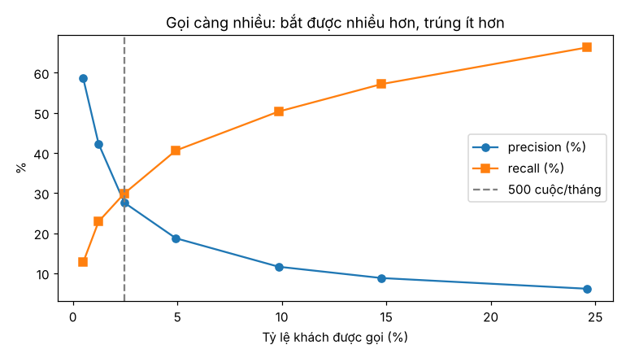

# A5 · Gradient boosting, mất cân bằng và ngưỡng theo chi phí

**Tuần 5** · Kỹ năng: [ML-02](../02-skill-map/generated/mang/ml.md#ml-02) Trung cấp,
[ML-03](../02-skill-map/generated/mang/ml.md#ml-03) Trung cấp, [STAT-05](../02-skill-map/generated/mang/stat.md#stat-05) Trung cấp ·
Lab: [`labs/stat-05-trung-cap-nguong-chi-phi/`](../../labs/stat-05-trung-cap-nguong-chi-phi/README.md) ·
Sản phẩm: bảng so với baseline (có KTC) + đường coverage–precision–lợi nhuận + số cuộc gọi khuyến nghị

Có bảng học đúng thời điểm rồi, giờ mới tới model mạnh hơn. Nhưng model chỉ là nửa đường. Nửa còn lại là đi từ
**điểm số** tới **quyết định**: xác suất có đáng tin không, gọi ai trước, gọi bao nhiêu người thì có lãi.

**Sau bài này bạn làm được:**

- Train LightGBM với early stopping trên valid, lưu model dạng text kèm metadata đủ để tái lập (không dùng pickle).
- Đánh giá đúng cho sự kiện hiếm và giải thích vì sao trọng số lớp (class weight) phá hỏng xác suất.
- Kiểm tra độ tin cậy của xác suất (bảng reliability, ECE) và hiệu chỉnh khi cần (Platt, isotonic).
- Xếp khách theo giá trị kỳ vọng, chọn ngưỡng theo chi phí và năng lực, vẽ đường coverage–precision–lợi nhuận.

---

## 1 · Lý thuyết: gradient boosting

### 1.1 Từ một cây tới hàng trăm cây

Một **cây quyết định** chia khách thành nhóm bằng các câu hỏi có/không ("`usage_ratio < 0,75`?", "`days_to_contract_end
< 31`?"). Mỗi lá cho một điểm số. Một cây sâu thì học thuộc dữ liệu train; một cây nông thì quá thô.

**Gradient boosting** cộng dồn nhiều cây nông. Mỗi cây mới không học lại từ đầu, mà học **phần sai** của tổng các cây
trước: chính xác hơn là gradient của hàm mất mát log-loss theo điểm hiện tại. Điểm cuối cùng là tổng điểm của mọi cây
(theo thang log-odds), qua hàm sigmoid thì thành xác suất. Mỗi cây chỉ được góp một phần nhỏ (`learning_rate`), nên
model tiến chậm và chắc.

### 1.2 Tham số nào quan trọng

| Tham số | Giá trị dự án | Vai trò |
|---|---|---|
| `learning_rate` | 0,03 | mỗi cây góp ít → cần nhiều cây hơn nhưng tổng quát tốt hơn |
| `num_leaves` | 31 | độ phức tạp mỗi cây (số nhóm tối đa) |
| `min_data_in_leaf` | **100** | mỗi lá phải có ≥ 100 dòng. Churn hiếm (2%), lá nhỏ là học thuộc nhiễu |
| `feature_fraction`, `bagging_fraction` | 0,8 | mỗi cây chỉ thấy 80% cột / 80% dòng → các cây bớt giống nhau |
| `lambda_l2` | 1,0 | phạt điểm lá quá lớn |
| số cây | **early stopping** | dừng khi PR-AUC trên valid không tăng sau 100 cây |

Thứ tự ưu tiên khi chỉnh: số cây (luôn dùng early stopping) → `min_data_in_leaf` và `num_leaves` → còn lại. Tuning tự
động (Optuna) làm trên **valid**, có ngân sách, và chỉ mang cấu hình cuối cùng sang tập đóng băng (bài A3, mục 4.4).

### 1.3 Biến phân loại và giá trị thiếu

LightGBM nhận thẳng cột kiểu `category` của pandas. Nó tìm cách gom các giá trị (10 tỉnh, 6 gói) thành hai nhóm tốt
nhất ở mỗi lần chia, không cần one-hot. Giá trị thiếu (NaN) cũng được xử lý tự nhiên: ở mỗi lần chia, cây học xem
dòng thiếu nên đi nhánh trái hay phải. Vì vậy bảng học giữ NaN (bài A4) thay vì điền trung vị.

### 1.4 Vì sao cây có thể hơn logistic ở đây

Logistic regression cộng các feature theo đường thẳng. Rủi ro churn thật thì **phi tuyến** và có **tương tác**:

- Rủi ro vọt lên trong **cửa sổ** "hợp đồng hết hạn trong 30 ngày tới" rồi trở lại bình thường. Một đường thẳng theo
  `days_to_contract_end` không vẽ được cái "gờ" đó. Cây thì chia `< 31` là xong.
- "Mất mạng nặng **và** ticket chưa xử lý" tệ hơn tổng hai thứ cộng lại. Cây biểu diễn được bằng hai lần chia nối
  tiếp.

Lợi thế đó phải được **đo**, không được giả định: bài này so với logistic bằng chênh lệch cặp có KTC.

---

## 2 · Lý thuyết: dữ liệu mất cân bằng

### 2.1 Metric nào còn dùng được

Chỉ 2,3% khách rời. Ba hệ quả (lab ở mục A5.5 đo từng điều):

- **Accuracy** của "đoán không ai rời" là 97,7%. Con số này vô nghĩa.
- **PR-AUC** của điểm ngẫu nhiên ≈ 0,022 (tỷ lệ nền), không phải 0,5. Đọc PR-AUC phải so với mức sàn này.
- **Precision@500** gắn với năng lực thật của đội vận hành. Đây là metric chính (ML-03 "Đạt khi").

### 2.2 Có nên "cân bằng" dữ liệu?

Một phản xạ hay gặp là cân bằng hai lớp: nhân trọng số lớp hiếm (`scale_pos_weight ≈ 49`), hoặc nhân bản/cắt bớt dòng.
Với bài toán **xếp hạng**, cách này hầu như không làm thứ hạng tốt hơn. Nhưng nó làm **xác suất phình to**: model được
dạy rằng hai lớp ngang nhau, nên dự đoán trung bình ~33% trong khi thực tế là 2,3%. Mọi phép tính giá trị kỳ vọng dựa
trên xác suất đó sẽ sai. Nếu buộc phải dùng trọng số lớp, phải **hiệu chỉnh lại** xác suất sau đó.

---

## 3 · Lý thuyết: hiệu chỉnh xác suất

### 3.1 Xác suất "đúng" nghĩa là gì

Model **hiệu chỉnh tốt** (calibrated) khi: trong những khách được dự đoán 10%, khoảng 10% thật sự rời; trong những khách
được dự đoán 30%, khoảng 30% rời. Hiệu chỉnh khác xếp hạng. Một model xếp hạng hoàn hảo vẫn có thể cho xác suất sai
hết, chỉ cần nhân mọi xác suất lên 10 lần là AUC không đổi.

Cách kiểm tra:

- **Bảng/biểu đồ reliability**: chia khách thành 10 nhóm theo xác suất dự đoán, so trung bình dự đoán với tỷ lệ churn
  thực tế của từng nhóm. Tốt thì các điểm nằm trên đường chéo.
- **ECE** (expected calibration error): trung bình |dự đoán − thực tế| qua các nhóm, có trọng số theo số khách.
- **Brier score**: trung bình (p − y)², gộp cả xếp hạng lẫn hiệu chỉnh.

### 3.2 Hai cách hiệu chỉnh

- **Platt**: học một logistic regression 2 tham số trên logit của xác suất thô, p' = sigmoid(a·logit(p) + b). Trơn,
  ít tham số, giữ nguyên thứ hạng.
- **Isotonic**: học một hàm bậc thang đơn điệu. Linh hoạt hơn nhưng cần nhiều dữ liệu, và tạo nhiều điểm hoà.

Hiệu chỉnh phải học trên dữ liệu **không dùng để train** (ở đây là valid). Và chỉ giữ nó nếu nó cải thiện trên dữ liệu
chưa thấy. LightGBM với hàm mất mát log-loss thường **đã gần chuẩn**; lab sẽ cho thấy đúng như vậy.

---

## 4 · Lý thuyết: từ xác suất tới quyết định

### 4.1 Giá trị kỳ vọng theo từng khách

Bài A1 tính EV của một cuộc gọi với cước trung bình. Giờ tính cho **từng** khách, vì khách gói COMBO 450.000 đ đáng giữ
hơn khách SX50 198.000 đ:

    EV_i = p_i × SAVE_RATE × (cước_i × 12 × 0,45 − OFFER_COST) − CALL_COST

Vì EV dùng p_i như một xác suất thật, đây là chỗ hiệu chỉnh trở nên quan trọng.

### 4.2 Hai ngưỡng: hoà vốn và năng lực

- **Ngưỡng hoà vốn** (EV = 0): từ 3,7% (COMBO) tới 9,1% (SX50). Mỗi tháng có khoảng 1.300 khách vượt ngưỡng này.
- **Ngưỡng năng lực**: chỉ gọi được 500. Ngưỡng thực tế là EV của người thứ 500, cao hơn nhiều so với hoà vốn.

Khi năng lực là **ràng buộc chặt**, mọi cuộc gọi đều có lãi. Câu hỏi chuyển thành: tăng năng lực thêm bao nhiêu thì
còn có lãi? Đó là câu hỏi cho trưởng phòng (bài A8).

### 4.3 Đường coverage–precision–lợi nhuận

Đây là phiên bản "dự đoán có chọn lọc" của bài toán gọi điện. **Coverage** là phần trăm khách được gọi; **precision**
là độ chính xác trên phần được gọi. Gọi càng nhiều (coverage tăng) thì bắt được càng nhiều người sắp rời (recall tăng)
nhưng trúng càng ít (precision giảm), và lợi nhuận đi lên rồi đi xuống. Đường này cho ta chọn mức gọi đạt mục tiêu:
precision tối thiểu, hoặc lợi nhuận cao nhất.

---

## 5 · Lab A5

### A5.1 `decision.py` — từ điểm số tới danh sách gọi

**File: `src/churn_telco/decision.py` · `đầu file…apply_platt`**

```python
"""Từ điểm số tới quyết định gọi ai (A5 · STAT-05): hiệu chỉnh xác suất, giá trị kỳ vọng, ngưỡng theo năng lực.

Một cuộc gọi giữ chân khách i có giá trị kỳ vọng
    EV_i = p_i × SAVE_RATE × (giá trị_i − OFFER_COST) − CALL_COST,   với giá trị_i = cước_i × VALUE_MONTHS × MARGIN
nên ta cần p_i là XÁC SUẤT THẬT (đã hiệu chỉnh), không chỉ là điểm xếp hạng. Gọi khi EV > 0 (ngưỡng hoà vốn), nhưng
mỗi tháng tối đa CALL_CAPACITY cuộc — khi năng lực là ràng buộc chặt, ngưỡng thực tế là EV của người thứ 500.
"""

from __future__ import annotations

import numpy as np
import pandas as pd
from sklearn.linear_model import LogisticRegression

from churn_telco import config
from churn_telco.features import LABEL

EPS = 1e-6


def _logit(p: np.ndarray) -> np.ndarray:
    p = np.clip(np.asarray(p, float), EPS, 1 - EPS)
    return np.log(p / (1 - p))


def fit_platt(p: np.ndarray, y: np.ndarray) -> dict[str, float]:
    """Hiệu chỉnh Platt: p' = sigmoid(a·logit(p) + b), học trên tập valid (KHÔNG trên tập dùng để train model)."""
    lr = LogisticRegression(C=1e6, max_iter=1000).fit(_logit(p).reshape(-1, 1), y)
    return {"a": float(lr.coef_[0, 0]), "b": float(lr.intercept_[0])}


def apply_platt(p: np.ndarray, a: float, b: float) -> np.ndarray:
    return 1 / (1 + np.exp(-(a * _logit(p) + b)))
```

- `_logit` kẹp xác suất vào `[1e-6, 1 − 1e-6]` để `log` không ra vô cực.
- `fit_platt` dùng `LogisticRegression(C=1e6)` (gần như không điều chuẩn) trên **một** cột logit. Kết quả chỉ là hai
  số `a`, `b`, nên lưu vào JSON được. Không cần pickle.

**File: `src/churn_telco/decision.py` · `reliability…ece`**

```python
def reliability(p: np.ndarray, y: np.ndarray, bins: int = 10) -> pd.DataFrame:
    """Bảng độ tin cậy: chia theo phân vị của p; model hiệu chỉnh tốt thì mean_pred ≈ frac_churn ở mọi nhóm."""
    frame = pd.DataFrame({"p": p, "y": y})
    frame["bin"] = pd.qcut(frame["p"].rank(method="first"), bins, labels=False)
    return frame.groupby("bin").agg(n=("y", "size"), mean_pred=("p", "mean"), frac_churn=("y", "mean")).reset_index()


def ece(p: np.ndarray, y: np.ndarray, bins: int = 10) -> float:
    """Expected calibration error: trung bình |dự đoán − thực tế| theo nhóm, có trọng số theo số dòng."""
    r = reliability(p, y, bins)
    return float(np.average((r["mean_pred"] - r["frac_churn"]).abs(), weights=r["n"]))
```

`qcut` theo **hạng** (`rank(method="first")`) để 10 nhóm có số khách bằng nhau, kể cả khi nhiều khách cùng xác suất.

**File: `src/churn_telco/decision.py` · `customer_value…call_list`**

```python
def customer_value(df: pd.DataFrame) -> np.ndarray:
    """Lợi nhuận gộp giữ được nếu khách ở lại: cước tháng × số tháng ở thêm × biên lợi nhuận."""
    return df["monthly_fee"].to_numpy(float) * config.VALUE_MONTHS * config.MARGIN


def expected_value(p: np.ndarray, value: np.ndarray) -> np.ndarray:
    return p * config.SAVE_RATE * (value - config.OFFER_COST) - config.CALL_COST


def break_even(value: np.ndarray) -> np.ndarray:
    """Xác suất churn tối thiểu để một cuộc gọi có lãi kỳ vọng (EV = 0)."""
    return config.CALL_COST / (config.SAVE_RATE * (value - config.OFFER_COST))


def call_list(frame: pd.DataFrame, p: np.ndarray, capacity: int = config.CALL_CAPACITY) -> pd.DataFrame:
    """Mỗi tháng: xếp theo EV giảm dần, gọi tối đa `capacity` khách có EV > 0."""
    out = frame.assign(p=p, value=customer_value(frame))
    out["ev"] = expected_value(out["p"].to_numpy(), out["value"].to_numpy())
    out["rank"] = out.groupby("t")["ev"].rank(ascending=False, method="first").astype(int)
    out["call"] = (out["rank"] <= capacity) & (out["ev"] > 0)
    return out
```

`call_list` xếp **trong từng tháng** theo EV giảm dần, rồi gọi khi vừa nằm trong năng lực vừa có EV > 0. Nếu một tháng
chỉ có 300 khách EV > 0 thì chỉ gọi 300, không gọi đủ 500 cho "đủ chỉ tiêu".

**File: `src/churn_telco/decision.py` · `profit_curve`**

```python
def profit_curve(frame: pd.DataFrame, p: np.ndarray, ks: list[int] | None = None) -> pd.DataFrame:
    """Theo số cuộc gọi mỗi tháng k: precision, recall, và lợi nhuận kỳ vọng THỰC HIỆN được (tính theo nhãn thật).

    Lợi nhuận(k) = Σ_{k khách đầu} [y · SAVE_RATE · (giá trị − OFFER_COST)] − k · CALL_COST, trung bình theo tháng.
    Đường này trả lời: tăng năng lực gọi lên bao nhiêu thì còn có lãi (coverage–precision cho bài toán gọi điện).
    """
    ks = ks or [100, 250, 500, 750, 1000, 1500, 2000, 3000, 5000]
    ranked = call_list(frame, p, capacity=max(ks)).sort_values(["t", "rank"])
    rows = []
    for k in ks:
        top = ranked[ranked["rank"] <= k]
        gain = (top[LABEL] * config.SAVE_RATE * (top["value"] - config.OFFER_COST)).groupby(top["t"]).sum()
        months = ranked["t"].nunique()
        churners = ranked.groupby("t")[LABEL].sum()
        rows.append(
            {
                "k": k,
                "coverage": k / (len(ranked) / months),
                "precision": top[LABEL].mean(),
                "recall": (top.groupby("t")[LABEL].sum() / churners).mean(),
                "profit": (gain - k * config.CALL_COST).mean(),
                "ev_at_k": top.groupby("t")["ev"].min().mean(),  # EV của người cuối danh sách
            }
        )
    return pd.DataFrame(rows)
```

Lợi nhuận tính bằng **nhãn thật**: người được gọi thật sự rời thì có `SAVE_RATE` cơ hội giữ được giá trị; mọi người
được gọi đều tốn `CALL_COST`. `ev_at_k` là EV của người cuối danh sách. Nó âm thì người thứ k không còn đáng gọi nữa.

### A5.2 `train.py` — train, hiệu chỉnh, lưu bundle

**File: `src/churn_telco/train.py` · `đầu file…PARAMS`**

```python
"""Huấn luyện LightGBM (A5 · ML-02): early stopping trên valid, hiệu chỉnh Platt trên valid, lưu model dạng text.

Một "bundle" = thư mục models/<tên>/ gồm:
- model.txt  — cây LightGBM dạng văn bản (đọc được, không dùng pickle: nạp pickle từ nguồn lạ = chạy code lạ);
- bundle.json — mọi thứ cần để tái lập và phục vụ: danh sách feature, tham số, số vòng, hệ số hiệu chỉnh, metric trên
  valid, mã băm dữ liệu, phiên bản thư viện, commit git. API (A7) và MLflow (A7) đều chỉ đọc bundle này.

    uv run python -m churn_telco.train --feature-set v1     # → models/lgbm-v1/
"""

from __future__ import annotations

import argparse
import hashlib
import json
import logging
import platform
import subprocess
from dataclasses import dataclass
from datetime import UTC, datetime
from pathlib import Path

import lightgbm as lgb
import numpy as np
import pandas as pd

from churn_telco import config, decision, features, metrics, split
from churn_telco.features import CATEGORICAL, LABEL, NUMERIC

log = logging.getLogger(__name__)

FEATURE_SETS = {
    "v1": CATEGORICAL + NUMERIC,  # A5: dữ liệu CRM, billing, helpdesk, đo mạng
    "v2": CATEGORICAL + NUMERIC + ["competitor_promo_30d"],  # A6: thêm lịch khuyến mãi của đối thủ (marketing)
}
PARAMS = {
    "objective": "binary",
    "metric": "average_precision",  # early stopping theo PR-AUC trên valid
    "learning_rate": 0.03,
    "num_leaves": 31,
    "min_data_in_leaf": 100,  # lá phải có ≥ 100 dòng: churn hiếm, lá nhỏ là học thuộc nhiễu
    "feature_fraction": 0.8,
    "bagging_fraction": 0.8,
    "bagging_freq": 1,
    "lambda_l2": 1.0,
    "seed": config.SEED,
    "deterministic": True,
    "force_row_wise": True,
    "verbose": -1,
}
```

- `FEATURE_SETS` đặt tên cho **tập feature**: `v1` là dữ liệu của 4 hệ thống; `v2` thêm feature marketing ở bài A6.
  So hai model chỉ khác nhau ở tập feature là một thí nghiệm sạch.
- `PARAMS` là mục 1.2. `deterministic=True` + `force_row_wise=True` + `seed`: train lại cho đúng từng số (có test).

**File: `src/churn_telco/train.py` · `Bundle`**

```python
@dataclass
class Bundle:
    booster: lgb.Booster
    meta: dict

    @property
    def features(self) -> list[str]:
        return self.meta["features"]

    def score(self, df: pd.DataFrame) -> np.ndarray:
        """Xác suất thô của LightGBM — dùng để xếp hạng."""
        return self.booster.predict(df[self.features], num_iteration=self.meta["best_iteration"])

    def proba(self, df: pd.DataFrame) -> np.ndarray:
        """Xác suất đã hiệu chỉnh — dùng để tính giá trị kỳ vọng và chọn ngưỡng."""
        return decision.apply_platt(self.score(df), **self.meta["calibration"])
```

Hai cách lấy điểm, hai mục đích: `score` (xác suất thô) để **xếp hạng** và đánh giá; `proba` (đã hiệu chỉnh) để tính
**EV**. `num_iteration=best_iteration` dùng đúng số cây mà early stopping chọn.

**File: `src/churn_telco/train.py` · `file_sha256…train`**

```python
def file_sha256(*paths: Path) -> str:
    h = hashlib.sha256()
    for path in paths:
        h.update(path.read_bytes())
    return h.hexdigest()


def git_commit() -> str | None:
    try:
        out = subprocess.run(["git", "rev-parse", "--short", "HEAD"], capture_output=True, text=True, cwd=config.ROOT)
        return out.stdout.strip() or None
    except OSError:
        return None


def train(df: pd.DataFrame, feature_set: str = "v1", params: dict = PARAMS, rounds: int = 3000) -> Bundle:
    cols = FEATURE_SETS[feature_set]
    parts = split.split(df)
    tr, va = parts["train"], parts["valid"]
    dtrain = lgb.Dataset(tr[cols], tr[LABEL])  # cột category của pandas → LightGBM tự xử lý biến phân loại
    dvalid = lgb.Dataset(va[cols], va[LABEL], reference=dtrain)
    booster = lgb.train(
        params,
        dtrain,
        num_boost_round=rounds,
        valid_sets=[dvalid],
        callbacks=[lgb.early_stopping(100, verbose=False), lgb.log_evaluation(0)],
    )
    raw_valid = booster.predict(va[cols], num_iteration=booster.best_iteration)
    meta = {
        "name": f"LightGBM {feature_set}",
        "feature_set": feature_set,
        "features": cols,
        "params": params,
        "best_iteration": booster.best_iteration,
        "calibration": decision.fit_platt(raw_valid, va[LABEL].to_numpy()),
        "valid": metrics.evaluate(metrics.rank(raw_valid, va[LABEL], va["t"])),
        "data": {
            "train_rows": len(tr),
            "valid_rows": len(va),
            "train_period": [f"{tr['t'].min():%Y-%m}", f"{tr['t'].max():%Y-%m}"],
            "valid_period": [f"{va['t'].min():%Y-%m}", f"{va['t'].max():%Y-%m}"],
        },
        "trained_at": datetime.now(UTC).isoformat(timespec="seconds"),
        "versions": {"python": platform.python_version(), "lightgbm": lgb.__version__, "pandas": pd.__version__},
        "git_commit": git_commit(),
    }
    return Bundle(booster, meta)
```

- `lgb.Dataset(valid, reference=dtrain)`: tập valid **chia bin giống train**. Thiếu `reference` thì LightGBM chia bin
  valid theo phân phối riêng của nó và kết quả early stopping sai lệch.
- `early_stopping(100)`: theo dõi `metric` trong `PARAMS` (PR-AUC) trên valid, dừng khi 100 cây liên tiếp không cải
  thiện, và nhớ cây tốt nhất.
- Hiệu chỉnh Platt học trên **valid** (dữ liệu model không học).
- `meta` ghi đủ để trả lời "model này từ đâu ra": tham số, số cây, hệ số hiệu chỉnh, metric valid, giai đoạn
  dữ liệu, phiên bản thư viện, commit git. Bài A7 gửi nguyên `meta` lên MLflow.

**File: `src/churn_telco/train.py` · `save…__main__`**

```python
def save(bundle: Bundle, out: Path) -> Path:
    out.mkdir(parents=True, exist_ok=True)
    bundle.booster.save_model(out / "model.txt", num_iteration=bundle.meta["best_iteration"])
    (out / "bundle.json").write_text(json.dumps(bundle.meta, ensure_ascii=False, indent=2) + "\n", encoding="utf-8")
    return out


def load(path: Path) -> Bundle:
    meta = json.loads((path / "bundle.json").read_text(encoding="utf-8"))
    return Bundle(lgb.Booster(model_file=path / "model.txt"), meta)


def main(argv: list[str] | None = None) -> None:
    parser = argparse.ArgumentParser(description="Huấn luyện LightGBM cho churn 30 ngày")
    parser.add_argument("--feature-set", choices=list(FEATURE_SETS), default="v1")
    parser.add_argument("--out", type=Path, default=None, help="mặc định models/lgbm-<feature-set>")
    args = parser.parse_args(argv)
    df = features.load()
    bundle = train(df, args.feature_set)
    files = sorted(config.PROCESSED.glob("features*.parquet"))
    bundle.meta["data"]["features_sha256"] = file_sha256(*files)  # "phiên bản dữ liệu" của lần train này
    bundle.meta["data"]["files"] = [f.name for f in files]
    bundle.meta["version"] = f"{args.feature_set}-{bundle.meta['data']['features_sha256'][:8]}"
    out = save(bundle, args.out or config.MODELS / f"lgbm-{args.feature_set}")
    v = bundle.meta["valid"]
    log.info(
        "%s: %d vòng · valid AUC %.3f · PR-AUC %.3f · P@%d %.3f → %s",
        bundle.meta["name"],
        bundle.meta["best_iteration"],
        v["auc"],
        v["pr_auc"],
        config.CALL_CAPACITY,
        v["p@k"],
        out,
    )


if __name__ == "__main__":
    logging.basicConfig(level=logging.INFO, format="%(levelname)s %(name)s: %(message)s")
    main()
```

- `save_model` ghi cây dạng **văn bản** (`model.txt`). Đọc được bằng mắt, so sánh được bằng `diff`, và nạp không chạy
  code lạ. Ngược lại, `pickle.load` một file từ nguồn không tin cậy có thể chạy mã tuỳ ý.
- `main` ghi thêm **mã băm dữ liệu** (`features_sha256`) và `version = "<tập feature>-<8 ký tự đầu mã băm>"`. Hai
  model cùng phiên bản dữ liệu thì cùng hậu tố.

```bash
make train
```

```text
INFO __main__: LightGBM v1: 278 vòng · valid AUC 0.739 · PR-AUC 0.168 · P@500 0.225 → .../models/lgbm-v1
```

Một phần `models/lgbm-v1/bundle.json`:

```json
{
  "name": "LightGBM v1",
  "best_iteration": 278,
  "calibration": {"a": 0.8995871672688146, "b": -0.12924393445100987},
  "valid": {"auc": 0.7387689522130454, "pr_auc": 0.16806477008430562, "p@k": 0.22466666666666665},
  "data": {"train_period": ["2024-07", "2025-06"], "valid_period": ["2025-07", "2025-09"], "features_sha256": "…"},
  "versions": {"python": "3.12.3", "lightgbm": "4.7.0", "pandas": "3.0.6"}
}
```

### A5.3 LightGBM vào bảng so sánh

Không phải sửa `evaluate.py`: harness tự tìm thấy `models/lgbm-v1/bundle.json` (bài A3).

```bash
make eval
```

```text
| Model | AUC | PR-AUC | P@500 | R@500 | F1@500 | Δ P@500 so với tham chiếu |
|---|---|---|---|---|---|---|
| Ngẫu nhiên | 0.493 [0.478–0.509] | 0.022 [0.021–0.024] | 0.021 [0.014–0.028] | 0.022 [0.015–0.031] | 0.022 [0.014–0.029] | -0.234 [-0.259…-0.211] |
| Luật CSKH hiện tại | 0.668 [0.654–0.683] | 0.052 [0.047–0.060] | 0.075 [0.062–0.088] | 0.081 [0.067–0.095] | 0.078 [0.064–0.091] | -0.180 [-0.204…-0.156] |
| Luật giảm sử dụng | 0.683 [0.666–0.700] | 0.108 [0.096–0.124] | 0.217 [0.193–0.236] | 0.236 [0.211–0.254] | 0.226 [0.202–0.244] | -0.037 [-0.061…-0.021] |
| Logistic | 0.763 [0.749–0.778] | 0.190 [0.169–0.215] | 0.255 [0.231–0.278] | 0.276 [0.255–0.299] | 0.265 [0.244–0.287] | — |
| LightGBM v1 | 0.791 [0.778–0.804] | 0.240 [0.217–0.266] | 0.287 [0.261–0.309] | 0.311 [0.286–0.331] | 0.298 [0.274–0.319] | +0.032 [+0.017…+0.043] |
```

LightGBM hơn logistic **3,2 điểm** precision@500 với KTC chênh lệch cặp [+1,7; +4,3]: **có ý nghĩa thống kê** trên
tập đóng băng. Đây chính là tiêu chí "Đạt khi" của ML-02. Quy ra người: thêm ~16 người sắp rời được gọi trúng mỗi
tháng. PR-AUC tăng từ 0,190 lên 0,240. Lợi thế của cây nằm ở phần sâu hơn của bảng xếp hạng, không chỉ top 500.

### A5.4 Test cho model và quyết định

**File: `tests/test_model.py` · `test_bundle_roundtrip_gives_identical_predictions…test_training_is_deterministic`**

```python
def test_bundle_roundtrip_gives_identical_predictions(small, tmp_path):
    path = train.save(small.bundle, tmp_path / "m")
    loaded = train.load(path)
    test = split.split(small.df)["test"]
    np.testing.assert_allclose(loaded.score(test), small.bundle.score(test))
    meta = json.loads((path / "bundle.json").read_text())
    assert {"features", "params", "best_iteration", "calibration", "valid", "trained_at", "versions"} <= set(meta)


def test_training_is_deterministic(small):
    again = train.train(small.df, "v2")
    test = split.split(small.df)["test"]
    np.testing.assert_allclose(again.score(test), small.bundle.score(test))
```

**File: `tests/test_model.py` · `test_platt_fixes_a_miscalibrated_score…test_call_list_respects_capacity_and_positive_ev`**

```python
def test_platt_fixes_a_miscalibrated_score():
    rng = np.random.default_rng(0)
    p_true = rng.beta(1, 30, 50_000)
    y = (rng.random(len(p_true)) < p_true).astype(int)
    inflated = np.clip(p_true * 4, 0, 0.99)  # model "tự tin thái quá", kiểu train với class weight
    cal = decision.apply_platt(inflated, **decision.fit_platt(inflated, y))
    assert decision.ece(cal, y) < decision.ece(inflated, y) / 3


def test_expected_value_and_break_even():
    value = np.array([1_620_000.0])  # cước 300.000 đ × 12 tháng × biên 45%
    p0 = decision.break_even(value)
    assert decision.expected_value(p0, value) == pytest.approx(0, abs=1e-6)
    assert decision.expected_value(p0 * 2, value) > 0 > decision.expected_value(p0 / 2, value)


def test_call_list_respects_capacity_and_positive_ev(small):
    test = split.split(small.df)["test"]
    calls = decision.call_list(test, small.bundle.proba(test), capacity=100)
    per_month = calls[calls["call"]].groupby("t").size()
    assert (per_month <= 100).all()
    assert (calls.loc[calls["call"], "ev"] > 0).all()
```

- Test Platt **tự tạo** dữ liệu biết trước đáp án: xác suất thật → nhãn → một model "tự tin thái quá" (×4). Hiệu chỉnh
  phải giảm ECE ít nhất 3 lần. Test không phụ thuộc dữ liệu dự án.
- Test EV dùng đúng định nghĩa: tại xác suất hoà vốn, EV = 0; gấp đôi thì dương, một nửa thì âm.

### A5.5 Lab: mất cân bằng, hiệu chỉnh, ngưỡng

**File: `labs/stat-05-trung-cap-nguong-chi-phi/threshold_lab.py`**

```python
"""Lab A5 · ML-02, ML-03, STAT-05: từ model tới quyết định "gọi ai" khi sự kiện hiếm và năng lực có hạn.

1. Bẫy accuracy khi chỉ ~2% khách rời mạng.
2. LightGBM mặc định vs cấu hình của dự án + early stopping.
3. Trọng số lớp (class weight): xếp hạng gần như không đổi nhưng XÁC SUẤT sai lệch nặng.
4. Hiệu chỉnh xác suất: thô vs Platt vs isotonic, đo trên tập đóng băng.
5. Ngưỡng: hoà vốn theo gói cước, ngưỡng do năng lực 500 cuộc, đường coverage–precision–lợi nhuận.
6. Xếp theo xác suất hay theo giá trị kỳ vọng?

    cd labs/stat-05-trung-cap-nguong-chi-phi
    uv run --project ../../projects/g1-churn-telco python threshold_lab.py     # cần `make features train`
"""

from pathlib import Path

import lightgbm as lgb
import matplotlib

matplotlib.use("Agg")
import matplotlib.pyplot as plt  # noqa: E402
import numpy as np  # noqa: E402
from churn_telco import config, decision, features, metrics, split, train  # noqa: E402
from churn_telco.features import LABEL  # noqa: E402
from sklearn.isotonic import IsotonicRegression  # noqa: E402
from sklearn.metrics import accuracy_score, average_precision_score, brier_score_loss  # noqa: E402

OUT = Path(__file__).with_name("out")
OUT.mkdir(exist_ok=True)
df = features.load()
parts = split.split(df)
tr, va = parts["train"], parts["valid"]
te = split.frozen_test(df)
bundle = train.load(config.MODELS / "lgbm-v1")
cols = bundle.features

# %% 1. Accuracy đánh lừa: "không ai rời mạng" đúng 98% mà không giúp được ai
y = te[LABEL].to_numpy()
print(f"1) Tỷ lệ churn trong tập đánh giá: {y.mean():.2%}")
print(f"   Đoán 'không ai rời' → accuracy {accuracy_score(y, np.zeros_like(y)):.1%}, gọi trúng 0 người")
random_ap = average_precision_score(y, np.random.default_rng(0).random(len(y)))
print(f"   PR-AUC của điểm ngẫu nhiên ≈ tỷ lệ nền: {random_ap:.3f} — đây là 'mức 0' của PR-AUC, không phải 0,5")


# %% 2. LightGBM mặc định vs cấu hình dự án (lá ≥ 100 dòng, học chậm, dừng sớm theo PR-AUC trên valid)
def datasets() -> tuple[lgb.Dataset, lgb.Dataset]:
    """Dataset MỚI cho mỗi lần train: LightGBM chia bin lúc dựng Dataset theo tham số của lần train đầu tiên."""
    dtrain = lgb.Dataset(tr[cols], tr[LABEL])
    return dtrain, lgb.Dataset(va[cols], va[LABEL], reference=dtrain)  # valid chia bin giống train


default = lgb.train({"objective": "binary", "verbose": -1}, datasets()[0], num_boost_round=100)
default_ap = average_precision_score(va[LABEL], default.predict(va[cols]))
history: dict = {}
dtrain, dvalid = datasets()
lgb.train(
    train.PARAMS,
    dtrain,
    num_boost_round=1500,
    valid_sets=[dvalid],
    valid_names=["valid"],
    callbacks=[lgb.record_evaluation(history)],  # không dừng sớm ở đây, để xem cả đường cong
)
curve = history["valid"]["average_precision"]
best = int(np.argmax(curve)) + 1
print(f"\n2) PR-AUC valid — LightGBM mặc định (100 cây): {default_ap:.3f}")
for n in (50, 100, best, 500, 1500):
    note = "  ← tốt nhất: early stopping dừng ở đây" if n == best else ""
    print(f"   cấu hình dự án, {n:4d} cây: {curve[n - 1]:.3f}{note}")

# %% 3. Trọng số lớp: "cân bằng" hai lớp khi train — thứ hạng gần như giữ nguyên, xác suất thì phình to
ratio = (tr[LABEL] == 0).sum() / tr[LABEL].sum()
weighted = lgb.train(
    {**train.PARAMS, "scale_pos_weight": ratio}, datasets()[0], num_boost_round=bundle.meta["best_iteration"]
)
print(f"\n3) Trọng số lớp (tập đóng băng, xác suất trung bình thật = {y.mean():.3f}):")
for name, p in [("không trọng số", bundle.score(te)), (f"scale_pos_weight={ratio:.0f}", weighted.predict(te[cols]))]:
    m = metrics.evaluate(metrics.rank(p, y, te["t"]))
    print(f"   {name:22} PR-AUC {m['pr_auc']:.3f} · P@500 {m['p@k']:.3f} · xác suất trung bình {p.mean():.3f}")

# %% 4. Hiệu chỉnh: học trên valid, đo trên tập đóng băng
raw_va, raw_te = bundle.score(va), bundle.score(te)
platt = decision.apply_platt(raw_te, **decision.fit_platt(raw_va, va[LABEL].to_numpy()))
iso = IsotonicRegression(out_of_bounds="clip").fit(raw_va, va[LABEL]).predict(raw_te)
w_raw = weighted.predict(te[cols])
w_platt = decision.apply_platt(w_raw, **decision.fit_platt(weighted.predict(va[cols]), va[LABEL].to_numpy()))
print("\n4) Hiệu chỉnh (đo trên tập đóng băng):   ECE      Brier")
for name, p in [
    ("thô", raw_te),
    ("Platt", platt),
    ("isotonic", iso),
    ("class weight thô", w_raw),
    ("class weight + Platt", w_platt),
]:
    print(f"   {name:22} {decision.ece(p, y):.4f}   {brier_score_loss(y, p):.5f}")
table = decision.reliability(raw_te, y)
print("   Bảng độ tin cậy (model thô, 10 nhóm):\n" + table.round(4).to_string(index=False))

# %% 5. Ngưỡng: hoà vốn theo giá trị khách, rồi ràng buộc 500 cuộc/tháng
calls = decision.call_list(te, bundle.proba(te))
fee = te.groupby("plan_code", observed=True)["monthly_fee"].mean()
value = fee * config.VALUE_MONTHS * config.MARGIN  # = decision.customer_value cho một khách mỗi gói
print("\n5) Xác suất hoà vốn theo gói (chỉ gọi khi p cao hơn mức này):")
print("   " + " · ".join(f"{plan} {decision.break_even(np.array([v]))[0]:.1%}" for plan, v in value.items()))
positive = calls[calls["ev"] > 0].groupby("t").size()
edge = calls[calls["rank"] == config.CALL_CAPACITY][["t", "p", "ev"]]
print(f"   Mỗi tháng có {positive.mean():.0f} khách EV > 0, nhưng chỉ gọi được {config.CALL_CAPACITY}.")
print(
    f"   Người thứ 500: p ≈ {edge['p'].mean():.1%}, EV ≈ {edge['ev'].mean():,.0f} đ → năng lực mới là ràng buộc chặt."
)

curve_k = decision.profit_curve(te, bundle.proba(te), ks=[100, 250, 500, 1000, 2000, 3000, 5000])
print("\n   Đường coverage–precision–lợi nhuận (trung bình mỗi tháng):")
print(curve_k.round({"coverage": 3, "precision": 3, "recall": 3, "profit": 0, "ev_at_k": 0}).to_string(index=False))
fig, ax = plt.subplots(figsize=(7, 4))
ax.plot(curve_k["coverage"] * 100, curve_k["precision"] * 100, marker="o", label="precision (%)")
ax.plot(curve_k["coverage"] * 100, curve_k["recall"] * 100, marker="s", label="recall (%)")
ax.axvline(100 * config.CALL_CAPACITY / (len(te) / te["t"].nunique()), color="grey", ls="--", label="500 cuộc/tháng")
ax.set(xlabel="Tỷ lệ khách được gọi (%)", ylabel="%", title="Gọi càng nhiều: bắt được nhiều hơn, trúng ít hơn")
ax.legend()
fig.tight_layout()
fig.savefig(OUT / "coverage_precision.png", dpi=110)

# %% 6. Xếp theo xác suất hay theo giá trị kỳ vọng (EV = p × giá trị khách...)?
p_cal = bundle.proba(te)
for name, order in [("xếp theo xác suất", p_cal), ("xếp theo EV", calls["ev"].to_numpy())]:
    frame = te.assign(order=order, value=decision.customer_value(te))
    top = frame[frame.groupby("t")["order"].rank(ascending=False, method="first") <= config.CALL_CAPACITY]
    gain = top[LABEL] * config.SAVE_RATE * (top["value"] - config.OFFER_COST)
    profit = gain.groupby(top["t"]).sum().mean() - config.CALL_CAPACITY * config.CALL_COST
    hits = top[LABEL].mean() * config.CALL_CAPACITY
    print(f"\n6) {name:18} gọi trúng {hits:.0f} người/tháng · lợi nhuận {profit:,.0f} đ/tháng")
print("   Xếp theo EV gọi trúng ít người hơn một chút nhưng là những người đáng giữ hơn (cước cao).")
```

```bash
cd labs/stat-05-trung-cap-nguong-chi-phi
uv run --project ../../projects/g1-churn-telco python threshold_lab.py
```

```text
1) Tỷ lệ churn trong tập đánh giá: 2.28%
   Đoán 'không ai rời' → accuracy 97.7%, gọi trúng 0 người
   PR-AUC của điểm ngẫu nhiên ≈ tỷ lệ nền: 0.022 — đây là 'mức 0' của PR-AUC, không phải 0,5

2) PR-AUC valid — LightGBM mặc định (100 cây): 0.153
   cấu hình dự án,   50 cây: 0.163
   cấu hình dự án,  100 cây: 0.164
   cấu hình dự án,  278 cây: 0.168  ← tốt nhất: early stopping dừng ở đây
   cấu hình dự án,  500 cây: 0.168
   cấu hình dự án, 1500 cây: 0.159

3) Trọng số lớp (tập đóng băng, xác suất trung bình thật = 0.023):
   không trọng số         PR-AUC 0.240 · P@500 0.287 · xác suất trung bình 0.022
   scale_pos_weight=49    PR-AUC 0.230 · P@500 0.275 · xác suất trung bình 0.334

4) Hiệu chỉnh (đo trên tập đóng băng):   ECE      Brier
   thô                    0.0010   0.01944
   Platt                  0.0030   0.01948
   isotonic               0.0032   0.01950
   class weight thô       0.3112   0.14574
   class weight + Platt   0.0029   0.01994
   Bảng độ tin cậy (model thô, 10 nhóm):
 bin    n  mean_pred  frac_churn
   0 6092     0.0035      0.0041
   ...
   8 6091     0.0251      0.0268
   9 6092     0.1167      0.1169

5) Xác suất hoà vốn theo gói (chỉ gọi khi p cao hơn mức này):
   COMBO 3.7% · SX150 6.4% · SX150TV 5.9% · SX300 5.3% · SX300TV 4.6% · SX50 9.1%
   Mỗi tháng có 1331 khách EV > 0, nhưng chỉ gọi được 500.
   Người thứ 500: p ≈ 14.5%, EV ≈ 32,749 đ → năng lực mới là ràng buộc chặt.

   Đường coverage–precision–lợi nhuận (trung bình mỗi tháng):
   k  coverage  precision  recall     profit  ev_at_k
 100     0.005      0.587   0.127 23617700.0 130581.0
 250     0.012      0.423   0.229 39882980.0  67916.0
 500     0.025      0.276   0.299 47144080.0  32749.0
1000     0.049      0.187   0.406 55697540.0   7175.0
2000     0.099      0.116   0.503 50026840.0  -7113.0
3000     0.148      0.088   0.572 39445440.0 -11742.0
5000     0.246      0.061   0.663  7962160.0 -15288.0

6) xếp theo xác suất  gọi trúng 143 người/tháng · lợi nhuận 47,026,660 đ/tháng

6) xếp theo EV        gọi trúng 138 người/tháng · lợi nhuận 47,144,080 đ/tháng
   Xếp theo EV gọi trúng ít người hơn một chút nhưng là những người đáng giữ hơn (cước cao).
```

Đọc từng phần:

1. **Accuracy 97,7% mà không gọi trúng ai.** PR-AUC 0,022 là mức sàn để so.
2. **Early stopping.** LightGBM mặc định (học nhanh, lá nhỏ, 100 cây) đạt 0,153. Cấu hình dự án đạt đỉnh 0,168 ở cây
   thứ 278, rồi **giảm** dần (1.500 cây chỉ còn 0,159) vì bắt đầu học thuộc train. Early stopping chọn đúng đỉnh.
   Hàm `datasets()` dựng `Dataset` mới cho mỗi lần train: LightGBM chia bin theo tham số của lần train *đầu tiên*
   dùng Dataset đó, nên dùng chung Dataset giữa hai cấu hình khác nhau cho kết quả sai lặng lẽ.
3. **Trọng số lớp.** Xếp hạng gần như không đổi (PR-AUC 0,240 → 0,230), nhưng xác suất trung bình nhảy từ 0,022 lên
   **0,334**, gấp 15 lần thực tế. Dùng xác suất đó tính EV thì sẽ gọi cả nghìn người lỗ vốn.
4. **Hiệu chỉnh.** Model thô đã khớp thực tế rất tốt (ECE 0,10%; bảng 10 nhóm: dự đoán 11,67% so với thực tế 11,69% ở
   nhóm cao nhất). Platt và isotonic học trên valid **không** cải thiện thêm trên tập đóng băng (0,30%). Nguyên nhân
   là valid rơi vào giai đoạn khuyến mãi của đối thủ (bài A6), khác với 3 tháng cuối năm. Với model dùng trọng số lớp
   thì hiệu chỉnh là **bắt buộc**: 0,31 → 0,003. Kết luận thực hành: mọi mức sai lệch 0,1–0,3% đều không đổi quyết
   định gọi ai; dự án giữ Platt cho đồng bộ, và bài tập 3 yêu cầu bạn chọn bằng dữ liệu valid.
5. **Năng lực là ràng buộc chặt.** ~1.330 khách mỗi tháng có EV > 0, nhưng chỉ gọi được 500. Người thứ 500 vẫn có
   p ≈ 14,5%, gấp 2–4 lần ngưỡng hoà vốn. Trên đường coverage–precision: gọi 500 người (2,5% khách) đạt precision 27,6%,
   lãi 47,1 triệu/tháng. Gọi 1.000 người thì precision giảm còn 18,7% nhưng lãi tăng lên **55,7 triệu**. Từ khoảng
   2.000 người, người cuối danh sách có EV âm (`ev_at_k` < 0) và tổng lãi bắt đầu giảm.
6. **EV hay xác suất.** Xếp theo EV gọi trúng ít hơn 5 người nhưng lãi hơn một chút: ưu tiên khách cước cao. Ở đây
   giá trị khách chỉ chênh nhau trong khoảng 2,3 lần nên khác biệt nhỏ. Với khách doanh nghiệp giá trị gấp 10 lần
   thì khác biệt sẽ lớn.



---

## 6 · Kiểm tra kết quả

- [ ] `make train eval`: LightGBM v1 hơn logistic với KTC chênh lệch cặp không chứa 0 (ML-02 "Đạt khi").
- [ ] Bạn báo cáo được metric theo năng lực (precision@500, recall@500), không dùng accuracy (ML-03 "Đạt khi").
- [ ] Bạn đọc được bảng reliability và giải thích vì sao trọng số lớp cần hiệu chỉnh lại.
- [ ] Bạn có một khuyến nghị số cuộc gọi mỗi tháng, kèm đường coverage–precision–lợi nhuận (STAT-05 "Đạt khi").
- [ ] `uv run pytest tests/test_model.py` xanh.

## 7 · Lỗi thường gặp

| Triệu chứng | Nguyên nhân | Cách sửa |
|---|---|---|
| Early stopping chọn số cây "lạ", kết quả khác lần trước | Dataset valid thiếu `reference=dtrain`, hoặc dùng lại Dataset giữa các cấu hình | dựng `Dataset` mới mỗi lần, valid luôn `reference=dtrain` |
| Xác suất trung bình cao hơn hẳn tỷ lệ churn | train với class weight hoặc resampling | hiệu chỉnh lại trên valid, hoặc bỏ class weight |
| EV âm cho mọi khách | quên đổi cước → giá trị khách (×12×0,45) | dùng `decision.customer_value` |
| Model nạp lỗi trên máy khác | lưu bằng pickle khác phiên bản thư viện | `model.txt` + `bundle.json`, ghi phiên bản thư viện vào meta |
| Hiệu chỉnh/ngưỡng chọn trên tập test | "cho nhanh" | mọi lựa chọn trên valid; test chỉ báo cáo |

## 8 · Bài tập

1. **(Cơ bản)** Đổi `min_data_in_leaf` thành 20 rồi 500. Ghi PR-AUC valid và số cây của mỗi lần. Giải thích xu hướng.
2. **(Trung cấp — ML-02)** Tuning có ngân sách: 30 lần thử Optuna trên valid cho `num_leaves`, `min_data_in_leaf`,
   `feature_fraction`. Mang **một** cấu hình tốt nhất sang `make eval`. P@500 trên tập đóng băng có tăng ngoài biên sai
   số so với cấu hình hiện tại không?
3. **(Trung cấp — STAT-05)** Chọn có hiệu chỉnh hay không **chỉ bằng valid**: chia valid theo tháng, học Platt trên 2
   tháng, đo ECE trên tháng còn lại (3 lần xoay vòng). Nếu Platt không thắng, lưu `calibration = {"a": 1, "b": 0}`.
4. **(Trung cấp)** Thêm vào `profit_curve` cột "lợi nhuận biên": lợi nhuận tăng thêm khi gọi thêm 250 người. Mức gọi
   tối ưu ở đâu?
5. **(Mở rộng)** Trưởng phòng muốn "chỉ gọi khi chắc chắn": viết hàm chọn số cuộc gọi lớn nhất sao cho precision trên
   phần được gọi ≥ 30%. Đây chính là chọn mức tự động hoá theo đường coverage–accuracy.

---

**Tiếp theo:** [A6 · Phân tích lỗi, giải thích và kiểm thử](a6-phan-tich-loi-shap-test.md). Model sai ở đâu, vì sao,
sửa nhóm lỗi lớn nhất bằng dữ liệu mới, rồi viết 3 lý do dễ hiểu cho từng khách trong danh sách gọi.
