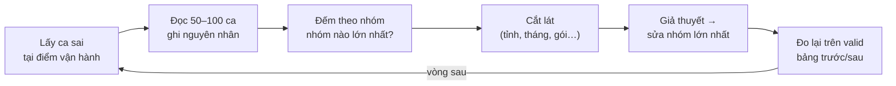
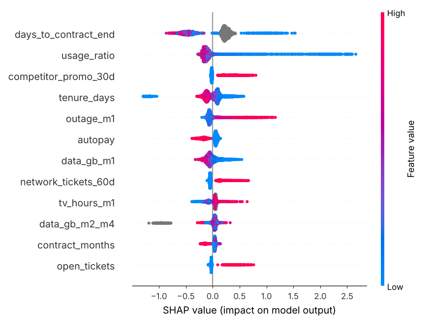

# A6 · Phân tích lỗi, giải thích và kiểm thử

**Tuần 6** · Kỹ năng: [BIZ-03](../02-skill-map/generated/mang/biz.md#biz-03) Trung cấp,
[ML-04](../02-skill-map/generated/mang/ml.md#ml-04) Trung cấp, [PY-03](../02-skill-map/generated/mang/py.md#py-03) Trung cấp ·
Lab: [`labs/biz-03-trung-cap-phan-tich-loi/`](../../labs/biz-03-trung-cap-phan-tich-loi/README.md) ·
Sản phẩm: bảng "nhóm lỗi – số ca – đã sửa – metric trước/sau" + danh sách top 500 khách kèm 3 lý do

Bài A5 cho một con số: LightGBM hơn logistic. Con số đó không nói model sai **ở đâu** và **vì sao**. Bài này đọc từng
ca sai, gom chúng thành nhóm theo nguyên nhân, và sửa nhóm lớn nhất. Ở đây cách sửa không phải tuning thêm, mà là
**một nguồn dữ liệu mới**. Sau đó ta biến model thành thứ CSKH dùng được: mỗi khách trong danh sách có 3 lý do dễ hiểu
và việc nên làm. Cuối bài, ta viết test cho cả pipeline để mọi thay đổi sau này đều được kiểm tra tự động.

**Sau bài này bạn làm được:**

- Phân tích lỗi đúng quy trình: trên valid, tại điểm vận hành thật (top 500/tháng), đọc ca → gán nguyên nhân → đếm →
  cắt lát → sửa nhóm lớn nhất → đo lại.
- Cải tiến lấy dữ liệu làm trung tâm: tìm ra và thêm nguồn dữ liệu còn thiếu, giữ đúng quy tắc as-of.
- Dùng SHAP để giải thích toàn cục và từng khách; gộp feature thành lý do (reason codes) bằng tiếng Việt.
- Viết test cho pipeline dữ liệu bằng fixture nhỏ, test thuộc tính, test so với nguồn độc lập, test đầu-cuối.

---

## 1 · Lý thuyết: phân tích lỗi

### 1.1 Lỗi đo ở đâu, theo định nghĩa nào

- **Trên valid**, không phải tập đóng băng. Soi lỗi là một dạng "học", và tập đóng băng chỉ để báo cáo (bài A3).
- **Tại điểm vận hành**: lỗi là lỗi *của quyết định*, không phải của ngưỡng 0,5 nào đó. Với danh sách 500 người/tháng:
  - **bỏ sót** = khách rời mạng nhưng **không** nằm trong top 500 của tháng;
  - **gọi nhầm** = nằm trong top 500 nhưng ở lại.

### 1.2 Quy trình



**Đọc từng ca trước khi vẽ biểu đồ.** Biểu đồ chỉ trả lời câu hỏi bạn đã nghĩ ra; đọc ca mới gợi ra câu hỏi bạn chưa
nghĩ tới. Với mỗi ca, hỏi: *nếu là nhân viên giỏi nhất của CSKH, nhìn dữ liệu này tôi có đoán được khách sắp đi
không?* Nếu có, model đang bỏ phí thông tin (cần feature mới). Nếu không, có lẽ thiếu hẳn một nguồn dữ liệu, hoặc ca
này vốn không đoán được.

### 1.3 Ba cách sửa, theo thứ tự nên thử

1. **Dữ liệu**: nguồn mới, nhãn sai, feature thiếu. Thường hiệu quả nhất.
2. **Bài toán**: định nghĩa nhãn, tổng thể, cách dùng kết quả. Có khi nhóm lỗi đó nên xử lý bằng **cách khác**,
   không phải bằng model.
3. **Model**: tham số, thuật toán. Thường là đòn bẩy nhỏ nhất ở giai đoạn này.

Mỗi vòng sửa ghi vào **bảng nhóm lỗi**: nhóm – số ca – đã sửa chưa, bằng gì – metric trước/sau. Đó là tiêu chí "Đạt
khi" của BIZ-03.

---

## 2 · Lý thuyết: giải thích model

### 2.1 Toàn cục và từng ca

- **Toàn cục**: model dựa vào feature nào *nói chung*? Dùng để kiểm tra model có hợp lý không, có dấu hiệu rò rỉ không
  (bài A4).
- **Từng ca**: *vì sao* khách này điểm cao? Dùng để hành động: CSKH cần biết nói gì với từng người.

### 2.2 SHAP

SHAP chia điểm của **một** khách (theo thang log-odds) thành phần đóng góp của từng feature:

    log-odds(khách) = giá trị nền + Σ shap_j(khách)

Giá trị nền là log-odds trung bình. `shap_j > 0` nghĩa là feature j đẩy rủi ro **lên** so với trung bình. Với mô hình
cây, **TreeSHAP** tính chính xác, không xấp xỉ, và LightGBM có sẵn nó (`predict(..., pred_contrib=True)`). Lab và test
kiểm tra kết quả khớp thư viện `shap` tới 1e-8.

Trung bình |SHAP| trên nhiều khách cho độ quan trọng **toàn cục**. Nó tốt hơn "gain" của cây vì có cùng đơn vị cho mọi
feature, và vì cộng lại được theo nhóm.

### 2.3 Từ SHAP tới lý do mà CSKH đọc được

SHAP thô chưa dùng được cho CSKH: 33 con số, tên cột tiếng Anh, nhiều feature tương quan với nhau (`data_gb_m1`,
`data_gb_m2_m4`, `usage_ratio` cùng nói về "dùng ít đi"). Ba bước biến chúng thành **reason codes**:

1. **Gộp** feature cùng ý nghĩa thành nhóm và cộng SHAP lại. SHAP cộng được, và gộp còn giải quyết vấn đề feature
   tương quan chia nhau đóng góp.
2. **Lọc**: chỉ nhóm làm *tăng* rủi ro, đủ lớn, và **không bao giờ** dùng nhóm "hồ sơ" (tỉnh, tuổi, kênh). Chúng có
   thể đúng về thống kê, nhưng "vì anh ở Đà Nẵng" không phải lý do để gọi, và dễ thành phân biệt đối xử.
3. **Diễn đạt bằng giá trị thật**: "mất mạng 663 phút tháng trước" thay cho "outage_m1 cao", kèm **việc nên làm**.

### 2.4 Giải thích không phải nhân quả

SHAP nói model **dựa vào** gì, không nói *thay đổi* gì thì khách ở lại. "Dùng ít đi" là **triệu chứng**: khách đã
quyết đi nên dùng ít đi, chứ không phải ngược lại. Nhờ CSKH tăng lượng dùng của khách thì không giữ được ai. Lý do loại
này giúp *tìm đúng người*. Hành động phải nhắm vào **nguyên nhân** (hợp đồng, chất lượng mạng, giá), thường nằm ở lý
do thứ 2, thứ 3 (bài tập 4).

---

## 3 · Lý thuyết: kiểm thử pipeline dữ liệu và ML

| Loại test | Ví dụ trong dự án | Bắt được gì |
|---|---|---|
| Hàm thuần, ví dụ tính tay | `normalize_province`, `break_even`, metric khớp sklearn | sai công thức |
| **Fixture dữ liệu nhỏ** | pipeline thật trên nhà mạng 3.000 khách (`conftest.py`) | lỗi ghép nối giữa các bước, chạy trong vài giây |
| **Test thuộc tính** | đúng thời điểm: dữ liệu đầy đủ và dữ liệu chụp tại t phải cho cùng feature | cả một lớp lỗi, kể cả feature viết sau này |
| So với cách tính độc lập | nhãn tính lại bằng pandas; SHAP so với thư viện shap | hai cách viết khác nhau khó cùng sai |
| Cố tình làm hỏng | dòng trùng, tháng thiếu khách, cột PII → pipeline phải dừng | kiểm tra "có kêu khi cần kêu không" |
| Tái lập | train hai lần ra cùng dự đoán; dựng bảng học hai lần giống từng bit | tính ngẫu nhiên không kiểm soát |
| Đầu-cuối | chạy đúng các lệnh `make` ở tiến trình con; chạy mọi lab | "từng hàm thì chạy, ghép lại thì hỏng" |
| Chất lượng model | AUC valid > 0,6 trên dữ liệu nhỏ | thay đổi làm model hỏng hẳn |

Test chạy trên **dữ liệu nhỏ sinh tại chỗ**, không cần `make data`, không đụng `data/` thật. Nhờ vậy CI chạy được ở bất
kỳ đâu (bài A8).

---

## 4 · Lab A6

### A6.1 Đọc ca sai của v1

**File: `labs/biz-03-trung-cap-phan-tich-loi/error_analysis.py`**

```python
"""Lab A6 · BIZ-03, ML-04: đọc ca sai của model v1, nhóm theo nguyên nhân, sửa nhóm lớn nhất bằng DỮ LIỆU, đo lại.

Mọi phân tích làm trên tập VALID (07–09/2025) — tập đóng băng chỉ để báo cáo cuối cùng, không để "soi lỗi".
1. Ca sai ở năng lực thật: bỏ sót = rời mạng nhưng ngoài top-500 của tháng; gọi nhầm = trong top-500 nhưng ở lại.
2. Đọc 100 ca bỏ sót (in 12 ca đầu) — ngoài đời bạn ghi tay cột "nguyên nhân"; ở đây đối chiếu với lý do trên phiếu hủy.
3. Đếm theo nhóm: lý do, tỉnh, tháng → nhóm lớn nhất.
4. Lát cắt theo tỉnh: recall@500 và xác suất dự đoán so với thực tế.
5. Sửa bằng dữ liệu mới (lịch khuyến mãi của đối thủ → model v2), lập bảng "nhóm lỗi – số ca – đã sửa – trước/sau".
6. SHAP toàn cục: nhóm lý do nào đẩy rủi ro nhiều nhất; biểu đồ beeswarm → out/shap_beeswarm.png.

    cd labs/biz-03-trung-cap-phan-tich-loi
    uv run --project ../../projects/g1-churn-telco python error_analysis.py     # cần `make train train-v2`
"""

from pathlib import Path

import matplotlib

matplotlib.use("Agg")
import matplotlib.pyplot as plt  # noqa: E402
import pandas as pd  # noqa: E402
import shap  # noqa: E402
from churn_telco import config, explain, features, metrics, split, train  # noqa: E402
from churn_telco.features import LABEL  # noqa: E402

OUT = Path(__file__).with_name("out")
OUT.mkdir(exist_ok=True)
pd.set_option("display.width", 160)
K = config.CALL_CAPACITY
df = features.load()
va = split.split(df)["valid"].copy()
v1, v2 = train.load(config.MODELS / "lgbm-v1"), train.load(config.MODELS / "lgbm-v2")
va["p_v1"], va["p_v2"] = v1.proba(va), v2.proba(va)
va["rank_v1"] = va.groupby("t")["p_v1"].rank(ascending=False, method="first")
va["rank_v2"] = va.groupby("t")["p_v2"].rank(ascending=False, method="first")
churners = va[va[LABEL] == 1]
missed = churners[churners["rank_v1"] > K]
wrong = va[(va[LABEL] == 0) & (va["rank_v1"] <= K)]
print(f"1) Valid: {len(churners)} khách rời mạng; v1 bắt được {len(churners) - len(missed)} trong top-{K} mỗi tháng,")
print(f"   bỏ sót {len(missed)} ({len(missed) / len(churners):.0%}); gọi nhầm {len(wrong)} trên {3 * K} cuộc gọi.")

# %% 2. Đọc từng ca — đừng nhảy ngay vào biểu đồ
sample = missed.sample(min(100, len(missed)), random_state=config.SEED)
cols = ["t", "province", "contract_months", "days_to_contract_end", "usage_ratio", "outage_m1", "p_v1", "churn_reason"]
print("\n2) 12 trong 100 ca bỏ sót (đọc cả 100 khi làm thật):")
print(sample[cols].head(12).assign(t=lambda d: d["t"].dt.strftime("%Y-%m")).round(3).to_string(index=False))

# %% 3. Đếm theo nhóm — nhóm nào lớn nhất?
reason = pd.DataFrame(
    {
        "trong_100_bo_sot": sample["churn_reason"].value_counts(),
        "ty_le_bo_sot": missed["churn_reason"].value_counts(normalize=True).round(3),
        "ty_le_bat_duoc": churners[churners["rank_v1"] <= K]["churn_reason"].value_counts(normalize=True).round(3),
    }
).fillna(0)
print("\n3) Lý do hủy (từ phiếu hủy) của ca bỏ sót vs ca bắt được:\n" + reason.to_string())
SOUTH = ["TP. Hồ Chí Minh", "Bình Dương"]
hcm_bd = va["province"].isin(SOUTH)
print(f"   HCM + Bình Dương: {hcm_bd.mean():.0%} khách, nhưng {missed['province'].isin(SOUTH).mean():.0%} ca bỏ sót")

# %% 4. Lát cắt theo tỉnh: model hiểu sai rủi ro ở đâu?
by_prov = va.groupby("province", observed=True).agg(
    khach_roi=(LABEL, "sum"),
    ty_le_that=(LABEL, "mean"),
    du_doan_v1=("p_v1", "mean"),
    recall_v1=("rank_v1", lambda r: ((r <= K) & (va.loc[r.index, LABEL] == 1)).sum()),
)
by_prov["recall_v1"] = (by_prov["recall_v1"] / by_prov["khach_roi"]).round(3)
by_prov["du_doan/that"] = (by_prov["du_doan_v1"] / by_prov["ty_le_that"]).round(2)
print("\n4) Theo tỉnh (valid):\n" + by_prov.round(4).sort_values("du_doan/that").to_string())

# %% 5. Giả thuyết: đối thủ khuyến mãi ở HCM/BD từ giữa 06/2025 — hỏi marketing, có lịch khuyến mãi → feature mới (v2)
before = metrics.evaluate(metrics.rank(va["p_v1"], va[LABEL], va["t"]))
after = metrics.evaluate(metrics.rank(va["p_v2"], va[LABEL], va["t"]))
group = churners["province"].isin(SOUTH)
rows = [
    (
        "Đối thủ khuyến mãi (HCM, BD)",
        (sample["churn_reason"] == "Đối thủ khuyến mãi").sum(),
        "thêm lịch khuyến mãi (v2)",
    ),
    ("Chuyển nhà / đi xa", (sample["churn_reason"] == "Chuyển nhà/đi xa").sum(), "không — không có dấu hiệu trước"),
    ("Chất lượng mạng / khác", sample["churn_reason"].isin(["Chất lượng mạng", "Khác"]).sum(), "chưa — vòng sau"),
]
print("\n5) Bảng nhóm lỗi (100 ca bỏ sót của v1):")
print("   | Nhóm lỗi | Số ca | Đã sửa |")
for name, n, fix in rows:
    print(f"   | {name} | {n} | {fix} |")
print(
    f"   Metric valid v1 → v2: AUC {before['auc']:.3f} → {after['auc']:.3f} · PR-AUC {before['pr_auc']:.3f} → "
    f"{after['pr_auc']:.3f} · P@{K} {before['p@k']:.3f} → {after['p@k']:.3f}"
)
recall = [(churners[group][f"rank_{v}"] <= K).mean() for v in ("v1", "v2")]
pred = [va.loc[hcm_bd, f"p_{v}"].mean() for v in ("v1", "v2")]
print(
    f"   HCM+BD: recall@{K} {recall[0]:.3f} → {recall[1]:.3f}; xác suất dự đoán {pred[0]:.4f} → {pred[1]:.4f}", end=""
)
print(f" (thực tế {va.loc[hcm_bd, LABEL].mean():.4f})")

# %% 6. SHAP toàn cục: trung bình |SHAP| theo nhóm lý do, và beeswarm cho từng feature
rows_shap = va.sample(min(5000, len(va)), random_state=config.SEED)
values = explain.shap_values(v2, rows_shap)
mean_abs = explain.group_shap(values).abs().mean().sort_values(ascending=False)
print("\n6) Mức ảnh hưởng trung bình |SHAP| theo nhóm (log-odds):")
print("   " + " · ".join(f"{explain.GROUPS[g].label} {v:.3f}" for g, v in mean_abs.items()))
X = rows_shap[v2.features].apply(lambda s: s.cat.codes if s.dtype == "category" else s)  # màu cần số
shap.summary_plot(values.to_numpy(), X, max_display=12, show=False)
plt.gcf().set_size_inches(8, 6)
plt.tight_layout()
plt.savefig(OUT / "shap_beeswarm.png", dpi=110)
print(f"   Biểu đồ: {OUT.name}/shap_beeswarm.png")
```

```bash
cd labs/biz-03-trung-cap-phan-tich-loi
uv run --project ../../projects/g1-churn-telco python error_analysis.py
```

**Ô 1–2: lấy ca sai và đọc.**

```text
1) Valid: 1403 khách rời mạng; v1 bắt được 337 trong top-500 mỗi tháng,
   bỏ sót 1066 (76%); gọi nhầm 1163 trên 1500 cuộc gọi.

2) 12 trong 100 ca bỏ sót (đọc cả 100 khi làm thật):
      t        province  contract_months  days_to_contract_end  usage_ratio  outage_m1  p_v1       churn_reason
2025-07 TP. Hồ Chí Minh             12.0                  11.0        1.101       41.0 0.071 Đối thủ khuyến mãi
2025-09         Nghệ An              0.0                   NaN        1.151       81.0 0.010               Khác
2025-08 TP. Hồ Chí Minh              0.0                   NaN        1.319      144.0 0.057 Đối thủ khuyến mãi
2025-09       Hải Phòng              0.0                   NaN        0.687       36.0 0.057               Khác
2025-09      Bình Dương              0.0                   NaN        0.916       87.0 0.024 Đối thủ khuyến mãi
2025-09          Hà Nội              0.0                   NaN        0.780        8.0 0.026    Chất lượng mạng
2025-08 TP. Hồ Chí Minh             24.0                 251.0        1.050        8.0 0.007   Chuyển nhà/đi xa
...
```

Đọc như nhân viên CSKH: nhiều khách bỏ sót **dùng bình thường** (`usage_ratio` ≈ 1), mạng ổn, không có gì đáng ngờ, và
nhiều người ở **HCM, Bình Dương**. Cột `churn_reason` (lý do ghi trên phiếu hủy, có *sau* sự việc) gợi ý rằng đối thủ
có khuyến mãi. Ngoài đời, bạn sẽ ghi nguyên nhân bằng tay cho từng ca. Lý do trên phiếu hủy thì giúp đối chiếu.

**Ô 3–4: đếm và cắt lát.**

```text
3) Lý do hủy (từ phiếu hủy) của ca bỏ sót vs ca bắt được:
                    trong_100_bo_sot  ty_le_bo_sot  ty_le_bat_duoc
Chuyển nhà/đi xa                22.0         0.187           0.015
Chất lượng mạng                 16.0         0.166           0.457
Khác                            17.0         0.181           0.214
Đối thủ khuyến mãi              45.0         0.448           0.252
   HCM + Bình Dương: 37% khách, nhưng 53% ca bỏ sót

4) Theo tỉnh (valid):
                 khach_roi  ty_le_that  du_doan_v1  recall_v1  du_doan/that
Bình Dương             159      0.0375      0.0254      0.145          0.68
TP. Hồ Chí Minh        491      0.0268      0.0193      0.126          0.72
Đồng Nai                59      0.0193      0.0215      0.271          1.11
Hà Nội                 391      0.0231      0.0278      0.368          1.20
...
```

- Nhóm lớn nhất trong 100 ca bỏ sót: **đối thủ khuyến mãi (45 ca)**, rồi chuyển nhà (22), mạng/khác (33).
- HCM và Bình Dương có 37% khách nhưng chiếm 53% ca bỏ sót. Ở đó model dự đoán rủi ro chỉ bằng **0,68–0,72 lần thực
  tế**, trong khi các tỉnh khác bị dự đoán **cao hơn** thực tế. Model không biết điều gì đang xảy ra ở hai tỉnh này.
- "Chuyển nhà" chiếm 19% ca bỏ sót nhưng chỉ 1,5% ca bắt được: đây là nhóm **không có dấu hiệu trước**.

### A6.2 Từ giả thuyết tới dữ liệu mới

Giả thuyết: *từ khoảng giữa 06/2025, đối thủ có chương trình khuyến mãi mạnh ở HCM và Bình Dương.* Dữ liệu CRM/billing
không có thông tin này. Ta đi hỏi phòng marketing: họ theo dõi lịch khuyến mãi của đối thủ trong một file riêng.

```text
province,start_date,end_date,competitor,offer
Hà Nội,2024-10-01,2024-11-30,NetNhanh,Giảm 50% cước 6 tháng cho khách chuyển mạng
TP. Hồ Chí Minh,2025-06-15,2025-09-30,NetNhanh,Miễn phí lắp đặt + 3 tháng cước
Bình Dương,2025-06-15,2025-09-30,NetNhanh,Miễn phí lắp đặt + 3 tháng cước
```

Đợt ở Hà Nội cuối 2024 nằm **trong train**, nên model có thể học hiệu ứng "đang có khuyến mãi" từ đó rồi áp dụng cho
HCM, Bình Dương năm 2025. Feature mới vẫn phải **as-of**: chỉ tính đợt đã bắt đầu trước t.

**File: `src/churn_telco/marketing.py`**

```python
"""Khối feature marketing (A6): lịch khuyến mãi của đối thủ theo tỉnh — nguồn dữ liệu MỚI tìm ra nhờ phân tích lỗi.

Phòng marketing theo dõi các đợt khuyến mãi của đối thủ (data/marketing/competitor_promotions.csv). Dữ liệu này
không nằm trong CRM/billing nên bảng học ban đầu không có. Feature vẫn phải as-of: chỉ tính đợt đã BẮT ĐẦU trước t.

    uv run python -m churn_telco.marketing     # → data/processed/features_marketing.parquet (features.load tự ghép)
"""

from __future__ import annotations

import logging
from pathlib import Path

import duckdb
import pandas as pd

from churn_telco import config
from churn_telco.features import KEYS

log = logging.getLogger(__name__)

PROMO = ["competitor_promo_30d"]

PROMO_SQL = """
SELECT b.t, b.customer_id, (count(m.province) > 0)::DOUBLE AS competitor_promo_30d
FROM base b LEFT JOIN promotions m
    ON m.province = b.province
    AND m.start_date < b.t                         -- đợt đã bắt đầu trước t (biết được tại t)
    AND m.end_date >= b.t - INTERVAL 30 DAY        -- và còn chạy trong 30 ngày trước t
GROUP BY ALL
ORDER BY b.t, b.customer_id                        -- thứ tự cố định: file ra giống hệt mỗi lần (mã băm dữ liệu ổn định)
"""


def read_promotions(path: Path = config.DATA / "marketing" / "competitor_promotions.csv") -> pd.DataFrame:
    return pd.read_csv(path, parse_dates=["start_date", "end_date"])


def build(base: pd.DataFrame, promotions: pd.DataFrame) -> pd.DataFrame:
    """base: bảng có (t, customer_id, province) — thường là bảng học của features.build."""
    con = duckdb.connect()
    con.register("base", base[[*KEYS, "province"]].astype({"province": str}))
    con.register("promotions", promotions)
    df = con.execute(PROMO_SQL).df()
    df["t"] = pd.to_datetime(df["t"])
    return df


def build_all(processed: Path = config.PROCESSED) -> pd.DataFrame:
    base = pd.read_parquet(processed / "features.parquet", columns=[*KEYS, "province"])
    df = build(base, read_promotions())
    df.to_parquet(processed / "features_marketing.parquet", index=False)
    log.info(
        "features_marketing.parquet: %d dòng, %.1f%% dòng có khuyến mãi đối thủ", len(df), 100 * df[PROMO[0]].mean()
    )
    return df


if __name__ == "__main__":
    logging.basicConfig(level=logging.INFO, format="%(levelname)s %(name)s: %(message)s")
    build_all()
```

- Khối feature mới nằm trong **module riêng**, ghi ra **file riêng** (`features_marketing.parquet`). `features.load`
  (bài A4) tự ghép mọi `features_*.parquet` theo khoá, có `validate="one_to_one"`. Bảng học cũ không phải sửa, và
  bộ đánh giá đóng băng giữ nguyên (feature đổi, khoá + nhãn không đổi).
- Điều kiện as-of: `start_date < t` (đợt đã bắt đầu, tức là đã biết tại t) **và** `end_date >= t − 30 ngày` (còn chạy
  trong 30 ngày qua).
- `ORDER BY` cố định thứ tự dòng. Không có nó, DuckDB trả dòng theo thứ tự tuỳ luồng xử lý, file ra khác byte mỗi lần,
  và mã băm "phiên bản dữ liệu" đổi dù dữ liệu không đổi.

Test as-of cho feature mới (đợt HCM bắt đầu 15/06/2025):

**File: `tests/test_features.py` · `test_marketing_feature_is_as_of`**

```python
def test_marketing_feature_is_as_of(small):
    """Đợt khuyến mãi HCM bắt đầu 2025-06-15: tại t = 2025-06-01 chưa biết, tại 2025-07-01 đã biết."""
    rows = small.df[small.df["province"] == "TP. Hồ Chí Minh"].groupby("t")["competitor_promo_30d"].mean()
    assert rows[pd.Timestamp("2025-06-01")] == 0
    assert rows[pd.Timestamp("2025-07-01")] == 1
    assert rows[pd.Timestamp("2025-11-01")] == 0  # kết thúc 2025-09-30, quá 30 ngày
```

```bash
make train-v2
```

```text
INFO __main__: features_marketing.parquet: 359908 dòng, 11.3% dòng có khuyến mãi đối thủ
INFO __main__: LightGBM v2: 265 vòng · valid AUC 0.759 · PR-AUC 0.172 · P@500 0.227 → .../models/lgbm-v2
```

### A6.3 Bảng nhóm lỗi — trước và sau

Phần 5 của lab so v1 với v2 trên **valid**:

```text
5) Bảng nhóm lỗi (100 ca bỏ sót của v1):
   | Nhóm lỗi | Số ca | Đã sửa |
   | Đối thủ khuyến mãi (HCM, BD) | 45 | thêm lịch khuyến mãi (v2) |
   | Chuyển nhà / đi xa | 22 | không — không có dấu hiệu trước |
   | Chất lượng mạng / khác | 33 | chưa — vòng sau |
   Metric valid v1 → v2: AUC 0.739 → 0.759 · PR-AUC 0.168 → 0.172 · P@500 0.225 → 0.227
   HCM+BD: recall@500 0.131 → 0.152; xác suất dự đoán 0.0205 → 0.0259 (thực tế 0.0288)
```

Viết thành bảng cho báo cáo:

| Nhóm lỗi | Số ca (/100) | Đã sửa | Metric trước → sau (valid) |
|---|---|---|---|
| Đối thủ khuyến mãi ở HCM, Bình Dương | 45 | thêm lịch khuyến mãi của marketing (v2) | AUC 0,739 → 0,759; recall@500 ở HCM+BD 0,131 → 0,152; dự đoán ở HCM+BD 2,05% → 2,59% (thực tế 2,88%) |
| Chuyển nhà / đi xa | 22 | không sửa bằng model: không có dấu hiệu trước | — (đề xuất cách khác: dịch vụ chuyển địa điểm) |
| Chất lượng mạng / lý do khác | 33 | vòng sau | — |

Đọc kết quả một cách trung thực:

- Feature marketing cải thiện rõ **xếp hạng tổng thể** (AUC +0,02) và **độ hiệu chỉnh ở hai tỉnh bị ảnh hưởng**: dự
  đoán từ 71% lên 90% mức thực tế.
- Nhưng **precision@500 gần như không đổi** (0,225 → 0,227). Khách bị đối thủ lôi kéo thường *chuyển mạng ngay*, không
  có dấu hiệu dùng ít đi. Feature chỉ nâng *đều* rủi ro của cả tỉnh, không chỉ ra *từng người*.
- Kết luận cho nghiệp vụ, đáng giá hơn bản thân con số: churn do khuyến mãi của đối thủ **không xử lý hiệu quả bằng
  gọi từng người**. Nên dùng **ưu đãi theo vùng** trong thời gian đối thủ khuyến mãi. Đây là kiểu kết luận chỉ có được
  nhờ đọc ca sai.
- Trên tập đóng băng (10–12/2025, đợt khuyến mãi đã kết thúc), v2 và v1 ngang nhau. Feature giúp khi cần và không hại
  lúc bình thường, nên ta chọn **v2** làm model chính.

### A6.4 Mở hộp: cơ chế sinh dữ liệu và điều model học được

Giờ mới mở `simulate.py`. Mỗi tháng, khách đang hoạt động có xác suất nảy ý định rời theo một hàm logistic. Log-odds
gồm:

| Thành phần | Hệ số (log-odds) |
|---|---|
| Không kỳ hạn / hợp đồng 24 tháng | +1,05 / −0,45 |
| **Hợp đồng hết hạn trong tháng tới** | **+2,20** |
| Khách mới (< 120 ngày) / lâu năm (> 3 năm) | +0,55 / −0,35 |
| Tăng giá (SX50, SX150, tháng 4–5/2025) | +0,75 |
| Mất mạng trên 60 phút | tới +1,1 |
| Ticket mạng 2 tháng gần nhất | +0,40 mỗi ticket (tối đa 3) |
| Ticket còn mở / mất mạng nặng **và** ticket còn mở | +0,55 / thêm +0,60 |
| CSAT ≤ 2 trong 3 tháng | +0,45 |
| Trả trễ (3 tháng) | +0,30 mỗi kỳ (tối đa 3) |
| Tự động trừ tiền / gói kèm TV / kèm di động | −0,45 / −0,30 / −0,45 |
| **Đối thủ khuyến mãi tại tỉnh** | **+0,65** |
| Doanh nghiệp nhỏ | −0,20 |
| Yếu tố cá nhân không quan sát được | ngẫu nhiên, độ lệch chuẩn 0,45 |

Thêm ba cơ chế ngoài hàm trên: khách có ý định rời thì 50% dùng ít data hẳn trong tháng đó, nhưng chỉ 15% nếu do khuyến
mãi của đối thủ; 0,35% khách mỗi tháng chuyển nhà (ngẫu nhiên, không dấu hiệu); nợ 2 kỳ liên tiếp thì bị cắt dịch vụ.
Mỗi tháng còn 4% khách dùng ít đi vì đi công tác hay về quê mà không định rời.

So với mức ảnh hưởng toàn cục của v2 (trung bình |SHAP| theo nhóm, phần 6 của lab):

```text
6) Mức ảnh hưởng trung bình |SHAP| theo nhóm (log-odds):
   Hợp đồng 0.379 · Dùng ít đi 0.290 · Chất lượng mạng 0.168 · Thanh toán 0.157 · Đối thủ khuyến mãi 0.143 · Khách mới 0.141 · Hỗ trợ khách hàng 0.096 · Hồ sơ khách 0.058 · Giá cước 0.052 · Gói dịch vụ 0.010
```



- Model tìm ra đúng các nguồn rủi ro lớn: **hợp đồng** (cửa sổ hết hạn: điểm xanh, tức `days_to_contract_end` thấp, có
  SHAP rất cao; điểm xám, tức không có hợp đồng, nằm bên phải), **dùng ít đi**, **chất lượng mạng**, **thanh toán**,
  **khuyến mãi của đối thủ**.
- "Giá cước" nhỏ vì đợt tăng giá chỉ tác động 2 tháng. "Gói dịch vụ" gần 0 vì TV/di động suy ra được từ `plan_code`
  (nằm ở nhóm "giá cước"): feature tương quan chia nhau đóng góp. Đây là lý do phải gộp nhóm trước khi đọc.
- `tenure_days` rất thấp có SHAP âm mạnh: khách vào mạng chưa tới một tháng hầu như chưa thể gửi yêu cầu hủy. Đây là một
  đặc điểm của dữ liệu cần giải thích được, không phải lỗi.

Trên dữ liệu thật, bạn không có bảng "đáp án" như trên. Thứ bạn có là **chuyên gia nghiệp vụ**: đưa họ xem biểu đồ
này, và mọi điểm họ thấy vô lý là một câu hỏi cần trả lời trước khi triển khai.

### A6.5 `explain.py` — 3 lý do cho từng khách

**File: `src/churn_telco/explain.py` · `đầu file…Row`**

```python
"""Lý do cho từng khách (A6 · ML-04): SHAP → nhóm feature → câu tiếng Việt CSKH đọc hiểu + gợi ý hành động.

SHAP (TreeSHAP) chia log-odds của model cho từng feature: bias + Σ shap_j = log-odds của khách. LightGBM tính sẵn
TreeSHAP (`pred_contrib=True`) — đúng bằng thư viện shap (có test), nên API không phải cài shap/numba. Ba bước:
1. Gộp feature cùng ý nghĩa thành NHÓM LÝ DO (data_gb_m1, usage_ratio... → "dùng ít đi"): CSKH cần một lý do, không cần
   năm con số tương quan với nhau.
2. Chỉ lấy nhóm làm TĂNG rủi ro (tổng SHAP > 0) và bỏ nhóm "hồ sơ" (tỉnh, tuổi, kênh): đúng về thống kê nhưng không
   phải lý do để gọi và dễ thành phân biệt đối xử.
3. Diễn đạt bằng GIÁ TRỊ THẬT của khách ("mất mạng 420 phút tháng trước"), kèm việc nên làm.
"""

from __future__ import annotations

from collections.abc import Callable
from dataclasses import dataclass

import pandas as pd

from churn_telco.train import Bundle

Row = pd.Series
```

Các hàm `_xxx(r)` biến **giá trị thật** của khách thành câu. Mỗi hàm xử lý các trường hợp của nhóm mình:

**File: `src/churn_telco/explain.py` · `_usage…_promo`**

```python
def _usage(r: Row) -> str:
    if r.usage_missing_m1:
        return "Không có số liệu dùng data tháng trước (thiết bị không gửi số liệu hoặc ngừng dùng)"
    return f"Tháng trước dùng {r.data_gb_m1:.0f} GB, bằng {r.usage_ratio:.0%} mức trung bình 3 tháng trước đó"


def _contract(r: Row) -> str:
    if r.contract_months == 0:
        return "Không có hợp đồng kỳ hạn — có thể rời mạng bất cứ lúc nào"
    when = "hôm nay" if r.days_to_contract_end == 0 else f"sau {r.days_to_contract_end:.0f} ngày"
    return f"Hợp đồng {r.contract_months:.0f} tháng hết hạn {when}"


def _network(r: Row) -> str:
    parts = [f"mất mạng {r.outage_m1:.0f} phút tháng trước"] if pd.notna(r.outage_m1) else []
    if r.network_tickets_60d:
        parts.append(f"{r.network_tickets_60d:.0f} lần báo lỗi mạng trong 60 ngày")
    return ("Chất lượng mạng: " + ", ".join(parts)) if parts else "Chất lượng mạng khu vực kém"


def _support(r: Row) -> str:
    parts = []
    if r.open_tickets:
        parts.append(f"còn {r.open_tickets:.0f} yêu cầu hỗ trợ chưa xử lý xong")
    if pd.notna(r.min_csat_90d) and r.min_csat_90d <= 3:
        parts.append(f"chấm hài lòng {r.min_csat_90d:.0f}/5")
    if r.tickets_30d:
        parts.append(f"{r.tickets_30d:.0f} lần liên hệ tổng đài trong 30 ngày")
    return ("Hỗ trợ: " + ", ".join(parts)) if parts else "Lâu không liên hệ tổng đài"


def _billing(r: Row) -> str:
    if r.unpaid_at_t:
        return f"Đang nợ {r.unpaid_at_t:.0f} hoá đơn quá hạn"
    if r.late_or_unpaid_90d:
        return f"Trả cước trễ {r.late_or_unpaid_90d:.0f} kỳ trong 90 ngày (trễ nhất {r.max_days_late_90d:.0f} ngày)"
    return "Thanh toán thủ công, không tự động trừ tiền"


def _vnd(x: float) -> str:
    return f"{x:,.0f}".replace(",", ".") + " đ"


def _price(r: Row) -> str:
    if r.fee_change_90d > 0:
        return f"Cước tăng {r.fee_change_90d:.0%} trong 90 ngày, hiện {_vnd(r.monthly_fee)}/tháng"
    return f"Gói {r.plan_code}, cước {_vnd(r.monthly_fee)}/tháng"


def _tenure(r: Row) -> str:
    return f"Khách mới — vào mạng {r.tenure_days:.0f} ngày" if r.tenure_days < 365 else "Thời gian dùng dịch vụ"


def _bundle(r: Row) -> str:
    if not (r.has_tv or r.has_mobile):
        return "Chỉ dùng internet, không có gói kèm TV/di động"
    return "Cấu hình gói dịch vụ"


def _promo(r: Row) -> str:
    return f"Đối thủ đang khuyến mãi mạnh tại {r.province}"
```

- Mỗi câu kiểm tra điều kiện trước khi nói, ví dụ chỉ nói "chấm hài lòng x/5" khi điểm ≤ 3 và có tồn tại
  (`pd.notna`). Nói sai về khách trước mặt khách thì mất uy tín ngay.
- `_vnd` định dạng tiền kiểu Việt (320.000 đ). Câu viết cho người đọc, không phải cho máy.

**File: `src/churn_telco/explain.py` · `Group…GROUPS`**

```python
@dataclass(frozen=True)
class Group:
    label: str  # tên nhóm lý do cho người đọc
    features: list[str]
    phrase: Callable[[Row], str] | None  # câu lý do từ giá trị thật của khách; None = không bao giờ là lý do
    action: str  # việc CSKH nên làm


GROUPS = {
    "usage": Group(
        "Dùng ít đi",
        ["data_gb_m1", "data_gb_m2_m4", "usage_ratio", "usage_missing_m1", "tv_hours_m1"],
        _usage,
        "Hỏi nhu cầu thực tế, tư vấn gói phù hợp hơn",
    ),
    "contract": Group(
        "Hợp đồng", ["contract_months", "days_to_contract_end"], _contract, "Mời gia hạn/ký hợp đồng kỳ hạn kèm ưu đãi"
    ),
    "network": Group(
        "Chất lượng mạng",
        ["outage_m1", "outage_avg_3m", "network_tickets_60d"],
        _network,
        "Kỹ thuật kiểm tra đường truyền trước khi gọi; xin lỗi và bù cước",
    ),
    "support": Group(
        "Hỗ trợ khách hàng",
        ["open_tickets", "min_csat_90d", "tickets_30d", "days_since_last_ticket", "billing_tickets_90d"],
        _support,
        "Ưu tiên đóng yêu cầu đang mở, gọi lại xác nhận",
    ),
    "billing": Group(
        "Thanh toán",
        ["late_or_unpaid_90d", "unpaid_at_t", "max_days_late_90d", "refunds_90d", "autopay", "payment_method"],
        _billing,
        "Nhắc lịch thanh toán, mời đăng ký tự động trừ tiền",
    ),
    "price": Group(
        "Giá cước", ["monthly_fee", "fee_change_90d", "plan_code", "speed_mbps"], _price, "Tư vấn gói tiết kiệm hơn"
    ),
    "tenure": Group("Khách mới", ["tenure_days"], _tenure, "Gọi chăm sóc khách mới, hướng dẫn sử dụng"),
    "bundle": Group("Gói dịch vụ", ["has_tv", "has_mobile"], _bundle, "Giới thiệu gói kèm TV/di động"),
    "promo": Group("Đối thủ khuyến mãi", ["competitor_promo_30d"], _promo, "Đưa ưu đãi giữ chân cạnh tranh"),
    "profile": Group("Hồ sơ khách", ["segment", "channel", "province", "age"], None, ""),  # không bao giờ là lý do
}
```

Bảng `GROUPS` là **chỗ duy nhất** quyết định feature nào thuộc lý do nào và nên làm gì. Thêm feature mới mà quên xếp
nhóm thì nó không bao giờ thành lý do (bài tập 2 viết test bắt trường hợp này). Nhóm `profile` có `phrase=None` nên
không bao giờ được dùng làm lý do.

**File: `src/churn_telco/explain.py` · `shap_values…reasons`**

```python
def shap_values(bundle: Bundle, df: pd.DataFrame) -> pd.DataFrame:
    """SHAP theo log-odds, một cột mỗi feature (TreeSHAP chính xác, không xấp xỉ); cột cuối của pred_contrib là bias."""
    contrib = bundle.booster.predict(
        df[bundle.features], num_iteration=bundle.meta["best_iteration"], pred_contrib=True
    )
    return pd.DataFrame(contrib[:, :-1], index=df.index, columns=bundle.features)


def group_shap(values: pd.DataFrame) -> pd.DataFrame:
    """Tổng SHAP theo nhóm lý do (chỉ nhóm có feature trong model)."""
    out = {}
    for name, group in GROUPS.items():
        present = [c for c in group.features if c in values.columns]
        if present:
            out[name] = values[present].sum(axis=1)
    return pd.DataFrame(out)


def reasons(bundle: Bundle, df: pd.DataFrame, top: int = 3, min_shap: float = 0.05) -> pd.DataFrame:
    """Mỗi khách: tối đa `top` lý do làm tăng rủi ro (SHAP nhóm ≥ min_shap), mạnh nhất trước, kèm việc nên làm."""
    grouped = group_shap(shap_values(bundle, df)).drop(columns="profile", errors="ignore")
    rows = []
    for idx, contrib in grouped.iterrows():
        record = df.loc[idx]
        best = contrib[contrib >= min_shap].sort_values(ascending=False).head(top)
        row: dict = {}
        for i, (name, value) in enumerate(best.items(), start=1):
            group = GROUPS[name]
            row |= {
                f"reason_{i}": group.phrase(record),
                f"action_{i}": group.action,
                f"shap_{i}": round(float(value), 3),
            }
        rows.append(row)
    return pd.DataFrame(rows, index=df.index)
```

- `shap_values` dùng `pred_contrib=True` của LightGBM: TreeSHAP chính xác, cột cuối là giá trị nền nên bỏ đi. Nhờ vậy
  API ở bài A7 không cần cài `shap` (kéo theo numba, llvmlite, hàng trăm MB).
- `group_shap` cộng SHAP theo nhóm. SHAP cộng được nên tổng của nhóm vẫn đúng nghĩa.
- `reasons`: bỏ nhóm hồ sơ, giữ nhóm ≥ `min_shap` (0,05 log-odds, đủ để không nói những lý do vặt), lấy tối đa 3 nhóm
  mạnh nhất. Mỗi lý do kèm câu, việc nên làm và mức đóng góp.

### A6.6 `score.py` — chấm điểm tháng mới và xuất danh sách cho CSKH

**File: `src/churn_telco/score.py`**

```python
"""Chấm điểm hằng tháng (A6 · A7): ngày chấm điểm MỚI (chưa có nhãn) → danh sách gọi kèm 3 lý do cho CSKH.

Dữ liệu lịch sử tới 2025-12-31, nên lần chấm điểm "thật" đầu tiên là t = 2026-01-01: dựng feature as-of tại t bằng
đúng code của bảng học, chấm điểm, xếp theo giá trị kỳ vọng, giữ tối đa 500 khách có EV > 0, sinh lý do.
File kết quả chỉ có mã khách — CSKH tra số điện thoại trong CRM (có phân quyền), dữ liệu cá nhân không rời hệ nguồn.

    uv run python -m churn_telco.score --t 2026-01-01      # → data/outputs/call_list_2026-01-01.{csv,parquet}
"""

from __future__ import annotations

import argparse
import logging
from pathlib import Path

import pandas as pd

from churn_telco import config, decision, explain, features, marketing, schemas, train
from churn_telco.features import KEYS, LABEL, META

log = logging.getLogger(__name__)

OUTPUTS = config.DATA / "outputs"
COLUMNS = ["t", "rank", "customer_id", "p", "value", "ev", "province", "plan_code"]


def build_features(
    t: pd.Timestamp, interim: Path = config.INTERIM, promotions: pd.DataFrame | None = None
) -> pd.DataFrame:
    """Feature tại một ngày chấm điểm — cùng SQL với bảng học, nên train và chấm điểm không lệch nhau."""
    df = features.build(features.connect(interim), [t]).drop(columns=[LABEL, *META])  # tương lai chưa có nhãn
    schemas.FEATURES.remove_columns([LABEL]).validate(df, lazy=True)
    if promotions is not None:
        df = df.merge(marketing.build(df, promotions), on=KEYS, how="left", validate="one_to_one")
    return df


def call_list(bundle: train.Bundle, df: pd.DataFrame, capacity: int = config.CALL_CAPACITY) -> pd.DataFrame:
    calls = decision.call_list(df, bundle.proba(df), capacity)
    top = calls[calls["call"]].sort_values("rank")
    return top[COLUMNS].join(explain.reasons(bundle, top))


def main(argv: list[str] | None = None) -> None:
    parser = argparse.ArgumentParser(description="Chấm điểm một ngày và xuất danh sách gọi cho CSKH")
    parser.add_argument("--t", type=pd.Timestamp, default=pd.Timestamp("2026-01-01"))
    parser.add_argument("--model", type=Path, default=config.MODELS / "lgbm-v2")
    parser.add_argument("--capacity", type=int, default=config.CALL_CAPACITY)
    args = parser.parse_args(argv)
    bundle = train.load(args.model)
    promos = marketing.read_promotions() if "competitor_promo_30d" in bundle.features else None
    df = build_features(args.t, promotions=promos)
    out = call_list(bundle, df, args.capacity)
    OUTPUTS.mkdir(parents=True, exist_ok=True)
    stem = OUTPUTS / f"call_list_{args.t:%Y-%m-%d}"
    out.to_parquet(stem.with_suffix(".parquet"), index=False)
    out.to_csv(stem.with_suffix(".csv"), index=False, encoding="utf-8-sig")  # utf-8-sig: Excel mở đúng tiếng Việt
    log.info(
        "%s: chấm %d khách, gọi %d (EV trung bình %.0f đ, xác suất trung bình %.1f%%) → %s.csv",
        f"{args.t:%Y-%m-%d}",
        len(df),
        len(out),
        out["ev"].mean(),
        100 * out["p"].mean(),
        stem,
    )


if __name__ == "__main__":
    logging.basicConfig(level=logging.INFO, format="%(levelname)s %(name)s: %(message)s")
    main()
```

- `build_features` dùng **đúng câu SQL** của bảng học cho một ngày chấm điểm mới. Train và chấm điểm dùng chung một
  đường code nên không thể lệch nhau (training/serving skew). Ngày 01/01/2026 chưa có tương lai nên bỏ cột nhãn, và
  schema kiểm tra bản không có nhãn (`remove_columns`).
- File xuất chỉ có **mã khách**. CSKH tra số điện thoại trong CRM, nơi có phân quyền. Dữ liệu cá nhân không đi qua
  pipeline ML (bài A7).
- `utf-8-sig`: thêm BOM để Excel trên Windows mở đúng tiếng Việt.

```bash
make score
```

```text
INFO __main__: 2026-01-01: chấm 20340 khách, gọi 500 (EV trung bình 63602 đ, xác suất trung bình 20.7%) → .../data/outputs/call_list_2026-01-01.csv
```

Bốn khách đầu danh sách tháng 01/2026:

```text
#1 KH000113  p=94%  EV=420.063 đ  Hà Nội · SX300
   Hợp đồng 12 tháng hết hạn hôm nay                                   → Mời gia hạn/ký hợp đồng kỳ hạn kèm ưu đãi
   Tháng trước dùng 138 GB, bằng 52% mức trung bình 3 tháng trước đó    → Hỏi nhu cầu thực tế, tư vấn gói phù hợp hơn
   Trả cước trễ 1 kỳ trong 90 ngày (trễ nhất 10 ngày)                  → Nhắc lịch thanh toán, mời đăng ký tự động trừ tiền
#2 KH024223  p=45%  EV=286.160 đ  Đà Nẵng · COMBO
   Tháng trước dùng 134 GB, bằng 47% mức trung bình 3 tháng trước đó    → Hỏi nhu cầu thực tế, tư vấn gói phù hợp hơn
   Hợp đồng 12 tháng hết hạn sau 19 ngày                               → Mời gia hạn/ký hợp đồng kỳ hạn kèm ưu đãi
   Đang nợ 1 hoá đơn quá hạn                                           → Nhắc lịch thanh toán, mời đăng ký tự động trừ tiền
#3 KH017489  p=71%  EV=278.268 đ  Đà Nẵng · SX150TV
   Hợp đồng 24 tháng hết hạn hôm nay                                   → Mời gia hạn/ký hợp đồng kỳ hạn kèm ưu đãi
   Chất lượng mạng: mất mạng 53 phút tháng trước, 1 lần báo lỗi mạng trong 60 ngày → Kỹ thuật kiểm tra đường truyền…
   Tháng trước dùng 258 GB, bằng 77% mức trung bình 3 tháng trước đó    → Hỏi nhu cầu thực tế, tư vấn gói phù hợp hơn
#4 KH023862  p=62%  EV=269.948 đ  Thừa Thiên Huế · SX300
   ...
```

Khách #2 có xác suất **45%**, thấp hơn khách #3 (**71%**), nhưng đứng trước vì gói COMBO 450.000 đ/tháng đáng giữ hơn.
Đây là cách xếp theo giá trị kỳ vọng ở bài A5. `KH000113` là khách ta đã theo dõi ở bài A4: tháng 12, hợp đồng còn 31
ngày và lượng dùng bắt đầu giảm; tháng 1, hợp đồng hết hạn đúng ngày chấm điểm.

### A6.7 Test cho cả pipeline

Mọi test dùng chung một fixture: **chạy toàn bộ pipeline** trên một nhà mạng thu nhỏ trong thư mục tạm.

**File: `tests/conftest.py`**

```python
"""Fixture dùng chung: chạy TOÀN BỘ pipeline trên một nhà mạng thu nhỏ (≈ 3.000 khách) trong thư mục tạm.

Mất vài giây, chạy một lần cho cả phiên test. Test không đụng tới data/ và models/ thật của dự án.
"""

from __future__ import annotations

import os
from pathlib import Path
from types import SimpleNamespace

import pytest

from churn_telco import clean, features, marketing, simulate, split, train

SMALL = simulate.SimConfig(n_initial=3000, new_per_month=80)


def env_for(root: Path) -> dict[str, str]:
    """Biến môi trường trỏ mọi đường dẫn của config sang thư mục tạm — cho test chạy lệnh/lab ở tiến trình con."""
    paths = {"CHURN_DATA": "data", "CHURN_MODELS": "models", "CHURN_EVAL_DIR": "eval", "CHURN_REPORTS": "reports"}
    return {**os.environ, **{k: str(root / v) for k, v in paths.items()}, "CHURN_MLRUNS": str(root / "mlruns")}


@pytest.fixture(scope="session")
def small(tmp_path_factory: pytest.TempPathFactory) -> SimpleNamespace:
    root = tmp_path_factory.mktemp("churn")
    data = root / "data"
    tables = simulate.simulate(SMALL)
    simulate.write_raw(tables, data / "raw")
    cleaned = clean.clean_all(data / "raw", data / "interim")
    base = features.build_all(data / "interim", data / "processed")
    promos = marketing.read_promotions(data / "marketing" / "competitor_promotions.csv")
    marketing.build(base, promos).to_parquet(data / "processed" / "features_marketing.parquet", index=False)
    df = features.load(data / "processed")
    split.freeze(df, root / "eval" / "manifest.json")
    train.save(train.train(df, "v1"), root / "models" / "lgbm-v1")  # model của A5 (lab A5, A6 cần)
    bundle = train.train(df, "v2")
    train.save(bundle, root / "models" / "lgbm-v2")
    return SimpleNamespace(
        root=root,
        data=data,
        raw=data / "raw",
        interim=data / "interim",
        processed=data / "processed",
        tables=tables,
        clean=cleaned,
        df=df,
        promos=promos,
        bundle=bundle,
        env=env_for(root),
    )
```

- `scope="session"`: dựng **một lần** cho cả phiên test (vài giây), mọi test dùng lại.
- `tmp_path_factory`: thư mục tạm riêng, tự xoá. Test không bao giờ đụng `data/` và `models/` thật.
- `env_for` trả biến môi trường `CHURN_*` trỏ sang thư mục tạm. Nhờ vậy test chạy được cả **lệnh `make` thật** và
  **script lab** ở tiến trình con (`test_cli.py`, `test_labs.py`). Đây là lý do `config.py` đọc đường dẫn từ biến môi
  trường (bài A1).

Hai test cho lý do SHAP:

**File: `tests/test_model.py` · `test_pred_contrib_equals_shap_library…test_reasons_are_positive_readable_and_never_profile`**

```python
@pytest.mark.filterwarnings("ignore:LightGBM binary classifier:UserWarning")  # shap báo đổi kiểu output, không sao
def test_pred_contrib_equals_shap_library(small):
    shap = pytest.importorskip("shap")
    rows = split.split(small.df)["test"].head(200)
    ours = explain.shap_values(small.bundle, rows)
    theirs = shap.TreeExplainer(small.bundle.booster).shap_values(rows[small.bundle.features])
    np.testing.assert_allclose(ours.to_numpy(), np.asarray(theirs), atol=1e-8)


def test_shap_adds_up_to_the_log_odds(small):
    rows = split.split(small.df)["test"].head(200)
    values = explain.shap_values(small.bundle, rows)
    raw = small.bundle.booster.predict(rows[small.bundle.features], raw_score=True)
    bias = raw - values.sum(axis=1)
    assert np.allclose(bias, bias.iloc[0])  # phần còn lại là một hằng số (giá trị kỳ vọng của model)


def test_reasons_are_positive_readable_and_never_profile(small):
    test = split.split(small.df)["test"]
    top = test.assign(p=small.bundle.proba(test)).nlargest(50, "p")
    why = explain.reasons(small.bundle, top)
    assert why["reason_1"].notna().all()
    assert (why[["shap_1", "shap_2", "shap_3"]].fillna(1) > 0).all().all()
    assert (why["shap_1"] >= why["shap_2"].fillna(0)).all()
    profile_words = ("Hộ gia đình", "Doanh nghiệp", "tuổi")
    assert not why.filter(like="reason").stack().str.contains("|".join(profile_words)).any()
```

```bash
make test
```

```text
........................................................................ [ 45%]
........................................................................ [ 91%]
.............                                                            [100%]
157 passed in 76.22s (0:01:16)
```

Bộ test gồm: làm sạch (A2), metric và bộ đánh giá (A3), đúng thời điểm và schema (A4), model và quyết định (A5),
lý do và chấm điểm (A6), API (A7), các lệnh `make` đầu-cuối, mọi lab, và **mọi khối code trong 9 bài học khớp với
code thật** (`test_doc_sync.py`).

---

## 5 · Kiểm tra kết quả

- [ ] Bảng nhóm lỗi có số ca thật từ 100 ca bỏ sót và metric valid trước/sau (BIZ-03 "Đạt khi").
- [ ] `data/outputs/call_list_2026-01-01.csv`: 500 khách, mỗi khách tối đa 3 lý do dễ hiểu kèm việc nên làm, không
      có PII (ML-04 "Đạt khi").
- [ ] `make test` xanh; bạn chỉ ra được test nào sẽ đỏ nếu ai đó lọc ticket theo `created_at` (PY-03).
- [ ] Bạn giải thích được vì sao feature marketing làm AUC tăng mà precision@500 gần như không đổi, và hệ quả cho
      nghiệp vụ.

## 6 · Lỗi thường gặp

| Triệu chứng | Nguyên nhân | Cách sửa |
|---|---|---|
| Phân tích lỗi trên tập đóng băng | "dữ liệu mới nhất, gần thực tế nhất" | soi lỗi trên valid; tập đóng băng chỉ báo cáo |
| Lỗi định nghĩa theo ngưỡng 0,5 | thói quen bài toán cân bằng | lỗi tại điểm vận hành: top 500 mỗi tháng |
| Lý do "Đà Nẵng", "độ tuổi" | dùng thẳng SHAP từng feature | gộp nhóm, bỏ nhóm hồ sơ |
| Lý do mâu thuẫn với dữ liệu ("chấm hài lòng nan/5") | câu không kiểm tra giá trị thiếu | mỗi hàm câu kiểm tra điều kiện, có test |
| Test chạy chậm, phụ thuộc `data/` thật | test đọc dữ liệu thật | fixture dữ liệu nhỏ, `scope="session"`, đường dẫn qua biến môi trường |

## 7 · Bài tập

1. **(Cơ bản — BIZ-03)** Đọc 50 ca **gọi nhầm** (trong top 500 nhưng ở lại). Nhóm lớn nhất là gì? Gợi ý: nhìn khách
   dùng ít đi vì đi công tác.
2. **(Cơ bản — PY-03)** Viết test: mọi feature trong `FEATURE_SETS["v2"]` đều thuộc đúng một nhóm trong
   `explain.GROUPS`.
3. **(Trung cấp — ML-04)** Thêm `permutation_importance` (sklearn) trên valid cho v2 và so thứ tự với trung bình |SHAP|
   theo nhóm. Chỗ nào khác nhau, vì sao?
4. **(Trung cấp)** Tách lý do thành "**dấu hiệu**" (dùng ít đi) và "**nguyên nhân có thể**" (hợp đồng, mạng, giá,
   thanh toán). Danh sách gọi hiển thị 1 dấu hiệu + tối đa 2 nguyên nhân. Hỏi lại CSKH xem cách nào dễ dùng hơn.
5. **(Mở rộng — DATA-04)** Nhóm "chuyển nhà" chiếm 19% ca bỏ sót. Giả sử helpdesk có loại ticket "Hỏi chuyển địa điểm".
   Thiết kế feature as-of từ ticket đó. Dữ liệu mô phỏng hiện chưa nối hai thứ này với nhau, vậy làm sao bạn biết
   feature có ích hay không trước khi xin dữ liệu thật?

---

**Tiếp theo:** [A7 · API, Docker, MLflow và bảo mật dữ liệu](a7-api-docker-mlflow-bao-mat.md). Đưa model ra khỏi máy
bạn: API có khoá, container chạy bằng user thường, lịch sử thí nghiệm, và repo không lộ secret hay dữ liệu khách.
