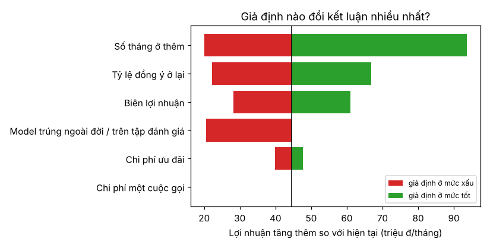

# A8 · Trình bày kết quả — mốc giai đoạn A

**Tuần 8** · Kỹ năng: [BIZ-04](../02-skill-map/generated/mang/biz.md#biz-04) Cơ bản,
[PY-02](../02-skill-map/generated/mang/py.md#py-02) **Trung cấp** ·
Lab: [`labs/biz-04-co-ban-trinh-bay/`](../../labs/biz-04-co-ban-trinh-bay/README.md) ·
Sản phẩm: demo chạy được + [báo cáo 1 trang](../../projects/g1-churn-telco/reports/README.md) so với baseline

Một model tốt mà không ai dùng thì giá trị bằng 0. Người quyết định có triển khai hay không là trưởng phòng CSKH. Họ
không đọc AUC, và họ có 10 phút. Bài cuối gói 7 tuần làm việc thành một trang, một demo và một đề nghị cụ thể. Cũng
trong bài này, dự án được đưa vào quy trình làm việc nhóm: pull request, CI, tái lập từ đầu bằng một lệnh.

**Sau bài này bạn làm được:**

- Viết báo cáo 1 trang cho người ngoài ngành: so với cách làm hiện tại, bằng đơn vị nghiệp vụ (người, tiền), có khoảng
  tin cậy, độ nhạy theo giả định, giới hạn và rủi ro.
- Làm phân tích độ nhạy (tornado) và tìm điểm hoà vốn của chương trình.
- Dựng một kịch bản demo 3 phút.
- Đưa dự án vào quy trình nhóm: nhánh, PR có checklist, CI chạy lint + test + tái lập dữ liệu.

---

## 1 · Lý thuyết: trình bày cho người ra quyết định

### 1.1 Cấu trúc một trang

| Phần | Trả lời câu hỏi | Ở báo cáo Sóng Xanh |
|---|---|---|
| Câu hỏi | Ta đang giải quyết chuyện gì? | gọi 500 khách nào để giữ được nhiều nhất |
| Đề xuất | Bạn muốn tôi làm gì? | thay danh sách hiện tại bằng danh sách của model |
| Kết quả **so với hiện tại** | Tốt hơn bao nhiêu, chắc chắn tới đâu? | +103 người gọi trúng/tháng (KTC 90–114) |
| Quy ra tiền | Đáng bao nhiêu? | +44,5 triệu đ/tháng (KTC 39–50) |
| Độ vững | Nếu giả định sai thì sao? | bảng độ nhạy, điểm hoà vốn |
| Giới hạn, rủi ro | Cái gì có thể sai? | dữ liệu mô phỏng, tỷ lệ giữ chân là giả định, nhóm không bắt được |
| Bước tiếp | Làm gì tuần sau? | chạy thử 2 tháng có nhóm đối chứng |

Bắt đầu bằng **đề xuất**, không bằng phương pháp. "LightGBM với 33 feature as-of" là phụ lục. "Gọi trúng gấp 3,8 lần"
mới là câu đầu trang.

### 1.2 Con số đúng cho người đọc

- **So với cách làm hiện tại**, không so với ngẫu nhiên. "Gấp 13 lần ngẫu nhiên" nghe ấn tượng nhưng không ai đang gọi
  ngẫu nhiên.
- **Đơn vị nghiệp vụ**: người, tiền, giờ công. "precision@500 tăng 0,206" phải viết thành "mỗi tháng gọi trúng thêm
  103 người".
- **Kèm khoảng tin cậy** viết bằng lời: "từ 90 tới 114 người". Người đọc cần biết con số chắc tới đâu.
- **Con số tuyệt đối đi kèm tỷ lệ**: "+44,5 triệu đ/tháng" rõ hơn "+1.430%" (từ 2,9 lên 47,5 triệu).

### 1.3 Mỗi biểu đồ một thông điệp

Tiêu đề biểu đồ là **câu trả lời**, không phải tên trục: "Gọi bao nhiêu khách thì có lãi?" kèm đường đánh dấu năng lực
hiện tại. Trục có nhãn và đơn vị. Ít màu. Không biểu đồ 3D, không biểu đồ tròn cho dữ liệu có thứ tự.

### 1.4 Độ nhạy: kết luận có vững không?

Mọi con số tiền đều dựa trên giả định (tỷ lệ giữ chân 30%, ở thêm 12 tháng…). **Phân tích độ nhạy** đổi từng giả định
sang mức xấu và mức tốt, rồi xem lợi nhuận tăng thêm thay đổi ra sao. Biểu đồ **tornado** xếp giả định theo độ ảnh
hưởng: thanh dài nhất là giả định phải **đo lại** trước khi nhân rộng. Thêm một câu hỏi ngược: giả định phải xấu tới
mức nào thì kết luận đổi? Đó là **điểm hoà vốn**.

### 1.5 Đề nghị thử nghiệm có đối chứng

Báo cáo chứng minh model **xếp hạng** tốt hơn. Nó **chưa** chứng minh cuộc gọi **giữ** được khách (tỷ lệ 30% là giả
định từ một chiến dịch cũ). Đề nghị đúng là chạy thử: mỗi tháng lấy danh sách của model, gọi ngẫu nhiên 80% và **không
gọi** 20% còn lại (nhóm đối chứng). So tỷ lệ rời của hai nhóm thì ra hiệu quả thật của cuộc gọi. Đây là cầu nối sang
thiết kế thí nghiệm (STAT-03) và uplift (STAT-06) ở giai đoạn C.

---

## 2 · Lý thuyết: quy trình làm việc nhóm (PY-02 Trung cấp)

### 2.1 Nhánh và pull request

Mọi thay đổi đi qua **nhánh + PR**, không đẩy thẳng lên `main`. PR nhỏ, một mục đích, mô tả *vì sao* và *đã kiểm tra
thế nào*. Checklist review cho dự án ML:

- [ ] `make check` xanh trên máy và trên CI.
- [ ] Đổi feature → test đúng thời điểm vẫn xanh; `make eval` không báo lệch manifest (hoặc giải thích vì sao đổi bộ
      đánh giá).
- [ ] Đổi model → bảng `make eval` trước/sau có KTC, chênh lệch cặp với model đang chạy.
- [ ] Không có dữ liệu, model, `.env` trong diff (`security_check.py`).
- [ ] Đổi code → bài học đồng bộ (`scripts/sync_doc.py`).

### 2.2 CI — để máy kiểm tra điều con người hay quên

CI chạy ở mỗi PR trên một máy **sạch**. Nhờ vậy nó bắt được cả lỗi "chạy được trên máy tôi": quên commit `uv.lock`,
quên thêm file, phụ thuộc dữ liệu cục bộ. Job của dự án làm bốn việc: cài đúng `uv.lock`, lint, toàn bộ test, và
**dựng lại dữ liệu từ đầu** rồi kiểm tra bộ đánh giá đóng băng khớp manifest. Bước cuối chứng minh "clone sạch, một
lệnh, ra đúng kết quả" (PY-02 "Đạt khi").

### 2.3 Từ notebook sang module

Khám phá trong notebook hay script `# %%` (thư mục `labs/`). Khi một đoạn code sẽ **chạy lại** (mỗi tháng, mỗi lần
train) thì chuyển nó vào `src/` thành hàm thuần có test. Cả khoá học đi theo đúng nhịp đó: EDA ở A2 thành
`features.py` ở A4; phân tích lỗi ở A6 thành `marketing.py`.

---

## 3 · Lab A8

### A8.1 `report.py` — báo cáo 1 trang sinh bằng code

Báo cáo sinh bằng code (không gõ tay vào slide) để tháng sau chạy lại là có báo cáo mới, và mọi con số truy được về
nguồn.

**File: `src/churn_telco/report.py` · `đầu file…MODEL`**

```python
"""Báo cáo 1 trang (A8 · BIZ-04): so với cách làm hiện tại, quy ra khách giữ được và tiền; có khoảng tin cậy, độ nhạy
theo giả định và giới hạn. Người đọc là trưởng phòng CSKH — không phải người làm ML.

    uv run python -m churn_telco.report     # cần: make eval train score trước → reports/README.md + reports/*.png
"""

from __future__ import annotations

import json
import logging
from pathlib import Path

import matplotlib

matplotlib.use("Agg")  # vẽ ra file, không cần màn hình
import matplotlib.pyplot as plt  # noqa: E402
import numpy as np  # noqa: E402
import pandas as pd  # noqa: E402

from churn_telco import baselines, config, decision, explain, features, marketing, metrics, split, train  # noqa: E402
from churn_telco.features import LABEL  # noqa: E402

log = logging.getLogger(__name__)

FINAL = config.MODELS / "lgbm-v2"
RULE = "Luật CSKH hiện tại"
MODEL = "Model (LightGBM v2, xếp theo EV)"
```

`matplotlib.use("Agg")` vẽ ra file, không cần màn hình (chạy được trên server, trong CI). Lệnh này phải đứng trước
`import matplotlib.pyplot`, nên các import sau nó có `# noqa: E402`.

**File: `src/churn_telco/report.py` · `outcomes…money`**

```python
def outcomes(
    frame: pd.DataFrame,
    order: np.ndarray,
    k: int = config.CALL_CAPACITY,
    save_rate: float = config.SAVE_RATE,
    value_months: int = config.VALUE_MONTHS,
) -> dict[str, float]:
    """Gọi k khách điểm cao nhất mỗi tháng → trung bình/tháng: số người sắp rời gọi trúng, giữ được, lợi nhuận ròng."""
    value = frame["monthly_fee"].to_numpy(float) * value_months * config.MARGIN
    df = frame.assign(order=order, gain=frame[LABEL] * save_rate * (value - config.OFFER_COST))
    top = df[df.groupby("t")["order"].rank(ascending=False, method="first") <= k]
    per_month = top.groupby("t").agg(reached=(LABEL, "sum"), gain=("gain", "sum"))
    return {
        "reached": per_month["reached"].mean(),
        "saved": per_month["reached"].mean() * save_rate,
        "profit": (per_month["gain"] - k * config.CALL_COST).mean(),
    }


def num(x: float, digits: int = 0) -> str:
    """Số kiểu Việt: 60.912 và 44,5."""
    return f"{x:,.{digits}f}".replace(",", " ").replace(".", ",").replace(" ", ".")


def money(x: float) -> str:
    return f"{num(x / 1e6, 1)} triệu đ"
```

- `outcomes` là trái tim của báo cáo: với một cách xếp hạng bất kỳ, gọi k người đầu mỗi tháng, đếm người sắp rời gọi
  trúng, số giữ được và lợi nhuận ròng, **tính bằng nhãn thật** của tập đóng băng. Nó nhận `save_rate` và
  `value_months` làm tham số để dùng lại cho phân tích độ nhạy.
- `num`, `money` định dạng số kiểu Việt (60.912; 44,5 triệu đ). Người đọc không phải dịch dấu chấm, dấu phẩy.

**File: `src/churn_telco/report.py` · `profit_chart…reliability_chart`**

```python
def profit_chart(frame: pd.DataFrame, orders: dict[str, np.ndarray], out: Path) -> pd.DataFrame:
    ks = [100, 250, 500, 750, 1000, 1500, 2000, 3000, 4000, 6000]
    curve = pd.DataFrame([{"model": m, "k": k, **outcomes(frame, o, k)} for m, o in orders.items() for k in ks])
    fig, ax = plt.subplots(figsize=(7, 4))
    for name, g in curve.groupby("model", sort=False):
        ax.plot(g["k"], g["profit"] / 1e6, marker="o", label=name)
    ax.axvline(config.CALL_CAPACITY, color="grey", ls="--", lw=1, label=f"Năng lực hiện tại ({config.CALL_CAPACITY})")
    ax.axhline(0, color="black", lw=0.8)
    ax.set(
        xlabel="Số cuộc gọi mỗi tháng", ylabel="Lợi nhuận ròng (triệu đ/tháng)", title="Gọi bao nhiêu khách thì có lãi?"
    )
    ax.legend()
    fig.tight_layout()
    fig.savefig(out, dpi=120)
    plt.close(fig)
    return curve


def reliability_chart(p: np.ndarray, y: np.ndarray, out: Path) -> float:
    r = decision.reliability(p, y, bins=10)
    fig, ax = plt.subplots(figsize=(4.5, 4.5))
    ax.plot(r["mean_pred"], r["frac_churn"], marker="o", label="Model (10 nhóm theo xác suất)")
    lim = float(r[["mean_pred", "frac_churn"]].max().max()) * 1.05
    ax.plot([0, lim], [0, lim], color="grey", ls="--", lw=1, label="Dự đoán = thực tế")
    ax.set(xlabel="Xác suất dự đoán", ylabel="Tỷ lệ rời mạng thực tế", title="Xác suất có đáng tin?")
    ax.legend(fontsize=8)
    fig.tight_layout()
    fig.savefig(out, dpi=120)
    plt.close(fig)
    return decision.ece(p, y)
```

**File: `src/churn_telco/report.py` · `sensitivity…reason_summary`**

```python
def sensitivity(test: pd.DataFrame, orders: dict[str, np.ndarray]) -> str:
    months = (6, 12, 24)
    lines = ["| Tỷ lệ đồng ý ở lại \\ số tháng ở thêm | " + " | ".join(f"{m} tháng" for m in months) + " |"]
    lines.append("|---" * (len(months) + 1) + "|")
    for rate in (0.15, 0.30, 0.45):
        cells = []
        for m in months:
            a = outcomes(test, orders[RULE], save_rate=rate, value_months=m)["profit"]
            b = outcomes(test, orders[MODEL], save_rate=rate, value_months=m)["profit"]
            cells.append(f"+{money(b - a)}")
        lines.append(f"| {rate:.0%} | " + " | ".join(cells) + " |")
    return "\n".join(lines)


def reason_summary(bundle: train.Bundle) -> str:
    """Nhóm lý do chính trong danh sách gọi mới nhất (data/outputs từ `make score`)."""
    files = sorted((config.DATA / "outputs").glob("call_list_*.parquet"))
    if not files:
        return ""
    calls = pd.read_parquet(files[-1])
    t = calls["t"].iloc[0]
    df = features.build(features.connect(), [t]).merge(calls[["customer_id"]], on="customer_id")
    df = df.merge(marketing.build(df, marketing.read_promotions()), on=features.KEYS)
    main = explain.group_shap(explain.shap_values(bundle, df)).drop(columns="profile").idxmax(axis=1).value_counts()
    rows = "\n".join(f"| {explain.GROUPS[g].label} | {n} | {explain.GROUPS[g].action} |" for g, n in main.items())
    return (
        f"## Danh sách gọi tháng {t:%m/%Y}: lý do chính của {len(calls)} khách\n\n"
        "| Nhóm lý do chính | Số khách | Việc nên làm |\n|---|---|---|\n" + rows + "\n"
    )
```

`reason_summary` đếm **nhóm lý do chính** của 500 khách trong danh sách mới nhất. Trưởng phòng CSKH cần biết tháng này
đội phải chuẩn bị kịch bản gọi cho loại khách nào.

**File: `src/churn_telco/report.py` · `headline…LIMITS`**

```python
def headline(test: pd.DataFrame, orders: dict[str, np.ndarray], n_boot: int) -> str:
    """Bảng chính: danh sách hiện tại và model, mỗi tháng, kèm KTC 95% của phần chênh lệch."""
    res = metrics.bootstrap(orders, test, n_boot=n_boot, reference=RULE).set_index(["model", "metric"])
    hits = res.loc[(MODEL, "p@k")] * config.CALL_CAPACITY  # tỷ lệ trong top-500 → số người
    base, best = outcomes(test, orders[RULE]), outcomes(test, orders[MODEL])
    per_hit = (best["profit"] - base["profit"]) / (best["reached"] - base["reached"])  # tiền / mỗi người trúng thêm
    rate = config.SAVE_RATE
    rows = [
        ("Số người sắp rời được gọi trúng", num(base["reached"]), num(best["reached"]), hits, num, 1),
        (
            f"Số khách giữ được (giả định {rate:.0%} đồng ý ở lại)",
            num(base["saved"]),
            num(best["saved"]),
            hits,
            num,
            rate,
        ),
        (
            "Lợi nhuận ròng sau chi phí gọi và ưu đãi",
            money(base["profit"]),
            money(best["profit"]),
            hits,
            money,
            per_hit,
        ),
    ]
    lines = [f"| Mỗi tháng, với {config.CALL_CAPACITY} cuộc gọi | Danh sách hiện tại | Model | Chênh lệch (KTC 95%) |"]
    lines.append("|---|---|---|---|")
    for name, a, b, h, fmt, scale in rows:
        lines.append(
            f"| {name} | {a} | {b} | +{fmt(h.delta * scale)} ({fmt(h.delta_lo * scale)} … {fmt(h.delta_hi * scale)}) |"
        )
    return "\n".join(lines)


def versus_logistic(out: Path) -> str:
    """Chênh lệch cặp LightGBM v2 − Logistic trên tập đóng băng, đọc từ kết quả `make eval`."""
    path = out / "eval_test.json"
    if not path.exists():
        return ""
    e = pd.DataFrame(json.loads(path.read_text(encoding="utf-8"))).set_index(["model", "metric"])
    row = e.loc[("LightGBM v2", "p@k")] * config.CALL_CAPACITY
    return (
        f"So với baseline logistic regression, model gọi trúng thêm {num(row.delta)} người/tháng "
        f"(KTC 95%: {num(row.delta_lo)} … {num(row.delta_hi)}) — đủ để đáng thêm độ phức tạp."
    )


LIMITS = """## Giới hạn và rủi ro

- **Dữ liệu mô phỏng** có cơ chế churn biết trước; số liệu thật sẽ khác. Quy trình (feature as-of, bộ đánh giá đóng
  băng, bootstrap) thì dùng lại nguyên vẹn.
- **Tỷ lệ đồng ý ở lại {rate:.0%} là giả định** từ chiến dịch 2024. Trước khi nhân rộng: thử nghiệm có nhóm đối chứng
  (một phần danh sách KHÔNG gọi) để đo hiệu quả thật của cuộc gọi.
- **Model không bắt được** churn do chuyển nhà (không có dấu hiệu trước) và churn đột ngột khi đối thủ khuyến mãi —
  nhóm sau nên xử lý bằng ưu đãi theo vùng trong thời gian khuyến mãi, không phải gọi từng người.
- **Xác suất khớp thực tế** (sai lệch trung bình {ece}% giữa dự đoán và thực tế, hình dưới) nên dùng được để tính giá
  trị kỳ vọng. Theo dõi hằng tháng dự đoán và thực tế theo tỉnh; lệch nhiều thì train lại.
- **Không dùng hồ sơ** (tỉnh, tuổi, kênh) làm lý do gọi; danh sách chỉ có mã khách, CSKH tra liên hệ trong CRM.


"""
```

- `headline` chạy bootstrap với **tham chiếu là danh sách hiện tại** (không phải logistic như `make eval`): người đọc
  quan tâm "hơn cách đang làm bao nhiêu". KTC của số người gọi trúng nhân với tiền mỗi người gọi trúng thêm
  (`per_hit`) thì ra KTC của lợi nhuận.
- `versus_logistic` đọc lại kết quả `make eval` (file `reports/eval_test.json`) thay vì tính lại: một nguồn sự thật cho
  một con số.
- `LIMITS` viết sẵn giới hạn và rủi ro. Phần này không bao giờ được bỏ khỏi báo cáo.

**File: `src/churn_telco/report.py` · `build…__main__`**

```python
def build(out: Path = config.REPORTS, n_boot: int = 1000) -> str:
    out.mkdir(parents=True, exist_ok=True)
    df = features.load()
    test = split.frozen_test(df)
    bundle = train.load(FINAL)
    p = bundle.proba(test)
    orders = {RULE: baselines.rule_cskh(test), MODEL: decision.expected_value(p, decision.customer_value(test))}
    curve = profit_chart(test, orders, out / "profit_curve.png")
    peak = curve[curve["model"] == MODEL].sort_values("profit").iloc[-1]
    ece = reliability_chart(p, test[LABEL].to_numpy(), out / "reliability.png")
    period = f"{test['t'].nunique()} tháng {test['t'].min():%m}–{test['t'].max():%m/%Y}"
    sections = [
        "# Báo cáo 1 trang — Gọi ai để giữ khách? (Sóng Xanh · dữ liệu mô phỏng)",
        f"**Câu hỏi.** Mỗi tháng đội CSKH gọi được {config.CALL_CAPACITY} khách. Chọn ai để giữ lại nhiều khách nhất?",
        "**Đề xuất.** Thay danh sách hiện tại (khách sắp hết hợp đồng, hay báo lỗi mạng) bằng danh sách do model xếp "
        "theo giá trị kỳ vọng của cuộc gọi, kèm 3 lý do và việc nên làm cho từng khách.",
        "## Kết quả trên bộ đánh giá đóng băng",
        f"{period} mà model chưa từng thấy, {num(len(test))} lượt khách; khoảng tin cậy (KTC) 95% bootstrap theo "
        f"khách, {n_boot} lần.",
        headline(test, orders, n_boot),
        f"Gọi ngẫu nhiên thì {config.CALL_CAPACITY} cuộc trúng khoảng "
        f"{num(test[LABEL].mean() * config.CALL_CAPACITY)} người. {versus_logistic(out)}",
        "",
        f"**Nên gọi bao nhiêu?** Lợi nhuận còn tăng tới khoảng {num(peak['k'])} cuộc/tháng "
        f"({money(peak['profit'])}/tháng): năng lực {config.CALL_CAPACITY} cuộc là nút thắt. Đề xuất thử tăng năng "
        "lực, có nhóm đối chứng (xem Rủi ro).",
        "## Kết luận có vững nếu giả định sai?",
        "Lợi nhuận tăng thêm mỗi tháng so với danh sách hiện tại:",
        sensitivity(test, orders),
        "Ở mọi tổ hợp, model đều hơn danh sách hiện tại; độ lớn phụ thuộc mạnh vào tỷ lệ đồng ý ở lại — con số "
        "cần đo lại.",
        reason_summary(bundle),
        LIMITS.format(rate=config.SAVE_RATE, ece=num(100 * ece, 2)),
        f"*Tái lập: `make all` trong `projects/g1-churn-telco/`. {bundle.meta['name']}, phiên bản "
        f"{bundle.meta.get('version', '—')}.*",
    ]
    text = "\n\n".join(s.strip() for s in sections if s) + "\n"
    (out / "README.md").write_text(text, encoding="utf-8")
    return text


if __name__ == "__main__":
    logging.basicConfig(level=logging.INFO, format="%(levelname)s %(name)s: %(message)s")
    print(build())
```

```bash
make report
```

Kết quả: [`reports/README.md`](../../projects/g1-churn-telco/reports/README.md) cùng 2 biểu đồ. Phần đầu báo cáo:

```text
# Báo cáo 1 trang — Gọi ai để giữ khách? (Sóng Xanh · dữ liệu mô phỏng)

Câu hỏi. Mỗi tháng đội CSKH gọi được 500 khách. Chọn ai để giữ lại nhiều khách nhất?

Đề xuất. Thay danh sách hiện tại (khách sắp hết hợp đồng, hay báo lỗi mạng) bằng danh sách do model xếp theo giá trị
kỳ vọng của cuộc gọi, kèm 3 lý do và việc nên làm cho từng khách.

| Mỗi tháng, với 500 cuộc gọi                    | Danh sách hiện tại | Model        | Chênh lệch (KTC 95%)                |
| Số người sắp rời được gọi trúng                 | 37                 | 140          | +103 (90 … 114)                     |
| Số khách giữ được (giả định 30% đồng ý ở lại)   | 11                 | 42           | +31 (27 … 34)                       |
| Lợi nhuận ròng sau chi phí gọi và ưu đãi        | 2,9 triệu đ        | 47,5 triệu đ | +44,5 triệu đ (39,0 … 49,6 triệu đ) |

Gọi ngẫu nhiên thì 500 cuộc trúng khoảng 11 người. So với baseline logistic regression, model gọi trúng thêm 14
người/tháng (KTC 95%: 7 … 20) — đủ để đáng thêm độ phức tạp.
```


Biểu đồ trả lời câu hỏi tiếp theo của trưởng phòng: *"Có nên tăng người gọi không?"* Với danh sách của model, lợi nhuận
còn tăng tới khoảng 1.000 cuộc/tháng (55,4 triệu). Với danh sách hiện tại, gọi thêm gần như không có thêm lãi.

### A8.2 Lab: kết luận có vững không?

**File: `labs/biz-04-co-ban-trinh-bay/sensitivity.py`**

```python
"""Lab A8 · BIZ-04: kết luận có còn đúng nếu giả định sai? — phân tích độ nhạy và khung câu chuyện 3 phút.

Quyết định (gọi ai) đã chốt với giả định gốc; ở đây ta hỏi: nếu thực tế khác giả định thì lợi nhuận TĂNG THÊM so với
cách làm hiện tại còn bao nhiêu? Mỗi giả định thử một mức thấp và một mức cao → biểu đồ "lốc xoáy" (tornado):
thanh dài nhất là giả định cần đo lại trước khi nhân rộng.

    cd labs/biz-04-co-ban-trinh-bay
    uv run --project ../../projects/g1-churn-telco python sensitivity.py     # cần `make train-v2`
"""

from dataclasses import asdict, dataclass, replace
from pathlib import Path

import matplotlib

matplotlib.use("Agg")
import matplotlib.pyplot as plt  # noqa: E402
import numpy as np  # noqa: E402
import pandas as pd  # noqa: E402
from churn_telco import baselines, config, decision, features, split, train  # noqa: E402
from churn_telco.features import LABEL  # noqa: E402

OUT = Path(__file__).with_name("out")
OUT.mkdir(exist_ok=True)
K = config.CALL_CAPACITY


@dataclass(frozen=True)
class World:
    """Một "thế giới" giả định. Giá trị mặc định = giả định gốc trong config.py."""

    save_rate: float = config.SAVE_RATE
    value_months: float = config.VALUE_MONTHS
    margin: float = config.MARGIN
    offer_cost: float = config.OFFER_COST
    call_cost: float = config.CALL_COST
    hit_factor: float = 1.0  # < 1: ngoài đời model gọi trúng ít hơn trên tập đánh giá (dữ liệu trôi, quy trình khác)


LABELS = {
    "save_rate": "Tỷ lệ đồng ý ở lại",
    "value_months": "Số tháng ở thêm",
    "margin": "Biên lợi nhuận",
    "offer_cost": "Chi phí ưu đãi",
    "call_cost": "Chi phí một cuộc gọi",
    "hit_factor": "Model trúng ngoài đời / trên tập đánh giá",
}
RANGES = {  # (mức xấu, mức tốt)
    "save_rate": (0.15, 0.45),
    "value_months": (6, 24),
    "margin": (0.30, 0.60),
    "offer_cost": (300_000, 50_000),
    "call_cost": (50_000, 10_000),
    "hit_factor": (0.6, 1.0),
}


def top_k(frame: pd.DataFrame, order: np.ndarray) -> pd.DataFrame:
    """k khách điểm cao nhất của mỗi tháng."""
    return frame.assign(order=order).loc[lambda d: d.groupby("t")["order"].rank(ascending=False, method="first") <= K]


def profit(top: pd.DataFrame, w: World) -> float:
    """Lợi nhuận ròng trung bình mỗi tháng của danh sách gọi `top` trong thế giới `w`."""
    value = top["monthly_fee"] * w.value_months * w.margin
    gain = top[LABEL] * w.hit_factor * w.save_rate * (value - w.offer_cost)
    return gain.groupby(top["t"]).sum().mean() - K * w.call_cost


test = split.frozen_test(features.load())
bundle = train.load(config.MODELS / "lgbm-v2")
model_list = top_k(test, decision.expected_value(bundle.proba(test), decision.customer_value(test)))
rule_list = top_k(test, baselines.rule_cskh(test))


def uplift(w: World) -> float:
    """Model hơn danh sách hiện tại bao nhiêu tiền mỗi tháng (hit_factor chỉ áp cho model)."""
    return profit(model_list, w) - profit(rule_list, replace(w, hit_factor=1.0))


base = uplift(World())
rows = []
for name, (bad, good) in RANGES.items():
    rows.append(
        {
            "giả định": LABELS[name],
            "gốc": asdict(World())[name],
            "mức xấu": bad,
            "mức tốt": good,
            "khi xấu (tr.đ)": uplift(replace(World(), **{name: bad})) / 1e6,
            "khi tốt (tr.đ)": uplift(replace(World(), **{name: good})) / 1e6,
        }
    )
table = pd.DataFrame(rows)
table = table.assign(width=(table["khi tốt (tr.đ)"] - table["khi xấu (tr.đ)"]).abs()).sort_values("width")
print(f"1) Lợi nhuận tăng thêm mỗi tháng so với danh sách hiện tại, giả định gốc: {base / 1e6:.1f} triệu đ\n")
print(table.drop(columns="width").set_index("giả định").round(2).to_string())

fig, ax = plt.subplots(figsize=(7.5, 3.8))
y = np.arange(len(table))
ax.barh(y, table["khi xấu (tr.đ)"] - base / 1e6, left=base / 1e6, color="#d62728", label="giả định ở mức xấu")
ax.barh(y, table["khi tốt (tr.đ)"] - base / 1e6, left=base / 1e6, color="#2ca02c", label="giả định ở mức tốt")
ax.set_yticks(y, table["giả định"])
ax.axvline(base / 1e6, color="black", lw=1)
ax.set(xlabel="Lợi nhuận tăng thêm so với hiện tại (triệu đ/tháng)", title="Giả định nào đổi kết luận nhiều nhất?")
ax.legend(loc="lower right", fontsize=8)
fig.tight_layout()
fig.savefig(OUT / "tornado.png", dpi=110)

# 2. Điểm hoà vốn của CẢ CHƯƠNG TRÌNH gọi: cần bao nhiêu % khách đồng ý ở lại thì 500 cuộc gọi mới có lãi?
rates = np.linspace(0.005, 0.60, 120)
for name, calls in [("danh sách hiện tại", rule_list), ("danh sách của model", model_list)]:
    gains = np.array([profit(calls, replace(World(), save_rate=r)) for r in rates])
    need = rates[np.argmax(gains > 0)] if (gains > 0).any() else float("nan")
    print(f"\n2) {name}: có lãi khi ≥ {need:.1%} khách được gọi đồng ý ở lại")
worst = uplift(World(save_rate=0.15, value_months=6, hit_factor=0.6))
print(f"   Xấu cùng lúc (15% đồng ý, ở thêm 6 tháng, model trúng ít hơn 40%): {worst / 1e6:+.1f} triệu đ/tháng")

rule_hits = rule_list.groupby("t")[LABEL].sum().mean()
risk = table.iloc[-1]["giả định"].lower()
story = [
    f"Vấn đề   — mỗi tháng ~{100 * test[LABEL].mean():.1f}% khách rời mạng; đội gọi {K} khách theo danh sách 'sắp hết "
    f"hợp đồng', trúng khoảng {rule_hits:.0f} người thật sự sắp rời.",
    "Cách làm — model học 18 tháng lịch sử, xếp khách theo giá trị kỳ vọng của cuộc gọi, kèm 3 lý do cho từng người.",
    f"Kết quả  — trên 3 tháng model chưa thấy: lợi nhuận tăng thêm ~{base / 1e6:.0f} triệu đ/tháng (KTC: báo cáo).",
    f"Rủi ro   — kết luận nhạy nhất với '{risk}': phải đo lại trước khi nhân rộng.",
    "Đề nghị  — chạy thử 2 tháng: gọi 80% danh sách, giữ 20% làm nhóm đối chứng để đo hiệu quả thật.",
]
print("\n3) Khung câu chuyện 3 phút cho trưởng phòng CSKH:")
for i, line in enumerate(story, 1):
    print(f"   {i}. {line}")
```

- `World` là `dataclass(frozen=True)` mô tả một "thế giới" giả định; `replace(World(), save_rate=0.15)` tạo thế giới
  khác (cùng kỹ thuật với lab A1).
- **Quyết định giữ nguyên** (danh sách gọi đã chốt với giả định gốc), chỉ **thực tế** đổi. Đây đúng là câu hỏi
  "nếu ta làm theo đề xuất mà giả định sai thì sao".
- `hit_factor`: model ngoài đời có thể trúng ít hơn trên tập đánh giá (dữ liệu trôi, CSKH gọi không hết danh sách…).
  Chỉ áp cho model, không áp cho danh sách hiện tại: giả định bi quan *chống lại* đề xuất của chính ta.

```bash
cd labs/biz-04-co-ban-trinh-bay
uv run --project ../../projects/g1-churn-telco python sensitivity.py
```

```text
1) Lợi nhuận tăng thêm mỗi tháng so với danh sách hiện tại, giả định gốc: 44.5 triệu đ

                                                 gốc    mức xấu   mức tốt  khi xấu (tr.đ)  khi tốt (tr.đ)
giả định
Chi phí một cuộc gọi                        25000.00   50000.00  10000.00           44.54           44.54
Chi phí ưu đãi                             150000.00  300000.00  50000.00           39.92           47.62
Model trúng ngoài đời / trên tập đánh giá       1.00       0.60      1.00           20.56           44.54
Biên lợi nhuận                                  0.45       0.30      0.60           28.15           60.93
Tỷ lệ đồng ý ở lại                              0.30       0.15      0.45           22.27           66.81
Số tháng ở thêm                                12.00       6.00     24.00           19.96           93.70

2) danh sách hiện tại: có lãi khi ≥ 24.5% khách được gọi đồng ý ở lại

2) danh sách của model: có lãi khi ≥ 6.5% khách được gọi đồng ý ở lại
   Xấu cùng lúc (15% đồng ý, ở thêm 6 tháng, model trúng ít hơn 40%): +4.6 triệu đ/tháng

3) Khung câu chuyện 3 phút cho trưởng phòng CSKH:
   1. Vấn đề   — mỗi tháng ~2.3% khách rời mạng; đội gọi 500 khách theo danh sách 'sắp hết hợp đồng', trúng khoảng 37 người thật sự sắp rời.
   2. Cách làm — model học 18 tháng lịch sử, xếp khách theo giá trị kỳ vọng của cuộc gọi, kèm 3 lý do cho từng người.
   3. Kết quả  — trên 3 tháng model chưa thấy: lợi nhuận tăng thêm ~45 triệu đ/tháng (KTC: báo cáo).
   4. Rủi ro   — kết luận nhạy nhất với 'số tháng ở thêm': phải đo lại trước khi nhân rộng.
   5. Đề nghị  — chạy thử 2 tháng: gọi 80% danh sách, giữ 20% làm nhóm đối chứng để đo hiệu quả thật.
```



Đọc kết quả, cũng là nội dung phần "độ vững" của buổi trình bày:

- **Ở mọi mức giả định, model vẫn hơn danh sách hiện tại.** Kết luận *"nên đổi"* vững; chỉ *"đổi được bao nhiêu"* là
  phụ thuộc giả định.
- **Chi phí cuộc gọi không đổi kết luận** (thanh dài 0): cả hai phương án đều gọi 500 cuộc. Đây là câu trả lời cho câu
  hỏi hay gặp "nếu cuộc gọi đắt gấp đôi thì sao?".
- **Số tháng khách ở thêm** và **tỷ lệ đồng ý ở lại** quyết định độ lớn. Đó là hai con số cần đo trong thử nghiệm.
- **Điểm hoà vốn là thông điệp mạnh nhất**: danh sách hiện tại cần ≥ 24,5% khách đồng ý ở lại mới có lãi, danh sách
  của model chỉ cần ≥ 6,5%. Ngay cả khi mọi giả định cùng xấu một lúc, model vẫn hơn 4,6 triệu/tháng.

### A8.3 Demo 3 phút

Kịch bản, mỗi bước một màn hình:

1. **(30 giây) Vấn đề**: mở báo cáo, chỉ dòng "37 người trúng / 500 cuộc".
2. **(60 giây) Danh sách mới**: `make docker-up`, mở http://127.0.0.1:8000, nhập khoá. Bảng 50 khách đầu tháng 01/2026,
   mỗi người 3 lý do + việc nên làm. Đọc to khách #1: "hợp đồng hết hạn hôm nay, tháng trước dùng còn 52%, trả trễ
   một kỳ".
3. **(30 giây) Vì sao người #2 đứng trên người #3** dù xác suất thấp hơn: gói COMBO đáng giữ hơn (giá trị kỳ vọng).
4. **(30 giây) Độ vững**: biểu đồ tornado + câu "chỉ cần 6,5% khách đồng ý ở lại là có lãi".
5. **(30 giây) Đề nghị**: chạy thử 2 tháng có nhóm đối chứng; tiêu chí tiếp tục là tỷ lệ rời của nhóm được gọi thấp
   hơn nhóm đối chứng.

Tập trước một lần với người không làm ML. Câu hỏi nào của họ bạn trả lời lúng túng thì thêm vào báo cáo.

### A8.4 CI cho dự án

**File: `.github/workflows/ci.yml`**

```yaml
name: CI

on:
  pull_request:
  push:
    branches: [main]

jobs:
  check:
    runs-on: ubuntu-latest
    steps:
      - uses: actions/checkout@v4

      - uses: actions/setup-python@v5
        with:
          python-version: "3.12"

      - name: Cài uv
        run: pip install uv

      - name: Cài môi trường (nhóm dev)
        run: uv sync --locked

      - name: Lint
        run: |
          uv run ruff check .
          uv run ruff format --check .

      - name: Test
        run: uv run pytest

      - name: Catalog hợp lệ và tài liệu sinh tự động đã cập nhật
        run: uv run python -m aiarch.catalog build --check

      - name: Script kiểm tra môi trường chạy được
        run: uv run python scripts/check_env.py

  churn-telco:
    # Dự án G1 · Churn (real case Giai đoạn A): lint, test (pipeline trên dữ liệu nhỏ, mọi lab, đồng bộ bài học với
    # code), rồi dựng lại dữ liệu đầy đủ từ đầu và kiểm tra bộ đánh giá đóng băng khớp manifest đã commit.
    runs-on: ubuntu-latest
    defaults:
      run:
        working-directory: projects/g1-churn-telco
    steps:
      - uses: actions/checkout@v4

      - uses: actions/setup-python@v5
        with:
          python-version: "3.12"

      - name: Cài uv
        run: pip install uv

      - name: Cài môi trường đúng theo uv.lock
        run: uv sync --locked

      - name: Lint
        run: |
          uv run ruff check .
          uv run ruff format --check .

      - name: Test
        run: uv run pytest

      - name: Tái lập từ đầu — dữ liệu, bảng học và bộ đánh giá đóng băng phải khớp manifest
        run: make data features eval

  site:
    runs-on: ubuntu-latest
    steps:
      - uses: actions/checkout@v4

      - uses: actions/setup-python@v5
        with:
          python-version: "3.12"

      - name: Cài uv
        run: pip install uv

      - name: Cài môi trường (nhóm dev)
        run: uv sync --locked

      - name: Kiểm tra cú pháp JavaScript
        run: node --check web/assets/app.js

      - name: Cài Chromium cho Playwright
        run: uv run --with playwright playwright install --with-deps chromium

      - name: Kiểm thử trang web bằng trình duyệt thật
        run: uv run --with playwright python scripts/smoke_site.py
```

Job `churn-telco` chạy trong thư mục dự án (`defaults.run.working-directory`). Bước cuối `make data features eval`
dựng lại toàn bộ dữ liệu trên máy của GitHub. `make eval` tự kiểm tra bộ đánh giá khớp `eval/manifest.json` đã commit,
nên nếu ai đó làm đổi dữ liệu hay nhãn mà không cố ý, CI đỏ.

### A8.5 Tái lập từ con số 0

Bằng chứng cuối cùng của giai đoạn: xoá hết, chạy lại một lệnh.

```bash
make clean
make all
```

Khoảng 1 phút 20 giây sau, mọi file trong `data/`, `models/`, `mlruns/`, `reports/` được sinh lại, và các con số trong
bảng `make eval` và báo cáo **giống hệt từng chữ số**.

---

## 4 · Mốc giai đoạn A

> **Mốc** (theo [lộ trình](../02-skill-map/generated/lo-trinh.md#giai-doan-a)): Dự án Nhóm 1 (churn Telco) chạy qua
> API FastAPI + Docker, có bộ đánh giá cố định và danh sách top 500 khách kèm lý do SHAP.

- [ ] `make docker-up` → API `(healthy)`, `/version` đúng model, `/top` trả danh sách kèm lý do (A7).
- [ ] `eval/manifest.json` đã commit; `make eval` in bảng có KTC; LightGBM hơn logistic có ý nghĩa (A3, A5).
- [ ] `data/outputs/call_list_2026-01-01.csv`: top 500, mỗi khách tối đa 3 lý do + việc nên làm (A6).
- [ ] `reports/README.md`: báo cáo 1 trang có KTC, độ nhạy, giới hạn (A8).
- [ ] `make check` xanh trên máy và trên CI; `make clean all` tái lập đúng từng con số.

Cập nhật [bảng tự đánh giá](../02-skill-map/generated/tu-danh-gia.md) theo bảng ở
[trang tổng quan giai đoạn A](README.md#tự-đánh-giá-cuối-giai-đoạn).

## 5 · Lỗi thường gặp

| Triệu chứng | Nguyên nhân | Cách sửa |
|---|---|---|
| Người nghe hỏi "vậy AUC 0,79 là tốt hay xấu?" | trình bày bằng metric kỹ thuật | so với cách hiện tại, bằng người và tiền |
| Báo cáo hứa "+44,5 triệu" như chắc chắn | thiếu KTC và độ nhạy | KTC + tornado + điểm hoà vốn |
| Bị hỏi "cuộc gọi có thật sự giữ được khách không?" | đánh giá xếp hạng, chưa đo hiệu quả can thiệp | đề nghị thử nghiệm có nhóm đối chứng |
| Số trong slide khác số trong code | gõ tay vào slide | sinh báo cáo bằng code (`make report`) |
| CI đỏ "manifest không khớp" sau một PR | PR vô tình đổi tổng thể khách hoặc nhãn | xem lại thay đổi; nếu cố ý, `freeze(force=True)` + ghi lý do trong PR |

## 6 · Bài tập

1. **(Cơ bản — BIZ-04)** Trình bày 10 phút cho một người không làm ML, chỉ dùng báo cáo 1 trang. Ghi lại 3 câu hỏi họ
   hỏi và sửa báo cáo để trả lời trước các câu đó.
2. **(Cơ bản)** Thêm vào báo cáo dòng "nếu tăng năng lực lên 1.000 cuộc/tháng": lợi nhuận tăng thêm và số nhân viên
   cần thêm (giả sử mỗi nhân viên gọi 100 cuộc/tháng).
3. **(Trung cấp — STAT-03)** Thiết kế thử nghiệm có đối chứng: cỡ mẫu mỗi nhóm để phát hiện chênh lệch tỷ lệ rời 3 điểm
   phần trăm với độ mạnh 80%. Hai tháng với 500 cuộc/tháng có đủ không?
4. **(Trung cấp — PY-02)** Thêm `security_check.py` vào pre-commit của repo như một hook `local`, chỉ chạy khi có thay
   đổi trong `projects/g1-churn-telco/`.
5. **(Trung cấp — BIZ-04)** Làm demo Streamlit hoặc Gradio một màn hình cho CSKH: danh sách, lý do, và ô ghi kết quả
   cuộc gọi (giữ được / không / không liên lạc được). Kết quả cuộc gọi chính là dữ liệu cho thử nghiệm ở bài tập 3.

---

**Kết thúc Giai đoạn A.** Từ đây, [Giai đoạn B · GenAI](../02-skill-map/generated/lo-trinh.md#giai-doan-b) dùng lại gần
như toàn bộ phương pháp của 8 bài này: bộ đánh giá đóng băng (golden set), khoảng tin cậy, phân tích lỗi, đo chi phí.
Chỉ khác là "model" giờ là một LLM.
