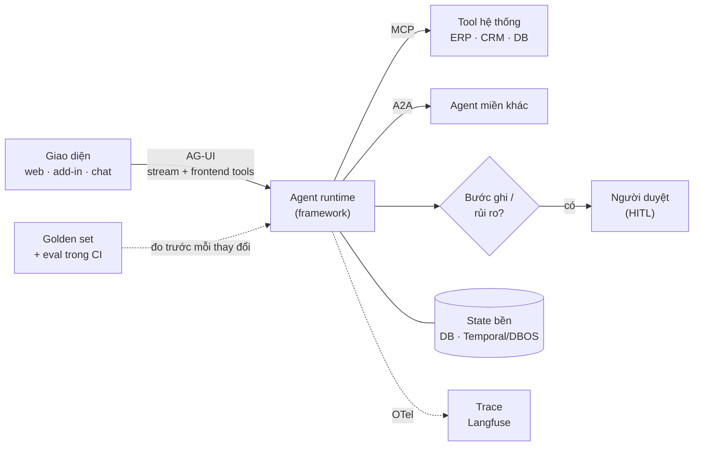

# Radar agent cho Nhóm 7 — framework, giao thức, quan sát, eval

| Thuộc tính | Chi tiết |
|---|---|
| Thuộc nhóm | [Nhóm 7 · AI Agent và tự động hóa quy trình](../02-skill-map/generated/nhom/g7-agent-tu-dong-hoa.md) |
| Loại tài liệu | **Tài liệu sống** — số liệu cập nhật tự động hằng tháng, nội dung review hằng quý (mục 6) |
| Review gần nhất | 2026-10-14 |
| Bảng so sánh đầy đủ | [generated/bang-so-sanh.md](generated/bang-so-sanh.md) — radar, 8 tiêu chí × 19 framework, số liệu registry, cờ cần xem lại |
| Dữ liệu | [`catalog/agent_landscape.yaml`](../../catalog/agent_landscape.yaml) (người duyệt) · [`catalog/agent_landscape.snapshot.json`](../../catalog/agent_landscape.snapshot.json) (máy kéo) |

Câu hỏi tài liệu này trả lời: **xây agent cho một quy trình doanh nghiệp cụ thể thì chọn framework và công cụ nào, vì
sao, và làm sao biết lựa chọn còn đúng theo thời gian.** "Tốt nhất" luôn gắn với bài toán: độ chính xác của vòng lặp gọi
tool phụ thuộc chủ yếu vào model, thiết kế tool và bộ eval; framework quyết định ta **kiểm soát và nhìn thấy** vòng lặp
đó đến đâu. Hiện **chưa có benchmark chuẩn so các framework** trên cùng tác vụ — các bảng xếp hạng năm 2026 phần lớn là ý
kiến; cách đáng tin là tự đo (mục 5).

## Mục lục

1. [Kết luận nhanh](#1-kết-luận-nhanh-102026)
2. [Tiêu chí đánh giá](#2-tiêu-chí-đánh-giá)
3. [Xu hướng 2026](#3-xu-hướng-2026)
4. [Kiến trúc tham chiếu cho agent Nhóm 7](#4-kiến-trúc-tham-chiếu-cho-agent-nhóm-7)
5. [Tự đo: framework nào tốt hơn cho dự án của mình](#5-tự-đo-framework-nào-tốt-hơn-cho-dự-án-của-mình)
6. [Cập nhật liên tục](#6-cập-nhật-liên-tục)
7. [Nguồn](#7-nguồn)

## 1. Kết luận nhanh (10/2026)

| Nhu cầu | Chọn | Vòng radar |
|---|---|---|
| Mặc định của repo: runtime đầy đủ, agent nối giao diện (add-in, web) qua AG-UI, dùng chung CMB-09/CMB-10 | **Agno + AgentOS** | Adopt |
| Luồng nhiều bước, nhiều nhánh, cần audit và người duyệt (đối soát, hồ sơ vay) | **LangGraph** (chỉ thư viện MIT) | Trial |
| Dịch vụ agent nhỏ, kiểu dữ liệu chặt, OTel sẵn | **Pydantic AI** | Trial |
| Tối ưu độ chính xác một bước LLM khi đã có golden set | **DSPy** (kèm framework khác) | Trial |
| Công ty chuẩn hóa Azure/.NET · Google Cloud · AWS | Microsoft Agent Framework · Google ADK · Strands Agents | Assess |
| Backend TypeScript / Next.js | Mastra · Vercel AI SDK | Assess |
| Agent nặng RAG, xử lý tài liệu | LlamaIndex · Haystack | Assess |
| Không chọn cho việc mới | AutoGen / Semantic Kernel (→ Microsoft Agent Framework), smolagents cho production, OpenAI Agents SDK khi cần AG-UI | Hold |

**Lớp chung, đúng với mọi framework:** tool qua **MCP** · giao diện qua **AG-UI** · trace phát **OpenTelemetry** gom về
**Langfuse** (MIT, tự host được) · eval bằng **golden set riêng** chạy như test (DeepEval hoặc Inspect AI) · bước ghi
luôn có người duyệt.

## 2. Tiêu chí đánh giá

| Cột | Câu hỏi | Vì sao quan trọng với Nhóm 7 |
|---|---|---|
| `routing` | Nhánh do code định nghĩa (graph) hay model chọn (llm)? | Điều hướng chính xác nhất khi phần xác định được để code quyết định |
| `hitl` | Run tạm dừng chờ người duyệt / nhập liệu được không? | Quyết định của Nhóm 7: "hoàn tất quy trình; người duyệt ở bước rủi ro" |
| `durable` | Resume sau lỗi, checkpoint lưu DB? | Quy trình dài (vài phút → vài ngày) không được chạy lại từ đầu |
| `otel` | Phát trace OpenTelemetry? | Debug production và đổi framework không mất lịch sử trace |
| `mcp` | Dùng MCP server làm tool? | Nối ERP/CRM/DB một lần, dùng cho mọi agent |
| `a2a` | Gọi agent khác qua A2A? | Agent miền gọi nhau qua ranh giới hệ thống |
| `agui` | Stream sự kiện + frontend tools qua AG-UI? | Agent làm việc ngay trong giao diện người dùng (CMB-10) |
| `eval` | Có công cụ eval đi kèm? | Đo được chất lượng trước khi đổi prompt, model, framework |

Ngoài 8 cột, bảng số liệu còn đo **giấy phép** (OSI hay không), **tốc độ đổi API** (số lần lên major trong 12 tháng),
**độ sống** (ngày phát hành gần nhất) và **sao GitHub** khi có token. Mỗi mục ghi **mức kiểm chứng**: `source` (đã đọc
mã nguồn), `docs` (tài liệu/registry chính thức), `secondary` (bài viết thứ cấp — cần kiểm lại).

## 3. Xu hướng 2026

| Xu hướng | Bằng chứng | Hệ quả khi chọn |
|---|---|---|
| **Hợp nhất framework của Microsoft** | AutoGen + Semantic Kernel → Microsoft Agent Framework 1.0 (04/2026); `autogen-agentchat` không phát hành từ 30/09/2025 (PyPI) | Việc mới trên hệ Microsoft dùng Agent Framework; AG2 là nhánh cộng đồng riêng, dễ nhầm tên |
| **Giao thức đã chín** | AG-UI 1.0 (09/2026), MCP Python SDK 2.x (06/2026), A2A SDK 1.x (03/2026) — PyPI | Đặt giao kèo ở giao thức (MCP cho tool, AG-UI cho UI) để framework thay được |
| **AG-UI gần như phổ cập** | Danh sách tích hợp AG-UI: LangGraph, CrewAI, Microsoft Agent Framework, Google ADK, Strands, Mastra, Pydantic AI, Agno, LlamaIndex, AG2, Claude Agent SDK, Google Antigravity…; **OpenAI Agents SDK vẫn "In Progress"** | Agent cần frontend tools: tránh framework chưa có AG-UI (bài học ADR-08 → ADR-09 ở CMB-10) |
| **Chuẩn trace còn đang định hình** | Quy ước OpenTelemetry GenAI (span `invoke_agent`, `execute_tool`) vẫn ở trạng thái Development (05/2026); 1.41 tách `invoke_agent` CLIENT/INTERNAL | Chọn backend nhận OTel thô (Langfuse, Phoenix); chấp nhận tên thuộc tính còn đổi |
| **API đổi rất nhanh** | Agno 2.0 (09/2025) → 3.0 (08/2026); Pydantic AI 1.0 (09/2025) → 2.0 (06/2026); Google ADK 2.0 (2026); Vercel AI SDK 2 lần lên major trong 12 tháng — PyPI/npm | Khóa phiên bản, test hồi quy giao kèo tool, nâng cấp có kế hoạch (cột Major/12 tháng) |
| **Đồ thị cho luồng chặt, model cho phần mơ hồ** | Hầu hết framework lớn đều có cả workflow do code định nghĩa (LangGraph, Agno Workflows, ADK workflow agents, CrewAI Flows, MAF workflows) lẫn điều hướng bằng model | Không chọn framework "chỉ có model tự điều phối" cho quy trình có quy định |
| **Agent tự học skill, bộ nhớ dài hạn** | Hermes Agent (Nous Research, MIT) tăng trưởng nhanh năm 2026; Mem0, Letta cho bộ nhớ | Theo dõi; chưa dùng cho quy trình doanh nghiệp cần kiểm soát |
| **SDK của nhà cung cấp model tiếp tục ra mới** | Google Antigravity SDK 0.1.x (có AG-UI), Claude Agent SDK, OpenAI Agents SDK | Tiện khi gắn một model; đổi lại bị khóa nhà cung cấp |

## 4. Kiến trúc tham chiếu cho agent Nhóm 7

Không phụ thuộc framework — framework chỉ là hộp "Agent runtime":

Nguyên tắc chọn và thiết kế:

1. **Code điều hướng phần xác định được** (đồ thị, state machine); model chỉ quyết định chỗ thật sự mơ hồ, và trả lời
   bằng **output có cấu trúc** (enum nhánh + lý do) thay vì tự do chuyển giao.
2. **Ít tool mỗi bước**, mô tả rõ, tham số chặt; code tìm và tính, model chọn tham số.
3. **Cổng ghi đặt ở nơi ghi** (client hoặc service), có xem trước + xác nhận + kiểm lại dữ liệu ngay trước khi ghi.
4. **Trace mọi bước** (model, tool, quyết định điều hướng) theo OTel; không ghi nội dung nhạy cảm vào trace mặc định.
5. **Eval trước khi đổi**: đổi prompt, model hay framework đều chạy lại golden set.

## 5. Tự đo: framework nào tốt hơn cho dự án của mình

Phép thử A/B nhỏ (2–3 ngày), làm khi đứng trước lựa chọn thật:

| Bước | Nội dung |
|---|---|
| 1 | Cố định **cùng bộ tool** (MCP hoặc hàm Python) và **cùng model** |
| 2 | Golden set 20–30 tác vụ có đáp án: đúng tool, đúng tham số, đúng kết quả cuối; gồm ca bẫy nghiệp vụ và ca mơ hồ |
| 3 | Dựng agent trên 2–3 framework ứng viên |
| 4 | Đo: **tỷ lệ tác vụ đúng hoàn toàn**, độ chính xác chọn tool/tham số, số bước, token, p50/p95 độ trễ, độ rõ của trace khi debug ca sai, số dòng code |
| 5 | Ghi kết quả vào ADR của dự án; cập nhật vòng radar ở đây nếu kết quả khác nhận định chung |

Trong repo: CMB-09 đã thiết kế `evals.yaml` + `scripts/eval.py` (so **kết quả** truy vấn, có/không skill, hai runtime);
CMB-10 có kế hoạch `golden-v0` 30 tác vụ Excel — cả hai chưa chạy.

## 6. Cập nhật liên tục

| Nhịp | Ai / cái gì | Việc |
|---|---|---|
| **Hằng tháng** (ngày 1) | Workflow [`agent-landscape.yml`](../../.github/workflows/agent-landscape.yml) | `make landscape-refresh` với `GITHUB_TOKEN` (thêm sao, trạng thái archive) → mở PR `bot/agent-landscape-YYYY-MM` nếu số liệu đổi |
| **Mỗi PR số liệu** | Người duyệt | Xem cột **Cờ**: ⚠ lâu không phát hành · 🔄 lên major sau lần review · 📦 repo archive · 🕑 quá 180 ngày chưa review → sửa YAML (`ring`, `features`, `verified`, `reviewed`) → `make landscape` |
| **Hằng quý** | Người duyệt | Rà toàn bộ; tìm framework mới từ danh sách tích hợp AG-UI, release notes, OTel semconv; ghi một dòng vào [HISTORY](../../HISTORY.md) |
| **Khi có dự án** | Nhóm dự án | Chạy phép thử mục 5, cập nhật `used_in` và vòng radar theo kết quả đo |

Chạy tay: `make landscape-refresh` (cần mạng: PyPI, npm; GitHub khi có `GITHUB_TOKEN`) hoặc `make landscape` (chỉ sinh lại
bảng từ YAML + snapshot). Test `tests/test_landscape.py` báo lỗi nếu bảng sinh ra đã cũ.

**Quy tắc vòng radar:**

- **Adopt** — đang dùng trong dự án của repo và đã có eval/test chứng minh.
- **Trial** — hợp một loại bài toán của Nhóm 7, đáng thử ở dự án kế tiếp phù hợp.
- **Assess** — đáng theo dõi hoặc chỉ hợp một hệ sinh thái cụ thể; thử nhỏ trước khi dùng.
- **Hold** — không chọn cho việc mới: đã có bản kế nhiệm, không phát hành > 12 tháng, hoặc thiếu tính năng bắt buộc của
  repo (ví dụ AG-UI cho agent nối giao diện).

**Thêm mục mới khi:** có bản phát hành trong 6 tháng, giấy phép rõ ràng, và ít nhất một tiêu chí ở mục 2 liên quan tới
Nhóm 7. Mục mới bắt đầu ở `assess`, `verified: secondary` cho tới khi có người đọc tài liệu/mã nguồn.

## 7. Nguồn

- Số liệu phiên bản, ngày phát hành, giấy phép: PyPI JSON API, npm registry (kéo ngày 2026-10-14, xem snapshot).
- [AG-UI — danh sách tích hợp](https://github.com/ag-ui-protocol/ag-ui) (đọc ngày 2026-10-14).
- [OpenTelemetry — GenAI agent spans](https://opentelemetry.io/docs/specs/semconv/gen-ai/gen-ai-agent-spans) ·
  [Greptime — tình trạng GenAI semantic conventions 05/2026](https://greptime.com/blogs/2026-05-09-opentelemetry-genai-semantic-conventions).
- Đọc mã nguồn khi viết ADR-07/ADR-09 (Agno 3.1.3, Pydantic AI, Microsoft Agent Framework AG-UI, LangGraph AG-UI, OpenAI
  Agents SDK 0.23.1): [tài liệu 05 của CMB-10](../../projects/cmb-10-excel-agent-addin/docs/05-adr-runtime-agent.md).
- Bài so sánh thứ cấp năm 2026 (chỉ tham khảo, nhiều bài là xếp hạng ý kiến; chỉ xem qua kết quả tìm kiếm, chưa đọc
  toàn văn — môi trường làm bản này không truy cập được các trang đó):
  [Morph](https://www.morphllm.com/ai-agent-framework) · [Firecrawl](https://www.firecrawl.dev/blog/best-open-source-agent-frameworks) ·
  [JetBrains](https://blog.jetbrains.com/pycharm/2026/06/top-agentic-frameworks-for-building-applications-2026/) ·
  [Microsoft Agent Framework tại Build 2026](https://devblogs.microsoft.com/agent-framework/microsoft-agent-framework-at-build-2026-announce/).
