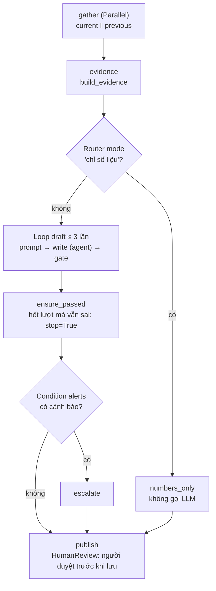

# Lab 01d — MCP, Team và Workflow (Phần 9–11)

Thuộc [Lab 01 — Agno và AgentOS](../guide_01_agno.md). Cần xong [Bước 0 — nâng MCP lên 2.x](../guide_01_agno.md#32-bước-0--nâng-mcp-lên-2x) và [Lab 01c](01c-tool-hitl-guardrail.md).

Ba phần này trả lời câu hỏi "**ai quyết định bước tiếp theo?**":

| | Ai quyết định bước tiếp theo | Ví dụ trong lab | Hợp khi |
| --- | --- | --- | --- |
| Agent + MCP tool (Phần 9) | Model chọn tool, kể cả tool ở process khác | `mcp-native` tự gọi `get_metrics` | Dữ liệu/công cụ nằm ở dịch vụ khác, dùng chung cho nhiều agent |
| Team (Phần 10) | Model của trưởng nhóm chọn thành viên | Trưởng nhóm giao việc cho `kpi-analyst` rồi `narrative-writer` | Nhiều chuyên môn, không biết trước cần ai |
| Workflow (Phần 11) | **Code** của bạn | thu số liệu → viết → cổng kiểm tra → duyệt → lưu | Quy trình đã biết, cần lặp lại được, có điểm duyệt |

---

## Phần 9 — MCP: agent tự gọi tool ở process khác

**Học xong phần này bạn:** nối agent với MCP server qua stdio và HTTP, chọn giữa tự bọc client và `MCPTools`, và xử lý lỗi của MCP 2.x.

### 9.1 Từ Lab 00 đến Phần 9

Lab 00 dựng MCP server (`mcp_db_server.py`) và client (`mcp_client.py`), trong đó **code** gọi MCP trước rồi mới đưa số liệu cho model (`agno_cli.py` làm đúng như vậy). Phần 9 để **model** quyết định khi nào gọi MCP. Đó là bài tập A của Lab 01 bản cũ.

```text
Agent (process của bạn) ──MCP (stdio: subprocess / streamable-http: URL)──► mcp_db_server.py
   model thấy tool get_metrics                                               └─ read_metrics() → SQLite
```

### 9.2 Hai cách

| | A — Tự bọc client trong function tool | B — `MCPTools` |
| --- | --- | --- |
| Model thấy | Tool bạn viết (`fetch_quarter_metrics`), schema từ docstring của bạn | Tool **của server** (`get_metrics`), schema lấy từ server |
| Server thêm tool mới | Phải viết thêm hàm bọc | Agent thấy ngay, không sửa code agent |
| Kết nối | Mở/đóng trong mỗi lần gọi tool | `async with tools:` mở một lần cho cả run |
| Kiểm soát kết quả | Hoàn toàn: gom, lọc, đổi định dạng trước khi model đọc | Kết quả của server đi thẳng tới model |
| Phụ thuộc | Chỉ SDK `mcp` | `agno[mcp]`: **mcp ≥ 2.1** với Agno 3.1.3 |

Cách B thường là lựa chọn mặc định. Cách A hợp khi bạn cần kiểm soát chặt (chỉ cho đọc một phần, thêm cache, đổi format) hoặc khi chưa nâng được SDK.

### 9.3 Hành vi của MCP 2.x cần biết (đã đo)

- Tool trả `list[dict]` thì client nhận **mỗi phần tử một `TextContent`** (3 phòng ban = 3 block JSON), không phải một mảng. Cách A gom lại thành một mảng; với cách B, model nhận các object JSON nối nhau bằng xuống dòng.
- Exception lạ trong tool bị server giấu thành `Error executing tool get_metrics`, model không biết sai ở đâu. Lỗi đã lường trước phải `raise ToolError("...")` (xem `mcp_db_server.py` ở Bước 0); khi đó `result.is_error` là `True` và nội dung lỗi đến được model.
- `include_tools=["get_metrics"]` giới hạn tool model được thấy. Nên luôn đặt: server có thể thêm tool ghi/xoá mà agent này không được phép dùng.
- Với stdio, `async with tools:` **khởi động một subprocess server** và tắt nó khi ra khỏi khối. Trong server thật (AgentOS), mở kết nối một lần lúc khởi động thay vì mỗi request.

### 9.4 Code

**File: `agno_lab/p09_mcp.py`**

```python
"""Phần 9 — MCP: agent tự chọn tool nằm ở MCP server (một process khác), qua stdio hoặc HTTP.

uv run python -m agno_lab.p09_mcp wrapper "Doanh thu các khối 2026-Q2?"
uv run python -m agno_lab.p09_mcp stdio   "Doanh thu các khối 2026-Q2?"
uv run python mcp_db_server.py --http 8811          # terminal khác
uv run python -m agno_lab.p09_mcp http    "Doanh thu các khối 2026-Q2?"
"""

from __future__ import annotations

import asyncio
import json
import sys

from agno.agent import Agent, RunOutput
from agno.tools.mcp import MCPTools
from mcp import ClientSession, StdioServerParameters
from mcp.client.stdio import stdio_client

from agno_lab.settings import ROOT, model

SERVER = StdioServerParameters(command=sys.executable, args=[str(ROOT / "mcp_db_server.py")])
INSTRUCTIONS = ["Lấy số liệu bằng tool MCP get_metrics; không tự đoán số.", "Trả lời ngắn bằng tiếng Việt."]


# Cách A — tự bọc client MCP trong một function tool (client của Lab 00 §7). Ta kiểm soát hoàn toàn lúc mở/đóng
# kết nối, nhưng phải tự viết schema tool (qua docstring) cho từng tool của server. `is_error` là tên của mcp 2.x.
async def fetch_quarter_metrics(quarter: str) -> str:
    """Đọc số liệu thô (doanh thu, chi phí, số dự án) của mọi phòng ban trong một quý YYYY-Q1..Q4 qua MCP."""
    async with stdio_client(SERVER) as (read, write), ClientSession(read, write) as session:
        await session.initialize()
        result = await session.call_tool("get_metrics", {"quarter": quarter})
    texts = [block.text for block in result.content if block.type == "text"]
    if result.is_error:
        return f"Lỗi MCP: {' '.join(texts)}"
    rows: list = []
    for text in texts:  # server trả list[dict] thành MỖI dòng một TextContent — gom lại thành một mảng JSON
        value = json.loads(text)
        rows.extend(value if isinstance(value, list) else [value])
    return json.dumps(rows, ensure_ascii=False)


def wrapper_agent() -> Agent:
    return Agent(id="mcp-wrapper", model=model(), tools=[fetch_quarter_metrics], instructions=INSTRUCTIONS)


# Cách B — MCPTools: Agno kết nối server, ĐỌC danh sách tool + schema từ server rồi đưa cho model.
# Server thêm tool mới thì agent thấy ngay, không sửa code agent. Cần mcp>=2.1 với agno 3.1.3.
def stdio_tools() -> MCPTools:
    return MCPTools(server_params=SERVER, include_tools=["get_metrics"], timeout_seconds=30)


def http_tools(url: str = "http://127.0.0.1:8811/mcp") -> MCPTools:
    return MCPTools(url=url, transport="streamable-http", timeout_seconds=30)


async def ask(question: str, tools: MCPTools) -> RunOutput:
    async with tools:  # mở kết nối (stdio: khởi động subprocess server) và đóng khi xong
        agent = Agent(id="mcp-native", model=model(), tools=[tools], instructions=INSTRUCTIONS)
        return await agent.arun(question)


if __name__ == "__main__":
    mode, question = sys.argv[1], sys.argv[2] if len(sys.argv) > 2 else "Doanh thu các khối 2026-Q2?"
    if mode == "wrapper":
        run = asyncio.run(wrapper_agent().arun(question))
    else:
        run = asyncio.run(ask(question, stdio_tools() if mode == "stdio" else http_tools()))
    print(run.content)
```

Đọc code:

- `StdioServerParameters(command=sys.executable, ...)`: dùng đúng Python đang chạy (trong venv) để khởi động server.
- `fetch_quarter_metrics` là hàm `async`, nên agent phải chạy bằng `arun`. Đã đo: gọi `run()` đồng bộ thì run kết thúc `ERROR` với thông báo `Async function ... can't be used with synchronous agent.run()... Use agent.arun()`.
- `ask(question, tools)` dùng chung cho stdio và HTTP: agent không biết, cũng không cần biết, transport là gì.

### 9.5 Chạy thử

```bash
uv run python -m agno_lab.p09_mcp wrapper "Doanh thu các khối 2026-Q2?"
uv run python -m agno_lab.p09_mcp stdio   "Doanh thu các khối 2026-Q2?"
uv run python mcp_db_server.py --http 8811          # terminal khác: server HTTP
uv run python -m agno_lab.p09_mcp http    "Doanh thu các khối 2026-Q2?"
```

Thử thêm với MCP Inspector (`npx @modelcontextprotocol/inspector`), kết nối tới `http://127.0.0.1:8811/mcp` để thấy danh sách tool và resource mà agent nhận.

### 9.6 Checkpoint

```bash
uv run pytest tests/test_p09_mcp.py -v      # 4 passed (test HTTP tự khởi động server ở cổng trống)
```

<details>
<summary>Test của Phần 9 — <code>tests/test_p09_mcp.py</code></summary>

**File: `tests/test_p09_mcp.py`**

```python
import asyncio
import json

import pytest

from agno_lab.p09_mcp import ask, http_tools, stdio_tools, wrapper_agent
from mock_llm import call, say
from servers import free_port, process_server


def tool_payload(run) -> list[dict]:
    """Wrapper trả một mảng JSON; MCPTools trả các JSON object nối nhau bằng xuống dòng (mỗi TextContent một object)."""
    (tool,) = run.tools
    text, rows, decoder, i = tool.result.strip(), [], json.JSONDecoder(), 0
    while i < len(text):
        value, i = decoder.raw_decode(text, i)
        rows.extend(value if isinstance(value, list) else [value])
        while i < len(text) and text[i].isspace():
            i += 1
    return rows


def test_wrapper_tool_calls_the_mcp_server(llm):
    llm.script(call("fetch_quarter_metrics", quarter="2026-Q2"), say("AI_LAB đạt 620.000 USD."))
    run = asyncio.run(wrapper_agent().arun("Doanh thu 2026-Q2?"))
    rows = tool_payload(run)
    assert {r["dept_code"]: r["revenue_usd"] for r in rows}["AI_LAB"] == 620000
    assert run.content == "AI_LAB đạt 620.000 USD."


def test_wrapper_reports_server_errors(llm):
    llm.script(call("fetch_quarter_metrics", quarter="Q2"), say("Quý sai định dạng."))
    run = asyncio.run(wrapper_agent().arun("Doanh thu Q2?"))
    assert run.tools[0].result.startswith("Lỗi MCP:") and "YYYY-Q1..Q4" in run.tools[0].result


def test_mcptools_stdio_discovers_tools_from_the_server(llm):
    llm.script(call("get_metrics", quarter="2026-Q2"), say("Đã đọc qua MCP."))
    run = asyncio.run(ask("Doanh thu 2026-Q2?", stdio_tools()))
    tools = {t["function"]["name"]: t["function"] for t in llm.requests[0]["tools"]}
    assert list(tools) == ["get_metrics"]  # schema lấy từ server, không viết trong code agent
    assert "không nhận SQL tự do" in tools["get_metrics"]["description"]
    assert {r["dept_code"] for r in tool_payload(run)} == {"AI_LAB", "CLOUD_OPS", "FIN_TECH"}


@pytest.fixture
def http_server():
    port = free_port()
    with process_server(["mcp_db_server.py", "--http", str(port)], port) as url:
        yield f"{url}/mcp"


def test_mcptools_streamable_http(llm, http_server):
    llm.script(call("get_metrics", quarter="2026-Q1"), say("Đã đọc qua MCP HTTP."))
    run = asyncio.run(ask("Doanh thu 2026-Q1?", http_tools(http_server)))
    assert {r["dept_code"]: r["cost_usd"] for r in tool_payload(run)}["CLOUD_OPS"] == 720000
```

</details>

Test HTTP dùng `process_server` trong `tests/servers.py` (xem [Phần 0](../guide_01_agno.md#36-hạ-tầng-test)): chạy server bằng tiến trình riêng như production, đợi cổng mở, tắt khi xong.

### 9.7 Bài tập

1. Thêm tool `list_quarters()` vào `mcp_db_server.py`. Chạy lại cách B **không sửa** `p09_mcp.py` (bỏ `include_tools`): agent có thấy tool mới không? Cách A thì sao?
2. Cho `get_metrics` raise `RuntimeError` thay vì `ToolError` với quý sai. Model nhận được gì? Vì sao đây là lý do phải dùng `ToolError`?
3. Đọc resource `schema://enterprise/metrics` trong cách A và đưa vào docstring/instructions. Có giúp model gọi đúng định dạng quý hơn không?

---

## Phần 10 — Team: nhiều agent, một trưởng nhóm

**Học xong phần này bạn:** dựng team với bốn chế độ phối hợp, biết trưởng nhóm "thấy" thành viên ra sao, và biết cái giá của team.

### 10.1 Cơ chế (đã đo)

Trưởng nhóm là một agent có model riêng. Agno thêm vào system prompt của nó danh sách thành viên và luật giao việc:

```text
<team_members>
<member id="kpi-analyst" name="KPI Analyst">
  Role: Lấy số liệu KPI và giải thích cảnh báo theo rule
</member>
<member id="narrative-writer" name="Narrative Writer">
  Role: Viết tóm tắt điều hành và hành động từ số liệu được giao
</member>
</team_members>

<delegation>
You work in coordinate mode: you hand sub-tasks to members with `delegate_task_to_member` and write the answer yourself.
- Match each sub-task to the member whose role and description fit it best...
- A member's output is evidence, not your answer...
```

- Trưởng nhóm có tool `delegate_task_to_member(member_id, task)`. `member_id` là `id` của agent thành viên.
- **Thành viên chỉ nhận đúng chuỗi `task`** làm tin nhắn user (cùng system prompt của chính nó), **không** nhận câu hỏi gốc của người dùng. Trưởng nhóm phải viết `task` đủ ngữ cảnh: quý nào, số liệu nào đã có.
- Câu trả lời của thành viên quay về trưởng nhóm dưới dạng kết quả tool. Với `store_member_responses=True`, nó nằm trong `run.member_responses`.
- `role` của thành viên là thứ trưởng nhóm đọc để chọn người (dòng `Role:`). Thành viên ở xa ở Phần 14 không có `role`; Agno hiện dòng `Description:` lấy từ Agent Card của nó.

### 10.2 Bốn chế độ

| `mode` | Trưởng nhóm làm gì | Số lượt gọi model của trưởng nhóm (đã đo) | Hợp khi |
| --- | --- | --- | --- |
| `coordinate` | Giao một hay nhiều việc, rồi tự viết câu trả lời cuối | 3 cho 2 lần giao (giao, giao, tổng hợp) | Cần ghép kết quả nhiều chuyên môn |
| `route` | Giao **một** thành viên, trả **nguyên văn** câu trả lời của thành viên | 1 | Phân loại câu hỏi rồi chuyển đúng người |
| `broadcast` | `delegate_task_to_members(task)`: cùng một việc cho **mọi** thành viên, rồi tổng hợp | 2 | Cần nhiều góc nhìn cho cùng một câu hỏi |
| `tasks` | Trưởng nhóm tự lập danh sách việc và giao dần | — (lab này không đo) | Việc dài nhiều bước; đọc tài liệu Agno trước khi dùng |

Chi phí: mỗi lần giao là ít nhất một lượt gọi model của thành viên (nhiều hơn nếu thành viên gọi tool) cộng lượt của trưởng nhóm. Team 2 thành viên ở chế độ `coordinate` dễ tốn 5–7 lượt gọi model cho một câu hỏi.

### 10.3 Code

**File: `agno_lab/p10_team.py`**

```python
"""Phần 10 — Team: nhiều agent chuyên trách, một trưởng nhóm điều phối theo 4 chế độ.

uv run python -m agno_lab.p10_team coordinate "Lập báo cáo KPI 2026-Q2"
uv run python -m agno_lab.p10_team route      "Ngưỡng của KPI_02 là bao nhiêu?"
uv run python -m agno_lab.p10_team broadcast  "Đánh giá rủi ro quý 2026-Q2"
"""

from __future__ import annotations

import sys

from agno.agent import Agent
from agno.team import Team

from agno_lab.p01_agent import KpiTools, inspect_rules
from agno_lab.settings import db, model

LEAD = "Bạn là trưởng nhóm báo cáo KPI."  # chuỗi đầu instructions — test dùng để nhận ra lượt gọi của từng agent
ANALYST = "Bạn là chuyên viên phân tích KPI."
WRITER = "Bạn là người viết báo cáo điều hành."
RISK = "Bạn là chuyên viên rủi ro."


def analyst() -> Agent:
    return Agent(
        id="kpi-analyst",
        name="KPI Analyst",
        role="Lấy số liệu KPI và giải thích cảnh báo theo rule",  # trưởng nhóm đọc role để chọn người
        model=model(),
        tools=[KpiTools(), inspect_rules],
        instructions=[ANALYST, "Chỉ trả số liệu và cảnh báo lấy từ tool, kèm rule_id."],
    )


def writer() -> Agent:
    return Agent(
        id="narrative-writer",
        name="Narrative Writer",
        role="Viết tóm tắt điều hành và hành động từ số liệu được giao",
        model=model(),
        instructions=[WRITER, "Không tự thêm số liệu ngoài phần được giao."],
    )


def risk_reviewer() -> Agent:
    return Agent(
        id="risk-reviewer",
        name="Risk Reviewer",
        role="Đánh giá rủi ro tài chính từ KPI",
        model=model(),
        tools=[KpiTools()],
        instructions=[RISK, "Nêu tối đa 2 rủi ro, mỗi rủi ro một câu."],
    )


def build_team(mode: str = "coordinate") -> Team:
    members = [analyst(), writer()] if mode != "broadcast" else [analyst(), risk_reviewer()]
    return Team(
        id=f"report-team-{mode}",
        name="Report Team",
        mode=mode,  # coordinate | route | broadcast | tasks
        model=model(),  # model của trưởng nhóm
        members=members,
        db=db(),
        add_history_to_context=True,
        store_member_responses=True,  # lưu câu trả lời của thành viên vào run → xem lại được
        instructions=[
            LEAD,
            "Giao việc lấy số liệu cho kpi-analyst; giao việc viết cho narrative-writer kèm số liệu đã có.",
            "Câu trả lời cuối bằng tiếng Việt, không thêm số liệu ngoài kết quả của thành viên.",
        ],
    )


if __name__ == "__main__":
    mode, question = sys.argv[1], sys.argv[2]
    run = build_team(mode).run(question, session_id=f"team-{mode}")
    for member in run.member_responses or []:
        print(f"--- {getattr(member, 'agent_id', '?')}: {member.content}")
    print("=== trả lời:", run.content)
```

Đọc code:

- `LEAD`, `ANALYST`, `WRITER`, `RISK` là câu đầu instructions của từng agent. Test dùng chúng để `mock_llm` biết request nào của ai (kênh `match=`). Với model thật, chúng chỉ là instructions bình thường.
- `build_team("broadcast")` đổi thành viên: phân tích + rủi ro, vì phát cùng một việc cho người viết narrative thì vô ích.
- `add_history_to_context=True` cho trưởng nhóm: lượt sau nhớ đã giao gì ở lượt trước trong cùng session.

### 10.4 Chạy thử

```bash
uv run python -m agno_lab.p10_team coordinate "Lập báo cáo KPI 2026-Q2"
uv run python -m agno_lab.p10_team route      "Ngưỡng của KPI_02 là bao nhiêu?"
uv run python -m agno_lab.p10_team broadcast  "Đánh giá rủi ro quý 2026-Q2"
```

Mỗi dòng `--- kpi-analyst: ...` là câu trả lời của một thành viên; dòng cuối là câu trả lời của team.

### 10.5 Checkpoint

```bash
uv run pytest tests/test_p10_team.py -v      # 3 passed
```

<details>
<summary>Test của Phần 10 — <code>tests/test_p10_team.py</code></summary>

**File: `tests/test_p10_team.py`**

```python
from agno_lab.p10_team import ANALYST, LEAD, RISK, WRITER, build_team
from mock_llm import call, calls, say


def test_coordinate_leader_delegates_then_synthesizes(llm):
    llm.script(
        call("delegate_task_to_member", member_id="kpi-analyst", task="Lấy KPI 2026-Q2 kèm rule_id"),
        call(
            "delegate_task_to_member",
            member_id="narrative-writer",
            task="Viết 2 ý tóm tắt: Cloud vàng, FinTech giải trình",
        ),
        say("Báo cáo: Cloud cảnh báo vàng (KPI_02), FinTech cần giải trình (KPI_03)."),
        match=LEAD,
    )
    llm.script(call("get_quarter_kpis", quarter="2026-Q2"), say("CLOUD_OPS: CẢNH BÁO VÀNG (KPI_02)."), match=ANALYST)
    llm.script(say("- Chi phí Cloud tăng 18%.\n- Doanh thu FinTech giảm."), match=WRITER)

    run = build_team("coordinate").run("Lập báo cáo KPI 2026-Q2", session_id="t1")
    assert [m.agent_id for m in run.member_responses] == ["kpi-analyst", "narrative-writer"]
    assert run.content.startswith("Báo cáo: Cloud cảnh báo vàng")
    leader_system = llm.requests_for(LEAD)[0]["messages"][0]["content"]
    assert "kpi-analyst" in leader_system and "Lấy số liệu KPI" in leader_system  # thành viên + role
    assert len(llm.requests_for(LEAD)) == 3  # giao, giao, tổng hợp


def test_route_returns_the_member_answer_directly(llm):
    llm.script(call("delegate_task_to_member", member_id="kpi-analyst", task="Ngưỡng KPI_02?"), match=LEAD)
    llm.script(call("inspect_rules"), say("KPI_02: chi phí tăng quá 10% là CẢNH BÁO VÀNG."), match=ANALYST)
    run = build_team("route").run("Ngưỡng của KPI_02 là bao nhiêu?", session_id="t2")
    assert run.content == "KPI_02: chi phí tăng quá 10% là CẢNH BÁO VÀNG."
    assert len(llm.requests_for(LEAD)) == 1  # trưởng nhóm không gọi model thêm để tổng hợp


def test_broadcast_sends_the_same_task_to_every_member(llm):
    llm.script(
        calls(("delegate_task_to_members", {"task": "Đánh giá rủi ro 2026-Q2"})),
        say("Tổng hợp 2 góc nhìn."),
        match=LEAD,
    )
    llm.script(call("get_quarter_kpis", quarter="2026-Q2"), say("Góc số liệu: Cloud vàng."), match=ANALYST)
    llm.script(
        call("get_quarter_kpis", quarter="2026-Q2"), say("Rủi ro: chi phí Cloud, doanh thu FinTech."), match=RISK
    )
    run = build_team("broadcast").run("Đánh giá rủi ro quý 2026-Q2", session_id="t3")
    assert sorted(m.agent_id for m in run.member_responses) == ["kpi-analyst", "risk-reviewer"]
    assert run.content == "Tổng hợp 2 góc nhìn."
```

</details>

### 10.6 Bài tập

1. Xoá `role` của `writer()`. Trưởng nhóm còn giao việc viết đúng người không (với model thật)? Đọc `<team_members>` trong request.
2. Viết test: ở chế độ `coordinate`, trưởng nhóm giao việc cho `kpi-analyst` với `task` thiếu quý. Thành viên làm gì? Sửa instructions của trưởng nhóm để `task` luôn có quý.
3. So chi phí: cùng câu "Lập báo cáo KPI 2026-Q2" bằng agent Phần 2 và bằng team `coordinate`. Đếm `metrics.total_tokens`.

---

## Phần 11 — Workflow: luồng do code quyết định

**Học xong phần này bạn:** dựng quy trình nhiều bước có chạy song song, rẽ nhánh, vòng sửa có giới hạn, người duyệt, và biết khi nào chọn workflow thay vì agent hay team.

### 11.1 Khi nào chọn workflow

Phần lớn "agent" trong doanh nghiệp thật ra là **quy trình đã biết** với một vài bước cần ngôn ngữ. Báo cáo KPI là ví dụ: luôn là lấy số liệu → tính → viết nhận xét → kiểm tra → duyệt → lưu. Để model tự quyết thứ tự các bước này là trao cho nó quyền bỏ qua bước kiểm tra. Workflow đặt thứ tự bằng code; agent chỉ làm bước **viết**.

### 11.2 Workflow của Phần 11



### 11.3 Các khối dựng

| Khối | Dùng ở đây | Cơ chế (đã đo) |
| --- | --- | --- |
| `Step(executor=fn)` | `fetch_current`, `gate`, `publish`... | Hàm nhận `step_input` (và `run_context` nếu khai báo), trả `StepOutput` |
| `Step(agent=...)` | `write` | Agent nhận **nội dung của bước liền trước** làm tin nhắn: vì vậy có bước `prompt` dựng tin nhắn ngay trước `write` |
| `Parallel(a, b)` | `gather` | Chạy song song; bước sau đọc từng kết quả bằng `step_input.get_step_content("current")` |
| `Loop(steps, end_condition, max_iterations)` | `draft` | `end_condition` nhận list `StepOutput` của lượt vừa chạy; trả `True` thì dừng |
| `Router(selector, choices)` | `mode` | `selector(step_input)` trả `Step`/`Steps` sẽ chạy |
| `Condition(evaluator, steps)` | `alerts` | `evaluator(step_input)` trả `False` thì bỏ qua các bước bên trong |
| `HumanReview(requires_confirmation=True)` | `publish` | Workflow **dừng trước** bước này; `reject` thì bỏ qua bước và workflow vẫn `COMPLETED` |
| `StepOutput(stop=True, success=False)` | `ensure_passed` | Dừng cả workflow ngay tại đó |

Dữ liệu đi giữa các bước theo hai đường:

- **Nội dung bước** (`StepOutput.content`): `previous_step_content`, `get_step_content("tên bước")`.
- **`run_context.session_state`**: dict chung cho mọi bước, lưu theo `session_id` sau khi chạy. Lần chạy sau trong cùng session đọc được `report` của lần trước, nên v2 được viết dựa trên v1 (test `test_second_run_in_same_session_makes_v2_from_v1`).

`input_schema=ReportRequest` validate input của cả workflow như Phần 2. Qua REST (Phần 12) bạn gửi JSON của `ReportRequest` làm message.

### 11.4 Cổng kiểm tra và vòng sửa có giới hạn

`gate` là **code**, không phải LLM: output phải đúng schema `Narrative`, tóm tắt phải nhắc mọi phòng ban bị cảnh báo. Không đạt thì `feedback` được ghi vào state, lượt sau `make_writer_prompt` thêm "Sửa theo nhận xét của lần trước: ...". Tối đa `MAX_DRAFTS = 3` lần. Hết lượt vẫn sai thì `ensure_passed` **dừng workflow**: không lặng lẽ lưu một báo cáo sai, đúng lỗi Lab 00 §1 đã chỉ ra.

Đây là harness kiểu "generator + verifier": model sinh, code kiểm, phản hồi có cấu trúc quay lại model. Thay `check_narrative` bằng kiểm tra chặt hơn (bài tập 1 Phần 8) là cách tăng chất lượng rẻ nhất.

### 11.5 Code

**File: `agno_lab/p11_workflow.py`**

```python
"""Phần 11 — Workflow: luồng do CODE định nghĩa; agent chỉ làm bước cần ngôn ngữ.

gather (Parallel: quý này ‖ quý trước) → evidence → Router(mode)
    ├─ numbers_only: narrative cố định, không gọi LLM
    └─ full: Loop[prompt → write (agent) → gate] ≤ 3 lần → ensure_passed → Condition(có cảnh báo → escalate)
→ publish (HumanReview: người duyệt trước khi lưu)

uv run python -m agno_lab.p11_workflow report-01 2026-Q2 "Lập báo cáo, nêu rủi ro"
"""

from __future__ import annotations

import sys

from agno.agent import Agent
from agno.run import RunContext
from agno.workflow import Condition, HumanReview, Loop, Parallel, Router, Step, StepInput, StepOutput, Steps, Workflow

from agno_lab.p01_agent import previous_quarter
from agno_lab.p02_structured import ReportRequest
from agno_lab.settings import db, model
from reporting import Narrative, make_evidence, make_prompt, render_report, save_local_report
from service import read_metrics

WRITER = "Bạn viết narrative cho báo cáo KPI."
MAX_DRAFTS = 3


def request_of(step_input: StepInput) -> ReportRequest:
    value = step_input.input
    return value if isinstance(value, ReportRequest) else ReportRequest.model_validate(value)


# ---------------------------------------------------------------- bước hàm thuần (không LLM)
def fetch_current(step_input: StepInput) -> StepOutput:
    return StepOutput(content=read_metrics(request_of(step_input).quarter))


def fetch_previous(step_input: StepInput) -> StepOutput:
    return StepOutput(content=read_metrics(previous_quarter(request_of(step_input).quarter)))


def build_evidence(step_input: StepInput, run_context: RunContext) -> StepOutput:
    """run_context.session_state dùng chung cho mọi bước và được lưu theo session_id sau khi chạy."""
    evidence = make_evidence(step_input.get_step_content("current"), step_input.get_step_content("previous"))
    state = run_context.session_state
    state.update(evidence=evidence, attempt=0, feedback="", narrative=None, extra_actions=[])
    alerts = [row["dept_code"] for row in evidence["kpis"] if row["alert"] != "ĐẠT"]
    return StepOutput(content={"departments": len(evidence["kpis"]), "alerts": alerts})


def make_writer_prompt(step_input: StepInput, run_context: RunContext) -> StepOutput:
    state = run_context.session_state
    instruction = request_of(step_input).instruction
    if state["feedback"]:
        instruction += f"\nSửa theo nhận xét của lần trước: {state['feedback']}"
    return StepOutput(content=make_prompt(state["evidence"], instruction, state.get("report", "")))


def check_narrative(narrative: object, evidence: dict) -> list[str]:
    """Cổng kiểm tra bằng code: đúng schema, và tóm tắt phải nhắc mọi phòng ban bị cảnh báo."""
    if not isinstance(narrative, Narrative):
        return ["Output không đúng schema Narrative"]
    summary = " ".join(narrative.executive_summary)
    return [
        f"Tóm tắt chưa nhắc {row['dept_code']} ({row['alert']})"
        for row in evidence["kpis"]
        if row["alert"] != "ĐẠT" and row["dept_code"] not in summary and row["dept_name"] not in summary
    ]


def gate(step_input: StepInput, run_context: RunContext) -> StepOutput:
    state = run_context.session_state
    state["attempt"] += 1
    problems = check_narrative(step_input.previous_step_content, state["evidence"])
    state["feedback"] = "; ".join(problems)
    if not problems:
        state["narrative"] = step_input.previous_step_content.model_dump()
    return StepOutput(content={"ok": not problems, "attempt": state["attempt"], "problems": problems})


def gate_passed(outputs: list[StepOutput]) -> bool:
    """end_condition của Loop: nhận output các bước trong lượt vừa chạy."""
    return bool(outputs) and isinstance(outputs[-1].content, dict) and outputs[-1].content["ok"]


def ensure_passed(step_input: StepInput, run_context: RunContext) -> StepOutput:
    """Hết số lần viết mà vẫn sai thì DỪNG workflow, không lặng lẽ đi tiếp (lỗi đã chỉ ra ở Lab 00 §1)."""
    if run_context.session_state.get("narrative") is None:
        return StepOutput(content=f"Narrative không qua cổng sau {MAX_DRAFTS} lần", success=False, stop=True)
    return StepOutput(content="Narrative đạt")


def has_alerts(step_input: StepInput) -> bool:
    return bool(step_input.get_step_content("evidence")["alerts"])


def escalate(step_input: StepInput, run_context: RunContext) -> StepOutput:
    alerts = step_input.get_step_content("evidence")["alerts"]
    action = f"Họp xử lý cảnh báo với {', '.join(alerts)} trong tuần này"
    run_context.session_state["extra_actions"].append(action)
    return StepOutput(content=action)


def numbers_only(step_input: StepInput, run_context: RunContext) -> StepOutput:
    narrative = Narrative(executive_summary=["Báo cáo chỉ gồm số liệu."], actions=["Đọc bảng KPI."])
    run_context.session_state["narrative"] = narrative.model_dump()
    return StepOutput(content="Bỏ qua bước viết")


def publish(step_input: StepInput, run_context: RunContext) -> StepOutput:
    state = run_context.session_state
    narrative = Narrative.model_validate(state["narrative"])
    narrative.actions.extend(state["extra_actions"])
    state["revision"] = state.get("revision", 0) + 1
    report = render_report(state["evidence"], narrative, state["revision"])
    save_local_report(f"wf-{run_context.session_id}", state["revision"], report)
    state["report"] = report
    return StepOutput(content=report)


# ---------------------------------------------------------------- ráp workflow
def writer_agent() -> Agent:
    return Agent(
        id="workflow-writer",
        name="Workflow Writer",
        model=model(),
        output_schema=Narrative,
        instructions=[WRITER, "Chỉ dùng số trong evidence. Viết tiếng Việt."],
    )


def build_workflow() -> Workflow:
    # Dựng nhánh TRONG hàm: mỗi workflow có agent riêng, và không cần MODEL_ID lúc import module.
    numbers_branch = Step(name="numbers_only", executor=numbers_only)
    full_branch = Steps(
        name="full",
        steps=[
            Loop(
                name="draft",
                steps=[
                    Step(name="prompt", executor=make_writer_prompt),
                    Step(name="write", agent=writer_agent()),
                    Step(name="gate", executor=gate),
                ],
                end_condition=gate_passed,
                max_iterations=MAX_DRAFTS,
            ),
            Step(name="ensure_passed", executor=ensure_passed),
            Condition(name="alerts", evaluator=has_alerts, steps=[Step(name="escalate", executor=escalate)]),
        ],
    )

    def pick_branch(step_input: StepInput) -> Step | Steps:
        """Router: hàm chọn nhánh chạy tiếp (có thể trả nhiều nhánh)."""
        return numbers_branch if "chỉ số liệu" in request_of(step_input).instruction.lower() else full_branch

    return Workflow(
        id="report-workflow",
        name="Report Workflow",
        db=db(),
        input_schema=ReportRequest,
        session_state={"revision": 0},
        steps=[
            Parallel(
                Step(name="current", executor=fetch_current),
                Step(name="previous", executor=fetch_previous),
                name="gather",
            ),
            Step(name="evidence", executor=build_evidence),
            Router(name="mode", selector=pick_branch, choices=[numbers_branch, full_branch]),
            Step(
                name="publish",
                executor=publish,
                human_review=HumanReview(requires_confirmation=True, confirmation_message="Lưu báo cáo này?"),
            ),
        ],
    )


if __name__ == "__main__":
    session_id, quarter, instruction = sys.argv[1:4]
    workflow = build_workflow()
    run = workflow.run(input=ReportRequest(quarter=quarter, instruction=instruction), session_id=session_id)
    while run.is_paused:
        for requirement in run.active_step_requirements:
            answer = input(f"{requirement.confirmation_message} [y/N] ")
            requirement.confirm() if answer.lower() == "y" else requirement.reject("Người duyệt từ chối")
        run = workflow.continue_run(run_response=run)
    print(run.status.value)
    print(run.content)
```

Đọc code:

- Nhánh `numbers_branch`, `full_branch` được dựng **trong** `build_workflow()`: mỗi workflow có agent riêng, và import module không cần `MODEL_ID` (lỗi gặp khi dựng ở mức module).
- `pick_branch` là closure nhìn thấy hai nhánh; `Router` cần cả `choices` để biết các nhánh có thể chạy.
- `publish` tăng `revision`, render bằng `render_report` và lưu `storage/wf-<session_id>/v<N>.md` qua `save_local_report` của Lab 00.
- `__main__` chạy vòng duyệt ở terminal: `active_step_requirements` → `confirm()`/`reject()` → `continue_run`.

### 11.6 Chạy thử

```bash
uv run python -m agno_lab.p11_workflow report-01 2026-Q2 "Lập báo cáo, nêu rủi ro"
uv run python -m agno_lab.p11_workflow report-01 2026-Q2 "Rút gọn còn 3 ý"        # v2 dựa trên v1
uv run python -m agno_lab.p11_workflow report-02 2026-Q2 "Chỉ số liệu thôi"       # nhánh không gọi LLM
```

Mỗi lần chạy terminal hỏi `Lưu báo cáo này? [y/N]`. Kiểm tra `storage/wf-report-01/v1.md`, `v2.md`.

### 11.7 Checkpoint

```bash
uv run pytest tests/test_p11_workflow.py -v      # 6 passed
```

<details>
<summary>Test của Phần 11 — <code>tests/test_p11_workflow.py</code></summary>

**File: `tests/test_p11_workflow.py`**

```python
import json

import pytest

from agno_lab.p02_structured import ReportRequest
from agno_lab.p11_workflow import WRITER, build_workflow
from mock_llm import answer_json
from settings_paths import clean_storage, storage_file

GOOD = {
    "executive_summary": ["CLOUD_OPS chi phí tăng 18%.", "FIN_TECH doanh thu giảm 12,5%."],
    "actions": ["Rà soát chi phí."],
}
MISSES_FINTECH = {"executive_summary": ["CLOUD_OPS chi phí tăng."], "actions": ["x"]}
REQUEST = ReportRequest(quarter="2026-Q2", instruction="Lập báo cáo, nêu rủi ro")


@pytest.fixture(autouse=True)
def _clean():
    for session in ("w1", "w2", "w3", "w4", "w5", "w6"):
        clean_storage(f"wf-{session}")


def approve_all(workflow, run):
    while run.is_paused:
        for requirement in run.active_step_requirements:
            requirement.confirm()
        run = workflow.continue_run(run_response=run)
    return run


def writer_prompts(llm) -> list[str]:
    return [json.dumps(r["messages"], ensure_ascii=False) for r in llm.requests_for(WRITER)]


def test_full_branch_retries_with_feedback_then_waits_for_review(llm):
    llm.script(answer_json(MISSES_FINTECH), answer_json(GOOD), match=WRITER)
    workflow = build_workflow()
    run = workflow.run(input=REQUEST, session_id="w1")
    assert run.is_paused and run.paused_step_name == "publish"
    assert not storage_file("wf-w1", "v1.md").exists()  # chưa duyệt thì chưa lưu

    prompts = writer_prompts(llm)
    assert len(prompts) == 2 and "Tóm tắt chưa nhắc FIN_TECH" in prompts[1]  # lần 2 nhận nhận xét của cổng
    final = approve_all(workflow, run)
    assert final.status.value == "COMPLETED"
    report = storage_file("wf-w1", "v1.md").read_text(encoding="utf-8")
    assert "| KPI_02 | CẢNH BÁO VÀNG |" in report and "Họp xử lý cảnh báo với CLOUD_OPS, FIN_TECH" in report
    state = workflow.get_session_state(session_id="w1")
    assert state["revision"] == 1 and state["attempt"] == 2


def test_exhausted_drafts_stop_the_workflow(llm):
    llm.script(*[answer_json(MISSES_FINTECH)] * 3, match=WRITER)
    workflow = build_workflow()
    run = workflow.run(input=REQUEST, session_id="w2")
    assert not run.is_paused and len(writer_prompts(llm)) == 3
    assert "không qua cổng sau 3 lần" in str(run.content)
    assert not storage_file("wf-w2", "v1.md").exists()
    assert workflow.get_session_state(session_id="w2")["revision"] == 0


def test_router_numbers_only_skips_the_llm(llm):
    workflow = build_workflow()
    run = workflow.run(input=ReportRequest(quarter="2026-Q2", instruction="Chỉ số liệu thôi"), session_id="w3")
    final = approve_all(workflow, run)
    assert llm.requests == []  # không gọi model lần nào
    assert "Báo cáo chỉ gồm số liệu." in storage_file("wf-w3", "v1.md").read_text(encoding="utf-8")
    assert final.status.value == "COMPLETED"


def test_rejected_review_skips_publishing(llm):
    llm.script(answer_json(GOOD), match=WRITER)
    workflow = build_workflow()
    run = workflow.run(input=REQUEST, session_id="w4")
    for requirement in run.active_step_requirements:
        requirement.reject("Chưa đủ ý")
    final = workflow.continue_run(run_response=run)
    assert final.status.value == "COMPLETED" and not storage_file("wf-w4", "v1.md").exists()
    assert workflow.get_session_state(session_id="w4")["revision"] == 0


def test_second_run_in_same_session_makes_v2_from_v1(llm):
    llm.script(answer_json(GOOD), answer_json(GOOD), match=WRITER)
    workflow = build_workflow()
    approve_all(workflow, workflow.run(input=REQUEST, session_id="w5"))
    approve_all(workflow, workflow.run(input=ReportRequest(quarter="2026-Q2", instruction="Rút gọn"), session_id="w5"))
    assert storage_file("wf-w5", "v2.md").exists()
    assert "# Báo cáo v1" in writer_prompts(llm)[1]  # lần 2 viết dựa trên báo cáo v1


def test_continue_from_a_new_instance_by_run_id(llm):
    llm.script(answer_json(GOOD), match=WRITER)
    paused = build_workflow().run(input=REQUEST, session_id="w6")
    requirements = paused.step_requirements
    for requirement in requirements:
        requirement.confirm()
    final = build_workflow().continue_run(run_id=paused.run_id, session_id="w6", step_requirements=requirements)
    assert final.status.value == "COMPLETED" and storage_file("wf-w6", "v1.md").exists()
```

</details>

Sáu test bao phủ: viết lại theo phản hồi rồi chờ duyệt; hết lượt thì dừng; nhánh không LLM; từ chối thì không lưu; lần hai cùng session ra v2; chạy tiếp từ instance mới bằng `run_id`.

### 11.8 Bài tập

1. Thêm bước `Step(name="risk", agent=...)` chạy **song song** với `draft` (dùng `Parallel`) để viết mục rủi ro riêng. Bước `publish` gộp cả hai.
2. Đổi `MAX_DRAFTS` thành tham số của `ReportRequest` (giới hạn 1–5) và test trường hợp `1`.
3. Thay `HumanReview` ở `publish` bằng duyệt **có điều kiện**: chỉ hỏi người khi có phòng ban `YÊU CẦU GIẢI TRÌNH` (gợi ý: `Condition` bọc hai phiên bản của bước publish).
4. Viết lại workflow này bằng LangGraph theo [Lab 03](../guide_03_langgraph.md) và so số dòng code, cách dừng/chạy tiếp. Bảng đối chiếu có trong [tài liệu harness Agno → LangChain](../../agent-radar/02-harness-agno-sang-langchain.md).

---

**Câu hỏi tự kiểm tra Phần 9–11**

1. Server MCP thêm tool `delete_metrics`. Agent dùng `MCPTools` không có `include_tools` sẽ thế nào?
2. Vì sao MCP 2.x cần `ToolError` cho lỗi đã lường trước?
3. Trong team `coordinate`, thành viên có thấy câu hỏi gốc của người dùng không? Hệ quả với cách viết instructions của trưởng nhóm?
4. Khi nào `route` rẻ hơn `coordinate`? Khi nào nó cho câu trả lời kém hơn?
5. Bước `write` nhận tin nhắn từ đâu? Vì sao cần bước `prompt` ngay trước nó?
6. Workflow hết 3 lần viết mà vẫn sai thì điều gì ngăn báo cáo sai được lưu?

Tiếp theo: [Lab 01e — AgentOS, AG-UI, A2A, MCP server và eval (Phần 12–16)](01e-agentos-agui-a2a-mcp-eval.md).
