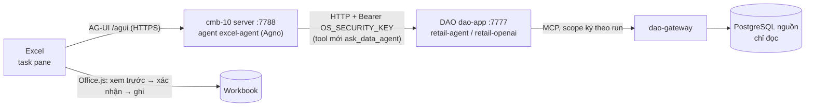

# Quickstart · Excel Agent Add-in (CMB-10) nối Data Agent OS (vizion-smart-retail-data-insight)

Mục tiêu: chạy add-in trong Excel và cho nó hỏi số liệu **retail / ecommerce** của Data Agent OS
(`vizion-smart-retail-data-insight`, gọi tắt là **DAO**) thay cho API dữ liệu giả lập.

> Trạng thái (2026-10-15): cmb-10 POC 0.2, 47 test unit + integration xanh. **Chưa có code nối DAO** — bước 4 bên dưới
> là việc cần làm (ước lượng 0,5–1 ngày). Bước 1–3 chạy được ngay, không sửa code.

## 0. Hai hệ thống, nối ở đâu



| | cmb-10 (add-in) | DAO (vizion) |
|---|---|---|
| Vai trò | **Kênh Excel**: chat, công cụ chạy trong workbook, ghi có xác nhận | **Agent số liệu**: text-to-SQL qua gateway, báo cáo có bằng chứng SQL |
| Runtime | AgentOS + **AG-UI** (Agno 3.1.3), 1 agent `excel-agent` | AgentOS (Agno 3.1.1), agent `<domain>-openai` (mặc định) và `<domain>-agent`; **không có AG-UI** |
| Cổng mặc định | 7777 (**trùng** DAO → đổi sang 7788) | 7777 (`dao-app`, chỉ 127.0.0.1) |
| API cho bên ngoài | `/agui`, `/api/v1/*`, `/mock-api/*` | `POST /agents/{id}/runs`, `POST /v1/analyze`, `GET /v1/reports/{id}/…` — Bearer `OS_SECURITY_KEY` |
| Dữ liệu | API giả lập: `khach_hang`, `san_pham`, `don_hang` | `retail` (2 DB), `ecommerce` — chỉ qua `dao-gateway` |

**Cách nối chọn:** cmb-10 gọi agent DAO **như một tool server** (`ask_data_agent`). Lý do:

- Không sửa DAO; giữ ranh giới tin cậy của DAO (add-in không bao giờ chạm gateway, DB hay credentials; DAO vẫn ghi evidence).
- `/v1/analyze` trả `report.tables[]` (`columns` + `rows`, ≤ 200 dòng) → map sang thẻ `search_results` sẵn có của
  cmb-10 → người dùng tích chọn → **Thêm thành dòng mới** vào sheet. Không phải sửa giao diện.
- Không chọn "gắn AG-UI vào DAO": agent `*-openai` (OpenAI Agents SDK) không chạy AG-UI, và phải trộn prompt Excel vào
  domain pack.
- Không chọn "viết API `/datasets`/`/search`/`/export` trên DAO" ở bước đầu: `/search` tự do theo cột cần SQL sinh sẵn
  đi qua gateway — làm sau nếu thật sự cần (mục 6).

## 1. cmb-10 đang có gì

| # | Tính năng | Chạy bằng | Ví dụ |
|---|---|---|---|
| 1 | Chat → agent gọi API → **file Excel** → xem (web POC) / **chèn vào workbook** (Excel thật) | LLM + `export_excel` | *Tạo file Excel khách hàng ở Hà Nội* |
| 2 | `/search` theo cột đang chọn hoặc cột chỉ định → tích → **Ghi vào cột** / **Thêm dòng mới** | code, 0 token | `/search Đà Nẵng`, `/search in:san_pham laptop` |
| 3 | Tìm dòng trong sheet đang mở theo cột, chọn dòng tìm được | `excel_find_rows` | *Tìm dòng có Thành phố là Huế* |
| 4 | Tra hệ thống rồi chèn nguyên một dòng | `search_data` → `excel_append_rows` | *Thêm khách hàng KH-0012 vào bảng* |
| 5 | Ghi giá trị vào một cột cho các dòng đang chọn | `excel_set_values` | *Ghi "VIP" vào cột Phân khúc cho các dòng đang chọn* |
| 6 | Office add-in thật: manifest, nút **Mở Excel Agent** ở tab Home | Office.js | Excel web / Windows / Mac |
| — | An toàn ghi: xem trước cũ → mới, chờ xác nhận, đọc lại sheet và chặn nếu ô/số dòng đã đổi, chặn trùng mã cột đầu, giữ số 0 đầu, Ctrl+Z | add-in | |
| — | Chế độ **offline** (không key): luật cố định, cùng đường code Agno — để thử giao diện | `AGENT_MODE=auto` | |

Công cụ Excel (`excel_get_context`, `excel_find_rows`, `excel_read_rows`, `excel_set_values`, `excel_append_rows`) do
add-in khai báo mỗi lượt qua AG-UI → run tạm dừng → Office.js chạy → run chạy tiếp (`web/js/excel-tools.js`).
Tool server: `list_datasets`, `search_data`, `export_excel` (`src/excel_agent/agents/tools.py`).

## 2. Chuẩn bị (một lần)

| Cần | Kiểm tra |
|---|---|
| `uv`, Docker/Colima (cho DAO), Node 22 qua nvm (cho `npx office-addin-dev-certs`) | `uv --version`, `docker ps`, `node -v` |
| DAO đã cấu hình (`python/.env`, `python/.env.gateway`) theo [QUICKSTART của DAO](../../../../vizion-smart-retail-data-insight/QUICKSTART.md) | `make ps` trong `vizion-smart-retail-data-insight/python` |
| Key model cho cmb-10 (`OPENAI_API_KEY`) — không có thì chạy offline | |
| Giá trị `OS_SECURITY_KEY` của DAO (nếu DAO bật) — **hỏi người quản lý**, không mở `python/.env` của DAO để chép | |

## 3. Cấu hình nhanh — chạy được ngay, không sửa code

### 3.1 Bật DAO (cổng 7777)

```bash
cd vizion-smart-retail-data-insight/python
make up && make ps
make probe DOMAIN=retail          # phải đạt, nếu không agent chỉ trả SOURCE_UNAVAILABLE
curl -s localhost:7777/health
curl -s -H "Authorization: Bearer $DAO_KEY" localhost:7777/agents | jq '.[].id'
# → retail-openai, retail-agent, ecommerce-openai, ecommerce-agent
```

> Cổng 7777 trên máy dev có thể đang bị chiếm (ví dụ tunnel `ssh -L 7777:…`): `lsof -iTCP:7777 -sTCP:LISTEN`.
> Nếu đó là tunnel tới DAO trên server khác thì dùng luôn, bỏ qua `make up`.

### 3.2 Bật cmb-10 ở cổng 7788

```bash
cd motivesidp-ai-learning/ai-architecture/projects/cmb-10-excel-agent-addin
make setup                        # uv sync + tạo .env
```

Sửa `.env` của cmb-10:

```dotenv
OPENAI_API_KEY=sk-...             # trống → offline
OPENAI_MODEL=gpt-5-mini
OPENAI_BASE_URL=                  # Azure OpenAI: thử https://<resource>.openai.azure.com/openai/v1/ (Responses API, chưa kiểm)
PORT=7788
```

```bash
make dev PORT=7788                # web POC: http://127.0.0.1:7788 (bảng mô phỏng, chưa cần Excel)
make test                         # 47 test, không mạng, không key
```

`PORT` trong `.env` chỉ là cấu hình app; cổng uvicorn lấy từ biến `PORT` của Makefile → luôn truyền `PORT=7788`.

### 3.3 Nạp vào Excel thật

```bash
make addin-certs                                   # một lần: chứng chỉ HTTPS localhost
make addin-manifest BASE_URL=https://localhost:7788  # → var/manifest.xml trỏ tới 7788
make dev-https PORT=7788
open https://localhost:7788/static/taskpane.html   # phải mở được, không lỗi chứng chỉ
```

| Excel | Nạp `var/manifest.xml` |
|---|---|
| Web (dễ nhất, thử trước) | excel.office.com → Home → Add-ins → **Upload My Add-in** |
| Mac | `cp var/manifest.xml ~/Library/Containers/com.microsoft.Excel/Data/Documents/wef/` rồi mở lại Excel |
| Windows | `npx office-addin-debugging start var/manifest.xml desktop` |

Nút **Mở Excel Agent** xuất hiện ở tab Home. Đến đây add-in chạy với **dữ liệu giả lập** — chưa nối DAO.

## 4. Nối DAO — việc cần làm trong cmb-10 (DAO không sửa)

### 4.1 Cấu hình mới (`core/config.py` + `.env.example`)

```dotenv
# --- Agent số liệu (Data Agent OS) ---
DATA_AGENT_URL=http://localhost:7777   # để trống → tắt tool ask_data_agent
DATA_AGENT_KEY=                        # = OS_SECURITY_KEY của DAO; để trống khi DAO không bật
DATA_AGENT_DATASET=retail              # retail | ecommerce
DATA_AGENT_RUNTIME=                    # trống = mặc định của DAO (openai); agno
DATA_AGENT_TIMEOUT_S=600               # báo cáo mất 3–6 phút
```

```python
data_agent_url: str | None = None
data_agent_key: SecretStr | None = None
data_agent_dataset: str = "retail"
data_agent_runtime: Literal["openai", "agno"] | None = None
data_agent_timeout_s: float = 600
```

### 4.2 Client `services/data_agent_client.py`

Gọi `POST {DATA_AGENT_URL}/v1/analyze` với `{"question", "dataset", "runtime", "language": "vi", "formats": ["json"],
"conversation_id"}` và header `Authorization: Bearer <DATA_AGENT_KEY>`; timeout `DATA_AGENT_TIMEOUT_S`. Lỗi HTTP →
`DataApiError` (tái dùng cách `DataApiClient._request` xử lý lỗi). Giữ `session_id` trả về theo phiên cmb-10 để gửi
lại làm `conversation_id` (hỏi tiếp cùng ngữ cảnh).

Câu hỏi nhanh không cần báo cáo đầy đủ: `POST /agents/{DATA_AGENT_DATASET}-agent/runs` dạng multipart
(`message`, `stream=false`, `session_id`) → lấy `content`. Bước đầu chỉ cần `/v1/analyze`.

### 4.3 Tool `ask_data_agent` (`agents/tools.py`)

Thêm vào `SystemDataTools` khi `settings.data_agent_url` có giá trị. Kết quả trả về **đúng shape thẻ
`search_results`** để giao diện hiện bảng chọn được và nút **Thêm thành dòng mới** mà không sửa JS:

```python
async def run_ask_data_agent(deps: AgentDeps, question: str, table: int = 0) -> str:
    try:
        resp = await deps.data_agent.analyze(question)
    except ExcelAgentError as exc:
        return _error(str(exc))
    report = resp["report"]
    tables = report.get("tables") or []
    if not tables:
        return _json({"type": "report", "summary": report["summary"], "kpis": report["kpis"]})
    t = tables[min(table, len(tables) - 1)]
    records = [dict(zip(t["columns"], row, strict=False)) for row in t["rows"]]
    return _json({
        "type": "search_results", "dataset": resp["dataset"], "query": question, "column": None,
        "total": len(records), "shown": len(records), "columns": t["columns"], "records": records,
        "summary": report["summary"], "report_id": resp["report_id"],
    })
```

`AgentDeps` thêm trường `data_agent`, tạo một lần trong `main.create_app`.

### 4.4 Prompt (`prompts/agents/excel_agent.yml`)

Thêm một đoạn: *"Hỏi số liệu bán lẻ (doanh số, lượt khách, tồn kho, KPI theo tháng/cửa hàng) → `ask_data_agent`.
Muốn đưa bảng kết quả vào sheet → `excel_append_rows` với khóa là tên cột của sheet; sheet trống thì dùng tên cột của
bảng. Không tự tính lại số liệu của bảng."* Đồng thời bỏ tên dataset cứng `khach_hang, san_pham hoặc don_hang` trong
docstring của `search_data` / `export_excel` (đã có `$datasets` lấy lúc chạy).

### 4.5 Test

- Unit: client với `httpx.MockTransport` (200, 401, 502, timeout); `run_ask_data_agent` map `tables[0]` →
  `search_results`, báo cáo không có bảng → `type: report`.
- Integration: model kịch bản gọi `ask_data_agent` rồi `excel_append_rows` (theo mẫu `tests/integration/test_agent_scripted.py`).
- Thật (tốn token, DAO đang chạy): `/v1/analyze` một câu retail; xác nhận `report.tables` có dữ liệu.

## 5. Kiểm tra sau khi nối

```bash
# DAO trả báo cáo có bảng?
curl -s -X POST localhost:7777/v1/analyze -H "Authorization: Bearer $DAO_KEY" -H 'Content-Type: application/json' \
  -d '{"question":"Lượt khách theo cửa hàng tháng gần nhất","dataset":"retail","language":"vi"}' \
  | jq '{summary: .report.summary, tables: [.report.tables[] | {title, columns, n: (.rows|length)}]}'
```

Câu mẫu trong task pane (sheet trống hoặc có dòng tiêu đề):

| Câu | Kỳ vọng |
|---|---|
| *Lượt khách theo cửa hàng tháng gần nhất* | thẻ bảng kết quả + tóm tắt 1–3 câu; tích → **Thêm thành dòng mới** |
| *Đưa bảng đó vào sheet* | `excel_append_rows` → xem trước → xác nhận → ghi |
| *Ghi "Cần kiểm tra" vào cột Ghi chú cho các dòng đang chọn* | `excel_set_values`, không gọi DAO |
| `/search Đà Nẵng` | vẫn chạy trên API giả lập (chưa nối `/search` với DAO) |

## 6. Việc sau (không chặn bước 4)

| Việc | Ghi chú |
|---|---|
| `/search`, `export_excel` trên dữ liệu retail | Cần API `/datasets`, `/search`, `/export` (giao kèo `schemas/data_api.py`) phía DAO, đi qua `dao-gateway` (`query_sql` với scope ký) — **không** nối thẳng DB. Phải bàn với chủ DAO |
| Stream tiến độ báo cáo (3–6 phút) | dùng `/agents/{id}/runs` `stream=true`, đẩy trạng thái về task pane |
| Biểu đồ / file HTML, PDF của báo cáo | link `/v1/reports/{id}/files/{fmt}` (link ký khi DAO bật `OS_SECURITY_KEY`) |
| Đăng nhập người dùng | NAA / Entra ID; hiện cmb-10 dùng **một** key DAO cho mọi người — không phân quyền theo người |
| Triển khai | cmb-10 trên domain HTTPS công ty, DAO sau reverse proxy; manifest qua M365 Integrated apps |

## 7. Review — điểm cần biết khi nối

| # | Vấn đề | Ảnh hưởng | Cách xử lý |
|---|---|---|---|
| 1 | Cả hai mặc định cổng **7777** | không chạy song song được | cmb-10 chạy 7788 + `make addin-manifest BASE_URL=…` (mục 3) |
| 2 | `DataApiClient` không gửi header xác thực, timeout 30 s | không gọi được DAO có `OS_SECURITY_KEY`; báo cáo 3–6 phút bị cắt | client riêng `data_agent_client.py`, timeout 600 s (mục 4.2) |
| 3 | Docstring `search_data` / `export_excel` ghi cứng `khach_hang, san_pham, don_hang`; tài liệu 06 mục 9 nói đổi `DATA_API_URL` là "không phải sửa agent" | model bị dẫn sai khi đổi nguồn dữ liệu | bỏ tên cứng, dựa vào `$datasets` (mục 4.4) |
| 4 | `/agui` và `/api/v1/*` của cmb-10 **không xác thực** | ai tới được cmb-10 sẽ hỏi DAO bằng key của cmb-10 | chỉ bind localhost khi dev; có Entra ID trước khi chia sẻ |
| 5 | Thẻ `search_results` chỉ hiện ≤ 20 dòng (`max_tool_rows`), bảng DAO tới 200 dòng | bảng dài bị cắt khi đưa vào ngữ cảnh model | trả đủ dòng cho UI, chỉ đưa model phần tóm tắt + vài dòng |
| 6 | Hai bản Agno khác nhau (3.1.3 / 3.1.1) | không ảnh hưởng — hai tiến trình riêng, nói chuyện qua HTTP | giữ nguyên |
| 7 | Mỗi câu `/v1/analyze` tốn token **hai lần** (model của cmb-10 + agent DAO) | chi phí, độ trễ | câu hỏi số liệu → gọi DAO 1 lần; tác vụ sheet thuần không gọi DAO |

## 8. Sự cố thường gặp

| Hiện tượng | Xử lý |
|---|---|
| `address already in use` | `lsof -iTCP:7788 -sTCP:LISTEN`; đổi `PORT` |
| Task pane trắng / lỗi chứng chỉ | `make addin-certs`; mở `https://localhost:7788/static/taskpane.html` trên trình duyệt trước |
| Add-in vẫn trỏ 7777 | nạp lại `var/manifest.xml` (không phải `addin/manifest.xml`); Excel web: xóa add-in cũ rồi upload lại |
| `401` từ DAO | thiếu/sai `DATA_AGENT_KEY` |
| DAO trả `SOURCE_UNAVAILABLE` | `make probe DOMAIN=retail` trong DAO; credentials ở `python/.env.gateway` của DAO |
| Tool `ask_data_agent` timeout | tăng `DATA_AGENT_TIMEOUT_S`; câu hỏi đơn giản thì dùng `/agents/{id}/runs` |
| Góc phải hiện *Offline* | `.env` của cmb-10 chưa có `OPENAI_API_KEY` hoặc `AGENT_MODE=offline` |

Tài liệu chi tiết: [README](README.md) · [06 · POC hướng dẫn](docs/06-poc-huong-dan-su-dung.md) ·
[addin/README](addin/README.md) · DAO: [QUICKSTART](../../../../vizion-smart-retail-data-insight/QUICKSTART.md),
[chat-ui/README (API AgentOS)](../../../../vizion-smart-retail-data-insight/chat-ui/README.md).
