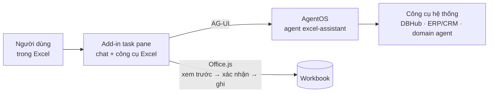

# CMB-10 · Excel Agent Add-in — trợ lý AI trong Excel nối với agent của hệ thống

**Tổ hợp:** [CMB-10](../../docs/02-skill-map/generated/to-hop-ky-nang.md#cmb-10) · Trợ lý AI trong Excel nối với agent
doanh nghiệp — Nhóm 7 + Nhóm 6 · **Người thực hiện:** <tên> · **Trạng thái:** nghiên cứu khả thi — chỉ tài liệu, chưa có code

Một khung chat AI gắn vào Excel (Office Add-in dạng task pane). Người dùng gõ yêu cầu bằng tiếng Việt; chatbot chuyển yêu
cầu cho **agent của hệ thống** (giả định: [Data Agent OS — CMB-09](../cmb-09-data-agent-os/README.md) trên AgentOS/Agno).
Agent vừa dùng **công cụ chạy ngay trong Excel** (tìm theo cột, đọc dòng, chèn hoặc cập nhật dòng…) vừa dùng **công cụ của
hệ thống** (tra ERP/CRM, hỏi số liệu bằng text-to-SQL). Mọi thao tác ghi vào sheet đều có xem trước, người dùng bấm xác
nhận và hoàn tác được bằng Ctrl+Z.

## Kết luận nhanh

| Câu hỏi | Trả lời |
|---|---|
| Có khả thi không? | **Có — nên làm POC 2–3 tuần.** API Excel cần cho yêu cầu cốt lõi đã GA (tìm: ExcelApi 1.9; thêm nhiều dòng: 1.4; gộp hoàn tác: 1.20). AgentOS/Agno có sẵn "công cụ chạy ở giao diện" qua giao thức AG-UI: run tạm dừng → add-in chạy Office.js → run chạy tiếp (đã kiểm tra mã nguồn). Claude for Excel và Copilot Agent Mode cho thấy trải nghiệm này đã chạy ở quy mô lớn. |
| Rủi ro chính | Không nằm ở "làm được hay không" mà ở: ghi sai dữ liệu, workbook "bẩn", prompt injection từ nội dung ô, dữ liệu nhạy cảm đi qua LLM, danh tính/quyền khi gọi hệ thống, nhiều phiên bản Excel khác nhau. |
| Thuộc bài toán nào? | **Nhóm 7** (AI Agent & tự động hóa) + **Nhóm 6** (LLM) → tổ hợp mới **CMB-10**, đã thêm vào catalog. Không cần nhóm thứ 9: "plugin trong Excel" là kênh giao diện, không phải loại đầu ra mới. |
| Đề xuất | **Phương án A:** tự xây add-in (React + Office.js) nối AgentOS qua AG-UI; cổng ghi đặt ở add-in. Nếu công ty đã có license Claude/Copilot, chạy thử **phương án B** (mua add-in có sẵn + nối agent qua MCP) song song để so. |
| Cần chủ dự án trả lời | [9 câu hỏi mở](docs/04-danh-gia-kha-thi.md#8-câu-hỏi-mở) — quan trọng nhất: agent hệ thống có đúng là Data Agent OS không; người dùng đang dùng Excel bản nào; đã có license Copilot/Claude chưa; chính sách gửi dữ liệu tới LLM. |

## Tài liệu

| # | Tài liệu | Nội dung |
|---|---|---|
| 1 | [Mô tả bài toán và phân loại](docs/01-mo-ta-bai-toan.md) | bối cảnh, đối chiếu 6 yêu cầu, 6 kịch bản sử dụng, phạm vi, vì sao thuộc Nhóm 7 + 6 → CMB-10, điểm khó riêng |
| 2 | [Giải pháp và kiến trúc](docs/02-giai-phap-kien-truc.md) | 4 phương án (tự xây / mua / không add-in / Copilot skills), kiến trúc đề xuất, luồng tìm → chèn dòng, kết nối agent qua AG-UI, bộ công cụ Excel, xác thực và bảo mật, triển khai, ADR |
| 3 | [Tính năng mở rộng](docs/03-tinh-nang-mo-rong.md) | 41 tính năng trong 7 nhóm, mức rủi ro R0–R3, API Office.js + requirement set, giai đoạn POC/MVP/Sau |
| 4 | [Đánh giá khả thi và kế hoạch POC](docs/04-danh-gia-kha-thi.md) | kết luận, 14 bằng chứng đã kiểm chứng kèm nguồn, điểm chưa kiểm chứng, 12 rủi ro, ước lượng công sức, kế hoạch POC + tiêu chí go/no-go, câu hỏi mở |

## 1 · ĐÚNG — framing

| Câu hỏi | Trả lời |
|---|---|
| Quyết định nào sẽ thay đổi nhờ model? | Người dùng thao tác dữ liệu trong Excel bằng câu lệnh tiếng Việt thay cho chuỗi thao tác tay (lọc, mở hệ thống khác tra cứu, copy-paste, gõ lại) |
| Ai dùng kết quả, dùng thế nào, bao lâu một lần? | Nhân viên kinh doanh, kế toán, PMO, điều phối đơn hàng; mở khung chat bên phải Excel; nhiều lần mỗi ngày |
| KPI nghiệp vụ | Thời gian mỗi tác vụ (tìm → chèn/cập nhật) giảm ≥ 50% so với làm tay; số lỗi nhập liệu giảm; tỷ lệ người dùng quay lại dùng hằng tuần |
| Metric kỹ thuật tương ứng | Tỷ lệ tác vụ đúng hoàn toàn trên `golden-v0` (đúng dòng tìm thấy, đúng giá trị từng ô khi ghi); số lần ghi sai lọt qua xác nhận; p50/p95 thời gian phản hồi; token và chi phí mỗi tác vụ |
| Loại sai nào đắt hơn? | Ghi sai mà trông hợp lý (sai dòng, sai cột, sai số, ghi đè) ≫ từ chối hoặc hỏi lại. Gửi dữ liệu nhạy cảm ra ngoài ngoài ý muốn là lỗi nghiêm trọng nhất |
| Cách làm hiện tại (baseline nghiệp vụ) | Ctrl+F, AutoFilter; tra ERP/CRM ở màn hình khác rồi copy-paste; hoặc hỏi agent trên web UI rồi chép kết quả sang Excel |
| Có cần AI không, hay luật if-else là đủ? | Cần AI để hiểu yêu cầu tiếng Việt và chọn bảng/cột/công cụ. Tìm kiếm, tính toán, kiểm tra dữ liệu và ghi vào sheet làm bằng code xác định. Tác vụ lặp lại cố định nên thành nút hoặc lệnh soạn sẵn, không cần chat |
| Ràng buộc: dữ liệu, quyền riêng tư, độ trễ, chi phí | Dữ liệu doanh nghiệp (có thể nhạy cảm) đi qua LLM; người dùng Excel Microsoft 365 (Windows, Mac, web); add-in do admin Microsoft 365 triển khai; backend chạy trong hạ tầng công ty; mục tiêu p50 ≤ 8 giây cho kịch bản tìm → chèn |

## 2 · NHANH — baseline và bộ đánh giá

- Bộ đánh giá: `golden-v0` — 3–5 workbook mẫu đã ẩn danh (1 sạch, còn lại "bẩn": tiêu đề gộp ô, kiểu lẫn lộn, tiếng Việt
  khác dấu) × 30 tác vụ có đáp án, gồm 3 ca prompt injection; đóng băng ở P0 trước khi viết prompt.
- Baseline nghiệp vụ: người dùng làm tay cùng tác vụ (đo thời gian và lỗi). Baseline kỹ thuật: agent + 4 công cụ lõi, chưa
  có chuẩn hóa tiếng Việt → kết quả: <điền sau POC-2>
- Lệnh tái tạo: `make eval` (có từ POC-2)

## 3 · CHÍNH XÁC — các vòng cải tiến

| Vòng | Nhóm lỗi lớn nhất | Thay đổi | Metric trước → sau (± KTC) | Chi phí/tác vụ trước → sau |
|---|---|---|---|---|
| 1 | | | | |

## 4 · THUYẾT PHỤC — kết quả

- So với baseline: <điền sau pilot>
- Quy ra giờ công: <thời gian tiết kiệm mỗi tác vụ × số tác vụ mỗi tuần × số người dùng>
- Demo: <điền sau POC-1>
- Giới hạn và rủi ro: xem [đánh giá khả thi, mục 4](docs/04-danh-gia-kha-thi.md#4-rủi-ro-và-cách-giảm)

## Kỹ năng sẽ luyện

`LLM-05` tool calling (công cụ chạy phía client, tạm dừng/tiếp tục run) · `LLM-02` structured output (giao kèo dòng/cột) ·
`EFF-07` kiểm chứng trước khi ghi · `LLM-06` an toàn (prompt injection, quyền) · `LLM-04` đánh giá (golden set tác vụ,
trajectory) · `LLM-08` text-to-SQL · `EFF-03` tinh gọn ngữ cảnh · `DATA-05` chất lượng dữ liệu · `DATA-06` tiếng Việt ·
`OPS-06` tracing · `OPS-08` bảo mật dữ liệu — xem [danh mục kỹ năng](../../docs/02-skill-map/generated/README.md). Ngoài
catalog: TypeScript/React, Office.js, Microsoft Entra ID (MSAL.js).
