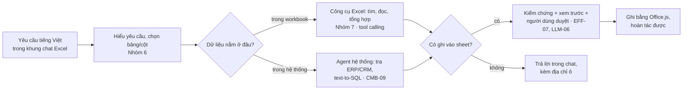

# 01 · Mô tả bài toán và phân loại

| Thuộc tính | Chi tiết |
|---|---|
| Phiên bản | 0.1 — bản nháp chờ review |
| Ngày lập | 2026-10-13 |
| Trạng thái | Nghiên cứu khả thi, chưa có code |
| Tổ hợp | [CMB-10](../../../docs/02-skill-map/generated/to-hop-ky-nang.md#cmb-10) · Nhóm 7 (AI Agent & tự động hóa) + Nhóm 6 (LLM) |
| Tài liệu tiếp theo | [02 · Giải pháp và kiến trúc](02-giai-phap-kien-truc.md) · [03 · Tính năng mở rộng](03-tinh-nang-mo-rong.md) · [04 · Đánh giá khả thi](04-danh-gia-kha-thi.md) |

## Mục lục

1. [Bối cảnh](#1-bối-cảnh)
2. [Đối chiếu yêu cầu](#2-đối-chiếu-yêu-cầu)
3. [Người dùng và kịch bản](#3-người-dùng-và-kịch-bản)
4. [Phạm vi](#4-phạm-vi)
5. [Phân loại: thuộc bài toán nào?](#5-phân-loại-thuộc-bài-toán-nào)
6. [Điểm khó riêng của bài toán](#6-điểm-khó-riêng-của-bài-toán)
7. [Kỹ năng cần](#7-kỹ-năng-cần)

## 1. Bối cảnh

Phần lớn dữ liệu tác nghiệp hằng ngày (danh sách khách hàng, đơn hàng, công nợ, kế hoạch, báo cáo) vẫn nằm trong Excel.
Một việc nhỏ như *"tìm khách KH-0123 rồi thêm một dòng đơn hàng mới, đơn giá lấy theo lần mua gần nhất"* tốn nhiều bước
tay: lọc cột, mở ERP/CRM ở màn hình khác, copy-paste, gõ lại — dễ sai dòng, sai cột, sai số.

Doanh nghiệp đã có (hoặc đang xây) **agent AI của hệ thống** — trong repo này là
[Data Agent OS (CMB-09)](../../cmb-09-data-agent-os/README.md): agent chạy trên AgentOS/Agno, mỗi miền dữ liệu (timesheet,
finance…) là một domain pack, truy vấn dữ liệu chỉ đọc qua MCP DBHub. Agent đó đang nằm ở một web UI riêng, nên người dùng
vẫn phải chép kết quả qua lại giữa chat và Excel.

**Mục tiêu:** đưa agent vào **ngay trong Excel** dưới dạng một khung chat (add-in). Agent đọc và thao tác trên workbook đang
mở, đồng thời gọi được công cụ và dữ liệu của hệ thống doanh nghiệp; mọi thao tác ghi đều do người dùng duyệt.

> **Giả định cần xác nhận:** "AI agent của hệ thống" = Data Agent OS (CMB-09). Thiết kế ở tài liệu 02 dùng giao thức mở
> AG-UI để không khóa vào Agno — nếu agent hệ thống là framework khác, chỉ thay lớp kết nối (xem
> [câu hỏi mở](04-danh-gia-kha-thi.md#8-câu-hỏi-mở)).

## 2. Đối chiếu yêu cầu

| # | Yêu cầu | Cách hiểu và đáp ứng | Chi tiết |
|---|---|---|---|
| 1 | Tạo plugin AI chatbot gắn vào Excel | **Office Add-in dạng task pane** (khung bên phải Excel): một web app HTML/JS chạy trong Excel trên Windows, Mac và Excel trên web; giao diện chat có stream câu trả lời | [02 §2](02-giai-phap-kien-truc.md#2-kiến-trúc-đề-xuất-phương-án-a) |
| 2 | Chatbot tích hợp AI agent của hệ thống | Add-in là một **kênh giao diện** của AgentOS, nói chuyện qua giao thức **AG-UI**. Công cụ của hệ thống (DBHub, ERP/CRM, các domain agent) chạy ở backend; công cụ thao tác Excel chạy trong add-in | [02 §4](02-giai-phap-kien-truc.md#4-kết-nối-add-in-với-agent-của-hệ-thống) |
| 3 | Tìm theo dữ liệu cột rồi chèn nguyên một dòng | Hai công cụ lõi `excel_find_rows` + `excel_insert_rows` chạy bằng Office.js: code tìm và lọc (không gửi cả sheet cho LLM), kiểm tra dữ liệu, xem trước, người dùng bấm xác nhận, hoàn tác được bằng Ctrl+Z | [02 §3](02-giai-phap-kien-truc.md#3-luồng-chính-tìm-theo-cột-rồi-chèn-dòng), [02 §5](02-giai-phap-kien-truc.md#5-bộ-công-cụ-excel) |
| 4 | Mở rộng thêm tính năng tương tác từ chatbot | Danh mục 41 tính năng trong 7 nhóm: hiểu workbook, tìm & lọc, ghi & chỉnh sửa, kết nối hệ thống, phân tích & báo cáo, tự động hóa, quản trị & an toàn — mỗi tính năng có mức rủi ro và giai đoạn | [03](03-tinh-nang-mo-rong.md) |
| 5 | Bài toán thuộc nhóm nào, chưa có thì thêm | Nhóm 7 + Nhóm 6 → **tổ hợp mới CMB-10**, đã thêm vào `catalog/combinations.yaml`; thêm ví dụ vào Nhóm 7 và hướng chuyên sâu "LLM ứng dụng & Agent" | [mục 5](#5-phân-loại-thuộc-bài-toán-nào) |
| 6 | Thư mục dự án + tài liệu, chỉ nghiên cứu | Thư mục này; chưa có code. Kết luận khả thi, rủi ro, kế hoạch POC | [04](04-danh-gia-kha-thi.md) |

## 3. Người dùng và kịch bản

**Người dùng chính:** nhân viên kinh doanh, kế toán, PMO, điều phối đơn hàng — làm việc với Excel hằng ngày, không viết
công thức phức tạp. **Người dùng phụ:** quản lý cần số liệu nhanh từ hệ thống đưa thẳng vào file báo cáo.

| # | Kịch bản | Ví dụ câu lệnh | Agent làm gì |
|---|---|---|---|
| K1 | **Tìm rồi chèn dòng trong cùng workbook** (yêu cầu 3) | "Tìm KH-0123 ở cột Mã KH của bảng Đơn hàng, thêm một dòng mới: SL 50, đơn giá như lần mua gần nhất" | `excel_find_rows` → lấy dòng gần nhất → soạn dòng mới theo tiêu đề bảng → kiểm tra → xem trước → người dùng xác nhận → `excel_insert_rows` |
| K2 | **Tra hệ thống rồi chèn dòng** | "Lấy thông tin khách KH-0456 từ CRM, thêm vào bảng Khách hàng" | công cụ backend tra CRM → ánh xạ trường CRM sang cột Excel → xem trước → chèn; mỗi giá trị ghi rõ nguồn |
| K3 | **Hỏi số liệu ngay trên sheet** | "Tổng doanh thu tháng 9 theo chi nhánh trong bảng này?" | `excel_aggregate` tính bằng code trong add-in (không để LLM tự cộng) → trả lời kèm vùng ô đã dùng |
| K4 | **Kéo báo cáo từ hệ thống vào sheet mới** | "Xuất giờ công theo dự án tháng 9 ra sheet mới" | domain agent timesheet (text-to-SQL của CMB-09) → `excel_write_table` vào sheet mới + ghi chú câu SQL đã chạy |
| K5 | **Đối chiếu sheet với hệ thống** | "Mã sản phẩm ở cột B có mã nào không tồn tại trong ERP? Tô vàng dòng sai" | đọc cột theo lô → tra ERP theo lô → `excel_highlight` các dòng lệch + bảng tóm tắt |
| K6 | **Cập nhật theo khóa** | "Đơn DH-889 chuyển trạng thái Đã giao, ngày giao hôm nay" | `excel_find_rows` theo khóa → đúng 1 dòng thì xem trước thay đổi → `excel_update_cells`; nhiều dòng thì hỏi lại |

Quy tắc chung cho mọi kịch bản: không chắc (nhiều dòng khớp, cột không rõ, giá trị thiếu) thì **hỏi lại**, không tự chọn;
câu trả lời luôn kèm địa chỉ ô/dòng để người dùng bấm tới kiểm tra.

## 4. Phạm vi

| Trong phạm vi (v1) | Ngoài phạm vi (v1) — lý do |
|---|---|
| Excel Microsoft 365 trên Windows, Mac và Excel trên web; Office 2021/2024 mua đứt chạy được phần lõi nhưng thiếu gộp hoàn tác | Excel 2016/2019 (đã hết hỗ trợ, thiếu API mới); Excel trên iPad và điện thoại (màn hình nhỏ, tốn công kiểm thử; iPad không có shared runtime nên không dùng được hàm tùy biến) |
| File `.xlsx`/`.xlsm` đang mở, ưu tiên dữ liệu dạng **Excel Table** | Macro/VBA, file `.xls`, data table "what-if" |
| Đọc, tìm, tổng hợp, chèn/cập nhật dòng, tạo sheet kết quả, tô sáng, lọc | Xóa sheet, bảo vệ/bỏ bảo vệ sheet, lưu/đóng workbook (không hoàn tác được — xem 02 §5) |
| Gọi công cụ **chỉ đọc** của hệ thống (DBHub, tra ERP/CRM) | Ghi ngược vào ERP/CRM — để sau pilot, cần duyệt hai bước và nhật ký |
| Người dùng chủ động chat và duyệt | Chạy định kỳ không có người — dùng phương án C (Microsoft Graph), xem [02 §6](02-giai-phap-kien-truc.md#6-các-phương-án-còn-lại) |

## 5. Phân loại: thuộc bài toán nào?

**Kết luận: Nhóm 7 · AI Agent và tự động hóa quy trình** (khối C · Hành động), với các bài toán con của
**Nhóm 6 · Ngôn ngữ, LLM và RAG** → tổ hợp mới **CMB-10 · Trợ lý AI trong Excel nối với agent doanh nghiệp**. Không cần
thêm nhóm thứ 9.

### 5.1 Đi qua cây nhận diện 30 giây

Theo [bản đồ bài toán](../../../docs/01-problem-map/README.md#nhận-diện-bài-toán-trong-30-giây), câu đầu tiên đã trả lời
"Có": *"Cần thực hiện một chuỗi thao tác trên nhiều hệ thống (đọc, tra cứu, cập nhật, gửi)?"* — đọc/tìm trong Excel, tra
ERP/CRM, rồi ghi dòng vào Excel → **Nhóm 7**. Tách tiếp thành bài toán con:

### 5.2 Vì sao không thêm nhóm mới

- Bản đồ phân loại theo **đầu ra mà nghiệp vụ cần**, không theo kênh hay loại dữ liệu. Đầu ra ở đây là *"chuỗi hành động
  đã thực hiện + log"* — đúng định nghĩa Nhóm 7. "Plugin trong Excel" là **kênh giao diện**, giống như chatbot trên web
  hay trên Teams.
- Kỹ năng cần đã có đủ trong catalog (Nhóm 7 + 6). Thêm nhóm mới sẽ lặp lại kỹ năng và phá ma trận 8 nhóm × kỹ năng mà bộ
  kiểm tra độ phủ đang dựa vào.
- Repo đã có cơ chế cho dự án ghép nhiều nhóm: **tổ hợp** (`catalog/combinations.yaml`). Vì vậy bài toán được thêm thành
  tổ hợp CMB-10.

### 5.3 So với các bài toán gần nhất

| Bài toán | Giống | Khác |
|---|---|---|
| [CMB-03](../../../docs/02-skill-map/generated/to-hop-ky-nang.md#cmb-03) Trợ lý nội bộ có RAG và thao tác được (G6 + G7) | trợ lý vừa hiểu vừa thao tác được, có người duyệt | CMB-03 thao tác trên hệ thống phía server (CRM/ERP); CMB-10 thao tác trên **tài liệu đang mở của người dùng** — công cụ chạy ở phía client |
| [CMB-09](../../../docs/02-skill-map/generated/to-hop-ky-nang.md#cmb-09) Hỏi số liệu bằng tiếng Việt (text-to-SQL agent) | cùng backend AgentOS, cùng domain pack | CMB-10 **dùng lại** CMB-09 làm năng lực backend (kịch bản K4) và thêm phần đưa kết quả vào Excel |
| Dự án luyện tập Nhóm 7: agent báo giá | mẫu "đọc → tra → soạn → chờ duyệt" | nơi ghi là Excel thay vì email |

### 5.4 Đã cập nhật trong repo

- `catalog/combinations.yaml`: thêm **CMB-10** (luồng, ví dụ, 11 kỹ năng, 3 kỹ năng keo, 5 bẫy, metric end-to-end) →
  trang sinh tự động [to-hop-ky-nang.md#cmb-10](../../../docs/02-skill-map/generated/to-hop-ky-nang.md#cmb-10).
- `catalog/problems.yaml`: thêm ví dụ "trợ lý AI ngay trong Excel/Office (add-in) gọi agent của hệ thống" vào Nhóm 7.
- `catalog/roadmap.yaml`: thêm CMB-10 vào hướng chuyên sâu "LLM ứng dụng & Agent" (G6 + G7).

## 6. Điểm khó riêng của bài toán

| # | Điểm khó | Vì sao khó | Hướng xử lý (chi tiết ở tài liệu 02) |
|---|---|---|---|
| 1 | **Công cụ chạy ở client, agent ở server** | Office.js chỉ chạy trong add-in trên máy người dùng; agent (LLM + công cụ hệ thống) chạy ở AgentOS. Run phải tạm dừng chờ client làm xong rồi chạy tiếp | AG-UI "frontend tools": Agno đổi công cụ của client thành công cụ thực thi bên ngoài, tạm dừng run, tiếp tục khi nhận kết quả (đã kiểm tra mã nguồn) |
| 2 | **Workbook "bẩn" do người tạo** | tiêu đề gộp ô hoặc nhiều dòng, không phải Excel Table, số lưu dạng chữ, ngày lẫn kiểu, ô trống giữa bảng | ưu tiên Excel Table; nhận diện tiêu đề; đề nghị "chuyển thành bảng" một chạm; kiểm tra kiểu trước khi ghi |
| 3 | **Ghi vào tài liệu của người dùng** | ghi sai rất khó phát hiện, mất niềm tin ngay lần đầu | validator xác định + xem trước + xác nhận + gộp một bước hoàn tác + tô sáng dòng vừa ghi |
| 4 | **Tiếng Việt** | "Nguyễn Văn A" / "nguyen van a" / NFC-NFD / khoảng trắng thừa làm tìm kiếm trượt | chuẩn hóa NFC, bỏ dấu tùy chọn, so khớp nhiều chế độ, trả về độ tin cậy |
| 5 | **Hai nguồn sự thật** | giá trị có thể đến từ workbook, từ ERP hay do agent đề xuất | mỗi giá trị trong bản xem trước ghi rõ nguồn; không bao giờ để LLM tự "nhẩm" số |
| 6 | **Dữ liệu và quyền** | nội dung sheet đi qua LLM; agent backend có thể có quyền rộng hơn người dùng | chỉ gửi phần cần thiết; danh tính người dùng (Entra ID) đi tới backend; công cụ hệ thống chỉ đọc |

## 7. Kỹ năng cần

Kỹ năng trong [catalog](../../../docs/02-skill-map/generated/README.md) (cũng là danh sách kỹ năng của CMB-10):

| Kỹ năng | Vai trò trong dự án |
|---|---|
| `LLM-05` Tool calling và điều phối | công cụ chạy phía client, tạm dừng/tiếp tục run, người duyệt ở bước ghi |
| `LLM-02` Structured output 🔗 | giao kèo dòng/cột giữa agent và Office.js — JSON theo schema của bảng |
| `EFF-07` Kiểm chứng xác định 🔗 | kiểm tra kiểu, cột bắt buộc, trùng khóa trước khi ghi — không lỗi im lặng |
| `LLM-06` An toàn và bảo mật 🔗 | prompt injection từ nội dung ô, quyền tối thiểu, không có công cụ gửi dữ liệu ra ngoài |
| `LLM-04` Đánh giá hệ LLM | golden set tác vụ trên workbook mẫu, đánh giá cả chuỗi bước (trajectory) |
| `LLM-08` Text-to-SQL | kéo số liệu từ hệ thống (qua CMB-09) |
| `EFF-03` Tinh gọn ngữ cảnh | chỉ gửi tiêu đề + kiểu cột + vài dòng khớp, không gửi cả sheet |
| `DATA-05` Kiểm định chất lượng dữ liệu | hồ sơ cột, phát hiện trùng/thiếu, nhận diện tiêu đề |
| `DATA-06` Văn bản tiếng Việt | chuẩn hóa để tìm kiếm đúng |
| `OPS-06` LLMOps | trace từng lần gọi công cụ, token, độ trễ |
| `OPS-08` Bảo mật dữ liệu | phân loại dữ liệu, che PII, lưu trữ trace |

🔗 = kỹ năng keo ở điểm nối. **Ngoài catalog** (catalog hiện chưa có mảng kỹ năng front-end): TypeScript/React, Office.js
(Excel JavaScript API), Microsoft Entra ID + MSAL.js. Có nên thêm thành kỹ năng của catalog hay để riêng cho dự án — xem
[câu hỏi mở](04-danh-gia-kha-thi.md#8-câu-hỏi-mở).
