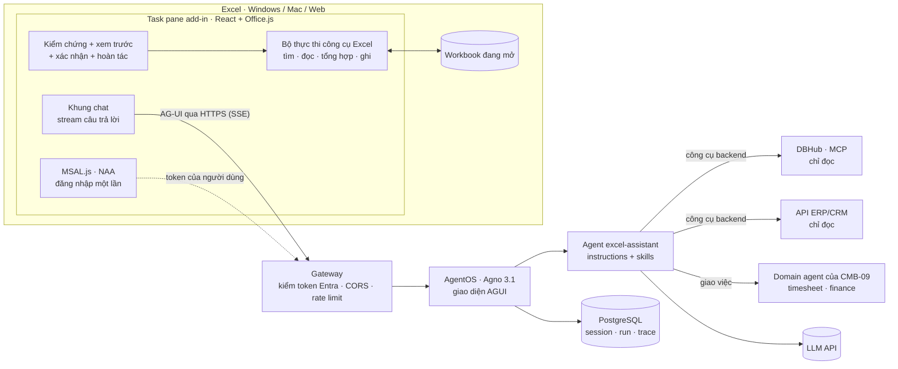
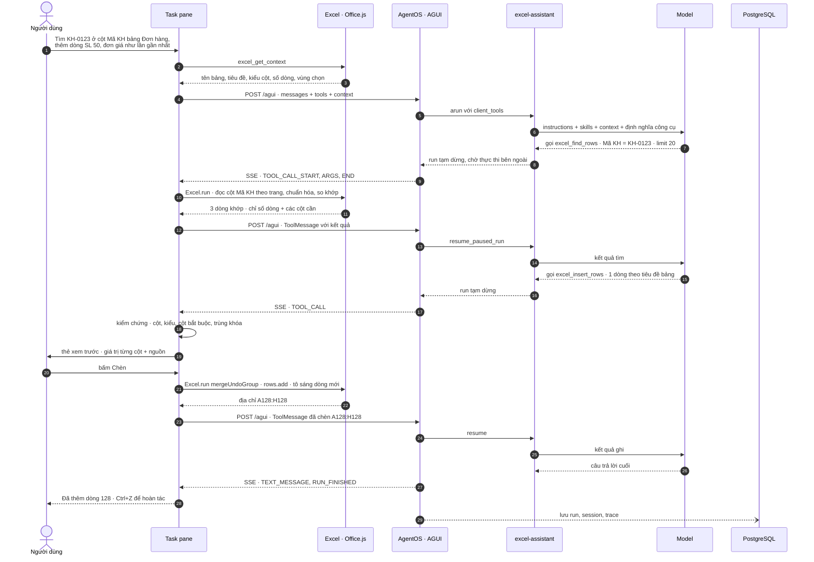
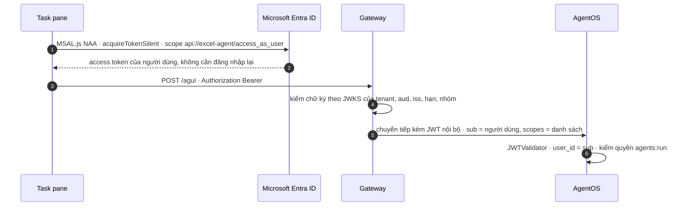

# 02 · Giải pháp và kiến trúc

| Thuộc tính | Chi tiết |
|---|---|
| Phiên bản | 0.1 — bản nháp chờ review |
| Ngày lập | 2026-10-13 |
| Trạng thái | Thiết kế ở mức nghiên cứu, chưa có code. Phiên bản thư viện và API kiểm tra ngày 2026-10-13 (nguồn ở [04 §9](04-danh-gia-kha-thi.md#9-nguồn-tham-khảo)) |
| Đọc trước | [01 · Mô tả bài toán và phân loại](01-mo-ta-bai-toan.md) |

## Mục lục

1. [Bốn phương án](#1-bốn-phương-án)
2. [Kiến trúc đề xuất (phương án A)](#2-kiến-trúc-đề-xuất-phương-án-a)
3. [Luồng chính: tìm theo cột rồi chèn dòng](#3-luồng-chính-tìm-theo-cột-rồi-chèn-dòng)
4. [Kết nối add-in với agent của hệ thống](#4-kết-nối-add-in-với-agent-của-hệ-thống)
5. [Bộ công cụ Excel](#5-bộ-công-cụ-excel)
6. [Các phương án còn lại](#6-các-phương-án-còn-lại)
7. [Xác thực, phân quyền và bảo mật](#7-xác-thực-phân-quyền-và-bảo-mật)
8. [Triển khai và vận hành](#8-triển-khai-và-vận-hành)
9. [Quyết định kiến trúc](#9-quyết-định-kiến-trúc)

## 1. Bốn phương án

| | **A · Tự xây add-in + AgentOS** (đề xuất) | B · Mua add-in có sẵn + nối agent qua MCP | C · Không add-in, ghi file qua Microsoft Graph | D · Copilot skills for Excel |
|---|---|---|---|---|
| Mô tả | Task pane React + Office.js của công ty; chat với agent `excel-assistant` trên AgentOS qua AG-UI; công cụ Excel chạy trong add-in | Claude for Excel hoặc Copilot trong Excel; agent hệ thống phơi ra thành MCP server (`AgentOS(mcp=True)`) và gắn làm connector | Agent ghi thẳng vào file `.xlsx` trên OneDrive/SharePoint bằng Graph API; người dùng chat ở kênh khác (AgentOS UI, Teams) | Gói skill (`SKILL.md` + script Office.js) cài vào Copilot trong Excel |
| Thời gian tới POC | 2–3 tuần | vài ngày nếu đã có license | 1–2 tuần | chưa dùng được (preview) |
| Bản quyền theo người dùng | không — chỉ trả token LLM và hạ tầng | có (Claude Team/Enterprise hoặc Microsoft 365 Copilot) | không | có (Microsoft 365 Copilot) |
| Dữ liệu đi qua | hạ tầng công ty + nhà cung cấp LLM đã chọn | thêm nhà cung cấp add-in | hạ tầng công ty + LLM + Microsoft 365 | Microsoft 365 Copilot |
| Kiểm soát bước ghi | toàn quyền: validator, xác nhận, nhật ký do mình viết | theo sản phẩm (có xác nhận thao tác rủi ro, cảnh báo ghi đè); không gắn được luật nghiệp vụ cứng | toàn quyền, nhưng không có người xem trước trong Excel | theo Copilot |
| Dùng lại agent hệ thống | trực tiếp: cùng AgentOS, cùng domain pack, trace chung | gián tiếp: agent hệ thống thành một công cụ MCP | trực tiếp | gián tiếp |
| Mức trưởng thành | API Excel GA; AG-UI 1.0 | GA | GA | **preview** — Microsoft dặn không dùng cho production |
| Hạn chế lớn nhất | tự xây và bảo trì UI, SSO, triển khai | MCP server phải truy cập được từ cloud của nhà cung cấp; chi phí theo đầu người | không ở trong Excel; chỉ `.xlsx` trên OneDrive for Business/SharePoint | chưa dùng được |

**Đề xuất:**

- **A là hướng chính.** Yêu cầu gốc là *chatbot của mình* gắn vào Excel và nói chuyện với *agent của mình*. Chỉ A giữ toàn
  quyền ở bước ghi — chỗ rủi ro nhất — và dùng thẳng AgentOS đã thiết kế ở CMB-09.
- **B chạy thử song song nếu công ty đã có license** Claude hoặc Copilot: 2–3 ngày gắn connector MCP, cho người dùng thử trên
  cùng bộ tác vụ với POC của A → có số liệu thật để quyết định build hay buy.
- **C là phần bổ sung** cho tác vụ định kỳ không cần người (ví dụ mỗi tối thêm doanh số ngày vào file chung trên SharePoint).
- **D để theo dõi.** Định dạng `SKILL.md` giống skill Data plugin mà CMB-09 dùng lại, nên skill domain có thể tái dùng khi
  tính năng ra GA.

Chi tiết B, C, D ở [mục 6](#6-các-phương-án-còn-lại). Phần còn lại của tài liệu mô tả phương án A.

## 2. Kiến trúc đề xuất (phương án A)



| Thành phần | Vai trò | Công nghệ đề xuất (phiên bản kiểm tra 2026-10-13) |
|---|---|---|
| Task pane add-in | khung chat, hiện tiến trình gọi công cụ, thẻ xem trước trước khi ghi | React + TypeScript, Fluent UI React v9 (giao diện giống Office), Office.js nạp từ CDN chính thức |
| Kết nối agent | gửi tin nhắn + định nghĩa công cụ Excel, nhận stream sự kiện, gửi kết quả công cụ | `@ag-ui/client` 1.0.2 (`HttpAgent`), hoặc CopilotKit 1.79 (`useFrontendTool`, `useHumanInTheLoop`) nếu muốn UI chat dựng sẵn |
| Bộ thực thi công cụ Excel | chạy `Excel.run` cho từng công cụ, đọc theo trang, chuẩn hóa tiếng Việt | Excel JavaScript API — tối thiểu ExcelApi 1.9 (tìm), 1.20 để gộp hoàn tác |
| Kiểm chứng trước khi ghi | kiểu dữ liệu, cột bắt buộc, trùng khóa, giới hạn số dòng | TypeScript thuần, có unit test chạy không cần Excel |
| Đăng nhập | lấy token Entra ID của người dùng mà không bắt đăng nhập lại | MSAL.js 5.x (`@azure/msal-browser` 5.25), `createNestablePublicClientApplication` — nested app authentication (NAA) |
| Manifest | khai báo add-in, nút ribbon, quyền đọc/ghi tài liệu | manifest XML (add-in only) để chạy được cả Office mua đứt; unified JSON khi mọi người dùng ở Microsoft 365 đủ mới |
| Gateway | kiểm token Entra (JWKS), đổi sang JWT nội bộ cho AgentOS, CORS, rate limit | API gateway sẵn có của công ty hoặc một dịch vụ FastAPI nhỏ |
| AgentOS | chạy agent, lưu session/run, trace, giao diện AGUI | `agno[os,agui,mcp,postgres]` 3.1.x — cùng phiên bản CMB-09 |
| Agent `excel-assistant` | hiểu yêu cầu, chọn công cụ, soạn dòng cần ghi, giải thích kết quả | `Agent` Agno chạy cục bộ trong AgentOS + skill `excel-operations` + skill domain của CMB-09 |
| Công cụ backend | tra dữ liệu hệ thống | DBHub (MCP, chỉ đọc), API ERP/CRM bọc thành tool chỉ đọc, domain agent của CMB-09 |
| PostgreSQL | session, run, trace — dùng chung DB `agentos` của CMB-09 | PostgreSQL 17 |

## 3. Luồng chính: tìm theo cột rồi chèn dòng

Kịch bản K1 của [tài liệu 01](01-mo-ta-bai-toan.md#3-người-dùng-và-kịch-bản):



Ghi chú theo bước:

- **2–3:** ngữ cảnh gửi cho agent là *schema gọn* (tên bảng, tiêu đề, kiểu cột suy đoán, số dòng, vùng chọn) — không có dữ
  liệu (`EFF-03`).
- **10–11:** việc tìm do code làm. LLM chỉ nhận tối đa `limit` dòng + tổng số khớp. Nhiều dòng khớp mà không xác định
  được dòng cần dùng → agent hỏi lại thay vì tự chọn.
- **18–20:** **cổng ghi nằm ở add-in**: dù model có "quên" hỏi, công cụ ghi vẫn chờ người dùng bấm. Người dùng bấm *Hủy* →
  kết quả công cụ là `rejected` kèm lý do → agent hỏi lại cần sửa gì.
- **21:** một lần chèn = **một bước hoàn tác** nhờ `Excel.run({ mergeUndoGroup: true })` (ExcelApi 1.20). Bản Excel chưa
  có ExcelApi 1.20 (bản mua đứt, bản cập nhật chậm) có thể chưa hoàn tác được thao tác của add-in — trước 09/2025, lệnh
  của add-in xóa luôn ngăn xếp hoàn tác — nên add-in giữ thêm **nhật ký hoàn tác riêng** (vùng đã chèn, giá trị cũ của ô
  đã sửa) và nút *Hoàn tác* trong chat. Thêm `delayForCellEdit: true` để lệnh ghi chờ khi người dùng đang gõ trong ô thay
  vì báo lỗi.
- **29:** trace lưu cả các lần gọi công cụ phía client (tham số + kết quả rút gọn) để phân tích lỗi và chạy lại eval.

## 4. Kết nối add-in với agent của hệ thống

### 4.1 Vì sao chọn AG-UI

- **AG-UI** là giao thức mở, hướng sự kiện (stream qua SSE) giữa agent và giao diện. Hai tính năng dự án cần có sẵn trong
  giao thức: **frontend tools** (công cụ do giao diện khai báo và tự thực thi) và **human-in-the-loop**.
- AgentOS có giao diện `AGUI` (cài thêm `agno[agui]`, kéo theo `ag-ui-protocol`). Nhiều framework khác cũng hỗ trợ AG-UI:
  LangGraph, CrewAI, Microsoft Agent Framework, Google ADK, AWS Strands, Mastra, Pydantic AI, LlamaIndex… → nếu agent của
  hệ thống không phải Agno, add-in giữ nguyên. Riêng **OpenAI Agents SDK** còn ghi "In Progress" trên README của AG-UI.
- Phía trình duyệt có client sẵn: `@ag-ui/client` (nhẹ, tự dựng UI) hoặc CopilotKit (UI chat dựng sẵn, hook
  `useFrontendTool`, `useHumanInTheLoop`; thường đi kèm một runtime trung gian — cần thử ở POC xem có cần không).

### 4.2 Cơ chế tạm dừng và tiếp tục run

Đã kiểm tra trực tiếp mã nguồn `agno` 3.1.1 (phiên bản CMB-09 chốt) và 3.1.3 (mới nhất trên PyPI ngày 2026-10-13) —
phần `agno/os/interfaces/agui/` giống hệt nhau ở hai bản.

| Bước | Điều xảy ra | Vị trí trong mã nguồn Agno |
|---|---|---|
| 1 | Add-in gửi `RunAgentInput`: `thread_id` (thành session), `messages`, **`tools`** (schema công cụ Excel), `context` (ảnh chụp gọn workbook), `state` | `agui/router.py` · `run_entity` |
| 2 | Mỗi công cụ của client được đổi thành `Function(external_execution=True, external_execution_silent=True)` và đưa vào `RunContext.client_tools` | `agui/input.py` · `parse_client_tools` |
| 3 | Khi model gọi công cụ đó, run **tạm dừng** và stream sự kiện `TOOL_CALL_*` về add-in | `agui/handlers.py` · `tools_awaiting_external_execution` |
| 4 | Add-in chạy Office.js rồi gửi kết quả dạng `ToolMessage` trong lần `POST /agui` kế tiếp | phía add-in |
| 5 | Tin nhắn cuối là `ToolMessage` → **tiếp tục** run đang tạm dừng; hỗ trợ cả các kiểu tạm dừng xác nhận, nhập liệu, phản hồi | `agui/resume.py` · `resume_paused_run` |
| 6 | Danh tính người dùng do server xác định (không tin `user_id` client tự gửi); chặn ghi vào session của người khác; quyền cần có `agents:run` | `agui/router.py` · `resolve_run_user_id`, `assert_session_writable`; `agui/agui.py` · `get_scope_mappings` |

**Ràng buộc rút ra:**

- Agent phục vụ add-in phải là `Agent`/`Team` Agno **chạy cục bộ** trong AgentOS và có DB: công cụ của client không được
  chuyển tiếp sang `RemoteAgent`/`RemoteTeam`, và việc tiếp tục run cần DB (PostgreSQL của CMB-09 đáp ứng).
- Agent OpenAI Agents SDK (POC-3 của CMB-09, chạy qua adapter) không nhận frontend tools theo đường này → add-in nói
  chuyện với một agent Agno; agent đó giao việc tiếp cho agent khác ở backend nếu cần.

### 4.3 Cấu hình phía AgentOS (mô tả, chưa phải code)

- Thêm agent `excel-assistant`: instructions ngắn (vai trò, trả lời tiếng Việt, quy tắc ghi, luôn kèm địa chỉ ô), skill
  `excel-operations` (khi nào dùng công cụ nào, khi nào hỏi lại, định dạng số/ngày Việt Nam), skill domain của CMB-09 khi
  cần, các công cụ backend chỉ đọc. Công cụ Excel **không** khai báo ở backend — add-in gửi lên trong mỗi lần chạy.
- Đăng ký giao diện: `AgentOS(agents=[...], interfaces=[AGUI(agent=excel_assistant)], db=..., tracing=True)` → endpoint
  `POST /agui` và `GET /status`.
- `cors_allowed_origins` chỉ gồm domain phục vụ add-in.
- Bật `authorization` (JWT) của AgentOS phía sau gateway — xem [mục 7](#7-xác-thực-phân-quyền-và-bảo-mật).

### 4.4 Các đường kết nối khác của AgentOS

| Đường | Endpoint (đã kiểm tra trong mã nguồn) | Dùng khi |
|---|---|---|
| AG-UI | `POST /agui` | add-in của mình — **đề xuất** |
| REST | `POST /agents/{agent_id}/runs`, `.../runs/{run_id}/continue`, `.../runs/{run_id}/cancel` | client tự viết không theo AG-UI; script eval |
| MCP server | `AgentOS(mcp=True)` hoặc `MCPConfig` (công cụ `run_agent`, `run_team`…) | phương án B: Claude for Excel hoặc Copilot gọi agent hệ thống như một connector |
| A2A | `AgentOS(a2a_interface=True)` → `/a2a/agents/{id}/v1/message:stream` | hệ agent khác gọi agent này |

## 5. Bộ công cụ Excel

### 5.1 Công cụ chạy trong add-in

| Công cụ | Tham số chính | Trả về | Loại | Xác nhận | API Office.js chính | ExcelApi tối thiểu |
|---|---|---|---|---|---|---|
| `excel_get_context` | — | sheet đang mở, vùng chọn, danh sách sheet/bảng + tiêu đề + số dòng | đọc | không | `worksheets`, `tables`, `getSelectedRange` | 1.1 |
| `excel_describe_table` | bảng hoặc vùng, số dòng mẫu | kiểu suy đoán từng cột, số ô trống/trùng, ô gộp, vài dòng mẫu | đọc | không | `getDataBodyRange`, `valueTypes`, `getMergedAreasOrNullObject` | 1.13 |
| `excel_find_rows` | bảng; điều kiện theo cột (bằng, chứa, bắt đầu bằng, lớn/nhỏ hơn, trong khoảng, trong danh sách, trống); chế độ so khớp; cột cần trả; `limit` | các dòng khớp (chỉ số + giá trị cột cần) + tổng số khớp | đọc | không | đọc cột theo trang + so khớp trong JS; `findAllOrNullObject` khi tìm toàn sheet | 1.9 |
| `excel_read_rows` | bảng, chỉ số dòng hoặc vùng, cột | giá trị | đọc | không | `getRange`, `values`, `text` | 1.1 |
| `excel_aggregate` | bảng, nhóm theo, phép tính (đếm, tổng, trung bình, min, max), điều kiện | bảng kết quả do code tính | đọc | không | đọc theo trang + tính trong JS | 1.1 |
| `excel_select` · `excel_highlight` | vùng, màu | — | hiển thị | không | `Range.select`, `format.fill` | 1.1 |
| `excel_apply_filter` | bảng, cột, điều kiện | — | hiển thị | không | `TableColumn.filter`, `AutoFilter` | 1.9 |
| `excel_insert_rows` | bảng, các dòng (theo tên cột), vị trí | địa chỉ vùng mới | **ghi** | **có** | `TableRowCollection.add` | 1.4 (nhiều dòng) |
| `excel_update_cells` | bảng, khóa hoặc chỉ số dòng, giá trị mới theo cột | địa chỉ đã sửa + giá trị cũ | **ghi** | **có** | `Range.values` | 1.1 |
| `excel_write_table` | tên sheet mới, cột, dòng, ghi chú nguồn | địa chỉ bảng mới | **ghi** | **có** | `worksheets.add`, `tables.add` | 1.3 |

"ExcelApi tối thiểu" là requirement set của API chính, tra trong `@types/office-js` 1.0.611. Gộp hoàn tác cho mọi công cụ
ghi cần ExcelApi 1.20 (Excel Windows bản 2509, Mac 16.100, Excel trên web). Danh sách tính năng mở rộng và API tương ứng:
[tài liệu 03](03-tinh-nang-mo-rong.md).

Ví dụ giao kèo của một lần gọi (minh họa định dạng, không phải code):

```json
{
  "tool": "excel_find_rows",
  "args": {
    "table": "DonHang",
    "where": [{"column": "Mã KH", "op": "eq", "value": "KH-0123"}],
    "match": "normalized",
    "return_columns": ["Ngày", "Mã SP", "SL", "Đơn giá"],
    "limit": 20
  },
  "result": {
    "total": 3,
    "rows": [{"row": 97, "values": {"Ngày": "2026-09-28", "Mã SP": "SP-77", "SL": 40, "Đơn giá": 125000}}],
    "truncated": false
  }
}
```

### 5.2 Công cụ phía backend

| Công cụ | Nguồn | Ghi chú |
|---|---|---|
| `execute_sql_<src>`, `search_objects_<src>` | DBHub (MCP), user cơ sở dữ liệu chỉ có quyền SELECT | như CMB-09 |
| `ask_<domain>_agent(question)` | domain agent timesheet/finance của CMB-09 | text-to-SQL có skill domain, trả bảng + câu SQL đã chạy |
| `lookup_<entity>(key)` | API ERP/CRM bọc thành tool chỉ đọc | chỉ trả các trường đã chọn |
| `create_<entity>(...)` — sau pilot | API ghi ERP/CRM | `requires_confirmation`, nhật ký, quyền theo người dùng |

### 5.3 Quy tắc thiết kế công cụ

1. **Code tìm, LLM chọn tham số.** Không công cụ nào trả cả sheet; `excel_find_rows` trả tối đa `limit` dòng + tổng số
   khớp. (Claude for Excel cũng chỉ đọc tối đa 2.000 ô có dữ liệu mỗi lần.)
2. **Con số do code tính** — `excel_aggregate`, hoặc ghi công thức như `=SUMIFS(...)` vào sheet. LLM không tự cộng.
3. **Ít công cụ, mô tả ngắn, tham số dạng enum** (`LLM-05`, `EFF-05`); tên cột phải nằm trong danh sách tiêu đề đã trả
   trong context.
4. **Cổng ghi ở client:** mọi công cụ loại *ghi* đi qua validator → thẻ xem trước → người dùng bấm. Agent không có đường
   nào bỏ qua bước này.
5. **Hoàn tác được:** mỗi lần ghi gói trong `Excel.run({ mergeUndoGroup: true, delayForCellEdit: true })`; add-in giữ nhật
   ký hoàn tác riêng cho bản Excel chưa hỗ trợ. Không đưa vào bộ công cụ các API làm xóa ngăn xếp hoàn tác (xóa/sao chép
   sheet, bảo vệ sheet, lưu/đóng workbook…).
6. **Mỗi giá trị có nguồn:** `workbook` · `hệ thống:<tên>` · `người dùng` · `agent đề xuất` — hiện trên thẻ xem trước.
7. **Giới hạn mỗi lần:** ví dụ ≤ 200 dòng mỗi lần ghi, đọc theo trang ≤ 5.000 ô mỗi lần — dưới xa giới hạn 5 MB mỗi yêu
   cầu của Excel trên web và 5 triệu ô mỗi lần đọc.
8. **Không làm treo Excel:** việc nặng chia nhỏ và nhường luồng; Office trên desktop tự khởi động lại add-in nếu nó chặn
   giao diện quá 5 giây.

### 5.4 Lớp kiểm chứng trước khi ghi

| Kiểm tra (`EFF-07`) | Lỗi bị chặn (ví dụ) |
|---|---|
| Cột tồn tại, đúng bảng | ghi "Đơn giá" vào bảng chỉ có cột "Đơn giá (VND)" |
| Kiểu dữ liệu theo cột (suy từ dữ liệu sẵn có + định dạng số) | chữ vào cột số; 13/10/2026 bị hiểu thành tháng 13 |
| Cột bắt buộc không trống | thiếu Mã KH |
| Khóa không trùng (cột được đánh dấu là khóa) | chèn lại đơn DH-889 đã có |
| Giá trị nằm trong danh sách hợp lệ (data validation sẵn có trong sheet) | trạng thái "Da giao" không có trong danh sách |
| Không ghi vào cột công thức của bảng (calculated column) | ghi đè cột Thành tiền = SL × Đơn giá |
| Giới hạn số dòng; sheet không bị khóa | chèn 5.000 dòng một lần |

Kết quả kiểm chứng hiện trên thẻ xem trước; có lỗi chặn thì không có nút *Chèn*.

### 5.5 Tìm kiếm tiếng Việt và workbook "bẩn"

- **Chuẩn hóa trước khi so:** Unicode NFC, chữ thường, bỏ khoảng trắng thừa; chế độ `normalized` bỏ dấu (Nguyễn → nguyen);
  số lưu dạng chữ và số thật so như nhau; ngày so theo giá trị ngày.
- **Chế độ so khớp:** `exact` → `normalized` → `contains` → `fuzzy` (khoảng cách chỉnh sửa nhỏ, kèm độ tin cậy). Nhiều
  dòng khớp hoặc độ tin cậy thấp → hỏi lại.
- **Ưu tiên Excel Table.** Vùng dữ liệu thường: lấy used range, đoán dòng tiêu đề (dòng đầu toàn chữ, không trống), phát
  hiện ô gộp; không chắc thì đề nghị người dùng "chuyển thành bảng" bằng một chạm (`tables.add`).
- **Định dạng theo locale** của Excel người dùng (vi-VN: `1.234.567,5`, `dd/mm/yyyy`); skill `excel-operations` ghi rõ
  quy tắc cho agent.

## 6. Các phương án còn lại

### 6.1 B · Mua add-in có sẵn và nối agent hệ thống qua MCP

**Claude for Excel** (Anthropic) — đã GA cho các gói Pro, Max, Team, Enterprise:

- Chạy trên Excel trên web, Excel Windows (Microsoft 365, build 16.0.13127.20296 trở lên), Excel Mac 16.46 trở lên; không
  chạy trên iPad (cần SharedRuntime) và Excel 2016/2019.
- Có sẵn: trả lời kèm trích dẫn tới ô, sửa giá trị mà giữ công thức, sắp xếp/lọc/pivot/định dạng có điều kiện/dropdown,
  cảnh báo trước khi ghi đè, hỏi xác nhận trước thao tác rủi ro.
- Mở rộng bằng **connector (remote MCP)** do admin tổ chức bật và **Skills**. Cách nối: bật `AgentOS(mcp=True)` rồi thêm
  URL MCP làm custom connector.
- **Lưu ý:** connector được gọi **từ hạ tầng cloud của Anthropic** → MCP server phải truy cập được từ dải IP của Anthropic
  (hoặc dùng MCP tunnel), tức là phải mở agent hệ thống ra ngoài. Dữ liệu vào/ra bị xóa trong 30 ngày; lịch sử chat lưu cục
  bộ trên máy (IndexedDB); add-in không kế thừa chính sách lưu trữ riêng của tổ chức và không nằm trong audit log
  Enterprise (có trong Compliance API, đang beta). Khi chạy qua Bedrock/Vertex AI/Azure AI Foundry thì connector và skill
  có thể không dùng được.
- Anthropic tự cảnh báo rủi ro prompt injection từ file Excel bên ngoài — cùng loại rủi ro mà phương án A phải xử lý.

**Microsoft 365 Copilot trong Excel** (Agent Mode, hàm `=COPILOT()`): cần license Microsoft 365 Copilot (khoảng
30 USD/người/tháng cho bản doanh nghiệp theo các bài tổng hợp năm 2026 — cần báo giá chính thức). Đưa agent của mình vào
Copilot qua connector/MCP hoặc declarative agent; **chưa kiểm chứng** được Agent Mode trong Excel gọi agent tùy biến tới
mức nào.

**Khi nào chọn B:** công ty đã trả license; chấp nhận dữ liệu đi qua nhà cung cấp; nhu cầu chủ yếu là phân tích, sửa
workbook hơn là quy trình ghi có luật nghiệp vụ chặt.

### 6.2 C · Không add-in: agent ghi file qua Microsoft Graph

- Graph Excel REST API đọc/ghi workbook `.xlsx` trên OneDrive for Business, SharePoint, Group drive (không hỗ trợ `.xls`,
  chưa hỗ trợ OneDrive cá nhân); có phiên làm việc persistent hoặc non-persistent. Thêm dòng vào bảng:
  `POST /me/drive/items/{id}/workbook/tables/{name}/rows` — nên gom nhiều dòng một lần, gặp lỗi 504 thì gửi lại.
- **Hợp với:** tác vụ định kỳ không cần người, file dùng chung của phòng ban, kết quả agent cần "đổ" vào Excel khi người
  dùng không mở file.
- **Không hợp với:** trải nghiệm chat ngay trong Excel, xem trước trước khi ghi, file cục bộ. File trên ổ chung nội bộ
  (ngoài Microsoft 365) dùng thư viện đọc/ghi phía server như openpyxl — chỉ khi không ai đang mở file.
- Dùng như **phần bổ sung** cho A: cùng agent, thêm công cụ backend `graph_append_rows` có bước duyệt.

### 6.3 D · Copilot skills for Excel (preview)

- Gói skill (`SKILL.md` + thư mục `scripts/` chứa Office.js + tài liệu tham chiếu) nằm trong app package Microsoft 365,
  chạy trong Copilot của Excel; Copilot tự tạo runtime và nạp Office.js.
- Đang **preview**: cần Excel 2608 (build 20305.20002) trở lên, chỉ có ở kênh Beta và Current Channel (Preview); Microsoft
  ghi rõ không dùng cho production. Trang hướng dẫn cũ "Combine Copilot agents with Office Add-ins (preview)" đã bị gỡ
  (chuyển hướng về trang tổng quan add-in).
- Đáng chú ý: định dạng `SKILL.md` giống skill của Data plugin mà CMB-09 dùng lại → skill domain có thể tái dùng khi tính
  năng ra GA. Xem lại vào quý 2/2027.

## 7. Xác thực, phân quyền và bảo mật

### 7.1 Luồng xác thực



- **NAA** hỗ trợ tài khoản Microsoft Entra ID (work/school) và Microsoft account, không hỗ trợ Azure AD B2C. App
  registration cần redirect SPA `brk-multihub://<domain-add-in>`, và thêm redirect tới trang task pane cho Excel trên web.
- **Vì sao cần gateway** (đã kiểm tra mã nguồn): JWT validator của AgentOS đọc khóa tĩnh hoặc **file** JWKS và coi claim
  scope là **danh sách**; token Entra để scope ở claim `scp` dạng chuỗi cách nhau bởi dấu cách và xoay vòng khóa định kỳ.
  Gateway kiểm token Entra rồi cấp JWT nội bộ đúng định dạng AgentOS cần — POC phải thử cách này.

### 7.2 Rủi ro bảo mật và biện pháp

| Rủi ro | Biện pháp |
|---|---|
| Prompt injection từ nội dung ô hoặc workbook nhận từ bên ngoài | nội dung ô luôn được đóng khung là **dữ liệu**; instructions nói rõ không làm theo chỉ dẫn nằm trong dữ liệu; không có công cụ gửi dữ liệu tới URL tùy ý; mọi lệnh ghi qua cổng xác nhận; bộ eval có ca injection |
| Lộ dữ liệu cho LLM | chỉ gửi schema + dòng khớp; tùy chọn che PII (số CCCD, điện thoại) trước khi gửi; chọn nhà cung cấp, vùng dữ liệu, chế độ không lưu dữ liệu — hoặc model tự host cho sheet nhạy cảm; trace chứa dữ liệu nên có hạn lưu trữ |
| Agent vượt quyền người dùng | danh tính người dùng đi tới công cụ backend; DB user chỉ đọc; công cụ ghi vào hệ thống chỉ có sau pilot, kèm duyệt và nhật ký |
| Ghi sai hoặc ghi đè | validator + xem trước + một bước hoàn tác; không ghi đè ô có dữ liệu trừ lệnh cập nhật tường minh |
| Add-in bị sửa hoặc giả mạo | chỉ phục vụ qua HTTPS từ domain công ty, CSP chặt, không để bí mật trong code client, manifest triển khai qua admin center |
| Lạm dụng, chi phí tăng vọt | rate limit theo người dùng ở gateway; ngân sách token mỗi ngày; giới hạn số bước mỗi run |

## 8. Triển khai và vận hành

| Hạng mục | Cách làm |
|---|---|
| Khởi tạo dự án | `generator-office` 3.0.4 (`yo office`, mẫu task pane React + TypeScript) hoặc Microsoft 365 Agents Toolkit; Script Lab để thử nhanh API ngay trong Excel |
| Chạy thử khi phát triển | sideload trên Excel Windows, Mac và Excel trên web; `office-addin-debugging` 7.0.1 |
| Hosting add-in | file tĩnh qua HTTPS (web server hoặc CDN của công ty); sửa giao diện không cần cài lại add-in |
| Phân phối trong công ty | Microsoft 365 admin center → Integrated apps, gán cho nhóm pilot. Manifest XML để chạy cả Office mua đứt; unified manifest cần Excel Windows 2501+ hoặc Mac 16.103+ và không chạy trên bản mua đứt |
| Backend | AgentOS (docker) sau reverse proxy TLS, dùng chung PostgreSQL của CMB-09. Add-in gọi backend từ máy người dùng nên mạng nội bộ/VPN là đủ cho người dùng trong công ty |
| Quan sát | trace AgentOS (mỗi lần gọi công cụ, token, độ trễ) + log phía add-in (lỗi Office.js, thời gian `Excel.run`) gắn cùng `run_id` |
| Phiên bản | add-in và agent có số phiên bản; skill và prompt nằm trong repo, đổi phải qua eval (`LLM-04`) |

## 9. Quyết định kiến trúc

Bản tóm tắt, chờ chủ dự án duyệt:

| # | Quyết định | Lý do | Xem lại khi |
|---|---|---|---|
| ADR-01 | Phương án A làm hướng chính; B chạy thử song song nếu đã có license | giữ toàn quyền ở bước ghi, dùng lại AgentOS | POC A không đạt tiêu chí, hoặc B rẻ hơn rõ rệt trên cùng bộ tác vụ |
| ADR-02 | AG-UI làm giao kèo add-in ↔ agent | giao thức mở; Agno hỗ trợ sẵn frontend tools + tạm dừng/tiếp tục; nhiều framework khác hỗ trợ | AG-UI đổi phiên bản lớn |
| ADR-03 | Công cụ Excel chạy ở client, cổng ghi đặt ở client | Office.js chỉ chạy trong add-in; cổng đặt ở nơi ghi thì agent không vượt qua được | — |
| ADR-04 | Code tìm và tính, LLM chọn tham số | chính xác, ít token, không gửi cả sheet đi | — |
| ADR-05 | Manifest XML trước, unified manifest sau | chạy trên nhiều phiên bản Excel nhất | mọi người dùng đã ở Microsoft 365 đủ mới |
| ADR-06 | Agent phục vụ add-in là `Agent` Agno chạy cục bộ | frontend tools không chuyển tiếp sang `RemoteAgent` hay adapter OpenAI Agents SDK | Agno hỗ trợ chuyển tiếp |
| [ADR-07](05-adr-runtime-agent.md) | Giữ AgentOS/Agno làm runtime; dự phòng Pydantic AI → Microsoft Agent Framework → LangGraph | đủ mọi thứ cần ngay trong hộp và dùng chung runtime với CMB-09; AG-UI giữ cho backend thay được | POC lỗi tạm dừng/tiếp tục, Agno đổi API lớn, hoặc công ty chọn framework chuẩn khác |
