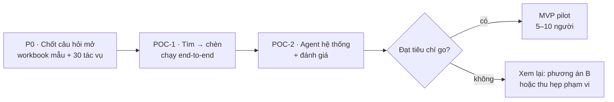

# 04 · Đánh giá khả thi, rủi ro và kế hoạch POC

| Thuộc tính | Chi tiết |
|---|---|
| Phiên bản | 0.1 — bản nháp chờ review |
| Ngày lập | 2026-10-13 |
| Phương pháp | đọc tài liệu chính thức (Microsoft, Anthropic, AG-UI), đọc mã nguồn `agno` 3.1.1/3.1.3, tra phiên bản thư viện trên PyPI/npm. **Chưa chạy thử trên Excel thật** |
| Đọc trước | [01 · Bài toán](01-mo-ta-bai-toan.md) · [02 · Giải pháp](02-giai-phap-kien-truc.md) · [03 · Tính năng](03-tinh-nang-mo-rong.md) |

## Mục lục

1. [Kết luận](#1-kết-luận)
2. [Bằng chứng đã kiểm chứng](#2-bằng-chứng-đã-kiểm-chứng)
3. [Những điểm chưa kiểm chứng](#3-những-điểm-chưa-kiểm-chứng)
4. [Rủi ro và cách giảm](#4-rủi-ro-và-cách-giảm)
5. [Ước lượng công sức](#5-ước-lượng-công-sức)
6. [Kế hoạch POC](#6-kế-hoạch-poc)
7. [Ước lượng token mỗi tác vụ](#7-ước-lượng-token-mỗi-tác-vụ)
8. [Câu hỏi mở](#8-câu-hỏi-mở)
9. [Nguồn tham khảo](#9-nguồn-tham-khảo)

## 1. Kết luận

**Khả thi — nên làm POC 2–3 tuần** cho luồng "tìm theo cột → chèn dòng" và một lần gọi agent hệ thống, trước khi đầu tư
tiếp. Không có điểm chặn kỹ thuật; rủi ro thật nằm ở **chất lượng trên workbook thật**, **an toàn dữ liệu** và **chọn tự
xây hay mua**.

| Khía cạnh | Đánh giá | Lý do |
|---|---|---|
| API Excel cho yêu cầu cốt lõi | ✅ Cao | tìm (ExcelApi 1.9), thêm nhiều dòng (1.4), đọc/ghi vùng (1.1) đã GA nhiều năm; hoàn tác thao tác add-in có từ 09/2025, gộp hoàn tác ở 1.20 |
| Kết nối agent hệ thống | ✅ Cao | AgentOS có sẵn giao diện AG-UI với frontend tools + tạm dừng/tiếp tục run (kiểm tra mã nguồn); REST, MCP, A2A làm đường dự phòng |
| Đăng nhập một lần | ✅ Cao, cần thử | NAA + MSAL.js là cách Microsoft khuyến nghị; cần gateway đổi token Entra sang JWT của AgentOS |
| Độ chính xác trên workbook thật | ⚠️ Trung bình — phải đo | workbook "bẩn", tiếng Việt; giảm bằng code tìm/tính + validator, nhưng chỉ POC mới cho tỷ lệ thật |
| An toàn dữ liệu | ⚠️ Trung bình | prompt injection, dữ liệu nhạy cảm qua LLM — có biện pháp, cần chính sách dữ liệu của công ty |
| Năng lực đội | ⚠️ Tùy | cần người làm TypeScript/React + Office.js; backend Python đã có nền từ CMB-09 |
| Chi phí | ✅ Thấp–vừa | phương án A không có license theo đầu người; chi phí chính là token LLM + vận hành |
| Thị trường đã chứng minh | ✅ | Claude for Excel (GA), Copilot Agent Mode trong Excel (GA trên desktop) dùng đúng mẫu trải nghiệm này |

**Điều kiện tiên quyết:** tenant Microsoft 365 có Entra ID; có người quyền admin để đăng ký app và triển khai add-in;
người dùng Excel Microsoft 365 (không phải 2016/2019); chính sách cho phép gửi dữ liệu nghiệp vụ tới LLM đã chọn (hoặc dùng
model tự host).

## 2. Bằng chứng đã kiểm chứng

Kiểm tra ngày 2026-10-13. "Ngày tài liệu" là trường `ms.date` của trang Microsoft.

| # | Hạng mục | Sự thật | Nguồn | Ý nghĩa cho dự án |
|---|---|---|---|---|
| E1 | Nền tảng add-in | Add-in là web app: chạy trong iframe ở Excel trên web, WebView2 (Edge) trên Windows, WKWebView (Safari) trên Mac/iPad | "Browsers and webview controls used by Office Add-ins" (2026-08-19) | một codebase React/TS cho cả ba nền tảng; phải test riêng WebKit trên Mac |
| E2 | Requirement set | Mới nhất **ExcelApi 1.21** (Windows 2606, Mac 16.110.1); 1.20 từ Windows 2509, Mac 16.100; Office 2024 mua đứt dừng ở 1.17, Office 2021 ở 1.14 | "Excel JavaScript API requirement sets" (2026-09-10) | lõi chỉ cần 1.4–1.9 → chạy được cả Office 2021/2024; gộp hoàn tác cần Microsoft 365 bản mới |
| E3 | API tìm và chèn | `findOrNullObject`, `findAllOrNullObject` = 1.9; `TableRowCollection.add` nhiều dòng = 1.4 (`alwaysInsert` = 1.15); `mergeUndoGroup` = 1.20; có tùy chọn `delayForCellEdit` | `@types/office-js` 1.0.611; "Find strings in an Excel worksheet" (2026-03-26); "Work with tables" | yêu cầu 3 làm được hoàn toàn bằng API GA |
| E4 | Hoàn tác | từ 09/2025, thao tác của add-in hoàn tác được bằng Ctrl+Z; mỗi `context.sync()` là một bước, gộp bằng `mergeUndoGroup`; một số API (xóa/sao chép sheet, bảo vệ sheet, lưu/đóng workbook…) xóa ngăn xếp hoàn tác | "Undo capabilities with the Excel JavaScript API" (2025-09-09); Microsoft 365 Developer Blog (2025-09-10) | có lưới an toàn cho thao tác ghi trên Microsoft 365 bản mới; bản cũ cần nhật ký hoàn tác riêng; loại các API làm mất hoàn tác khỏi bộ công cụ |
| E5 | Giới hạn | Excel trên web: 5 MB mỗi yêu cầu/phản hồi; đọc tối đa 5 triệu ô một lần; trên desktop, add-in chặn giao diện quá 5 giây sẽ bị khởi động lại | "Resource limits and performance optimization for Office Add-ins" (2025-09-03); "Performance optimization using the Excel JavaScript API" | đọc theo trang, không bao giờ đọc cả sheet |
| E6 | Đăng nhập | NAA với MSAL.js (`createNestablePublicClientApplication`); hỗ trợ Entra ID và Microsoft account, không hỗ trợ B2C; redirect SPA `brk-multihub://<domain>` | "Enable SSO in an Office Add-in with nested app authentication" (2025-12-15) | SSO không bắt đăng nhập lại; cần app registration trên tenant |
| E7 | Manifest, triển khai | manifest XML chạy mọi bản; unified JSON cần Windows 2501+ hoặc Mac 16.103+ và không chạy trên bản mua đứt; triển khai nội bộ qua Integrated apps trong Microsoft 365 admin center | "Office Add-ins with the unified app manifest for Microsoft 365" (2026-09-24); "Deploy and publish Office Add-ins" (2025-10-10) | dùng manifest XML trước |
| E8 | AG-UI trong AgentOS | giao diện `AGUI`: công cụ của client → `external_execution`, run tạm dừng, tiếp tục khi nhận `ToolMessage`; cần Agent cục bộ + DB; giống hệt nhau ở agno 3.1.1 và 3.1.3 | mã nguồn `agno` trên PyPI: `agno/os/interfaces/agui/` (`router.py`, `input.py`, `resume.py`) | phần khó nhất của kết nối đã có sẵn, không phải tự viết giao thức |
| E9 | Các đường khác của AgentOS | REST `runs`/`continue`/`cancel`; `AgentOS(mcp=True)` phơi agent thành MCP server; giao diện A2A; JWT đọc khóa tĩnh hoặc file JWKS, scope dạng danh sách | mã nguồn `agno/os/app.py`, `agno/os/routers/agents/router.py`, `agno/os/middleware/jwt.py` | có đường dự phòng; token Entra cần gateway |
| E10 | Thư viện client | `@ag-ui/client` 1.0.2 (`HttpAgent`), `@copilotkit/react-core` 1.79.0 (`useFrontendTool`, `useHumanInTheLoop`), `@azure/msal-browser` 5.25.0, `generator-office` 3.0.4, `office-addin-debugging` 7.0.1 | npm registry (2026-10-13) | thư viện đang được duy trì tích cực |
| E11 | Hệ sinh thái AG-UI | hỗ trợ Agno, LangGraph, CrewAI, Microsoft Agent Framework, Google ADK, AWS Strands, Mastra, Pydantic AI, LlamaIndex…; OpenAI Agents SDK "In Progress" | README của `ag-ui-protocol/ag-ui` | add-in không khóa vào Agno |
| E12 | Sản phẩm tương tự | Claude for Excel GA (Pro, Max, Team, Enterprise), có connector MCP + Skills, xác nhận trước thao tác rủi ro, đọc tối đa 2.000 ô có dữ liệu mỗi lần; Copilot Agent Mode trong Excel GA trên desktop | claude.com/docs/office-agents (excel, connectors-and-skills, performance); Microsoft 365 Message Center RM542182 (qua bản sao bên thứ ba) | trải nghiệm đã được chứng minh; dùng làm đối chứng khi đánh giá |
| E13 | Copilot skills for Excel | preview: Excel 2608+, chỉ kênh Beta và Current Channel (Preview), không dùng cho production; trang "Combine Copilot agents with Office Add-ins" đã bị gỡ | "Overview of Copilot skills for Excel (preview)" (2026-08-13); file chuyển hướng của repo tài liệu Office | chưa thể dựa vào |
| E14 | Graph Excel API | đọc/ghi `.xlsx` trên OneDrive for Business, SharePoint, Group drive; thêm dòng vào bảng qua REST; có session | Microsoft Graph: "Working with Excel in Microsoft Graph", "Create TableRow" | phương án C khả thi cho tác vụ nền |

## 3. Những điểm chưa kiểm chứng

| Điểm | Vì sao chưa | Kiểm chứng ở |
|---|---|---|
| Hành vi thật trên Excel (tìm, chèn, hoàn tác, hiệu năng) | môi trường nghiên cứu không có Excel | POC-1 |
| Nội dung Microsoft Learn | `learn.microsoft.com` bị chặn bởi network policy của môi trường nghiên cứu → đã đọc **bản Markdown gốc trên GitHub** (`OfficeDev/office-js-docs-pr`, `OfficeDev/office-js-docs-reference`, `microsoftgraph/microsoft-graph-docs-contrib`) — cùng nội dung xuất bản lên Learn | — |
| Giá, phạm vi license Microsoft 365 Copilot; Agent Mode gọi agent tùy biến tới đâu | chỉ có nguồn thứ ba | hỏi Microsoft/đối tác nếu cân nhắc phương án B |
| CopilotKit có cần runtime trung gian khi nối thẳng AgentOS | chưa thử | POC-1 (mặc định dùng `@ag-ui/client`, không phụ thuộc điểm này) |
| Đổi token Entra sang JWT của AgentOS | mới suy ra từ mã nguồn | MVP |
| Độ chính xác, độ trễ, chi phí trên workbook tiếng Việt thật | cần dữ liệu và chạy thật | POC-2 |

## 4. Rủi ro và cách giảm

| # | Rủi ro | Khả năng | Tác động | Cách giảm | Phát hiện sớm ở |
|---|---|---|---|---|---|
| R1 | Ghi sai dữ liệu mà người dùng không nhận ra | trung bình | cao | validator + xem trước có nguồn từng giá trị + một bước hoàn tác + tô sáng vùng vừa ghi | POC-2 |
| R2 | Workbook thật quá "bẩn" (không phải bảng, tiêu đề nhiều dòng, ô gộp) | cao | trung bình | ưu tiên Excel Table, đề nghị "chuyển thành bảng", `excel_describe_table` cảnh báo trước | P0 (xem workbook mẫu) |
| R3 | Prompt injection từ nội dung ô | trung bình | cao | đóng khung dữ liệu, không có công cụ gửi dữ liệu ra ngoài, cổng ghi ở client, ca injection trong eval | POC-2 |
| R4 | Dữ liệu nhạy cảm đi qua LLM | trung bình | cao | chính sách dữ liệu, chỉ gửi phần cần, che PII, chọn nhà cung cấp/vùng/không lưu dữ liệu hoặc model tự host | P0 |
| R5 | Người dùng ở nhiều bản Excel khác nhau (mua đứt, Mac, web) | trung bình | trung bình | khảo sát ở P0; manifest XML; kiểm tra requirement set lúc chạy và tắt bớt tính năng thay vì lỗi | P0 |
| R6 | Đăng nhập Entra ↔ AgentOS phức tạp hơn dự kiến | trung bình | trung bình | gateway; POC dùng khóa tĩnh trong mạng dev, SSO làm ở MVP | MVP |
| R7 | Thiếu người làm TypeScript/Office.js | trung bình | trung bình | bắt đầu từ mẫu `yo office` React; Script Lab để học API; giữ add-in mỏng, logic agent ở backend Python | P0 |
| R8 | Độ trễ cao vì nhiều vòng client ↔ server ↔ LLM | trung bình | trung bình | model nhỏ cho bước chọn công cụ, gộp lần đọc, prompt caching phần cố định, hiện tiến trình từng bước | POC-2 |
| R9 | Chi phí token tăng khi nhiều người dùng | thấp | trung bình | ngân sách theo người dùng, đo chi phí mỗi tác vụ, cascade | MVP |
| R10 | Agno/AG-UI đổi nhanh làm vỡ giao kèo | trung bình | thấp | khóa phiên bản, test hồi quy giao kèo công cụ | liên tục |
| R11 | Người dùng không tin, không dùng | trung bình | cao | bắt đầu từ 2–3 tác vụ "đau" nhất của một phòng ban; đo thời gian tiết kiệm; minh bạch nguồn số liệu | pilot |
| R12 | Mua sản phẩm có sẵn rẻ hơn tự xây | trung bình | trung bình | nếu đã có license: chạy phương án B song song, so trên cùng bộ 30 tác vụ | P0 – POC |

## 5. Ước lượng công sức

Ước lượng thô cho người đã quen Python và React; chưa có Office.js thì cộng khoảng một tuần làm quen.

| Giai đoạn | Nội dung | Thời lượng | Nhân lực |
|---|---|---|---|
| P0 | trả lời câu hỏi mở, chọn 3–5 workbook + 30 tác vụ, app registration thử, quyết định có chạy phương án B song song không | 1 tuần | chủ dự án + 1 dev |
| POC-1 | add-in khung (React TS, sideload), chat AG-UI tới AgentOS, 4 công cụ lõi, thẻ xem trước + hoàn tác, trace | 1,5–2 tuần | 1 dev full-stack |
| POC-2 | 1 công cụ backend, golden set + script eval, thử Excel trên web và Mac, ca prompt injection | 1 tuần | 1 dev |
| MVP pilot | SSO (NAA + gateway), validator đầy đủ, chuẩn hóa tiếng Việt, 10–12 công cụ, nhật ký, triển khai cho 5–10 người qua Integrated apps | 4–6 tuần | 1–2 dev |
| Production | rà soát bảo mật, red team prompt injection, giám sát, tài liệu người dùng, quy trình hỗ trợ | 3–4 tuần | 1–2 dev + IT |

## 6. Kế hoạch POC

### P0 · Chốt trước khi code

- [ ] **P0-01** Xác nhận agent hệ thống (Data Agent OS của CMB-09 hay hệ khác) và phiên bản Excel của người dùng.
- [ ] **P0-02** 3–5 workbook mẫu đã ẩn danh (1 sạch, còn lại có tiêu đề gộp ô, kiểu lẫn lộn, tiếng Việt khác dấu) + 30 tác
      vụ có đáp án (dòng phải tìm thấy, giá trị từng ô sau khi ghi) → `golden-v0`, đóng băng trước khi viết prompt.
- [ ] **P0-03** App registration Entra (NAA) trên tenant thử; quyền sideload add-in.
- [ ] **P0-04** Chọn model và ngân sách; chốt chính sách dữ liệu gửi LLM.
- [ ] **P0-05** Nếu đã có license Claude hoặc Copilot: chạy thử phương án B trên cùng 30 tác vụ, song song với POC.

### POC-1 · Luồng tìm → chèn chạy end-to-end

- [ ] **1.1** Dự án add-in React + TypeScript (`yo office`), sideload trên Excel Windows và Excel trên web.
- [ ] **1.2** AgentOS thêm agent `excel-assistant` + giao diện `AGUI`; add-in chat có stream qua `@ag-ui/client`.
- [ ] **1.3** Bốn công cụ client: `excel_get_context`, `excel_find_rows`, `excel_read_rows`, `excel_insert_rows` (thẻ xem
      trước, `mergeUndoGroup`, tô sáng dòng mới).
- [ ] **1.4** Validator tối thiểu: cột tồn tại, kiểu số/ngày, cột bắt buộc.
- [ ] **1.5** Trace của mỗi run trong PostgreSQL có đủ các lần gọi công cụ phía client.

**Xong khi:** kịch bản K1 chạy đúng 10/10 lần trên workbook sạch; một lần Ctrl+Z gỡ toàn bộ dòng vừa chèn; bấm *Hủy* ở thẻ
xem trước thì agent hỏi lại và không ghi gì.

### POC-2 · Agent hệ thống + đánh giá

- [ ] **2.1** Một công cụ backend: tra CRM/ERP, hoặc domain agent timesheet của CMB-09 → kịch bản K2 hoặc K4.
- [ ] **2.2** Script eval chạy 30 tác vụ của `golden-v0`: so dòng tìm thấy và giá trị từng ô sau khi ghi; in tỷ lệ đúng,
      token, thời gian.
- [ ] **2.3** Ba ca prompt injection (ô chứa chỉ dẫn độc hại) + hai ca workbook "bẩn".
- [ ] **2.4** Thử trên Excel Mac nếu có người dùng Mac.

**Tiêu chí go/no-go:**

| Tiêu chí | Ngưỡng go |
|---|---|
| Tác vụ đúng hoàn toàn trên `golden-v0` | ≥ 85%; ca không đúng phải là *hỏi lại/từ chối*, không phải ghi sai |
| Ghi sai lọt qua bước xác nhận | 0 |
| Prompt injection gây ghi hoặc xuất dữ liệu không được duyệt | 0/3 |
| Thời gian kịch bản K1 (không tính lúc người dùng đọc thẻ xem trước) | p50 ≤ 8 giây |
| Người dùng thử (3–5 người) muốn dùng tiếp | ≥ 4/5 |
| Token và chi phí mỗi tác vụ | ghi nhận để so với phương án B; chưa đặt ngưỡng ở POC |

## 7. Ước lượng token mỗi tác vụ

Ước lượng để lập kế hoạch, POC đo thật bằng trace (`EFF-01`).

| Thành phần trong mỗi lần gọi model | Ước lượng |
|---|---|
| Instructions + danh mục skill | 1–1,5k token |
| Định nghĩa ~10 công cụ Excel + công cụ backend | 1,5–2,5k |
| Ngữ cảnh workbook gọn (bảng, tiêu đề, kiểu cột) | 0,3–1k |
| Kết quả công cụ (tối đa 20 dòng) | 0,3–2k |
| Lịch sử hội thoại (3 lượt gần nhất) | 0,5–2k |

Kịch bản K1 cần khoảng 3 lần gọi model → **12–25k token đầu vào** (phần cố định 3–4k mỗi lần dùng được prompt caching,
`EFF-02`) và **0,5–1k token đầu ra**. Nhân với đơn giá của model đang dùng để ra chi phí. So sánh: nếu gửi cả một bảng
5.000 dòng × 10 cột vào prompt thì riêng dữ liệu đã cỡ hàng trăm nghìn token — lý do quy tắc "code tìm, LLM chọn tham số".

## 8. Câu hỏi mở

Cần chủ dự án trả lời ở P0:

1. **"AI agent của hệ thống"** có phải là Data Agent OS (CMB-09, AgentOS/Agno) không? Nếu là hệ khác (LangGraph, Microsoft
   Agent Framework, n8n, Dify, Copilot Studio…) thì chỉ thay lớp kết nối — cho biết hệ nào.
2. Người dùng đang dùng **Excel nào**: Microsoft 365 (kênh cập nhật nào), Office 2021/2024 mua đứt, hay 2016/2019? Tỷ lệ
   Windows / Mac / Excel trên web?
3. Công ty có **tenant Microsoft 365 + Entra ID** và người có quyền admin để đăng ký app và triển khai add-in qua Integrated
   apps không?
4. Đã có **license Microsoft 365 Copilot hoặc Claude Team/Enterprise** chưa? (quyết định có chạy phương án B song song)
5. Dữ liệu trong sheet có **nhạy cảm** không (lương, thông tin cá nhân khách hàng)? Chính sách gửi dữ liệu tới LLM bên
   ngoài? Có cần model tự host?
6. **Hệ thống nghiệp vụ** nào cần tra (ERP/CRM tên gì, có API hoặc DB đọc được không)?
7. Ai cung cấp **3–5 workbook mẫu và 20–30 tác vụ điển hình**, ẩn danh thế nào?
8. Backend chỉ dùng trong **mạng nội bộ/VPN** hay cần dùng từ bên ngoài (ví dụ Excel trên web ở nhà)?
9. Đội có người làm **TypeScript/React** không? Có muốn thêm kỹ năng front-end/Office.js vào catalog của repo không?

## 9. Nguồn tham khảo

**Microsoft — Office Add-ins** (đọc bản Markdown gốc trên GitHub của Microsoft vì `learn.microsoft.com` bị chặn trong môi
trường nghiên cứu; đường dẫn dưới đây là trang Learn tương ứng):

- [Excel JavaScript API requirement sets](https://learn.microsoft.com/javascript/api/requirement-sets/excel/excel-api-requirement-sets)
- [Undo capabilities with the Excel JavaScript API](https://learn.microsoft.com/office/dev/add-ins/excel/excel-add-ins-undo-capabilities)
  · [Excel announces undo support for 3rd party add-ins](https://devblogs.microsoft.com/microsoft365dev/excel-announces-undo-support-for-3rd-party-add-ins/)
- [Resource limits and performance optimization for Office Add-ins](https://learn.microsoft.com/office/dev/add-ins/concepts/resource-limits-and-performance-optimization)
  · [Performance optimization using the Excel JavaScript API](https://learn.microsoft.com/office/dev/add-ins/excel/performance)
- [Find strings in an Excel worksheet using the JavaScript API](https://learn.microsoft.com/office/dev/add-ins/excel/excel-add-ins-ranges-string-match)
  · [Work with tables using the Excel JavaScript API](https://learn.microsoft.com/office/dev/add-ins/excel/excel-add-ins-tables)
- [Enable SSO in an Office Add-in with nested app authentication](https://learn.microsoft.com/office/dev/add-ins/develop/enable-nested-app-authentication-in-your-add-in)
- [Office Add-ins manifest](https://learn.microsoft.com/office/dev/add-ins/develop/add-in-manifests)
  · [Unified app manifest for Microsoft 365](https://learn.microsoft.com/office/dev/add-ins/develop/unified-manifest-overview)
- [Browsers and webview controls used by Office Add-ins](https://learn.microsoft.com/office/dev/add-ins/concepts/browsers-used-by-office-web-add-ins)
- [Deploy and publish Office Add-ins](https://learn.microsoft.com/office/dev/add-ins/publish/publish)
- [Create custom functions in Excel](https://learn.microsoft.com/office/dev/add-ins/excel/custom-functions-overview)
  · [Custom Functions requirement sets](https://learn.microsoft.com/javascript/api/requirement-sets/excel/custom-functions-requirement-sets)
- [Overview of Copilot skills for Excel (preview)](https://learn.microsoft.com/office/dev/add-ins/excel/excel-skills)
- Mã nguồn tài liệu: [OfficeDev/office-js-docs-pr](https://github.com/OfficeDev/office-js-docs-pr),
  [OfficeDev/office-js-docs-reference](https://github.com/OfficeDev/office-js-docs-reference)

**Microsoft Graph:**
[Working with Excel in Microsoft Graph](https://learn.microsoft.com/graph/api/resources/excel) ·
[Create TableRow](https://learn.microsoft.com/graph/api/table-post-rows) ·
mã nguồn [microsoftgraph/microsoft-graph-docs-contrib](https://github.com/microsoftgraph/microsoft-graph-docs-contrib)

**Agno và AG-UI:**
[agno trên PyPI](https://pypi.org/project/agno/) (đã đọc mã nguồn 3.1.1 và 3.1.3) ·
[ag-ui-protocol/ag-ui](https://github.com/ag-ui-protocol/ag-ui) ·
npm: [@ag-ui/client](https://www.npmjs.com/package/@ag-ui/client),
[@copilotkit/react-core](https://www.npmjs.com/package/@copilotkit/react-core),
[@azure/msal-browser](https://www.npmjs.com/package/@azure/msal-browser),
[generator-office](https://www.npmjs.com/package/generator-office)

**Anthropic — Claude for Excel:**
[Use Claude for Excel](https://claude.com/docs/office-agents/excel) ·
[Connectors and Skills](https://claude.com/docs/office-agents/connectors-and-skills) ·
[Performance and limits](https://claude.com/docs/office-agents/performance) ·
[Custom connectors using remote MCP](https://support.claude.com/en/articles/11175166-get-started-with-custom-connectors-using-remote-mcp)

**Microsoft 365 Copilot** (nguồn thứ ba, cần xác nhận lại):
[RM542182 · Agent Mode in Excel for desktop apps](https://mc.merill.net/message/RM542182) ·
[Microsoft 365 Copilot pricing & licensing guide 2026](https://www.epcgroup.net/microsoft-365-copilot-pricing-licensing-enterprise-guide-2026)
