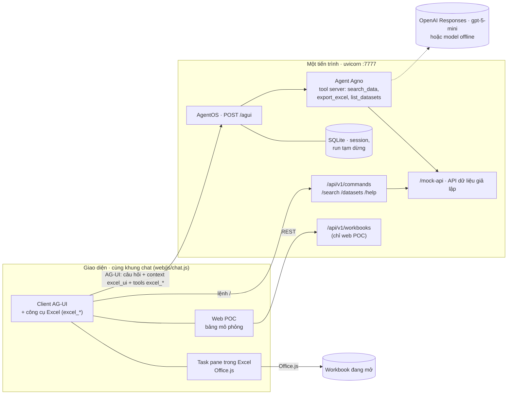
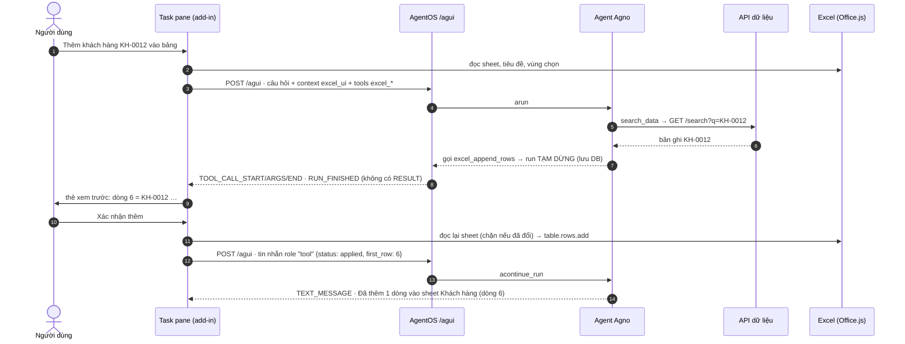

# 06 · POC: hướng dẫn cài đặt và sử dụng

| Thuộc tính | Chi tiết |
|---|---|
| Phiên bản | 0.2 — POC chạy được, có add-in cho Excel thật |
| Ngày | 2026-10-13 |
| Stack | **AgentOS** (Agno 3.1.3) + giao thức **AG-UI** + **agent Agno**, model mặc định **gpt-5-mini** (OpenAI Responses API) |
| Hai giao diện, một khung chat | **Web POC** (bảng Excel mô phỏng, file trên server) và **task pane Office add-in** (Excel thật, Office.js) |
| Chạy không cần API key | Có — chế độ offline (luật cố định, đi qua đúng đường code của Agno); có `OPENAI_API_KEY` thì dùng gpt-5-mini |
| Kiểm thử | 47 test unit + integration (không mạng, không key) + 2 test giao diện bằng Chromium (web POC; task pane với Office.js giả lập) |
| Quyết định liên quan | [ADR-09](05-adr-runtime-agent.md#bổ-sung--adr-09--quay-lại-agent-agno-một-agent-công-cụ-excel-chạy-ở-add-in) — bản 0.1 viết agent bằng OpenAI Agents SDK (ADR-08), bản 0.2 quay lại Agno để có công cụ Excel chạy ở add-in |

## Mục lục

1. [POC làm được gì](#1-poc-làm-được-gì)
2. [Kiến trúc POC](#2-kiến-trúc-poc)
3. [Công cụ Excel chạy ở add-in](#3-công-cụ-excel-chạy-ở-add-in)
4. [Cấu trúc mã nguồn](#4-cấu-trúc-mã-nguồn)
5. [Cài đặt và chạy web POC](#5-cài-đặt-và-chạy-web-poc)
6. [Chạy trong Excel thật](#6-chạy-trong-excel-thật)
7. [Sử dụng](#7-sử-dụng)
8. [API](#8-api)
9. [Thay API giả lập bằng API thật](#9-thay-api-giả-lập-bằng-api-thật)
10. [Kiểm thử](#10-kiểm-thử)
11. [Giới hạn và bước tiếp theo](#11-giới-hạn-và-bước-tiếp-theo)
12. [Xử lý sự cố](#12-xử-lý-sự-cố)

## 1. POC làm được gì

| # | Yêu cầu | Trong POC |
|---|---|---|
| 1 | Chat UI → AgentOS (AG-UI) → agent gọi **một API**, đầu ra là **file Excel**; **bấm vào file → hiện dữ liệu** | *"Tạo file Excel khách hàng ở Hà Nội"* → tool `export_excel` gọi `POST /export` → **thẻ file**. Web POC: bấm **Xem dữ liệu** → bảng. Trong Excel: bấm **Chèn vào workbook** → thành sheet mới |
| 2 | **`/search`** theo cột hoặc theo text → API search → **chọn kết quả → áp vào cột** | `/search Đà Nẵng` (theo **cột đang chọn** trên sheet, hoặc mọi cột), `/search Thành phố: Đà Nẵng` → bảng kết quả có ô tích → **Ghi vào cột…** (các dòng đang chọn) hoặc **Thêm thành dòng mới**. Chạy bằng code, không tốn token |
| 3 | Agent **thao tác trực tiếp trên sheet**: tìm theo cột, chèn nguyên một dòng từ hệ thống, ghi cột | *"Thêm khách hàng KH-0012 vào bảng"* → `search_data` (server) → `excel_append_rows` (chạy ở add-in) → run **tạm dừng**, add-in hiện **xem trước** → người dùng **xác nhận** → ghi → run **chạy tiếp**, agent tóm tắt |
| 4 | Chạy trong **Excel thật** | Task pane + manifest (`addin/`), công cụ Excel viết bằng Office.js, nút **Mở Excel Agent** ở tab Home |
| 5 | Agent **Agno**, model **gpt-5-mini** | Một `Agent` Agno, `OpenAIResponses(gpt-5-mini, reasoning low, store=false)`. Không dùng Team/agent điều hướng — lý do ở [ADR-09](05-adr-runtime-agent.md#bổ-sung--adr-09--quay-lại-agent-agno-một-agent-công-cụ-excel-chạy-ở-add-in) |

Quy tắc giữ từ thiết kế (tài liệu 02): **code tìm và tính, LLM chọn tham số**; **mọi lệnh ghi đều có xem trước và chờ người
dùng xác nhận** — cổng ghi đặt ở add-in, agent không vượt qua được; ngay trước khi ghi, add-in đọc lại sheet và chặn nếu
dữ liệu đã đổi; lệnh bắt đầu bằng `/` chạy bằng code.

## 2. Kiến trúc POC



**Luồng tạm dừng/tiếp tục** — điểm khác biệt chính so với bản 0.1: agent gọi công cụ chạy trong Excel.



| Sự kiện Agno | Sự kiện AG-UI tới giao diện | Giao diện làm gì |
|---|---|---|
| `RunContent` | `TEXT_MESSAGE_START/CONTENT/END` | hiện chữ |
| tool server bắt đầu / xong | `TOOL_CALL_START/ARGS/END` → `TOOL_CALL_RESULT` | chip ✓; kết quả `workbook` → thẻ file, `search_results` → bảng kết quả |
| `RunPaused` (tool `external_execution`) | `TOOL_CALL_START/ARGS/END` **không có RESULT**, rồi `RUN_FINISHED` | chạy công cụ Excel trên host; tool ghi → thẻ xác nhận; gửi kết quả để run chạy tiếp |
| lỗi | `RUN_ERROR` | hiện lỗi |

## 3. Công cụ Excel chạy ở add-in

Định nghĩa trong `web/js/excel-tools.js`, gửi kèm **mỗi** lượt chat. Model thấy chúng như tool bình thường; AgentOS biến
thành tool `external_execution`. Số dòng luôn là **số dòng thật trong Excel** (dòng tiêu đề là 1 với bảng ở A1).

| Công cụ | Loại | Tham số | Kết quả trả agent |
|---|---|---|---|
| `excel_get_context` | đọc | — | workbook, sheet, Table, tiêu đề cột, số dòng, vùng chọn, 3 dòng đầu |
| `excel_find_rows` | đọc | `query`, `column?`, `match` (`contains`/`exact`), `limit` | `matches: [{row, values}]`, `total`; chọn dòng tìm được trên sheet |
| `excel_read_rows` | đọc | `rows`, `columns?` | giá trị các dòng |
| `excel_set_values` | **ghi** | `column`, `rows`, `values` (1 giá trị hoặc bằng số dòng), `create_column` | `status: applied/rejected/error`, `changed_rows` |
| `excel_append_rows` | **ghi** | `rows: [{tên cột: giá trị}]` | `status`, `first_row`, `last_row` |

Hai **host** cùng giao diện (`context`, `readTable`, `select`, `setValues`, `appendRows`):

| | Web POC (`hosts/web-host.js`) | Excel thật (`hosts/office-host.js`) |
|---|---|---|
| Dữ liệu | file `.xlsx` trên server, mỗi lần ghi tạo phiên bản mới | workbook đang mở; vùng dữ liệu = Excel Table đầu tiên của sheet, không có thì vùng đã dùng |
| Ghi | `POST /api/v1/workbooks/{id}/apply` (server kiểm kiểu, trùng mã, `expected_version`) | `Range.values`, `table.rows.add`, `table.columns.add` |
| Kiểm trước khi ghi | phía client (cột, dòng, trùng mã ở cột đầu) + phía server | phía client + đọc lại sheet ngay trước khi ghi (ô hoặc số dòng đổi → chặn) |
| Hoàn tác | nút **↶ Hoàn tác** (về phiên bản trước) | Ctrl+Z |
| Giữ số 0 đầu (điện thoại, mã) | server giữ dạng chữ | ghi dạng `'0957…` để Excel không đổi thành số |

## 4. Cấu trúc mã nguồn

Theo [best practice cấu trúc dự án Python AI](../../python-ai-project-structure-best-practices.md): `src/` layout, tách
tầng API (chỉ routing) — service — schema — agent, prompt nằm ngoài code. Dùng **uv** như cả repo.

```text
projects/cmb-10-excel-agent-addin/
├── pyproject.toml · uv.lock · Makefile · .env.example
├── prompts/agents/excel_agent.yml  # [PROMPT ISOLATION] instructions của agent (biến $datasets)
├── addin/                          # Office add-in: manifest.xml + hướng dẫn nạp vào Excel
├── src/excel_agent/
│   ├── main.py                     # AgentOS + AGUI + API + web/task pane (create_app)
│   ├── core/                       # [SHARED KERNEL] config, text (tiếng Việt), values, exceptions, logging
│   ├── api/v1/                     # [API LAYER] commands.py (lệnh /), workbooks.py (web POC), router.py
│   ├── schemas/                    # [CONTRACTS] data_api.py, workbook.py, commands.py
│   ├── services/                   # [SERVICE LAYER] data_api_client.py, workbook_service.py
│   ├── agents/                     # [AGENT LAYER] Agno
│   │   ├── excel_agent.py          #   build_agent + build_model (gpt-5-mini / offline)
│   │   ├── tools.py                #   tool server: SystemDataTools (search_data, export_excel, list_datasets)
│   │   ├── context.py              #   UiState (context excel_ui) + AgentDeps
│   │   ├── commands.py             #   lệnh /search, /datasets, /help (không gọi model)
│   │   └── summaries.py            #   câu trả lời từ kết quả tool (lệnh / và model offline)
│   ├── offline_llm/                # OpenAI Responses API giả lập: chế độ offline (RuleBrain) + test (ScriptBrain)
│   ├── builders/prompt_builder.py  # [PROMPT BUILDERS] nạp YAML + điền biến
│   └── mock_data_api/              # API dữ liệu giả lập (thay ERP/CRM)
├── web/
│   ├── index.html · taskpane.html · commands.html · styles.css · assets/icon-*.png
│   └── js/  agui.js (client AG-UI) · chat.js (vòng tạm dừng/tiếp tục, thẻ) · excel-tools.js (giao kèo công cụ)
│            hosts/web-host.js · hosts/office-host.js · main-web.js · main-taskpane.js · util.js
├── scripts/                        # generate_sample_data.py, generate_addin_icons.py
└── tests/                          # unit/ · integration/ (AG-UI qua AgentOS thật) · e2e/ (Chromium, Office.js giả lập)
```

## 5. Cài đặt và chạy web POC

**Cần:** Python ≥ 3.12, [uv](https://docs.astral.sh/uv/), trình duyệt. Không cần Excel.

```bash
cd projects/cmb-10-excel-agent-addin
make setup        # uv sync + tạo .env từ .env.example
make dev          # http://127.0.0.1:7777
```

Góc phải trên hiện **"Offline · chưa có OPENAI_API_KEY"** — vẫn thử được mọi luồng với các câu mẫu ở mục 7.

**Bật gpt-5-mini** khi có key: sửa `.env` rồi chạy lại `make dev` → góc phải hiện **"Agno · gpt-5-mini"**.

```dotenv
OPENAI_API_KEY=sk-...
OPENAI_MODEL=gpt-5-mini
OPENAI_REASONING_EFFORT=low
OPENAI_STORE=false
```

| Biến | Mặc định | Ý nghĩa |
|---|---|---|
| `OPENAI_API_KEY` | trống | trống → chế độ offline |
| `OPENAI_MODEL` | `gpt-5-mini` | model của agent |
| `OPENAI_REASONING_EFFORT` | `low` | `minimal` · `low` · `medium` · `high` (chỉ gửi với model gpt-5/o) |
| `OPENAI_STORE` | `false` | `false` = OpenAI không lưu hội thoại, Agno gửi lại ngữ cảnh mỗi lượt |
| `OPENAI_BASE_URL` | trống | gateway tương thích OpenAI |
| `AGENT_MODE` | `auto` | `auto` (có key thì OpenAI) · `openai` · `offline` |
| `NUM_HISTORY_RUNS` | `4` | số lượt hội thoại trước đưa vào ngữ cảnh |
| `TOOL_CALL_LIMIT` | `12` | số lần gọi tool tối đa một lượt |
| `DATA_API_URL` | trống | trống → API giả lập gắn trong server |
| `MOUNT_MOCK_API` | `true` | gắn API giả lập vào server |
| `DEFAULT_DATASET` | `khach_hang` | dataset mặc định khi không đoán được từ sheet |
| `STORAGE_DIR` | `./var` | file Excel của web POC + SQLite của AgentOS |
| `HOST`, `PORT` | `127.0.0.1`, `7777` | địa chỉ server |

## 6. Chạy trong Excel thật

Chi tiết: [`addin/README.md`](../addin/README.md). Tóm tắt:

```bash
make addin-certs   # một lần, cần Node.js: chứng chỉ https://localhost tin cậy
make dev-https     # https://localhost:7777
```

Nạp `addin/manifest.xml`: **Excel web** → Home → Add-ins → More Add-ins → **Upload My Add-in**; **Windows** →
`npx office-addin-debugging start addin/manifest.xml desktop`; **Mac** → chép vào thư mục `wef`. Nút **Mở Excel Agent**
xuất hiện ở tab Home. Triển khai cho công ty: `make addin-manifest BASE_URL=https://<domain>` rồi admin Microsoft 365 đưa
lên **Integrated apps**.

Dòng trạng thái trên cùng task pane cho biết workbook, sheet và vùng đang chọn (cập nhật theo sự kiện chọn ô của Excel).

## 7. Sử dụng

### 7.1 Tạo file Excel từ hệ thống

*Tạo file Excel danh sách khách hàng ở Hà Nội* · *Xuất danh sách đơn hàng đang giao ra Excel* → thẻ file (tên, số dòng,
bộ lọc). Web POC: **Xem dữ liệu** mở bảng bên phải (sheet dữ liệu + sheet *Thông tin*). Trong Excel: **Chèn vào workbook**
thêm các sheet của file vào cuối workbook (ExcelApi 1.13; bản cũ hơn mở thành workbook mới). Nút ⬇ tải file `.xlsx`.

### 7.2 Agent thao tác trên sheet đang mở

| Câu mẫu (chạy được cả offline) | Agent làm |
|---|---|
| *Tìm dòng có Thành phố là Đà Nẵng trong bảng* | `excel_find_rows(column="Thành phố", query="Đà Nẵng")` → trả số dòng, chọn dòng trên sheet |
| *Thêm khách hàng KH-0012 vào bảng* | `search_data` (hệ thống) → `excel_append_rows` với các cột trùng tên → **xem trước → xác nhận** |
| *Ghi "VIP" vào cột Phân khúc cho các dòng đang chọn* | `excel_set_values` cho các dòng đang chọn → bảng **giá trị cũ → mới** → xác nhận |

Có gpt-5-mini thì nói tự nhiên hơn, ví dụ *"tra 3 khách hàng mới nhất ở Huế rồi thêm vào cuối bảng"*, *"điền email từ
hệ thống cho các dòng đang chọn theo Mã KH"*. Chế độ offline chỉ hiểu các mẫu ở bảng trên.

Mỗi thẻ xác nhận ghi rõ sẽ ghi gì, vào đâu; **Hủy** → agent nhận `rejected` và không thử lại. Thêm trùng mã ở cột đầu
(Mã KH, Mã SP…), dòng ngoài vùng dữ liệu, cột không tồn tại → bị chặn trước khi tới bước xác nhận, agent báo lại lý do.

### 7.3 Lệnh `/search`

| Lệnh | Ý nghĩa |
|---|---|
| `/search Đà Nẵng` | tìm trong hệ thống; đang chọn một cột có trong dataset thì **chỉ tìm trong cột đó** |
| `/search Thành phố: Đà Nẵng` · `/search Thành phố=Đà Nẵng` | chỉ định cột |
| `/search in:san_pham laptop` · `/search @san_pham laptop` | chọn dataset (mặc định: đoán theo tiêu đề cột của sheet) |
| `/datasets` · `/help` | danh sách dữ liệu · hướng dẫn |

Tích chọn kết quả → **Ghi vào cột…** (chọn cột đích — có *+ Tạo cột mới…* — và trường lấy giá trị; 1 kết quả → cùng giá
trị cho mọi dòng đang chọn, n kết quả ↔ n dòng) hoặc **Thêm thành dòng mới** → xác nhận.

## 8. API

| Endpoint | Ai gọi | Mô tả |
|---|---|---|
| `POST /agui` | giao diện | AG-UI của AgentOS: `RunAgentInput` (kèm `tools` excel_* và context `excel_ui`) → stream SSE; tin nhắn `role: "tool"` ở cuối = chạy tiếp run đang tạm dừng |
| `POST /api/v1/commands` | giao diện | `{text, ui}` → `{handled, result, text}` cho `/search`, `/datasets`, `/help` |
| `POST /agents/excel-agent/runs` | script, hệ thống khác | REST chuẩn của AgentOS (không có công cụ Excel) |
| `GET /health`, `GET /info`, `GET /sessions/...` | giám sát | của AgentOS |
| `GET /api/v1/config` | giao diện | chế độ (openai/offline), model |
| `GET /api/v1/workbooks...` · `POST .../apply` · `POST .../undo` | web POC | xem, tải, ghi có kiểm chứng, hoàn tác file trên server |
| `GET /static/taskpane.html` | Excel | task pane của add-in |
| `/mock-api/datasets` · `/mock-api/search` · `/mock-api/export` | agent (tool server) | API dữ liệu giả lập |

## 9. Thay API giả lập bằng API thật

Đặt `MOUNT_MOCK_API=false` và `DATA_API_URL=https://<api-của-công-ty>`. API thật cần đúng ba endpoint (giao kèo trong
`schemas/data_api.py`), hoặc viết lại `services/data_api_client.py` cho API sẵn có:

| Endpoint | Vào | Ra |
|---|---|---|
| `GET /datasets` | — | `[{name, title, key, columns:[{name, type}], rows}]` — `type`: text · number · money · date |
| `GET /search` | `q`, `dataset`, `column` (tùy chọn), `limit` | `{dataset, query, column, total, columns, records:[{cột: giá trị}]}` |
| `POST /export` | `{dataset, filters:[{column, op, value}], columns, title, limit}` | file `.xlsx`; header `X-File-Name`, `X-Row-Count` |

Không phải sửa agent hay giao diện: danh mục dataset và tên cột đưa vào instructions của agent lúc chạy.

## 10. Kiểm thử

```bash
make test        # 47 test unit + integration, không mạng, không API key
make setup-e2e   # một lần: Playwright (dùng Chromium có sẵn của máy)
make e2e         # 2 test giao diện: web POC và task pane (Office.js giả lập)
make lint
```

| Nhóm | Bao phủ |
|---|---|
| `tests/unit` | tiếng Việt, số/ngày, cú pháp `/search`, luật offline, API giả lập + SDK `openai` đọc được stream, dựng agent/model (gpt-5-mini, reasoning, `store=false`), API dữ liệu, workbook service |
| `tests/integration` | `POST /agui` qua AgentOS thật: xuất file; **tạm dừng → chạy tiếp** khi thêm dòng; người dùng hủy; tìm trong sheet; ghi cột theo vùng chọn; không có công cụ Excel; model "kịch bản" giả gpt-5-mini gọi song song tool server + tool Excel, kiểm tham số gửi OpenAI và `call_id` khi chạy tiếp; lệnh `/`; REST của AgentOS |
| `tests/e2e/test_ui_flow.py` | web POC trên Chromium: file → xem → thêm dòng có xác nhận → chặn trùng mã → hủy → tìm → ghi cột → `/search` → hoàn tác → tải |
| `tests/e2e/test_taskpane.py` | task pane 400 px + Office.js giả lập: tìm, thêm vào Excel Table (giữ số 0 đầu), ghi vùng chọn, **chặn ghi khi ô bị sửa sau lúc xem trước**, `/search`, chèn file xuất, sheet không phải Table bắt đầu ở B3 |

## 11. Giới hạn và bước tiếp theo

| Giới hạn của POC | Bước tiếp theo |
|---|---|
| **Chưa chạy với gpt-5-mini thật** (chưa có key; môi trường làm POC chặn `api.openai.com`) | Điền key, thử các câu ở 7.2; lập `golden-v0` 30 tác vụ để đo (tài liệu 04 · POC-2) |
| **Chưa chạy trong Excel thật** — Office.js kiểm bằng bản giả lập | Nạp manifest vào Excel web/Windows/Mac, chạy lại kịch bản của `test_taskpane.py` bằng tay; ghi lại khác biệt |
| Không có đăng nhập | NAA (Entra ID) + JWT của AgentOS (tài liệu 02 §7) |
| SQLite, file web POC trong `var/` | PostgreSQL dùng chung CMB-09 |
| Đọc tối đa 5.000 dòng mỗi lần tìm; ghi tối đa 200 dòng | Tìm theo trang / `Range.find` (ExcelApi 1.9) cho sheet lớn |
| Tìm được nhiều dòng thì Excel chỉ chọn dòng đầu | Tô sáng tạm bằng conditional format, hoặc danh sách dòng bấm được trong chat |
| Không có agent điều hướng | Khi có nhiều miền: agent Excel gọi agent miền (CMB-09) như tool server |

## 12. Xử lý sự cố

| Hiện tượng | Cách xử lý |
|---|---|
| Góc phải hiện *Offline* dù đã có key | `.env` nằm trong `projects/cmb-10-excel-agent-addin/`; chạy lại `make dev`; kiểm `AGENT_MODE` |
| Lỗi kết nối / key / model trong khung chat | mạng hoặc proxy chặn `api.openai.com`, `OPENAI_BASE_URL` sai, key không có quyền dùng `gpt-5-mini`. Lệnh `/search` vẫn chạy |
| Task pane trắng hoặc báo lỗi chứng chỉ | chạy `make addin-certs`, dùng `make dev-https`, mở thử `https://localhost:7777/static/taskpane.html` trong trình duyệt |
| *Add-in này chỉ chạy trong Excel* / *Không tải được Office.js* | mở trang qua nút **Mở Excel Agent** trong Excel, không mở trực tiếp; máy phải tải được `appsforoffice.microsoft.com` |
| *Sheet … chưa có dữ liệu* | sheet cần một dòng tiêu đề cột; bảng có tiêu đề báo cáo phía trên → chuyển thành Excel Table (Ctrl+T) |
| *… đã đổi từ lúc xem trước* | sheet vừa được sửa trong lúc thẻ xác nhận đang mở — gửi lại yêu cầu |
| *File đã đổi sang phiên bản …* (web POC) | file vừa được sửa ở thẻ khác — **Làm mới** rồi áp lại |
| Muốn xóa dữ liệu chạy thử | `make clean` (xóa `var/`) |
