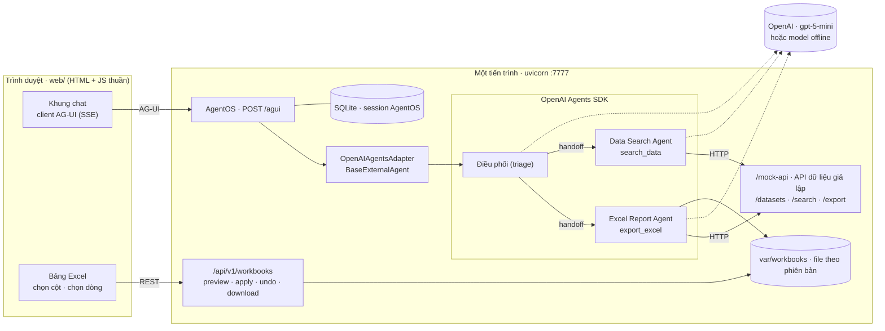
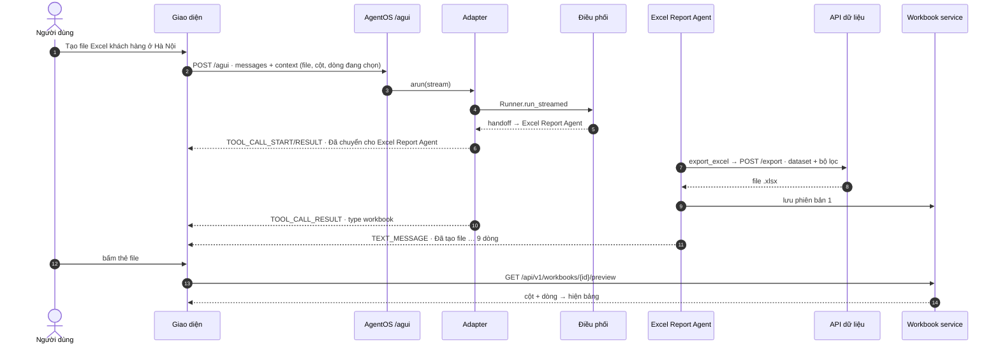
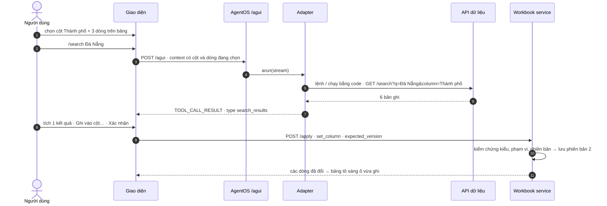

# 06 · POC: hướng dẫn cài đặt và sử dụng

| Thuộc tính | Chi tiết |
|---|---|
| Phiên bản | 0.1 — POC chạy được |
| Ngày | 2026-10-13 |
| Stack | **AgentOS** (Agno 3.1.3, chỉ làm runtime phục vụ) + giao thức **AG-UI** + agent viết bằng **OpenAI Agents SDK** 0.23.1, model mặc định **gpt-5-mini** |
| Chạy không cần API key | Có — chế độ offline (luật cố định) để thử giao diện; có `OPENAI_API_KEY` thì tự chuyển sang gpt-5-mini |
| Kiểm thử | 38 test unit + integration (không mạng, không key) + 1 test giao diện bằng Chromium thật |
| Đọc trước | [02 · Giải pháp và kiến trúc](02-giai-phap-kien-truc.md) · [05 · ADR-07 runtime agent](05-adr-runtime-agent.md) |

## Mục lục

1. [POC làm được gì](#1-poc-làm-được-gì)
2. [Kiến trúc POC](#2-kiến-trúc-poc)
3. [Cấu trúc mã nguồn](#3-cấu-trúc-mã-nguồn)
4. [Cài đặt và chạy](#4-cài-đặt-và-chạy)
5. [Sử dụng](#5-sử-dụng)
6. [API](#6-api)
7. [Thay API giả lập bằng API thật](#7-thay-api-giả-lập-bằng-api-thật)
8. [Kiểm thử](#8-kiểm-thử)
9. [Giới hạn và bước tiếp theo](#9-giới-hạn-và-bước-tiếp-theo)
10. [Xử lý sự cố](#10-xử-lý-sự-cố)

## 1. POC làm được gì

| # | Yêu cầu | Trong POC |
|---|---|---|
| 1 | Chat UI → AgentOS (AG-UI) → agent gọi **một API**, đầu ra là **file Excel** | Gõ *"Tạo file Excel khách hàng ở Hà Nội"* → agent điều phối chuyển cho **Excel Report Agent** → tool `export_excel` gọi `POST /export` của API dữ liệu → nhận file `.xlsx` (định dạng Excel Table, số tiền, ngày) → giao diện hiện **thẻ file** |
| 2 | **Bấm vào file Excel → hiện dữ liệu** | Bấm thẻ file → bảng dữ liệu bên phải (các sheet, chữ cái cột, số dòng Excel), tải file về, hoàn tác |
| 3 | **`/search`** theo cột, hoặc truyền text → gọi API search → **chọn kết quả → áp vào cột** | `/search Đà Nẵng` (mọi cột, hoặc theo **cột đang chọn** trên bảng), `/search Thành phố: Đà Nẵng` (chỉ định cột) → `GET /search` → bảng kết quả có ô tích → **Ghi vào cột…** (ghi vào các dòng đang chọn) hoặc **Thêm thành dòng mới** → xác nhận → file lên phiên bản mới |
| 4 | Agent viết bằng **OpenAI Agents SDK** (không viết agent bằng Agno), **gpt-5-mini**, có **agent điều hướng** | `Điều phối` (triage) handoff sang `Excel Report Agent` / `Data Search Agent`; AgentOS chỉ phục vụ qua adapter `OpenAIAgentsAdapter` |

Quy tắc giữ nguyên từ thiết kế (tài liệu 02): **code tìm và tính, LLM chọn tham số**; **mọi lệnh ghi do người dùng xác nhận
trên giao diện** (agent chỉ đề xuất kết quả, không tự ghi); mỗi lần ghi tạo **phiên bản mới**, hoàn tác = quay về phiên bản
trước; lệnh bắt đầu bằng `/` chạy bằng code, **không tốn token**.

## 2. Kiến trúc POC



**Vì sao cần adapter:** AgentOS 3.1 có adapter cho Claude Agent SDK, LangGraph, DSPy… nhưng chưa có cho OpenAI Agents SDK.
`OpenAIAgentsAdapter` (≈ 250 dòng) chạy `Runner.run_streamed` rồi đổi sự kiện của SDK sang sự kiện AgentOS; AgentOS đổi tiếp
sang AG-UI. Nhờ vậy được dùng nguyên phần AgentOS làm tốt (endpoint AG-UI, session lưu SQLite/PostgreSQL, REST `/agents/…`,
lịch sử hội thoại) mà agent vẫn viết thuần OpenAI Agents SDK.

| Sự kiện OpenAI Agents SDK | Sự kiện AgentOS | Sự kiện AG-UI tới trình duyệt |
|---|---|---|
| `raw_response_event` · `response.output_text.delta` | `RunContent` | `TEXT_MESSAGE_START/CONTENT/END` |
| `run_item_stream_event` · `tool_called`, `handoff_requested` | `ToolCallStarted` | `TOOL_CALL_START`, `TOOL_CALL_ARGS` |
| `run_item_stream_event` · `tool_output`, `handoff_occured` | `ToolCallCompleted` | `TOOL_CALL_END`, `TOOL_CALL_RESULT` (JSON) |

Giao diện đọc `TOOL_CALL_RESULT` theo trường `type`: `workbook` → thẻ file, `search_results` → bảng kết quả chọn được,
`handoff` → "Đã chuyển cho …", `error` → báo lỗi.

### 2.1 Luồng 1 · chat → file Excel → xem dữ liệu



### 2.2 Luồng 2 · /search → chọn → áp vào cột



## 3. Cấu trúc mã nguồn

Theo [best practice cấu trúc dự án Python AI](../../python-ai-project-structure-best-practices.md): `src/` layout, tách
tầng API (chỉ routing) — service (logic) — schema (giao kèo) — agent, prompt nằm ngoài code. Dùng **uv** như cả repo thay
cho Poetry.

```text
projects/cmb-10-excel-agent-addin/
├── pyproject.toml · uv.lock · Makefile · .env.example
├── prompts/agents/                 # [PROMPT ISOLATION] instructions của từng agent (YAML)
│   ├── triage.yml                  #   agent điều phối
│   ├── excel_report.yml            #   agent xuất Excel
│   ├── data_search.yml             #   agent tìm kiếm
│   └── single.yml                  #   khi USE_TRIAGE=false (một agent đủ tool)
├── src/excel_agent/
│   ├── main.py                     # khởi tạo AgentOS + AGUI + API + UI (create_app)
│   ├── core/                       # [SHARED KERNEL] config (pydantic-settings), text (chuẩn hóa tiếng Việt),
│   │                               #   values (số/ngày kiểu Việt), exceptions, logging
│   ├── api/                        # [API LAYER] chỉ routing + DI
│   │   ├── dependencies.py
│   │   └── v1/{router.py, workbooks.py}
│   ├── schemas/                    # [CONTRACTS] Pydantic v2: data_api.py, workbook.py
│   ├── services/                   # [SERVICE LAYER] data_api_client.py (HTTP tới API dữ liệu),
│   │                               #   workbook_service.py (phiên bản, preview, apply, undo, kiểm chứng)
│   ├── agents/                     # [AGENT LAYER] OpenAI Agents SDK
│   │   ├── factory.py              #   dựng triage + 2 agent chuyên trách, model gpt-5-mini
│   │   ├── tools.py                #   function tools: list_datasets, export_excel, search_data
│   │   ├── context.py              #   AgentDeps + UiState (trạng thái giao diện gửi qua AG-UI context)
│   │   ├── commands.py             #   lệnh /search, /datasets, /help (không gọi LLM)
│   │   ├── summaries.py            #   câu trả lời từ kết quả tool cho lệnh /
│   │   ├── offline_model.py        #   model offline (khi chưa có key) dựa trên ScriptedModel của SDK
│   │   ├── intent.py               #   luật đọc câu tiếng Việt cho model offline
│   │   └── runtime/agentos_adapter.py  # OpenAIAgentsAdapter: OpenAI Agents SDK → AgentOS → AG-UI
│   ├── builders/prompt_builder.py  # [PROMPT BUILDERS] nạp YAML + điền biến
│   └── mock_data_api/              # API dữ liệu giả lập (thay ERP/CRM): app.py, service.py, data/*.json
├── web/                            # giao diện chat + bảng Excel (index.html, app.js, styles.css)
├── scripts/generate_sample_data.py # sinh dữ liệu mẫu cố định theo seed
└── tests/                          # [TEST PYRAMID] unit/ · integration/ (AG-UI qua AgentOS) · e2e/ (Chromium)
```

Phần của mẫu best practice **chưa dùng** trong POC và lý do: `models/`, `repositories/`, Alembic (chưa có bảng nghiệp vụ —
session do AgentOS lưu, file Excel lưu theo thư mục); `mcp/` (API dữ liệu gọi bằng HTTP; khi nối CMB-09 sẽ dùng DBHub qua
MCP); `domains/` (một miền dữ liệu giả lập — tách pack khi có miền thật); `eval/` (để POC-2 của tài liệu 04).

## 4. Cài đặt và chạy

**Cần:** Python ≥ 3.12, [uv](https://docs.astral.sh/uv/), trình duyệt. Không cần Excel.

```bash
cd projects/cmb-10-excel-agent-addin
make setup        # uv sync + tạo .env từ .env.example
make dev          # http://127.0.0.1:7777
```

Mở `http://127.0.0.1:7777`. Góc phải trên hiện **"Offline · chưa có OPENAI_API_KEY"** — vẫn dùng được hai luồng (câu
được hiểu bằng luật cố định, lệnh `/` chạy bình thường).

**Bật gpt-5-mini** khi có key: sửa `.env` rồi chạy lại `make dev`.

```dotenv
OPENAI_API_KEY=sk-...
OPENAI_MODEL=gpt-5-mini
OPENAI_REASONING_EFFORT=low
USE_TRIAGE=true          # false = một agent đủ tool, bớt một lượt gọi model
```

Góc phải trên đổi thành **"OpenAI · gpt-5-mini · có agent điều phối"**. Trace của OpenAI Agents SDK **không** gửi lên
OpenAI trừ khi đặt `OPENAI_TRACING=true`. Dùng gateway tương thích OpenAI thì đặt thêm `OPENAI_BASE_URL`.

| Biến | Mặc định | Ý nghĩa |
|---|---|---|
| `OPENAI_API_KEY` | trống | trống → chế độ offline |
| `OPENAI_MODEL` | `gpt-5-mini` | model cho cả 3 agent |
| `OPENAI_REASONING_EFFORT` | `low` | `minimal` · `low` · `medium` · `high` (model gpt-5) |
| `AGENT_MODE` | `auto` | `auto` (có key thì OpenAI) · `openai` · `offline` |
| `USE_TRIAGE` | `true` | agent điều phối + handoff |
| `MAX_TURNS` | `8` | số bước tối đa của một lượt chạy |
| `DATA_API_URL` | trống | trống → API giả lập tại `http://HOST:PORT/mock-api` |
| `MOUNT_MOCK_API` | `true` | gắn API giả lập vào cùng server |
| `DEFAULT_DATASET` | `khach_hang` | dataset mặc định cho `/search` khi chưa mở file |
| `STORAGE_DIR` | `./var` | file Excel theo phiên bản + SQLite của AgentOS |
| `HOST`, `PORT` | `127.0.0.1`, `7777` | địa chỉ server |

## 5. Sử dụng

### 5.1 Tạo file Excel và xem dữ liệu

1. Gõ (hoặc bấm gợi ý): *Tạo file Excel danh sách khách hàng ở Hà Nội* · *Xuất danh sách đơn hàng đang giao ra Excel* ·
   *Xuất sản phẩm có đơn giá từ 10 triệu* (câu cuối cần gpt-5-mini; chế độ offline chỉ hiểu thành phố, phân khúc, trạng thái).
2. Khung chat hiện các bước: *Đã chuyển cho Excel Report Agent* → *Gọi API xuất Excel* → **thẻ file** (tên, số dòng, số cột,
   bộ lọc).
3. **Bấm thẻ file** → bảng dữ liệu bên phải: sheet dữ liệu + sheet *Thông tin* (nguồn, bộ lọc, thời điểm tạo). Nút ⬇ tải
   file `.xlsx` (mở được bằng Excel, dữ liệu là Excel Table).

### 5.2 Tìm kiếm rồi áp vào cột

1. Trên bảng: **bấm tiêu đề cột** để chọn cột (ví dụ *Thành phố*), **bấm số dòng** để chọn dòng (Shift để chọn liên tiếp).
2. Gõ lệnh:

   | Lệnh | Ý nghĩa |
   |---|---|
   | `/search Đà Nẵng` | tìm "Đà Nẵng"; nếu đang chọn một cột có trong dataset thì **chỉ tìm trong cột đó**, không thì tìm mọi cột |
   | `/search Thành phố: Đà Nẵng` · `/search Thành phố=Đà Nẵng` | chỉ định cột |
   | `/search in:san_pham laptop` · `/search @san_pham laptop` | chọn dataset (mặc định: dataset của file đang mở) |
   | `/datasets` · `/help` | danh sách dữ liệu · hướng dẫn |
   | câu tự nhiên, ví dụ *tìm khách hàng ở Cần Thơ* | đi qua agent điều phối → Data Search Agent |

   Tìm kiếm không phân biệt hoa thường, có dấu hay không dấu (*da nang* = *Đà Nẵng*).
3. Trong bảng kết quả, tích chọn bản ghi rồi chọn:
   - **Ghi vào cột…** → chọn *cột đích* (mặc định là cột đang chọn; có *+ Tạo cột mới…*) và *trường lấy giá trị* (mặc định
     trường cùng tên) → **Xác nhận ghi**. Chọn 1 kết quả → ghi cùng giá trị cho mọi dòng đang chọn; chọn n kết quả và n dòng
     → ghi lần lượt.
   - **Thêm thành dòng mới** → mỗi bản ghi thành một dòng; trường trùng tên cột được điền, cột thiếu để trống → **Xác nhận
     thêm**.
4. Ô vừa ghi được tô vàng; phiên bản tăng 1. **↶ Hoàn tác** quay về phiên bản trước.

**Lớp kiểm chứng trước khi ghi** (`workbook_service.py`): cột phải tồn tại (hoặc chọn tạo mới); giá trị phải đúng kiểu cột
(ngày, số); dòng phải trong phạm vi; không thêm trùng mã ở cột đầu (Mã KH, Mã SP…); chặn ghi nếu file đã đổi phiên bản kể
từ lúc xem (`expected_version`); tối đa 200 dòng mỗi lần. Lỗi hiện ngay trong thẻ kết quả.

## 6. API

| Endpoint | Ai gọi | Mô tả |
|---|---|---|
| `POST /agui` | giao diện | AG-UI của AgentOS: `RunAgentInput` → stream SSE |
| `POST /agents/excel-agent/runs` | script, hệ thống khác | REST chuẩn của AgentOS (form `message`, `stream`, `session_id`) |
| `GET /health`, `GET /info` | giám sát | của AgentOS |
| `GET /api/v1/config` | giao diện | chế độ (openai/offline), model, có triage không |
| `GET /api/v1/workbooks` · `GET /api/v1/workbooks/{id}` | giao diện | danh sách file gần đây · thông tin file |
| `GET /api/v1/workbooks/{id}/preview?sheet=&offset=&limit=` | giao diện | cột + dòng (tối đa 500 dòng mỗi lần) |
| `GET /api/v1/workbooks/{id}/download` | giao diện | tải file `.xlsx` phiên bản hiện tại |
| `POST /api/v1/workbooks/{id}/apply` | giao diện | `set_column` / `append_rows` — xem `ApplyRequest` trong `schemas/workbook.py` |
| `POST /api/v1/workbooks/{id}/undo` | giao diện | quay về phiên bản trước |
| `GET /mock-api/datasets` · `GET /mock-api/search` · `POST /mock-api/export` | agent (tool) | API dữ liệu giả lập |

AG-UI gọi thử bằng curl (lệnh `/` nên không cần key):

```bash
curl -N http://127.0.0.1:7777/agui -H 'Content-Type: application/json' -d '{
  "threadId": "demo", "runId": "r1", "state": {}, "tools": [], "forwardedProps": {},
  "context": [{"description": "excel_ui", "value": "{}"}],
  "messages": [{"id": "m1", "role": "user", "content": "/search Đà Nẵng"}]
}'
```

Giao diện gửi trạng thái bảng trong `context` với `description = "excel_ui"`:
`{"active_workbook_id", "sheet", "selected_column", "selected_rows"}` — agent đọc qua `AgentDeps.ui`.

## 7. Thay API giả lập bằng API thật

Đặt `MOUNT_MOCK_API=false` và `DATA_API_URL=https://<api-của-công-ty>`. API thật cần đúng ba endpoint (giao kèo trong
`schemas/data_api.py`), hoặc viết lại `services/data_api_client.py` cho API sẵn có:

| Endpoint | Vào | Ra |
|---|---|---|
| `GET /datasets` | — | `[{name, title, key, columns:[{name, type}], rows}]` — `type`: text · number · money · date |
| `GET /search` | `q`, `dataset`, `column` (tùy chọn), `limit` | `{dataset, query, column, total, columns, records:[{cột: giá trị}]}` |
| `POST /export` | `{dataset, filters:[{column, op, value}], columns, title, limit}` | file `.xlsx`; header `X-File-Name`, `X-Row-Count` |

Không phải sửa agent hay giao diện: danh mục dataset và tên cột được đưa vào instructions của agent lúc chạy.

## 8. Kiểm thử

```bash
make test        # 38 test unit + integration, không mạng, không API key
make setup-e2e   # một lần: cài Playwright (dùng Chromium có sẵn của máy)
make e2e         # chạy giao diện thật: chat → file → xem → /search → ghi vào cột → thêm dòng → hoàn tác → tải về
make lint
```

| Nhóm | Bao phủ |
|---|---|
| `tests/unit` | chuẩn hóa tiếng Việt, đọc số/ngày, cú pháp `/search`, luật offline, API dữ liệu (lọc, tìm, xuất Excel), workbook service (ghi cột, tạo cột, thêm dòng mở rộng Excel Table, chặn trùng mã, sai kiểu, sai phiên bản, hoàn tác), factory (gpt-5-mini + reasoning, triage + handoff), đổi lỗi OpenAI sang tiếng Việt |
| `tests/integration` | `POST /agui` qua AgentOS thật: handoff → `export_excel` → xem/tải file; `/search` theo cột đang chọn → apply → chặn phiên bản cũ → hoàn tác; REST `/agents/excel-agent/runs`; model "kịch bản" (`ScriptedModel`) mô phỏng gpt-5-mini gọi tool với bộ lọc số và xử lý lỗi tool |
| `tests/e2e` | Chromium thật qua toàn bộ hai luồng; `E2E_SCREENSHOTS=<thư mục>` để lưu ảnh từng bước |

**Chưa chạy thử với gpt-5-mini thật** (chưa có key; môi trường làm POC chặn `api.openai.com`). Đường đi tới model đã được
kiểm bằng `ScriptedModel` của OpenAI Agents SDK; khi có key, chạy `make dev` và thử các câu ở mục 5.1.

## 9. Giới hạn và bước tiếp theo

| Giới hạn của POC | Bước tiếp theo |
|---|---|
| Giao diện là web app, "Excel" là file trên server | Đưa `web/` vào task pane của Office add-in; thao tác ghi chuyển sang Office.js (`TableRowCollection.add`, `Range.values`) ngay trên workbook đang mở — cùng mẫu *agent đề xuất → người dùng xác nhận trên giao diện* |
| Không có đăng nhập, ai vào được server là dùng được | NAA (Entra ID) + gateway + JWT của AgentOS (tài liệu 02 §7) |
| SQLite + thư mục `var/` | PostgreSQL (dùng chung CMB-09) và kho file (S3/SharePoint) |
| API dữ liệu giả lập | Nối API/DB thật (mục 7) hoặc DBHub qua MCP như CMB-09 |
| Model offline chỉ hiểu vài mẫu câu | Có key → gpt-5-mini; lập golden set 30 tác vụ để đo (tài liệu 04 · POC-2) |
| Adapter tự viết, chưa hỗ trợ pause/resume (frontend tools) của AG-UI | Chưa cần: mẫu xác nhận trên giao diện thay được. Cần thì bổ sung bằng cơ chế duyệt (`needs_approval`) của OpenAI Agents SDK |

## 10. Xử lý sự cố

| Hiện tượng | Cách xử lý |
|---|---|
| Góc phải hiện *Offline* dù đã có key | `.env` nằm trong `projects/cmb-10-excel-agent-addin/`; chạy lại `make dev`; kiểm tra `AGENT_MODE` không phải `offline` |
| *Không kết nối được OpenAI API* | mạng/proxy chặn `api.openai.com`, hoặc `OPENAI_BASE_URL` sai. Lệnh `/search`, `/datasets` vẫn chạy |
| *OPENAI_API_KEY không hợp lệ* · *Key hiện tại không dùng được model* | kiểm tra key, quyền dùng `gpt-5-mini` của project trên OpenAI, hoặc đổi `OPENAI_MODEL` |
| *Không gọi được API dữ liệu* | `DATA_API_URL` sai, hoặc đổi `PORT` mà vẫn để `MOUNT_MOCK_API=false` |
| *File đã đổi sang phiên bản …* | file vừa được sửa ở thẻ khác — bấm **Làm mới** rồi áp lại |
| Muốn xóa dữ liệu chạy thử | `make clean` (xóa `var/`) |
