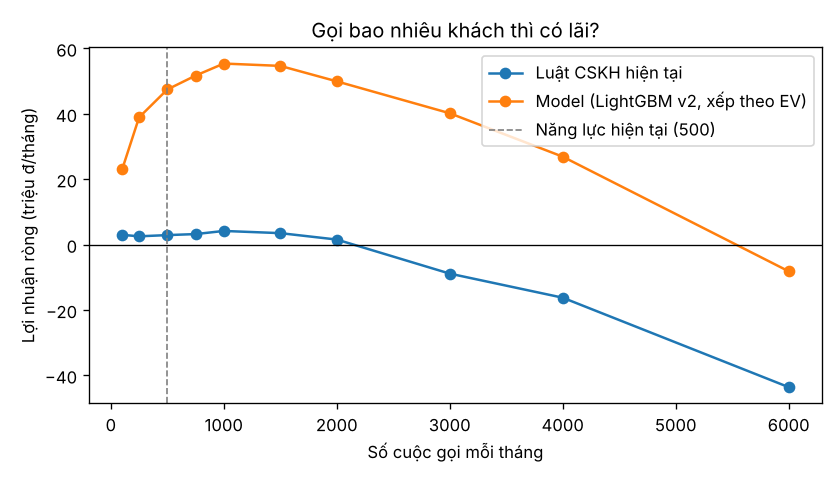
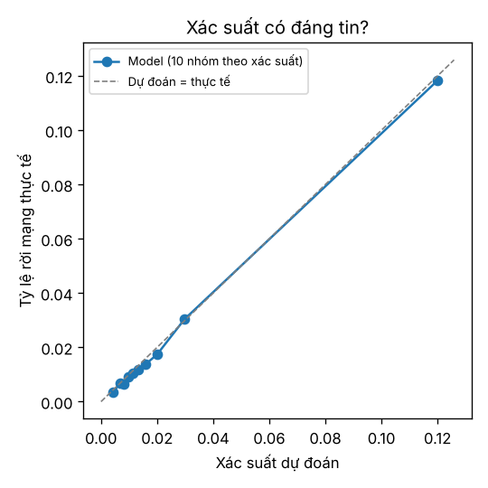

# Báo cáo 1 trang — Gọi ai để giữ khách? (Sóng Xanh · dữ liệu mô phỏng)

**Câu hỏi.** Mỗi tháng đội CSKH gọi được 500 khách. Chọn ai để giữ lại nhiều khách nhất?

**Đề xuất.** Thay danh sách hiện tại (khách sắp hết hợp đồng, hay báo lỗi mạng) bằng danh sách do model xếp theo giá trị kỳ vọng của cuộc gọi, kèm 3 lý do và việc nên làm cho từng khách.

## Kết quả trên bộ đánh giá đóng băng

3 tháng 10–12/2025 mà model chưa từng thấy, 60.912 lượt khách; khoảng tin cậy (KTC) 95% bootstrap theo khách, 1000 lần.

| Mỗi tháng, với 500 cuộc gọi | Danh sách hiện tại | Model | Chênh lệch (KTC 95%) |
|---|---|---|---|
| Số người sắp rời được gọi trúng | 37 | 140 | +103 (90 … 114) |
| Số khách giữ được (giả định 30% đồng ý ở lại) | 11 | 42 | +31 (27 … 34) |
| Lợi nhuận ròng sau chi phí gọi và ưu đãi | 2,9 triệu đ | 47,5 triệu đ | +44,5 triệu đ (39,0 triệu đ … 49,6 triệu đ) |

Gọi ngẫu nhiên thì 500 cuộc trúng khoảng 11 người. So với baseline logistic regression, model gọi trúng thêm 14 người/tháng (KTC 95%: 7 … 20) — đủ để đáng thêm độ phức tạp.

**Nên gọi bao nhiêu?** Lợi nhuận còn tăng tới khoảng 1.000 cuộc/tháng (55,4 triệu đ/tháng): năng lực 500 cuộc là nút thắt. Đề xuất thử tăng năng lực, có nhóm đối chứng (xem Rủi ro).

## Kết luận có vững nếu giả định sai?

Lợi nhuận tăng thêm mỗi tháng so với danh sách hiện tại:

| Tỷ lệ đồng ý ở lại \ số tháng ở thêm | 6 tháng | 12 tháng | 24 tháng |
|---|---|---|---|
| 15% | +10,0 triệu đ | +22,3 triệu đ | +46,8 triệu đ |
| 30% | +20,0 triệu đ | +44,5 triệu đ | +93,7 triệu đ |
| 45% | +29,9 triệu đ | +66,8 triệu đ | +140,5 triệu đ |

Ở mọi tổ hợp, model đều hơn danh sách hiện tại; độ lớn phụ thuộc mạnh vào tỷ lệ đồng ý ở lại — con số cần đo lại.

## Danh sách gọi tháng 01/2026: lý do chính của 500 khách

| Nhóm lý do chính | Số khách | Việc nên làm |
|---|---|---|
| Dùng ít đi | 439 | Hỏi nhu cầu thực tế, tư vấn gói phù hợp hơn |
| Chất lượng mạng | 30 | Kỹ thuật kiểm tra đường truyền trước khi gọi; xin lỗi và bù cước |
| Hợp đồng | 25 | Mời gia hạn/ký hợp đồng kỳ hạn kèm ưu đãi |
| Thanh toán | 6 | Nhắc lịch thanh toán, mời đăng ký tự động trừ tiền |

## Giới hạn và rủi ro

- **Dữ liệu mô phỏng** có cơ chế churn biết trước; số liệu thật sẽ khác. Quy trình (feature as-of, bộ đánh giá đóng
  băng, bootstrap) thì dùng lại nguyên vẹn.
- **Tỷ lệ đồng ý ở lại 30% là giả định** từ chiến dịch 2024. Trước khi nhân rộng: thử nghiệm có nhóm đối chứng
  (một phần danh sách KHÔNG gọi) để đo hiệu quả thật của cuộc gọi.
- **Model không bắt được** churn do chuyển nhà (không có dấu hiệu trước) và churn đột ngột khi đối thủ khuyến mãi —
  nhóm sau nên xử lý bằng ưu đãi theo vùng trong thời gian khuyến mãi, không phải gọi từng người.
- **Xác suất khớp thực tế** (sai lệch trung bình 0,13% giữa dự đoán và thực tế, hình dưới) nên dùng được để tính giá
  trị kỳ vọng. Theo dõi hằng tháng dự đoán và thực tế theo tỉnh; lệch nhiều thì train lại.
- **Không dùng hồ sơ** (tỉnh, tuổi, kênh) làm lý do gọi; danh sách chỉ có mã khách, CSKH tra liên hệ trong CRM.

*Tái lập: `make all` trong `projects/g1-churn-telco/`. LightGBM v2, phiên bản v2-488c967b.*
