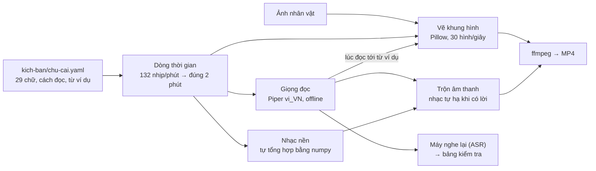

# Video dạy chữ cái tiếng Việt cùng Sách Vui

**Nhóm bài toán:** [Nhóm 9 · Tạo nội dung đa phương tiện](../../docs/02-skill-map/generated/nhom/g9-tao-noi-dung.md) ·
**Cách làm:** A — dựng hoàn toàn bằng code, cùng Claude Code · **Trạng thái:** bản đầu đã dựng; chờ giáo viên nghe
duyệt và thu âm lại câu chữ P

<video src="media/video-chu-cai.mp4" poster="media/poster.jpg" controls preload="metadata" width="100%">
  <track kind="subtitles" src="media/phu-de.vtt" srclang="vi" label="Tiếng Việt">
</video>

[Mở video MP4 (2 phút, ~10 MB)](media/video-chu-cai.mp4) ·
[Hướng dẫn tự làm bằng Claude Code](docs/huong-dan-claude-code.md) ·
[Bảng kiểm tra lời đọc](reports/kiem-tra-giong.md) · [Kịch bản](kich-ban/chu-cai.yaml)

Video 2 phút dạy 29 chữ cái tiếng Việt trên nền nhạc vui. Nhân vật **Sách Vui** (cuốn sách đeo tai nghe, ảnh do người
dùng cung cấp) có mặt suốt video. Hình, chữ, nhạc và giọng đọc đều sinh từ một file kịch bản. Không dùng mô hình tạo
video, nên chữ và dấu trên hình luôn đúng. Dựng lại cả video bằng một lệnh, chạy offline, không tốn phí API.

| Đoạn | Thời gian | Trên hình và trong tai |
|---|---|---|
| Mở đầu | 0:00–0:07 | Tiêu đề, Sách Vui chào, các chữ cái bay vòng quanh như quỹ đạo 3D |
| 29 chữ cái | 0:07–1:53 | Mỗi chữ 3,6 giây (2 ô nhịp): tiếng "ting", thẻ chữ in hoa + chữ thường, dòng "đọc là: bờ"; giọng đọc "Đây là chữ bờ, như trong con bò"; hình minh họa và từ ví dụ (chữ cái tô màu, gạch chân) hiện đúng lúc giọng đọc tới; phụ đề sáng dần theo lời; hàng 29 chữ trên cùng cho biết đang ở đâu |
| Kết thúc | 1:53–2:00 | "Giỏi quá!", lưới 29 chữ cái nhún theo nhạc, pháo giấy, dòng ghi nguồn |

## 1 · ĐÚNG — framing

| Câu hỏi | Trả lời |
|---|---|
| Ai dùng, dùng thế nào? | Bé mầm non – lớp 1 học chữ cái, lớp 2–3 ôn lại; giáo viên chiếu trên lớp, phụ huynh mở ở nhà |
| Đầu ra cần gì? | MP4 2 phút; chữ và dấu đúng tuyệt đối; đọc âm theo cách dạy ở trường (a, á, ớ, bờ, cờ… ca, quy, i dài) |
| Cách làm hiện tại | Giáo viên ghép slide, ảnh, nhạc bằng tay — vài giờ cho mỗi video, sửa một chữ phải làm lại |
| Có cần AI không? | Cần cho giọng đọc (TTS) và để máy nghe lại lời đọc (ASR). Chữ, hình, nhịp do code đặt nên không cần AI và không sai |
| Sai nào đắt nhất? | Dạy sai chữ, dấu, âm ≫ hình chưa đẹp. Vì vậy chữ do code vẽ, mọi câu đọc có máy nghe lại, giáo viên duyệt lần cuối |
| KPI | Số câu đọc đúng (máy nghe lại + người nghe); thời gian dựng lại một video; chi phí mỗi video |
| Ràng buộc | Nhân vật có sẵn (ảnh tĩnh); video đúng 2 phút; chạy được trên máy cá nhân, không cần GPU, không tốn phí API |

## 2 · NHANH — pipeline và bộ đánh giá



- **Bộ đánh giá cố định:** 31 câu của kịch bản (mở đầu, 29 chữ cái, kết thúc). Mỗi câu chữ cái chấm hai ý: máy có nghe
  ra **âm đọc** ("bờ") và **từ ví dụ** ("con bò") không; chấm hai lần, giọng riêng và trong bản trộn có nhạc. Lệnh:
  `make qa` → [`reports/kiem-tra-giong.md`](reports/kiem-tra-giong.md).
- **Baseline:** giọng đọc từng từ đứng riêng ("Bờ, con bò!") — máy nghe ra 8/29 từ ví dụ.

## 3 · CHÍNH XÁC — các vòng cải tiến

| Vòng | Vấn đề | Thay đổi | Máy nghe đúng từ ví dụ / âm đọc |
|---|---|---|---|
| 1 | Từ đứng riêng bị đọc quá nhanh (0,1–0,5 giây), thiếu ngữ cảnh | Đặt âm và từ ví dụ trong câu đầy đủ "Đây là chữ …, như trong …" | từ 8/29 → 18/29 |
| 2 | Một số từ giọng này đọc sai | Mỗi chữ thử 2–4 từ ví dụ, giữ từ máy nghe đúng | từ 24/29, âm 25/29 (bản dựng đầu) |
| 3 | Giọng có phần ngẫu nhiên: mỗi lần dựng một khác, có lúc sai | Tắt ngẫu nhiên (`noise_scale = 0`); đổi từ cho N, V, Ê | từ 28/29, âm 24/29; dựng lại ra y hệt |
| 4 | Sai dấu thanh của âm: á → "a rát", ca → "cà", quy → "quỵ", ê → "ệ" | Câu riêng (`say`) cho 4 chữ: thêm "nhé" hoặc lặp âm | từ **28/29**, âm **28/29** — cả khi có nhạc |
| — | Âm "pờ" (chữ P): giọng này không đọc được, máy nghe thành "thờ" | Đổi câu không cứu được (đã thử 8 cách) | Cần thu âm thật: `giong-thu-am/chu-20.wav` |

Câu mở đầu và câu kết: máy nghe sai 5% và 0% số tiếng (lỗi duy nhất: "Sách Vui" nghe thành "sách vùi").

## 4 · THUYẾT PHỤC — kết quả

- **Video:** 2:00, 1280×720, 30 hình/giây, ~10 MB. `make video` dựng lại trong ~3 phút trên CPU 4 nhân, không cần GPU,
  không tốn phí API. Cùng kịch bản thì ra đúng cùng một video.
- **Lời đọc:** 28/29 câu chữ cái được máy nghe đúng cả âm lẫn từ ví dụ, kể cả khi có nhạc nền. Khi đang đọc, lời to
  hơn nhạc 14 dB; lúc không có lời, nhạc chỉ nhỏ hơn mức lời 6 dB.
- **Chữ trên hình:** 100% đúng chính tả, vì chữ được vẽ từ kịch bản bằng font thật, không để AI vẽ.
- **Đổi nội dung:** sửa một dòng trong kịch bản (đổi từ ví dụ, hình, tốc độ) rồi `make video`.
- **Giới hạn:**
  - Giọng máy (Piper vais1000) chưa đọc được âm "pờ", và có thể còn lỗi mà máy nghe lại không bắt được — **giáo viên
    phải nghe duyệt trước khi dùng với bé**.
  - Nhân vật là ảnh tĩnh: chỉ nhún, nghiêng, phóng to theo nhịp và theo lời. Không cử động tay chân, không nhép miệng.
    Muốn vậy cần vẽ thêm tư thế hoặc dùng công cụ tạo video (cách B, xem hướng dẫn).

## Chạy dự án

```bash
make setup     # cài môi trường theo uv.lock; cần thêm ffmpeg của hệ điều hành
make assets    # tải font, hình minh họa, giọng đọc, model nghe lại vào .cache/ (~150 MB, một lần)
make preview   # vài khung hình xem thử → out/khung-*.png
make video     # dựng cả video → media/ (MP4, ảnh bìa, chương, phụ đề)
make qa        # máy nghe lại từng câu → reports/kiem-tra-giong.md
make test      # 21 test, không cần mạng, không cần model
```

| Muốn | Làm |
|---|---|
| Đổi từ ví dụ, hình minh họa | Sửa `letters` trong [kịch bản](kich-ban/chu-cai.yaml); hình là `emoji: "🐄"` hoặc ảnh riêng `image: ../assets/hinh/bo.png` |
| Đổi nhân vật | Thay ảnh trong `assets/nhan-vat/`, sửa `character.image` và `character.crop` (tâm, bán kính vùng tròn chứa nhân vật) |
| Video dài/ngắn hơn | `music.bpm` (132 = 2 phút; 110 ≈ 2 phút 24 giây) hoặc `letter_bars` |
| Đọc chậm/nhanh hơn | `voice.speed` (0,8 = chậm hơn bình thường) |
| Thay giọng máy bằng giọng thật | Thu âm câu đó, lưu WAV 16 bit vào `giong-thu-am/<id>.wav` (`mo-dau`, `chu-01` … `chu-29`, `ket-thuc`) — xem [hướng dẫn](docs/huong-dan-claude-code.md#5--giọng-đọc-đo-rồi-mới-tin) |
| Xem nhanh không cần giọng | `uv run python -m chu_cai_video render --voice silent --end 15 --out out/thu.mp4` |

## Cấu trúc

```
g9-video-chu-cai/
├── kich-ban/chu-cai.yaml      # NGUỒN DUY NHẤT: tiêu đề, nhân vật, nhịp, giọng, 29 chữ cái
├── assets/nhan-vat/           # ảnh nhân vật gốc
├── giong-thu-am/              # (tùy chọn) câu thu âm thật thay cho giọng máy
├── src/chu_cai_video/
│   ├── lesson.py              # đọc + kiểm tra kịch bản, tìm chữ cần tô màu (bỏ qua dấu thanh)
│   ├── timeline.py            # mở đầu → 29 khúc bằng nhau → kết thúc, theo nhịp nhạc
│   ├── voice.py               # giọng đọc: thu âm thật → Piper → im lặng; nhớ kết quả trong .cache/
│   ├── music.py               # nhạc nền tổng hợp: trống, bass, đàn gảy, mộc cầm, chuông
│   ├── audio.py               # WAV, đổi tần số, cắt lặng, tìm chỗ ngắt, trộn có ducking
│   ├── character.py           # cắt nhân vật hình tròn, quầng sáng
│   ├── render.py              # vẽ khung hình + đẩy vào ffmpeg
│   ├── qa.py                  # máy nghe lại (ASR) và bảng kiểm tra
│   └── cli.py                 # python -m chu_cai_video assets|voice|frame|render|qa
├── media/                     # video đã dựng + poster.jpg + chuong.vtt + phu-de.vtt (commit để xem trên web)
├── reports/kiem-tra-giong.md  # bảng kiểm tra lời đọc (sinh bằng make qa)
├── docs/huong-dan-claude-code.md
└── tests/                     # 21 test chạy offline
```

## Nguồn và giấy phép

| Thành phần | Nguồn | Giấy phép |
|---|---|---|
| Nhân vật Sách Vui | Ảnh do người dùng cung cấp | Theo người tạo ảnh |
| Giọng đọc | [Piper](https://github.com/rhasspy/piper) vi_VN vais1000, bản đóng gói của [sherpa-onnx](https://github.com/k2-fsa/sherpa-onnx) | Dữ liệu VAIS-1000: CC BY 4.0 — ghi nguồn khi đăng video (đã có ở cuối video) |
| Hình minh họa | [Noto Emoji](https://github.com/googlefonts/noto-emoji), ghim theo commit | Apache 2.0 |
| Chữ | [Baloo 2](https://fonts.google.com/specimen/Baloo+2) | SIL OFL 1.1 |
| Nhạc nền | Tự tổng hợp trong [`music.py`](src/chu_cai_video/music.py) | Của dự án |
| Máy nghe lại | sherpa-onnx zipformer-vi (int8, 2025-04-20) | Chỉ dùng để kiểm tra, không có trong video |
