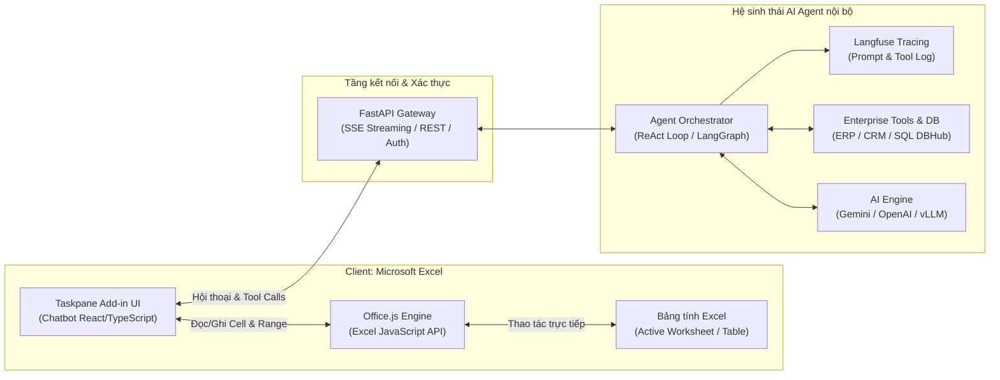

# gemini-excel-ai-agent · Trợ lý AI Agent nhúng Excel (Office Add-in)

**Nhóm bài toán:** Nhóm 7 · AI Agent & Tự động hóa quy trình (Tổ hợp mở rộng: **CMB-10 · Enterprise Spreadsheet Copilot**)  
**Trạng thái:** Nghiên cứu khả thi & Thiết kế giải pháp kiến trúc (Chưa code)  
**Người đề xuất / Nghiên cứu:** AI Architecture Team  
**Mục tiêu:** Đánh giá tính khả thi, định vị bài toán doanh nghiệp và thiết kế giải pháp xây dựng một Office Add-in Chatbot nhúng trực tiếp vào Microsoft Excel, kết nối hai chiều với hệ sinh thái AI Agent nội bộ để tự động hóa thao tác dữ liệu bảng tính.

---

## 1 · ĐÚNG — Framing bài toán (Khung phân tích nghiệp vụ)

| Câu hỏi framing | Phân tích & Trả lời |
|---|---|
| **Quyết định nào sẽ thay đổi?** | Nhân viên nghiệp vụ (Kế toán, Thu mua, Kinh doanh, Kho vận, Phân tích dữ liệu) không còn phải tự tìm kiếm, so khớp dữ liệu thủ công, gõ tay từng dòng, copy-paste giữa các phần mềm ERP/CRM và Excel. Giảm thời gian thao tác từ hàng giờ xuống vài giây thông qua hội thoại tự nhiên với AI Agent ngay trong bảng tính. |
| **Ai dùng kết quả, dùng thế nào?** | Nhân viên văn phòng, kế toán, quản lý kho, chuyên viên dữ liệu; tương tác qua khung chat bên cạnh bảng tính (Office Taskpane) trên Excel Desktop (Windows/macOS) hoặc Excel Online (Microsoft 365 Web). |
| **KPI nghiệp vụ cốt lõi** | - Giảm **80% thời gian** nhập liệu, tra cứu và đối soát dữ liệu trên Excel. - Giảm **95% lỗi gõ nhầm/lệch cột** khi điền thông tin hàng loạt. - Tỷ lệ chấp nhận của người dùng (User Adoption Rate) cao vì người dùng không phải rời khỏi môi trường Excel quen thuộc. |
| **Metric kỹ thuật tương ứng** | - Tỷ lệ thực thi đúng lệnh thao tác bảng tính (Search Accuracy, Insertion Success Rate) > 98%. - Độ trễ phản hồi (End-to-end latency): Streaming ký tự đầu tiên < 1.5s; hoàn thành lệnh cập nhật Excel < 3s. - Tỷ lệ người dùng duyệt qua giao diện Preview Diff trước khi ghi đè dữ liệu thật (Safety Check Rate) đạt 100%. |
| **Loại sai nào đắt hơn?** | **Ghi đè hoặc chèn sai dữ liệu vào bảng tính nghiệp vụ đắt hơn rất nhiều** so với việc Agent từ chối hoặc yêu cầu người dùng xác nhận lại. → *Nguyên tắc thiết kế:* Luôn có cơ chế **Human-in-the-Loop** (hiển thị thẻ xem trước thay đổi - Preview Diff) trước khi gọi API cập nhật bảng tính, hỗ trợ Undo tức thì. |
| **Cách làm hiện tại (Baseline)** | 1. Tra cứu thủ công (Ctrl+F, filter từng cột, dùng hàm `VLOOKUP`/`XLOOKUP` phức tạp). 2. Nhập tay từng ô hoặc copy từ email/PDF/phần mềm ngoài paste vào Excel. 3. Dùng ChatGPT/Claude bên ngoài: Phải copy dữ liệu nhạy cảm ra trình duyệt, rủi ro lộ bí mật kinh doanh, sau đó copy ngược lại Excel (thủ công, dễ vỡ format). |
| **Có cần AI không, hay Macro/VBA/Python script là đủ?** | VBA/Macro hay script thông thường chỉ giải quyết được các quy tắc cứng (cố định số cột, format cố định). Khi yêu cầu nghiệp vụ thay đổi theo ngôn ngữ tự nhiên ("Tìm khách hàng X rồi thêm đơn hàng vừa gửi qua email vào", "Kiểm tra xem dòng này có gì bất thường không"), **chỉ có AI Agent với khả năng hiểu ngữ nghĩa, gọi tool linh hoạt và kết nối API hệ thống lõi mới giải quyết được**. |
| **Ràng buộc bảo mật & hạ tầng** | - Không gửi dữ liệu nội bộ nhạy cảm ra các model AI công cộng chưa được ký cam kết bảo mật. - Hoạt động mượt mà cả trên Excel Desktop (Windows, Mac) và Excel Web. - Tương thích hoàn toàn với hệ thống backend FastAPI + Langfuse + Agent runtime hiện tại. |

---

## 2 · Tổng quan kiến trúc giải pháp

---

## 3 · Danh mục tài liệu nghiên cứu chi tiết

Hệ thống tài liệu nghiên cứu khả thi và kiến trúc giải pháp nằm trong thư mục [`docs/`](docs/):

| # | Tài liệu | Nội dung chính |
|---|---|---|
| 1 | [01 · Mô tả bài toán](docs/01-mo-ta-bai-toan.md) | Bối cảnh doanh nghiệp, bài toán người dùng, phân loại và định vị bài toán trong bản đồ 8 nhóm bài toán AI doanh nghiệp. |
| 2 | [02 · Kiến trúc giải pháp](docs/02-solution-approach-kien-truc.md) | Thiết kế kiến trúc 3 tầng: Office.js Taskpane, Client-Server Tool Execution Loop, cơ chế bảo mật và giao thức tương tác. |
| 3 | [03 · Đánh giá tính khả thi](docs/03-danh-gia-tinh-kha-thi.md) | Nghiên cứu sâu về khả năng của Office.js, ma trận tương thích (Web/Desktop/Mac), hiệu năng, rủi ro và kết luận khả thi. |
| 4 | [04 · Danh mục tính năng mở rộng](docs/04-danh-muc-tinh-nang-mo-rong.md) | Đề xuất danh mục tính năng đột phá: Smart Search, 2-way ERP Sync, Formula Copilot, Anomaly Detection, Doc-to-Excel Ingestion. |
| 5 | [05 · Kế hoạch thử nghiệm POC](docs/05-ke-hoach-poc.md) | Lộ trình triển khai POC 3 giai đoạn (POC-1, POC-2, POC-3) để kiểm chứng thực tế mà không gây rủi ro kỹ thuật. |

---

## 4 · Kết luận nghiên cứu sơ bộ

> [!IMPORTANT]
> **KẾT LUẬN TÍNH KHẢ THI: 100% KHẢ THI VỀ MẶT KỸ THUẬT VÀ CÓ GIÁ TRỊ THƯƠNG MẠI CAO.**
> 
> 1. **Về công nghệ Office Add-in:** Nền tảng **Office JavaScript API (`Office.js`)** hiện đại của Microsoft hỗ trợ đầy đủ các thao tác tìm kiếm cột, chèn dòng, định dạng, lắng nghe sự kiện trên cả Windows, Mac và Web.
> 2. **Về kiến trúc Agent:** Sử dụng mô hình **Client-Side Tool Execution Loop**, trong đó Agent trên server suy luận và phát lệnh, còn Taskpane Add-in trên client thực thi trực tiếp trên workbook, đảm bảo không cần upload toàn bộ file Excel lên server.
> 3. **Về phân loại bài toán:** Thuộc **Nhóm 7 (AI Agent & Tự động hóa quy trình)** ở tầng thuật toán và định vị là **CMB-10 (Enterprise Spreadsheet Copilot)** trong bản đồ bài toán doanh nghiệp.
