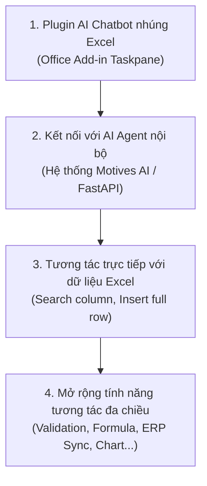

# 01 · Mô tả bài toán & Định vị trong bản đồ bài toán doanh nghiệp

Tài liệu này phân tích chi tiết bối cảnh nghiệp vụ, nhu cầu thực tế của doanh nghiệp đối với công cụ bảng tính (Excel), và định vị chính xác bài toán mới này trong hệ thống 8 bài toán AI doanh nghiệp sẵn có của kiến trúc.

---

## 1. Bối cảnh thực tế: Excel là "Hệ điều hành ngầm" (Shadow ERP) của doanh nghiệp

Dù các doanh nghiệp đầu tư hàng tỷ đồng vào các hệ thống ERP (SAP, Oracle, Odoo), CRM (Salesforce, HubSpot), hay Core Banking / WMS (Warehouse Management System), thực tế cho thấy:
- **80% đến 90% nhân viên nghiệp vụ** (Kế toán, Mua hàng, Bán hàng, Tài chính, Nhân sự, Kho vận) bắt đầu và kết thúc ngày làm việc của họ trên **Microsoft Excel**.
- Excel là nơi diễn ra các thao tác tổng hợp dữ liệu cuối cùng, lập báo giá tùy chỉnh, kiểm tra đối soát, tính lương thưởng, và lập kế hoạch ngân sách.

### Các điểm nghẽn (Pain Points) nhức nhối hiện nay:

1. **Rời rạc giữa bảng tính và dữ liệu hệ thống (Data Silos):**
   - Khi cần thêm thông tin một khách hàng hoặc một mã sản phẩm vào Excel, nhân viên phải mở trình duyệt hoặc ứng dụng ERP, tìm kiếm mã, copy từng trường thông tin, quay lại Excel và paste vào đúng cột.
   - Thao tác này lặp đi lặp lại hàng trăm lần mỗi ngày, gây lãng phí giờ công và dễ sai sót lệch cột.

2. **Cách dùng AI hiện tại còn rất thô sơ và rủi ro rò rỉ dữ liệu:**
   - Nhiều nhân sự đã bắt đầu dùng ChatGPT / Claude để nhờ xử lý dữ liệu. Tuy nhiên, họ phải:
     - Copy toàn bộ bảng dữ liệu dán lên giao diện chat công cộng (vi phạm nghiêm trọng chính sách bảo mật thông tin nội bộ - DLP).
     - Đọc câu trả lời rồi copy kết quả dán ngược lại Excel, phải chỉnh sửa định dạng thủ công.

3. **Hạn chế của Microsoft Copilot for Microsoft 365:**
   - Chi phí quá cao: Thường khoảng $30/người dùng/tháng, khó trang bị đại trà cho toàn bộ nhân viên.
   - Tính "đóng kín" (Walled Garden): Không thể kết nối trực tiếp với backend AI Agent riêng của doanh nghiệp, không gọi được các API nội bộ hay cơ sở dữ liệu on-premise của công ty.
   - Chỉ hỗ trợ các tác vụ chung chung, chưa hiểu được logic nghiệp vụ chuyên sâu và các quy trình nội bộ đặc thù.

---

## 2. Nhu cầu cốt lõi của bài toán mới

Từ yêu cầu của doanh nghiệp, bài toán đặt ra 4 thành tố cơ bản:

1. **Giao diện nhúng (In-situ Workplace Interface):** Một Chatbot dạng Taskpane nằm ngay cạnh bảng tính Excel. Người dùng không cần rời màn hình làm việc, không cần chuyển cửa sổ ứng dụng.
2. **Tích hợp với AI Agent backend nội bộ:** Chatbot không đơn thuần là một prompt LLM mà được kết nối với hệ thống AI Agent của doanh nghiệp (FastAPI, Langfuse tracing, tool calling, MCP kết nối database).
3. **Thao tác dữ liệu bảng tính theo lệnh tự nhiên:**
   - *Ví dụ 1:* "Tìm trong cột 'Mã hàng' xem có mã `SP-9921` chưa, nếu chưa hãy chèn 1 dòng mới với thông tin: Tên sản phẩm = Áo thun Polo, Giá = 250,000đ, Số lượng = 50".
   - *Ví dụ 2:* "Tìm các dòng có trạng thái 'Chưa duyệt' trong cột H, rồi cập nhật ngày duyệt là hôm nay".
4. **Mở rộng các năng lực tương tác hai chiều:** Không chỉ đọc/ghi ô, plugin có thể đóng vai trò như một người đồng nghiệp số (Digital Teammate), kết nối tri thức doanh nghiệp vào từng ô bảng tính.

---

## 3. Phân loại bài toán trong bản đồ AI Doanh nghiệp

Hiện tại, hệ thống đã chuẩn hóa **8 nhóm bài toán cốt lõi** và **9 tổ hợp bài toán (CMB-01 đến CMB-09)**:

### 8 nhóm bài toán hiện có:
- **G1 · Dữ liệu bảng:** Dự đoán rời bỏ, chấm điểm tín dụng, định giá.
- **G2 · Chuỗi thời gian:** Dự báo nhu cầu, doanh số, tồn kho.
- **G3 · Phát hiện bất thường:** Gian lận thanh toán, lỗi máy móc, giao dịch lạ.
- **G4 · Gợi ý và xếp hạng:** Recommendation, xếp hạng sản phẩm.
- **G5 · Thị giác máy tính & Document AI:** OCR, bóc tách hóa đơn/chứng từ bằng VLM.
- **G6 · Ngôn ngữ, LLM & RAG:** Hỏi đáp tài liệu nội bộ, tóm tắt, Text-to-SQL.
- **G7 · AI Agent & Tự động hóa quy trình:** Điều phối chuỗi việc, tool calling, ReAct loop.
- **G8 · Tối ưu hóa & Suy luận nhân quả:** Tối ưu tuyến đường xe, lập lịch ca, định giá tối ưu.

### Định vị bài toán Excel AI Plugin: Bài toán này thuộc nhóm nào?

Có hai góc nhìn rõ ràng:

#### Góc nhìn 1: Bản chất công nghệ cốt lõi → Thuộc **Nhóm 7 (G7: AI Agent và tự động hóa quy trình)**
- Khi người dùng chat: *"Tìm mã hàng X trong cột A và chèn dòng mới..."*, mô hình LLM đóng vai trò bộ não suy luận (Reasoning Engine):
  1. Phân tích ý định người dùng (Intent Detection).
  2. Lựa chọn công cụ phù hợp (Tool Calling): `excel_get_column_values`, `excel_search_range`, `excel_insert_row`.
  3. Lập kế hoạch các bước thao tác (Multi-step Action Plan).
  4. Yêu cầu client thực thi và nhận lại phản hồi kết quả (Observation).
  5. Giải thích kết quả cho người dùng.
- Về bản chất giải thuật, đây chính là **AI Agent dạng ReAct (Reasoning + Acting) có Human-in-the-loop**, hoàn toàn tương thích với định nghĩa của Nhóm 7.

#### Góc nhìn 2: Bản chất nghiệp vụ kết hợp → Định danh là **CMB-10 · Enterprise Spreadsheet Copilot**
Trong thực tế doanh nghiệp, bài toán này không đứng một mình mà là **sự kết hợp của nhiều nhóm bài toán**:

| Thành phần trong giải pháp | Thuộc nhóm bài toán | Vai trò trong dự án |
|---|---|---|
| **Điều phối tác vụ & gọi công cụ (Tool calling)** | **Nhóm 7 (Agent)** | Nhận lệnh, quyết định chuỗi thao tác Excel, gọi API nội bộ |
| **Hiểu ngôn ngữ tự nhiên & RAG tri thức** | **Nhóm 6 (LLM/RAG)** | Hiểu tiếng Việt không dấu/có dấu, tra cứu bảng giá, chính sách công ty |
| **Thao tác & cấu trúc dữ liệu bảng tính** | **Nhóm 1 (Bảng)** | Hiểu kiểu dữ liệu số, ngày tháng, cấu trúc dòng/cột |
| **Bóc tách file đính kèm (PDF, ảnh scan)** | **Nhóm 5 (Doc AI)** *(Mở rộng)* | Kéo thả hóa đơn PDF vào chat để tự động điền dòng vào Excel |
| **Phát hiện số liệu bất thường / kiểm tra lỗi** | **Nhóm 3 (Bất thường)** *(Mở rộng)* | Quét cột số liệu, cảnh báo các giá trị âm hoặc lệch chuẩn logic |

→ **Định danh chính thức trong catalog:** **`CMB-10 · Enterprise Spreadsheet Copilot (Trợ lý Agent nhúng Excel kết nối hệ thống doanh nghiệp)`**  
*(Luồng chính: Nhóm 6 · LLM ↔ Nhóm 7 · Agent ↔ Office.js Client ↔ Dữ liệu bảng/ERP)*.

#### Đề xuất mở rộng tương lai: **Nhóm 9 · Workplace AI Copilot (AI nhúng vào không gian làm việc)**
Nếu doanh nghiệp muốn định nghĩa một **nhóm bài toán cấp 1 mới (G9)**, nhóm này sẽ mang tên:
- **Tên:** G9 · Workplace Embedded Copilot & Human-in-the-Loop Interaction
- **Câu hỏi nghiệp vụ:** *"Làm sao để đưa năng lực AI & tri thức doanh nghiệp vào tương tác trực tiếp ngay tại phần mềm làm việc hàng ngày của người dùng (Excel, Word, Outlook, CAD) mà không thay đổi thói quen của họ?"*
- **Điểm khác biệt:** Trọng tâm không chỉ là "chạy ngầm trong backend" (như Agent truyền thống), mà là **tương tác thời gian thực trên giao diện ứng dụng (DOM / Document Object Model)** và có **sự giám sát liên tục của con người (Human-in-the-loop)**.
