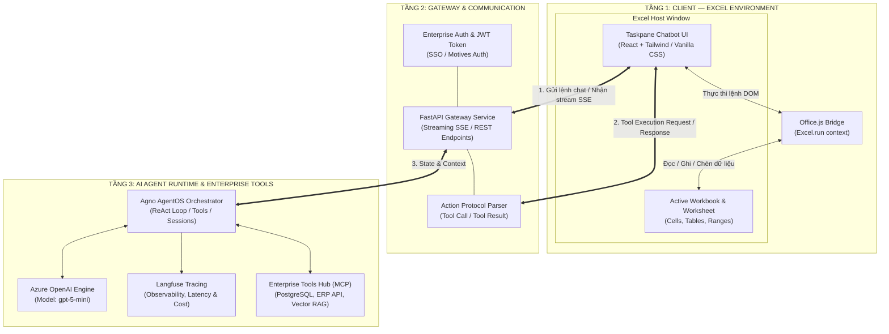
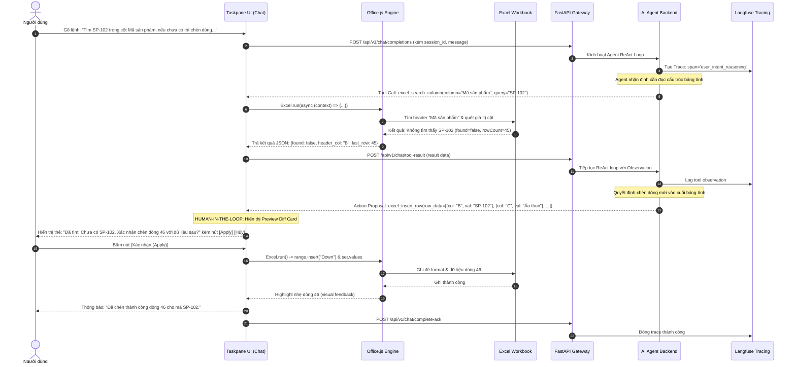

# 02 · Kiến trúc giải pháp kỹ thuật (Solution Approach & Architecture)

Tài liệu này thiết kế chi tiết kiến trúc kỹ thuật của hệ thống **Excel AI Agent Plugin**, mô hình tương tác Client-Server hai chiều, luồng thực thi ReAct Client-Side Tool Calling, và các giao thức giao tiếp.

---

## 1. Lựa chọn công nghệ: Modern Office Web Add-in (`Office.js`)

Trước khi thiết kế kiến trúc, cần làm rõ sự khác biệt giữa hai trường phái xây dựng plugin cho Microsoft Excel:

| Tiêu chí | Công nghệ cũ (VSTO / COM Add-in / VBA) | **Công nghệ hiện đại (Office Web Add-in - Được chọn)** |
|---|---|---|
| **Nền tảng** | C# .NET / C++ / Visual Basic for Applications | **HTML5 + CSS3 + TypeScript / JavaScript (`Office.js`)** |
| **Hệ điều hành** | Chỉ chạy trên Windows Desktop | **Đa nền tảng: Windows, macOS, Excel on the Web (M365), iPad** |
| **Cài đặt & Phân phối** | Cài file `.exe` / `.msi`, dễ xung đột DLL, đòi hỏi quyền Admin | **Deploy qua URL web + file Manifest XML/JSON**; IT có thể đẩy tập trung qua Microsoft 365 Admin Center |
| **Cập nhật tính năng** | Phải cài lại phần mềm trên máy người dùng | **Cập nhật tức thì trên Web Server**, người dùng mở Excel là có bản mới |
| **Bảo mật** | Chạy mã nhị phân trực tiếp trên OS (nguy cơ virus, treo ứng dụng) | **Chạy trong môi trường Sandbox (WebView2 / Browser iframe)**, bảo mật tuyệt đối |
| **Khả năng kết nối Web/AI** | Khó tích hợp thư viện Web hiện đại | **Tự nhiên hỗ trợ WebSocket, SSE, Fetch API, React/Vue** |

→ **Quyết định kiến trúc:** Sử dụng chuẩn **Microsoft Office Web Add-in (`Office.js`)** với giao diện **Taskpane** (thanh tác vụ nằm cố định ở cạnh phải của bảng tính Excel).

---

## 2. Kiến trúc tổng thể 3 tầng (3-Tier Architecture)



### Điểm đột phá kiến trúc: "Client-Side Tool Execution Loop"
Thay vì người dùng phải upload cả file Excel (.xlsx nặng hàng chục MB) lên server:
1. **File Excel vẫn nằm nguyên vẹn trên máy người dùng.**
2. **AI Agent trên server suy luận và phát lệnh điều khiển (Action Request).**
3. **Taskpane trên máy người dùng nhận lệnh và gọi API `Office.js` thao tác trực tiếp trên workbook đang mở.**
4. **Kết quả thao tác (hoặc dữ liệu đọc được) được gửi ngược lại cho AI Agent.**

Cách tiếp cận này mang lại 3 ưu thế vượt trội:
- **Tốc độ cực nhanh:** Chỉ truyền các payload JSON nhỏ gọn chứa lệnh và dữ liệu, không truyền file nhị phân.
- **Bảo mật tối đa (Privacy-first):** Dữ liệu của các sheet khác không bị gửi đi; chỉ những cell/cột cần xử lý mới được trao đổi.
- **Hoạt động theo thời gian thực:** Người dùng thấy dữ liệu nhảy trực tiếp trên màn hình Excel của mình ngay lập tức.

---

## 3. Quy trình thực thi chi tiết (Sequence Diagram)

Kịch bản: Người dùng ra lệnh: *"Tìm cột 'Mã sản phẩm' xem có mã 'SP-102' chưa, nếu chưa hãy chèn dòng mới với Tên='Áo thun', Giá=250000, Tồn kho=100"*.



---

## 4. Đặc tả hợp đồng dữ liệu (Tool Calling Schemas - Pydantic v2)

Theo quy chuẩn kỹ thuật của hệ thống, toàn bộ input/output của Tool tương tác với Excel đều được định nghĩa chặt chẽ bằng Pydantic v2.

### 4.1. Tool: Tìm kiếm dữ liệu theo cột (`excel_search_column`)

```python
from pydantic import BaseModel, Field


class SearchColumnRequest(BaseModel):
    sheet_name: str | None = Field(default=None, description="Tên worksheet, nếu None lấy sheet hiện tại")
    column_identifier: str = Field(
        ...,
        description="Tên tiêu đề cột (ví dụ 'Mã sản phẩm') hoặc chữ cái cột (ví dụ 'B')",
    )
    search_query: str = Field(..., description="Giá trị cần tìm kiếm")
    match_exact: bool = Field(default=True, description="Tìm chính xác tuyệt đối hay tìm kiếm mờ (fuzzy)")


class CellMatch(BaseModel):
    row_index: int = Field(..., description="Chỉ số dòng (1-indexed)")
    column_letter: str = Field(..., description="Cột chứa giá trị")
    cell_address: str = Field(..., description="Tọa độ ô (ví dụ 'B14')")
    current_value: str = Field(..., description="Giá trị hiện tại của ô")


class SearchColumnResult(BaseModel):
    found: bool = Field(..., description="Có tìm thấy kết quả hay không")
    matches: list[CellMatch] = Field(default_factory=list, description="Danh sách các ô khớp")
    total_scanned_rows: int = Field(..., description="Số dòng dữ liệu đã quét trong cột")
    header_found: bool = Field(..., description="Có tìm thấy cột theo tên tiêu đề hay không")
```

### 4.2. Tool: Chèn nguyên một dòng dữ liệu (`excel_insert_row`)

```python
from typing import Any
from pydantic import BaseModel, Field


class ColumnValue(BaseModel):
    column_name: str = Field(..., description="Tên cột theo tiêu đề (ví dụ 'Giá bán', 'Số lượng')")
    value: Any = Field(..., description="Giá trị cần điền (chuỗi, số, ngày tháng)")
    formula: str | None = Field(
        default=None,
        description="Công thức Excel nếu có (ví dụ '=C46*D46'), ưu tiên hơn value",
    )


class InsertRowRequest(BaseModel):
    sheet_name: str | None = Field(default=None, description="Tên worksheet, None là sheet active")
    target_row_index: int | None = Field(
        default=None,
        description="Vị trí dòng cần chèn. Nếu None, tự động chèn vào dòng trống cuối bảng",
    )
    row_values: list[ColumnValue] = Field(..., description="Danh sách các giá trị tương ứng từng cột")
    highlight_inserted_row: bool = Field(
        default=True,
        description="Bôi màu nhẹ dòng vừa chèn trong 3 giây để người dùng nhận diện",
    )


class InsertRowResult(BaseModel):
    success: bool = Field(..., description="Kết quả thực thi")
    inserted_at_row: int = Field(..., description="Dòng thực tế đã được chèn")
    cells_updated_count: int = Field(..., description="Số lượng ô đã được ghi giá trị")
    undo_token: str = Field(..., description="Mã token để hỗ trợ lệnh Undo hoàn tác")
```

---

## 5. Cơ chế Human-in-the-Loop & An toàn dữ liệu (Safety Protocol)

Để tránh tình trạng AI ghi đè làm mất mát hoặc hỏng công thức của người dùng:
1. **Chế độ Preview Diff bắt buộc:**
   - Khi Agent phát sinh lệnh chèn dòng (`insert_row`), sửa đổi hàng loạt (`batch_update`), hoặc xóa dòng (`delete_row`), Taskpane sẽ render một thẻ trực quan (Card) hiển thị:
     - Dòng sẽ chèn nằm ở đâu.
     - Giá trị từng cột sẽ thay đổi như thế nào (màu xanh lá = giá trị mới, màu vàng = ghi đè).
     - Nút `[Chấp nhận]` và `[Từ chối]`.
2. **Cơ chế Snapshots & Undo:**
   - Mỗi lần thực thi lệnh ghi đè, Add-in lưu trạng thái cũ của dòng vào bộ nhớ cục bộ (Local State). Người dùng chỉ cần gõ "Undo" hoặc bấm nút Hoàn tác trên chat, Add-in sẽ khôi phục lại dữ liệu ban đầu.
3. **Quyền hạn tối thiểu (Least Privilege):**
   - Add-in chỉ truy cập vào Workbook đang mở. Không truy cập vào file system hay các tài liệu khác trên máy tính người dùng.
