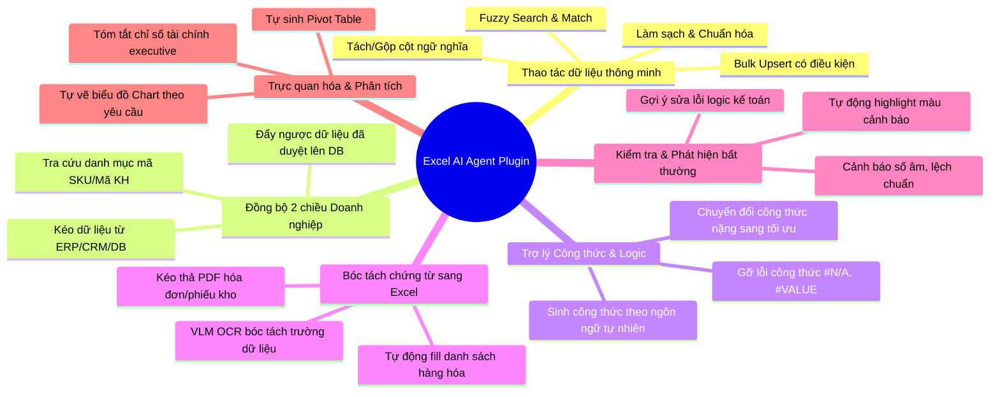

# 04 · Danh mục tính năng mở rộng của Excel AI Agent Plugin

Tài liệu này đề xuất và chi tiết hóa các tính năng mở rộng có thể tương tác được từ plugin AI Chatbot nhúng Excel, biến một bảng tính thông thường thành một **trạm điều khiển thông minh kết nối toàn diện với doanh nghiệp**.

---

## 1. Tổng quan các nhóm năng lực mở rộng



---

## 2. Chi tiết từng nhóm tính năng

### Nhóm 1: Thao tác & Làm sạch dữ liệu bảng tính thông minh (Smart Data Wrangling)

#### 1.1. Tìm kiếm & Ghép nối dữ liệu mờ (Fuzzy / Semantic VLOOKUP)
- **Vấn đề thực tế:** Hàm `VLOOKUP` hoặc `XLOOKUP` truyền thống của Excel yêu cầu chuỗi tìm kiếm phải trùng khớp 100%. Nếu tên khách hàng bị gõ sai chính tả ("Cty TNHH Sao Mai" vs "Công ty TNHH Sao Mai JSC"), Excel sẽ báo lỗi `#N/A`.
- **Năng lực AI Agent:**
  - Agent đọc cột cần tìm, áp dụng thuật toán so khớp ngữ nghĩa (Embedding / Fuzzy Match) để tìm đúng đối tượng.
  - Cho phép người dùng ra lệnh: *"Ghép mã khách hàng từ Sheet KháchHàng vào Sheet BánHàng dựa trên Tên công ty, tự động xử lý các trường hợp viết tắt"*.

#### 1.2. Tự động chuẩn hóa & Làm sạch dữ liệu (Data Cleaning)
- **Kịch bản:** Bảng tính nhập từ nhiều nguồn bị lộn xộn (chữ hoa chữ thường lẫn lộn, số điện thoại có dấu chấm hoặc khoảng trắng, định dạng ngày tháng dd/mm/yyyy lẫn mm/dd/yyyy).
- **Lệnh tương tác:** *"Chuẩn hóa cột Họ tên sang Title Case, đưa toàn bộ số điện thoại về chuẩn 10 số đầu +84, và xóa các dòng trùng lặp mã đơn hàng"*.
- **Cách Agent thực thi:** Agent quét qua cột, phát hiện định dạng lỗi, tạo danh sách các ô cần sửa, hiển thị thẻ preview và áp dụng hàng loạt chỉ trong 1 thao tác.

#### 1.3. Tách & Gộp cột thông minh theo ngữ nghĩa (Semantic Split/Merge)
- Tách cột "Địa chỉ giao hàng" dài ngoằng thành 3 cột riêng: `Phường/Xã`, `Quận/Huyện`, `Tỉnh/Thành phố` mà không cần viết các hàm `LEFT`, `RIGHT`, `MID` phức tạp.
- Tách cột "Mô tả sản phẩm" để trích xuất thuộc tính: `Màu sắc`, `Kích cỡ (Size)`, `Chất liệu`.

---

### Nhóm 2: Đồng bộ hai chiều với Hệ thống Doanh nghiệp (Enterprise 2-Way Sync)

#### 2.1. Kéo dữ liệu từ ERP / CRM / Database vào biểu mẫu Excel (Data Ingestion)
- **Kịch bản:** Kế toán đang mở một file biểu mẫu báo cáo chi phí tháng 10.
- **Lệnh tương tác:** *"Hãy lấy dữ liệu chi phí thực tế của phòng Marketing từ hệ thống ERP Odoo trong tháng 10 đổ vào bảng này"*.
- **Cơ chế Agent:**
  1. Agent gọi tool nội bộ (MCP DBHub / Odoo API) để truy vấn số liệu chi phí.
  2. Agent đọc header của biểu mẫu Excel hiện tại để map đúng các cột: Ngày, Khoản mục, Số tiền, Người duyệt.
  3. Chèn toàn bộ các dòng kết quả vào bảng tính, giữ nguyên định dạng font chữ, border, và công thức tổng có sẵn.

#### 2.2. Đẩy ngược dữ liệu đã đối soát lên Database (Reverse Commit)
- **Kịch bản:** Quản lý kho sau khi kiểm kê thực tế đã ghi nhận số lượng tồn mới trên file Excel.
- **Lệnh tương tác:** *"Kiểm tra lại toàn bộ dữ liệu kiểm kê này, nếu không có lỗi hãy cập nhật số lượng tồn kho mới lên hệ thống ERP"*.
- **Cơ chế Agent:**
  1. Agent quét bảng tính, chạy kiểm tra tính hợp lệ (các cột bắt buộc có đủ, số lượng >= 0).
  2. Hiển thị báo cáo tóm tắt: "Sẵn sàng cập nhật 45 mặt hàng vào ERP. 0 lỗi".
  3. Khi người dùng bấm [Xác nhận Đẩy dữ liệu], Agent gọi API ERP để commit dữ liệu, sau đó ghi chú lại mã giao dịch (Transaction ID) vào cột Ghi chú của Excel.

---

### Nhóm 3: Trợ lý Công thức & Logic nghiệp vụ (Smart Formula Copilot)

#### 3.1. Tự sinh công thức tối ưu từ mô tả ngôn ngữ tự nhiên
- **Người dùng yêu cầu:** *"Tính tổng tiền các đơn hàng của khách VIP có ngày đặt sau 01/09/2026 và trạng thái là 'Đã giao' vào ô F12"*.
- **AI Agent thực hiện:**
  - Phân tích địa chỉ cột: Cột B (Khách hàng), Cột C (Loại khách), Cột D (Ngày đặt), Cột E (Trạng thái), Cột F (Thành tiền).
  - Tự động sinh công thức: `=SUMIFS(F2:F100, C2:C100, "VIP", D2:D100, ">2026-09-01", E2:E100, "Đã giao")`.
  - Ghi thẳng công thức vào ô `F12` và giải thích ngắn gọn cách hoạt động.

#### 3.2. Chẩn đoán & Gỡ lỗi công thức (Formula Debugger)
- Khi người dùng click vào một ô bị lỗi `#N/A`, `#VALUE!`, hoặc `#REF!`:
- Agent tự động đọc công thức, dò tìm các ô phụ thuộc (precedent cells), phát hiện nguyên nhân (ví dụ: ô tham chiếu đang có khoảng trắng thừa, hoặc chia cho 0), và gợi ý nút `[Sửa tự động]` (ví dụ bọc hàm bằng `IFERROR` hoặc sửa phạm vi dải ô).

---

### Nhóm 4: Bóc tách chứng từ đổ thẳng vào Excel (Document-to-Excel Ingestion)

Tính năng kết hợp sức mạnh của **Nhóm 5 (Document AI & VLM)**:
- **Kịch bản:** Nhân viên nhận được 5 file PDF hóa đơn điện tử hoặc ảnh chụp phiếu giao hàng.
- **Tương tác:** Người dùng chỉ cần **kéo thả file PDF vào khung chat Taskpane**.
- **Quy trình Agent:**
  1. Agent gửi tài liệu qua mô hình Vision/Document AI để trích xuất các trường: Tên người bán, MST, Số hóa đơn, Ngày lập, Danh sách từng dòng hàng hóa (Tên hàng, ĐVT, Số lượng, Đơn giá, Thành tiền, Thuế suất).
  2. Agent đối chiếu với cấu trúc cột của sheet Excel hiện tại.
  3. Hiển thị bản xem trước các dòng trích xuất.
  4. Người dùng bấm [Thêm vào Excel] → Tự động chèn các dòng vào bảng kê mua vào.

---

### Nhóm 5: Kiểm tra tính hợp lệ & Phát hiện bất thường (Validation & Anomaly Detection)

Tính năng kết hợp với **Nhóm 3 (Phát hiện bất thường)**:
- **Quét rà soát bảng tính:**
  - Tìm các giá trị âm bất thường ở những cột chỉ được phép dương (như Đơn giá, Số lượng, Tồn kho).
  - Phát hiện các khoản chi tiêu lệch chuẩn (Outliers) gấp 5 lần mức trung bình của tháng.
  - Phát hiện sai sót ngày tháng (Ngày thanh toán trước Ngày lập hóa đơn).
- **Hành động trực quan trên Excel:**
  - Tự động bôi màu viền đỏ (Conditional Formatting) các ô nghi ngờ.
  - Thêm chú thích (Cell Note/Comment) vào ô giải thích lý do nghi ngờ để người dùng kiểm tra lại.

---

### Nhóm 6: Tự động phân tích & Trực quan hóa (Auto Pivot & Charting)

- **Lệnh tương tác:** *"Tạo một biểu đồ cột thể hiện Top 5 nhân viên có doanh số cao nhất trong Quý 3 đặt ngay bên dưới bảng dữ liệu"*.
- **Cách Agent thực thi qua `Office.js`:**
  ```typescript
  const sheet = context.workbook.worksheets.getActiveWorksheet();
  const chart = sheet.charts.add(
    Excel.ChartType.columnClustered,
    sheet.getRange("A1:B6"),
    Excel.ChartSeriesBy.columns
  );
  chart.title.text = "Top 5 Nhân viên Doanh số Quý 3";
  chart.top = 350; // Đặt vị trí hiển thị dưới bảng dữ liệu
  chart.left = 50;
  await context.sync();
  ```
- Tương tự, Agent có thể tự động tạo **Pivot Table** và kéo thả các trường vào Rows, Columns, Values theo yêu cầu người dùng.

---

## 3. Bảng tổng hợp giá trị mang lại cho doanh nghiệp

| Nhóm tính năng | Thao tác truyền thống | Khi có AI Agent Plugin | Mức độ tiết kiệm thời gian |
|---|---|---|---|
| **Tìm kiếm & chèn dòng** | Tìm thủ công, gõ tay từng ô | Chat 1 câu: Agent tìm, so khớp và chèn nguyên dòng | **Giảm 85%** |
| **Kéo số liệu từ ERP** | Đăng nhập ERP, export Excel, copy-paste sang file mẫu | Agent gọi API nội bộ điền thẳng vào form mẫu | **Giảm 90%** |
| **Nhập liệu từ hóa đơn PDF** | Đọc PDF bên trái, gõ lại vào Excel bên phải | Kéo thả file PDF vào chat → tự chèn dòng | **Giảm 95%** |
| **Viết công thức phức tạp** | Tìm Google/diễn đàn, thử sai nhiều lần | Mô tả yêu cầu → Agent điền sẵn công thức tối ưu | **Giảm 75%** |
| **Kiểm tra sai sót, bất thường** | Dò mắt thủ công từng dòng | Agent quét tự động, highlight các điểm nghi vấn | **Giảm 90%** |
