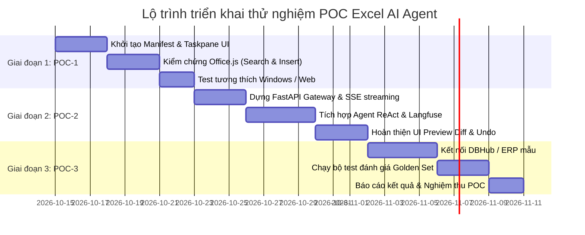

# 05 · Kế hoạch triển khai thử nghiệm POC (Proof of Concept)

Tài liệu này vạch ra lộ trình triển khai thử nghiệm POC theo phương pháp **chia nhỏ từng bước, kiểm chứng liên tục, không gây rủi ro kỹ thuật**, giúp nhóm dự án đánh giá thực tế trước khi đầu tư phát triển quy mô lớn.

---

## 1. Nguyên tắc triển khai POC

1. **Phần cứng & Phần mềm tối giản:**
   - Không cần server phức tạp ban đầu; toàn bộ POC có thể chạy trên máy phát triển cục bộ (`localhost`).
   - Sử dụng HTTPS tự ký (qua công cụ chính thức `office-addin-dev-certs` của Microsoft) để đáp ứng yêu cầu bảo mật của Office Add-in.
2. **Kiểm chứng từng mắt xích độc lập:**
   - Bước 1: Kiểm chứng khả năng tương tác của `Office.js` với Excel.
   - Bước 2: Kiểm chứng luồng hội thoại và Tool Calling giữa Chatbot UI và FastAPI Agent.
   - Bước 3: Ghép nối end-to-end có Human-in-the-Loop và dữ liệu doanh nghiệp mẫu.
3. **Đo lường bằng số liệu định lượng cụ thể:**
   - Không đánh giá theo cảm giác "thấy mượt"; phải đo bằng tỷ lệ thực thi lệnh đúng, độ trễ từng bước và chi phí token.

---

## 2. Lộ trình 3 giai đoạn của POC

---

### Giai đoạn 1: POC-1 — Kiểm chứng Office Add-in & Năng lực thao tác Excel (Standalone)

- **Mục tiêu:** Chứng minh 100% rằng một Web Add-in có thể đọc, tìm kiếm trong một cột bất kỳ và chèn nguyên một dòng dữ liệu vào Excel mà không gặp lỗi phân quyền hay giật lag.
- **Thành phần:**
  - `manifest.xml`: Định nghĩa Add-in ID, tên, icon, và quyền hạn `ReadWriteDocument`.
  - Frontend tĩnh: HTML + TypeScript + `Office.js`.
  - Chưa cần AI: Dùng các nút bấm giả lập (Mock buttons) trên Taskpane:
    - Nút 1: *"Tìm kiếm 'SP-101' trong cột B"*.
    - Nút 2: *"Chèn 1 dòng mới với dữ liệu mẫu vào dòng 15"*.
- **Tiêu chí nghiệm thu POC-1:**
  - [ ] Nạp thành công Add-in vào Excel Desktop và Excel Online.
  - [ ] Tìm kiếm đúng vị trí ô trong cột với thời gian < 50ms.
  - [ ] Chèn thành công 1 dòng dữ liệu đầy đủ các cột mà không làm xáo trộn các dòng bên dưới.

---

### Giai đoạn 2: POC-2 — Tích hợp AI Agent Backend & Human-in-the-Loop ReAct Loop

- **Mục tiêu:** Kết nối Taskpane Chatbot với FastAPI AI Agent Backend, thực thi chuỗi phản hồi qua ngôn ngữ tự nhiên và kiểm soát an toàn qua thẻ Preview Diff.
- **Thành phần:**
  - **Client:** Chat UI (hiển thị tin nhắn dạng stream markdown, input text, nút đính kèm).
  - **Backend:** FastAPI service chuẩn Pydantic v2:
    - Endpoint `/api/v1/chat/stream`: Trả về Server-Sent Events (SSE).
    - Tích hợp mô hình AI (Gemini 2.5/3 Flash hoặc GPT-4o-mini).
    - Cấu hình Tool Calling: `excel_search_column`, `excel_insert_row`.
    - Tích hợp Langfuse để đo độ trễ, số bước suy luận và chi phí token.
  - **Cơ chế an toàn:** Giao diện thẻ **Preview Diff** hiển thị trước khi chèn dữ liệu.
- **Kịch bản kiểm thử (Test Cases):**
  1. *Case 1 (Chèn mới):* "Thêm sản phẩm Bàn phím cơ giá 1.200.000đ vào danh sách".
  2. *Case 2 (Tìm rồi quyết định):* "Kiểm tra xem mã NV05 đã có trong danh sách chưa, nếu có thì báo lại, nếu chưa thì thêm vào".
  3. *Case 3 (Hoàn tác):* Người dùng bấm nút [Undo] sau khi chèn dòng.
- **Tiêu chí nghiệm thu POC-2:**
  - [ ] Streaming phản hồi mượt mà không bị ngắt kết nối.
  - [ ] Agent tự động kích hoạt đúng tool khi nhận lệnh từ người dùng.
  - [ ] Hiển thị chính xác thẻ Preview Diff và chỉ ghi dữ liệu khi người dùng bấm [Apply].
  - [ ] 100% các cuộc gọi LLM và Tool được ghi vết đầy đủ trên Langfuse.

---

### Giai đoạn 3: POC-3 — Mở rộng kết nối Dữ liệu Doanh nghiệp & Nghiệp vụ thực tế

- **Mục tiêu:** Thử nghiệm trên một kịch bản kinh doanh thực tế có kết nối với cơ sở dữ liệu nội bộ (ví dụ: Bảng kê Bán hàng hoặc Đối soát Công nợ).
- **Thành phần:**
  - Kết nối Tool truy vấn cơ sở dữ liệu nội bộ (qua MCP DBHub hoặc SQL connection).
  - Thử nghiệm tính năng: Người dùng chat *"Lấy thông tin khách hàng ABC từ hệ thống rồi điền vào dòng tiếp theo của bảng"* → Agent tra cứu DB nội bộ rồi điền vào Excel.
  - Xây dựng bộ câu hỏi chuẩn (Golden Set: 30 câu lệnh nghiệp vụ thường gặp) để đo độ chính xác.
- **Tiêu chí nghiệm thu POC-3:**
  - [ ] Tỷ lệ thực thi đúng nghiệp vụ đạt > 95% trên bộ Golden Set.
  - [ ] Thời gian hoàn thành trung bình cho một tác vụ < 3 giây.
  - [ ] Người dùng thử nghiệm nội bộ đánh giá mức độ tiện dụng đạt ít nhất 4.5/5 điểm.

---

## 3. Checklist kỹ thuật cần chuẩn bị khi bước vào thực thi

| Hạng mục | Công cụ / Thư viện đề xuất | Ghi chú kỹ thuật |
|---|---|---|
| **Office Add-in Tooling** | `yo office` (Yeoman Generator for Office Add-ins) | Khởi tạo nhanh khung dự án TypeScript React |
| **Development Certificates** | `office-addin-dev-certs` | Cấp chứng chỉ SSL HTTPS cho `localhost:3000` |
| **API Backend** | `FastAPI` (Python 3.11+) + `Uvicorn` | Theo quy chuẩn repo: Pydantic v2, Poetry |
| **Agent Runtime** | `LangGraph` hoặc `Agno (AgentOS)` | Quản lý state hội thoại và ReAct tool loop |
| **Tracing & Monitoring** | `langfuse` | Theo dõi prompt, tokens, cost và latencies |
| **Frontend UI Kit** | Fluent UI React (Microsoft) hoặc Tailwind CSS | Đảm bảo phong cách giao diện đồng nhất với Excel bản gốc |

---

## 4. Tóm tắt kết luận

Kế hoạch POC được thiết kế theo lộ trình thực tế, chặt chẽ và có thể bắt đầu triển khai ngay khi có quyết định phê duyệt. Dự án hứa hẹn mang lại bước đột phá lớn trong cách nhân sự doanh nghiệp tương tác với dữ liệu và hệ thống thông tin.
