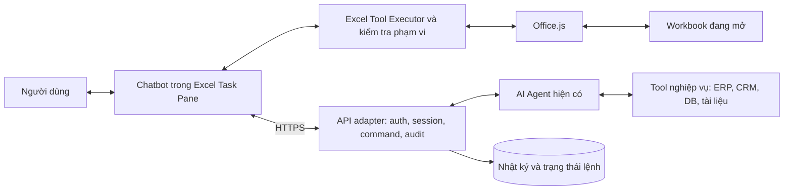
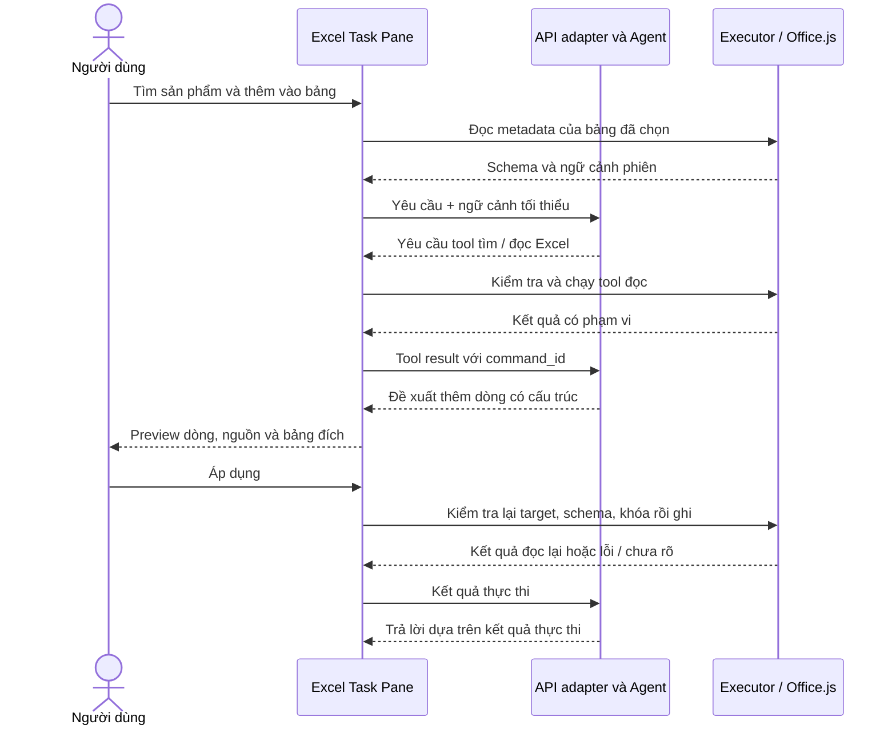

# 02 · Solution approach — Excel Add-in kết nối AI Agent nội bộ

**Ngày:** 2026-10-13 · **Mức độ:** thiết kế đề xuất; tên tool và trường dữ liệu dưới đây chưa phải API đã triển khai.

## 1. Chọn hướng triển khai

| Phương án | Phù hợp | Hạn chế / quyết định |
|---|---|---|
| **Task Pane Add-in + Office.js** | Chat trong Excel, đọc/ghi workbook đang mở, gọi backend riêng | **Chọn làm hướng chính**; cần web frontend và kiểm tra API trên host |
| COM/VSTO | Môi trường Windows chuyên biệt, tích hợp desktop sâu | Không chọn cho mục tiêu Windows/Mac/web; COM/VSTO giới hạn Windows [S1] |
| Office Scripts + Power Automate | Tác vụ tự động hóa theo lô, flow có sẵn | Không thay thế task pane có chat/auth/UI tùy biến [S8] |
| Microsoft Graph Excel API | Backend thao tác file trong OneDrive for Business/SharePoint | Nhánh riêng khi cần cloud-file workflow; quyền endpoint và định dạng là ràng buộc [S9][S10] |
| Xử lý file bằng Python | Import/export hoặc tạo báo cáo trên server | Không tự cung cấp giao diện và tương tác live trong Excel của người dùng |

Office Add-in là một web app được Office host và một manifest mô tả điểm tích hợp. Chọn manifest XML
`add-in only` cho POC; đây là định dạng được hỗ trợ production cho Excel. Unified manifest là lựa chọn khác,
phải đối chiếu host và deployment trước khi dùng, không mặc định coi hai loại tương đương [S1][S4].

## 2. Kiến trúc đề xuất

| Thành phần | Trách nhiệm |
|---|---|
| Task pane | Chat, chọn bảng đích, hiển thị preview, tiến độ, lỗi và kết quả |
| Excel Tool Executor | Thực thi tập thao tác cho phép; kiểm schema, target, dữ liệu và đọc lại sau ghi |
| Office.js | Cầu nối giữa JavaScript trong add-in và workbook; dùng mô hình load/sync [S3] |
| API adapter | Nối frontend với giao thức agent hiện có; xác thực, giới hạn, lưu command/session |
| Agent | Hiểu yêu cầu, chọn tool, lấy dữ liệu nghiệp vụ và giải thích kết quả |
| Nhật ký | Ai yêu cầu, target, thay đổi, nguồn dữ liệu, trạng thái, lỗi và liên kết trace |

Backend Python hoặc dịch vụ agent **không trực tiếp gọi Office.js trên workbook desktop**. Lệnh thao tác Excel
phải được chuyển đến add-in còn kết nối đúng phiên; executor thực thi rồi trả kết quả về để agent tiếp tục.
MCP, nếu dùng phía agent, vẫn cần cầu nối này; MCP server không tự nhìn thấy workbook trên máy người dùng.

Frontend đề xuất TypeScript và một UI framework quen thuộc với đội; backend giữ stack agent hiện có.
Không cần thay framework agent hoặc thêm vector database chỉ để tìm mã chính xác trong một cột.

## 3. Hợp đồng tích hợp với agent

### 3.1. Vòng thực thi

POC có thể dùng REST request/response: trả trạng thái chờ client tool, client gọi tool rồi gửi kết quả để tiếp tục.
Nếu đã có SSE, dùng SSE chiều server → client và HTTP POST cho tool result; WebSocket chỉ thêm khi cần hai chiều
liên tục. Không giữ HTTP request mở suốt thời gian người dùng đọc preview.

### 3.2. Metadata cần trao đổi

| Trường đề xuất | Mục đích |
|---|---|
| `session_id`, `run_id`, `command_id`, `tool_call_id` | Liên kết cuộc hội thoại, lần chạy và từng thao tác |
| `workbook_session_id`, `worksheet_id`, `table_id` | Gắn lệnh với đúng workbook và bảng; không chỉ dùng tên hiển thị |
| `schema_hash`, `expected_key`, `expected_values_hash` | Phát hiện schema/giá trị đã đổi từ lúc lập kế hoạch |
| `tool_name`, `arguments`, `expires_at` | Lệnh có schema, thời hạn và phạm vi hữu hạn |
| `approval_binding`, `idempotency_key` | Gắn preview đã duyệt với đúng nội dung, chống retry lặp cùng lệnh |
| `status`, `affected_keys`, `actual_range`, `error_code` | Báo kết quả từ executor, không suy đoán từ lời model |

Đây là trường do ứng dụng quản lý, không phải toàn bộ đều có sẵn trong Office.js. Workbook chưa lưu không có
cloud file ID để dựa vào; tạo định danh phiên gắn với instance add-in. Khi mở lại, Save As hoặc đổi workbook,
phải nhận diện lại, không phát lại lệnh ghi cũ chỉ vì tên file giống nhau.

### 3.3. Tập tool ban đầu

| Tool đề xuất | Quyền / nội dung |
|---|---|
| `excel.get_context` | Đọc metadata của sheet/table/range trong phạm vi được chọn |
| `excel.search_rows` | Đọc; predicates có column, operator, value và giới hạn trả kết quả |
| `excel.get_rows` | Đọc bản ghi theo khóa để xem chi tiết hoặc kiểm lại |
| `excel.propose_insert_row` | Chuẩn bị payload và preview; chưa ghi |
| `excel.apply_insert_row` | Ghi sau khi xác minh preview, target và precondition |

Tool không nhận JavaScript/VBA tùy ý để `eval`. Backend và executor đều kiểm tra danh sách thao tác cho phép,
kiểu dữ liệu, phạm vi và quyền. Nội dung ô Excel và kết quả tra cứu là dữ liệu, không được đổi thành chỉ thị hệ thống.

### 3.4. Tái sử dụng dự án trong workspace

[CMB-09 Data Agent OS](../../cmb-09-data-agent-os/README.md) mô tả agent theo domain pack, kỹ năng và tool dữ liệu.
Có thể tái sử dụng khái niệm domain pack cho tên cột, thuật ngữ, nguồn dữ liệu và quy tắc ánh xạ, rồi bổ sung Excel
client tools qua adapter. Đây là liên hệ thiết kế, **chưa xác nhận CMB-09 là backend đang chạy của chủ dự án**.

CMB-09 hiện ghi rõ POC dữ liệu chỉ đọc và chưa có auth. Không suy rộng quyền đó sang plugin ghi Excel;
quyền đọc DB và quyền ghi workbook là hai phạm vi riêng. Trước POC cần xác minh API, cơ chế resume tool call,
auth, identity người dùng và error contract của agent thực tế.

## 4. Cách search theo cột

1. Lấy tên và schema Table đã chọn; map bí danh tiếng Việt sang cột thật. Trường hợp mơ hồ cần chọn lại.
2. Agent chuyển câu nói thành điều kiện; executor kiểm column/operator/type rồi đọc các cột cần thiết.
3. So sánh xác định ở client với dữ liệu workbook; trả khóa bản ghi và vị trí hiện tại. Nếu dữ liệu ở ERP/DB,
   gọi tool hệ thống tương ứng và phân biệt rõ nguồn kết quả.
4. Khi cần lấy cả dòng, đọc các cột còn lại cho tập khóa khớp. Phân trang kết quả và công bố phạm vi đã quét.

Mã `00123` giữ kiểu chuỗi; ngày và tiền xử lý theo schema/locale, không đoán từ chuỗi hiển thị. Quy tắc trim,
phân biệt hoa/thường và bỏ dấu phải là cấu hình minh bạch. Fuzzy/semantic search là mở rộng, không dùng để
tự quyết định khóa khi ghi. Tìm kiếm không nhất thiết đổi filter đang hiển thị của người dùng.

Office.js cho phép đọc body của một cột Table và thêm dòng; đây là nền tảng API cho thao tác [S2].
Không gửi toàn bộ workbook vào LLM: ưu tiên metadata, điều kiện và kết quả tối thiểu cần để trả lời.

## 5. Cách insert một dòng đầy đủ

### 5.1. Excel Table — ưu tiên MVP

- Từ object theo tên cột, executor map về đúng thứ tự cột ở thời điểm ghi. `Table.rows.add` nhận dữ liệu dạng
  mảng hai chiều; index quyết định vị trí, có thể thêm cuối bảng [S2].
- Phân biệt cột nhập liệu và cột công thức. Không ghi literal đè công thức; xác minh việc kế thừa công thức,
  format, validation và total row trên mẫu workbook trước khi công bố hỗ trợ.
- Kiểm cột bắt buộc, kiểu, giới hạn và khóa nghiệp vụ. Nếu thiếu dữ liệu thì hỏi lại hoặc dùng default đã quy định.
- Preview hiển thị đầy đủ hàng và tác động đến vùng bên dưới. Table có dữ liệu sát bên dưới có thể làm dịch ô
  hoặc gây lỗi; MVP nên dùng vùng đích có khoảng trống, không giả định append luôn vô hại.
- Đọc lại schema và kiểm trùng ngay trước ghi; thực thi xong đọc lại theo khóa để xác nhận.

### 5.2. Cả hàng worksheet — tính năng riêng

Dùng `getEntireRow` và thao tác insert range theo hướng dịch xuống, sau đó chỉ ghi vùng cột đích [S5][S6].
Chèn một range hẹp không tương đương chèn cả hàng. Cần kiểm tra ảnh hưởng đến bảng cạnh bên, merged cells,
named ranges và công thức; nếu chưa xác định được tác động thì từ chối thao tác đó.

### 5.3. Chống lỗi và khôi phục

| Tình huống | Cách xử lý đề xuất |
|---|---|
| Đổi sheet khi agent đang suy luận | Dùng target đã gắn với command, kiểm lại trước ghi; không dùng active sheet mới |
| Sort/filter làm đổi số hàng | Tra lại theo khóa; row index chỉ là vị trí hiện tại |
| Mất kết nối sau khi ghi | Ghi trạng thái chưa rõ; đối soát bằng command/khóa và đọc lại trước retry |
| Gửi lại command | Tra nhật ký bền vững và khóa bản ghi; không append lại chỉ vì HTTP timeout |
| Schema hoặc dữ liệu đổi sau preview | Hủy preview cũ và tạo lại; không ghi theo mapping cũ |
| Lỗi giữa các bước ghi/format | Báo partial/unknown và đối soát; không coi nhiều lệnh là transaction có rollback |
| Nhiều người cùng sửa | POC giới hạn một writer; pilot kiểm coauthoring và xử lý xung đột [S11] |

Hash và idempotency key giảm rủi ro nhưng **không tạo khóa giao dịch nguyên tử trong Excel**. Dù đọc lại trước
ghi vẫn có khoảng đua với người sửa tay. Khóa trên server chỉ điều phối các client của ứng dụng. Không tuyên bố
exactly-once hoặc chống trùng tuyệt đối khi có coauthoring; cần đối soát và quy tắc dữ liệu nghiệp vụ.

Không dựa vào Ctrl+Z như cam kết khôi phục. Mở rộng undo cần lưu before/after và chỉ áp dụng thay đổi bù khi dữ
liệu còn khớp. Nếu khôi phục sẽ đè chỉnh sửa của người khác, dừng để xử lý xung đột.

## 6. Auth, dữ liệu và triển khai

- Manifest XML cần quyền đọc/ghi tài liệu phù hợp, ví dụ `ReadWriteDocument` [S13]. Quyền Office không thay thế
  đăng nhập/ủy quyền với backend; allowlist table là ràng buộc ứng dụng, không phải quyền Office ở cấp bảng.
- Dùng identity của hệ thống hiện có. Nếu tổ chức dùng Microsoft Entra, đánh giá SSO qua NAA trên host mục tiêu,
  có phương án đăng nhập tương thích khi host không hỗ trợ [S14]. Không mặc định token của Graph dùng được cho API nội bộ.
- HTTPS cho UI/API, CORS và origin rõ ràng; có thể host nội bộ nếu máy Excel truy cập được mạng/chứng chỉ.
  Secret model và thông tin DB ở backend, không nhúng trong manifest hay JavaScript client.
- Chỉ gửi các cột/hàng cần thiết; log có kiểm soát dữ liệu nhạy cảm. Chuỗi trông như công thức được xử lý như text
  khi đó là dữ liệu; công thức chỉ đi qua tool riêng có kiểm tra.
- Sideload để thử nghiệm; phân phối nội bộ qua cơ chế admin phù hợp tenant, như Integrated apps. Phát hành công khai
  có luồng Marketplace riêng [S12]. Đợt nghiên cứu này chưa cài hoặc phát hành add-in.

Client đọc/ghi trên host, backend agent qua mạng: workbook cục bộ không bắt buộc chuyển lên Graph. Tuy nhiên,
agent vẫn cần kết nối mạng phù hợp và workbook cần được lưu theo cơ chế Excel; tool trả “đã ghi” không mặc nhiên
có nghĩa file đã lưu bền vững xuống đĩa/cloud.

## 7. Graph và tác vụ chạy nền

Graph là hướng khác cho workbook lưu trên nền tảng doanh nghiệp Microsoft được hỗ trợ [S9]. Đặc biệt endpoint
thêm TableRow yêu cầu delegated `Files.ReadWrite` cho tài khoản cơ quan/trường học; tài liệu ghi application
permission và delegated personal account không được hỗ trợ [S10]. Không thiết kế daemon chỉ dùng client credentials
rồi mặc định có thể thêm dòng.

MVP làm việc khi workbook và runtime add-in còn hoạt động. Không coi task pane là dịch vụ chạy 24/7 sau khi đóng
Excel. Nếu phát sinh nhu cầu unattended, phải thiết kế luồng cloud riêng, kiểm lại quyền, phiên và trạng thái file.

Nguồn `[S1]`–`[S14]` được liệt kê và liên kết tại [03 · Đánh giá khả thi](03-danh-gia-kha-thi.md).
