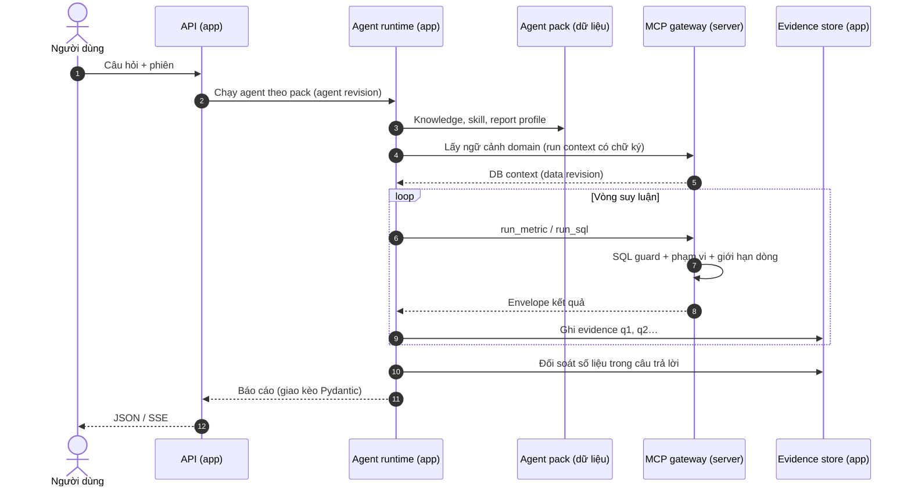

# Best Practices Tổ Chức Dự Án Python AI — Phần Chung và Profile Theo Loại Dự Án
> **Chuẩn kiến trúc cho dự án AI dùng Agent, MCP, giao diện client và dịch vụ model — tách rõ phần dùng cho mọi dự án và phần riêng của từng loại dự án**

| Thuộc tính | Chi tiết |
| :--- | :--- |
| **Phiên bản** | 1.2 |
| **Ngày lập / cập nhật** | 2026-10-08 · 2026-10-21 |
| **Trạng thái** | Tài liệu tham chiếu sống — cập nhật theo dự án thực tế |
| **Cấu trúc** | Phần I: chung cho mọi dự án · Phần II: profile theo loại dự án · Phần III: mẫu theo tình huống |
| **Profile** | A: agent phân tích dữ liệu trên cơ sở dữ liệu nghiệp vụ · B: trợ lý nhúng trong công cụ làm việc, đọc / ghi dữ liệu phía client · C: xử lý âm thanh / hình ảnh / video bằng model, thời gian thực |
| **Nền tảng chung** | Python 3.12+, Pydantic v2, pydantic-settings, FastAPI, Ruff, pytest. Package manager, agent runtime, cách lấy dữ liệu, giao diện, lưu trữ, tracing: **chọn lúc khởi tạo dự án** (mục 2) |

## Lịch sử thay đổi

| Phiên bản | Ngày | Thay đổi |
| :--- | :--- | :--- |
| 1.0 | 2026-10-08 | Bản đầu: `src/` layout, agent / MCP / domain pack, tiêu chuẩn kỹ thuật, multimodal, góc khuất production |
| 1.0 + Web JS | 2026-10-20 | Thêm tổ chức Web JavaScript cho giao diện chat và Office add-in |
| 1.1 | 2026-10-20 | Tách **Phần chung** và **Profile A / B / C** theo dự án thực tế. Package manager (uv hoặc Poetry) và các lựa chọn công nghệ thành **quyết định lúc khởi tạo**. Thêm: phát triển nhiều người cùng lúc, kiểm thử chung, bảng áp dụng cho từng dự án. MCP gateway + domain pack chuyển về Profile A; tổ chức Web JS về Profile B; multimodal về Profile C. Mục tình huống ghi rõ khi nào cần, bỏ số liệu không có nguồn; checklist tách bắt buộc / theo profile / theo tình huống |
| 1.2 | 2026-10-21 | Profile đặt tên và mô tả theo **chức năng bài toán**, không ghi tên dự án; bỏ ví dụ gắn với nghiệp vụ / tên file của một dự án cụ thể; dự án áp dụng tự khai báo phần riêng trong `AGENTS.md` của mình |

---

## Mở đầu

### 0. Cách dùng tài liệu

1. **Khởi tạo dự án:** trả lời các quyết định ở mục 2 — hỏi người phụ trách khi chưa rõ, không tự chọn thay — rồi chọn profile.
2. **Dựng cấu trúc** theo Phần I + profile đã chọn. Chỉ tạo thư mục khi đã có trách nhiệm tương ứng; dự án nhỏ không cần đủ cây.
3. **Ghi lại** trong `AGENTS.md` của dự án: các quyết định khởi tạo và bảng áp dụng (mục 2.3). `AGENTS.md` của dự án là
   quy tắc riêng — **thắng tài liệu này** khi khác nhau.
4. **Phần III** chỉ dùng khi gặp đúng tình huống mô tả.

Tài liệu mô tả theo **chức năng bài toán**, không gắn với một dự án cụ thể; dự án nào áp dụng thì khai báo phần riêng của
mình (quyết định khởi tạo, bảng áp dụng) trong `AGENTS.md` của dự án đó.

#### Chọn profile

| Câu hỏi | Có → |
| :--- | :--- |
| Người dùng hỏi đáp, xin báo cáo / KPI trên dữ liệu trong cơ sở dữ liệu nghiệp vụ (một hoặc nhiều domain), quyền truy cập dữ liệu phải được chặn ở phía server? | **Profile A** — Agent phân tích dữ liệu trên cơ sở dữ liệu nghiệp vụ |
| Người dùng làm việc trong một công cụ (bảng tính, web app), trợ lý đọc / ghi dữ liệu ngay trong công cụ đó, dữ liệu chuẩn nằm ở hệ thống nguồn có API? | **Profile B** — Trợ lý nhúng trong công cụ làm việc |
| Xử lý âm thanh, hình ảnh, video bằng model (ASR, dịch máy, OCR / VLM, CV), độ trễ quan trọng hoặc chạy trên GPU, ít hoặc không có agent loop? | **Profile C** — Xử lý âm thanh / hình ảnh / video thời gian thực |

Một dự án có thể kết hợp nhiều profile (ví dụ agent phân tích dữ liệu có giao diện chat web: A + phần web của B). Loại dự án mới →
thêm profile theo khuôn ở mục 10.

---

### 1. Bối cảnh và lựa chọn mô hình kiến trúc

Kiến trúc phân tầng (*Controller → Service → Repository*) và gói theo tính năng (*Vertical Slice*) phục vụ tốt bài toán
CRUD. Dự án AI thêm ba thách thức:

1. **Tính bất định và vòng suy luận của agent:** agent gọi LLM, gọi tool, quan sát kết quả, thử lại, chuyển ngữ cảnh.
2. **Công cụ đến từ bên ngoài:** tool ngày càng được cung cấp qua giao thức (MCP), hoặc chạy ở client (tool phía
   trình duyệt / Office add-in), không chỉ là hàm Python nội bộ.
3. **Tri thức và cấu hình nghiệp vụ thay đổi thường xuyên:** schema, từ điển dữ liệu, quy tắc, metric, prompt, mô tả tool
   không nên nằm cứng trong code.

> **Mục tiêu:** người mới phân biệt ngay đâu là hạ tầng, đâu là logic agent, đâu là tri thức nghiệp vụ; sửa prompt hay
> cấu hình không làm gãy code; thêm domain / tool / model bằng cách thêm file, không sửa lõi; nhiều người cùng sửa mà
> ít giẫm chân nhau.

#### Khảo sát dự án mẫu (2025–2026)

| Repository | Điểm nên học | Hạn chế nếu áp dụng máy móc |
| :--- | :--- | :--- |
| **`pydantic/pydantic-ai`** | Kiểu dữ liệu chặt với Pydantic v2, `Agent[Deps, Output]`; `AGENTS.md` lồng nhau cho coding agent; test với `TestModel`, `FunctionModel` | Là thư viện, không phải ứng dụng nghiệp vụ |
| **`openai/openai-agents-python`** | Agent loop đơn giản; tool và hand-off gọn; "less is more in tools" | Chưa có lớp quản trị domain knowledge |
| **`modelcontextprotocol/python-sdk`** | Client – server tách rõ qua stdio / SSE / Streamable HTTP; tool động theo JSON-RPC 2.0 | Chỉ là giao thức, không lo agent state hay API nghiệp vụ |
| **`GoogleCloudPlatform/agent-starter-pack`** | `app/agent.py`, `tests/{unit,integration}`, `eval/evalsets` tách khỏi CI | Phân tầng phẳng, dồn file khi nhiều domain |
| **`vanna-ai/vanna` (v2)** | Module theo năng lực, registry cắm rút LLM / VectorDB / DB | Abstraction trùng lặp nếu đã dùng framework hiện đại |
| **`fastapi-best-practices`** | Gói theo domain `{router, schemas, service, dependencies}` | Thiếu khái niệm AI: prompt, evidence, grounding, eval |

**Kết luận:** một **kernel chung** (cấu hình, logging, tracing, giao kèo Pydantic, tầng service / agent / API, kiểm thử)
dùng cho mọi dự án, cộng **profile** theo loại bài toán. Khi gọi engine bên ngoài (LLM, MCP server, model ASR/MT, API
hệ thống nguồn), dùng **Ports & Adapters**: lõi chỉ biết giao kèo, adapter cụ thể có thể thay.

---

## Phần I — Chung cho mọi dự án

### 2. Quyết định lúc khởi tạo dự án

Hỏi và ghi lại **trước khi scaffold**. Dự án đã có sẵn thì theo lựa chọn đang dùng — không đổi package manager,
tracing hay công cụ migration chỉ để khớp tài liệu tham khảo.

#### 2.1. Các quyết định

| Quyết định | Lựa chọn | Gợi ý | Ảnh hưởng tới |
| :--- | :--- | :--- | :--- |
| Loại dự án / profile | A · B · C · kết hợp | mục 0 | Phần II |
| Package manager | **uv** · **Poetry** | **hỏi người phụ trách**; uv nhanh, quản lý cả phiên bản Python và lock; Poetry khi team / CI đã chuẩn hóa Poetry | lock file, build backend, lệnh trong `Makefile` |
| Phiên bản Python | 3.12 · 3.13 | theo thư viện agent / model đang dùng | `requires-python`, Docker image |
| Agent runtime | Agno / AgentOS · OpenAI Agents SDK · PydanticAI · không có agent | theo tính năng cần (AG-UI, MCP, multi-runtime) | `agents/` |
| Cách lấy dữ liệu nghiệp vụ | MCP gateway riêng · API của hệ thống nguồn · không có | gateway khi phải chặn truy cập DB ở server (A); API khi hệ thống nguồn đã có (B) | profile |
| Giao diện | không có · web chat · Office add-in / tool phía client | — | `web/`, test e2e |
| Lưu trữ của ứng dụng | không có · SQLite (session) · PostgreSQL + migration | ít nhất có thể | `models/`, `repositories/`, migration |
| LLM tracing | Langfuse qua OpenTelemetry · Langfuse SDK wrapper · metric + log (không ghi nội dung) · không có | theo yêu cầu riêng tư của dữ liệu | `core/observability.py` |
| Triển khai | Docker Compose · Kubernetes · chạy trên máy | — | `deploy/`, CI |

#### 2.2. uv hay Poetry — lệnh tương đương

Tài liệu, README và CI **gọi `make <target>`**, không gọi thẳng `uv run` / `poetry run` — đổi công cụ chỉ sửa `Makefile`.

| Việc | uv | Poetry |
| :--- | :--- | :--- |
| Cài môi trường | `uv sync` | `poetry install` |
| Thêm thư viện / thư viện dev | `uv add x` · `uv add --dev x` | `poetry add x` · `poetry add --group dev x` |
| Chạy lệnh trong môi trường | `uv run pytest` | `poetry run pytest` |
| Khóa phiên bản | `uv lock` → `uv.lock` | `poetry lock` → `poetry.lock` |
| Nhóm phụ thuộc | `[dependency-groups]` | `[tool.poetry.group.<tên>.dependencies]` |
| Build backend | `uv_build` hoặc `hatchling` | `poetry-core` |
| Ghim phiên bản Python | `uv python pin 3.12` (`.python-version`) | `poetry env use 3.12` |

```makefile
# Makefile — lệnh chạy trong môi trường lấy từ một biến (uv run | poetry run)
RUN ?= uv run
test:  ## unit + integration
	$(RUN) pytest -m "not e2e"
lint:  ## style
	$(RUN) ruff check . && $(RUN) ruff format --check .
```

#### 2.3. Ghi vào `AGENTS.md` của dự án

```markdown
## Quyết định khởi tạo (ngày, người quyết định)
| Quyết định | Chọn | Lý do |
|---|---|---|
| Profile | B | người dùng làm việc trong Excel; dữ liệu chuẩn ở backend có API |
| Package manager | uv | repo đang dùng uv |
| … | … | … |

## Áp dụng hướng dẫn cấu trúc (v1.1)
Ký hiệu: ✅ dùng nguyên · 🔁 điều chỉnh · ⚠️ hoãn · ❌ không dùng
| Chuẩn | Ở dự án này | Lý do / cách làm |
|---|---|---|
| `src/` layout, phụ thuộc một chiều | ✅ | test quét import |
| SQLModel, migration, repositories | ❌ | app không lưu dữ liệu nghiệp vụ |
```

Bảng áp dụng là nơi khai báo **phần riêng** của dự án; tài liệu này là **phần chung**. Mỗi dòng nên trỏ tới mục tương ứng
trong tài liệu (ví dụ "3.1") để người review đối chiếu được.

---

### 3. Cấu trúc thư mục chung

Chuẩn **`src/` layout**: đóng gói được, tránh import nhầm thư mục gốc khi chạy test. Profile thêm thư mục riêng vào cây này.

```text
my-ai-project/
├── pyproject.toml · <lock>            # uv.lock hoặc poetry.lock (mục 2)
├── Makefile                           # giao diện lệnh ổn định: setup, dev, lint, test, e2e, eval, ci
├── .env.example                       # mọi biến môi trường, không có giá trị thật
├── README.md                          # dùng và chạy
├── AGENTS.md                          # quyết định khởi tạo, bảng áp dụng, bất biến, lệnh — cho người và coding agent
├── CLAUDE.md                          # (tùy chọn) một dòng `@AGENTS.md` cho Claude Code
├── CONTRIBUTING.md                    # khi ≥ 2 người: bản đồ module, ranh giới, giao kèo, quy trình MR (mục 5)
│
├── config/                            # cấu hình cấp hệ thống dạng YAML: registry, quyền, alias — không secret
├── prompts/                           # text gửi model: system prompt, template — có version (mục 4.2)
│
├── src/
│   └── my_project/
│       ├── main.py                    # tạo app: lifespan, middleware, router, static
│       ├── core/                      # [KERNEL] config, logging, observability, exceptions, decorators, text
│       ├── schemas/                   # [GIAO KÈO] Pydantic v2: request/response, giao kèo hệ thống ngoài, payload tool
│       ├── services/                  # [NGHIỆP VỤ] logic, client gọi hệ thống ngoài (adapter)
│       ├── agents/                    # [AGENT] dựng agent, tool (chia theo tính năng), ngữ cảnh chạy, lệnh không gọi LLM
│       ├── builders/                  # nạp + render prompt từ prompts/
│       └── api/                       # [API] chỉ routing, middleware, dependency — không chứa logic
│
├── tests/                             # mục 6
│   ├── unit/                          # không mạng; model giả theo kịch bản
│   ├── integration/                   # app thật + hệ thống ngoài giả / DB dùng một lần
│   ├── fakes/                         # LLM theo kịch bản, backend / MCP server giả
│   ├── contracts/                     # (khi hai phía chung giao kèo) mẫu sinh từ server
│   ├── e2e/                           # (khi có giao diện) UI thật với host / backend giả
│   └── live/                          # (tùy chọn) với hệ thống thật, chỉ đọc
├── eval/                              # đánh giá AI: dataset + chấm điểm — ngoài luồng CI nhanh
├── deploy/                            # Dockerfile, compose, cấu hình chạy cùng dịch vụ phụ thuộc
├── docs/                              # kiến trúc, quyết định (ADR), runbook; tài liệu sinh từ nguồn nằm trong repo
└── scripts/                           # tiện ích một lần (sinh icon, xuất giao kèo…)
```

- **`models/`, `repositories/`, migration** chỉ có khi ứng dụng lưu dữ liệu riêng (mục 4.7).
- **`prompts/`** đặt ở gốc, hoặc là package data trong `src/<pkg>/prompts/` — chọn một chỗ cho cả dự án.
- **Một hay nhiều package trong `src/`:** một package khi chỉ có một ranh giới tin cậy; tách nhiều package khi có server
  riêng (Profile A: app / MCP server / shared kernel) hoặc kernel dùng chung với client (Profile C).

#### 3.1. Phụ thuộc một chiều, có test giữ

```text
core ← schemas ← services ← agents ← api ← main.py          (builders chỉ phụ thuộc core)
```

`api/` không gọi thẳng hệ thống ngoài; `services/` không biết agent, prompt hay HTTP route; `schemas/` không có logic.
Giữ bằng một unit test quét import (AST) — vi phạm thì CI đỏ:

```python
# tests/unit/test_architecture.py
import ast
from pathlib import Path

PACKAGE = Path(__file__).resolve().parents[2] / "src" / "my_project"
ALLOWED = {  # tầng → các tầng được import
    "core": {"core"},
    "schemas": {"schemas", "core"},
    "builders": {"builders", "core"},
    "services": {"services", "schemas", "core"},
    "agents": {"agents", "services", "schemas", "builders", "core"},
    "api": {"api", "agents", "services", "schemas", "core"},
}


def imported_layers(path: Path) -> set[str]:
    out = set()
    for node in ast.walk(ast.parse(path.read_text(encoding="utf-8"))):
        names = [node.module] if isinstance(node, ast.ImportFrom) and node.module else (
            [a.name for a in node.names] if isinstance(node, ast.Import) else [])
        out |= {n.split(".")[1] for n in names if n.startswith("my_project.") and n.count(".") >= 1}
    return out


def test_layers_only_import_downwards() -> None:
    bad = [f"{p.relative_to(PACKAGE)} → {used}" for layer, ok in ALLOWED.items()
           for p in (PACKAGE / layer).rglob("*.py") for used in imported_layers(p) - ok]
    assert not bad, "\n".join(bad)
```

#### 3.2. Tri thức và cấu hình nghiệp vụ là dữ liệu

Khi có tri thức / cấu hình thay đổi thường xuyên (alias cột, preset, quy tắc, ngôn ngữ, profile model, golden set):

- Để dạng **YAML / Markdown** trong `config/` hoặc `packs/`, **không chứa code chạy được**.
- **Validate khi khởi động** bằng Pydantic (`extra="forbid"`): sai thì ứng dụng không chạy.
- Cần truy vết (eval, báo cáo, so kết quả giữa hai lần chạy) → **băm nội dung đã chuẩn hóa thành revision** và ghi
  revision vào log, health, kết quả eval. Profile A và C dùng revision; Profile B không cần khi chỉ là alias / preset.

---

### 4. Tiêu chuẩn kỹ thuật chung

#### 4.1. Không hard-code cấu hình

- Dùng `pydantic-settings`: biến môi trường + `.env`; mọi model name, URL, timeout, giới hạn đều cấu hình được.
- Lấy settings qua hàm có cache để test thay được; key của dịch vụ **tùy chọn** (thiếu key → tắt tính năng, ứng dụng
  vẫn chạy).
- Secret chỉ ở `.env` / secret store — không trong `config/`, prompt, pack, code phía client hay log.

```python
# src/my_project/core/config.py
from functools import lru_cache

from pydantic import SecretStr
from pydantic_settings import BaseSettings, SettingsConfigDict


class Settings(BaseSettings):
    model_config = SettingsConfigDict(env_file=".env", env_prefix="APP_", extra="ignore")

    llm_model: str = "gpt-4o-mini"
    llm_timeout_s: float = 60.0
    max_result_rows: int = 5000
    langfuse_public_key: SecretStr | None = None  # không có key → tắt tracing
    langfuse_secret_key: SecretStr | None = None


@lru_cache
def get_settings() -> Settings:
    return Settings()  # test: truyền Settings(...) vào app qua dependency, không sửa biến toàn cục
```

#### 4.2. Cô lập prompt — và mô tả tool cũng là prompt

- **Không** viết prompt dài trong code. Prompt lưu trong `prompts/` (YAML / Jinja2), render bằng một loader nhỏ, có
  trường `version`.
- **Mô tả tool** (docstring của tool Python, `description` của tool khai báo phía client) cũng là text model đọc: đặt trong
  `prompts/`, hoặc giữ cạnh code nhưng đổi như đổi prompt (tăng version, chạy eval).
- Thông điệp kiểm tra / validate sinh từ dữ liệu ở lại trong code, cạnh hàm kiểm tra.
- Gợi ý bố cục một prompt: vai trò → ngữ cảnh (template) → quy tắc bắt buộc / điều cấm → định dạng đầu vào / đầu ra.
- **Đổi prompt = đổi hành vi:** tăng `version`, chạy eval / test với model thật liên quan, lưu bằng chứng (mục 5.4).

#### 4.3. Giao kèo Pydantic ở ranh giới

- Request / response API, giao kèo với hệ thống ngoài, payload của tool, message WebSocket: **Pydantic v2**
  (`model_validate`, `model_dump`; không dùng `.dict()`).
- Giao kèo với hệ thống ngoài: chỉ khai báo trường dùng tới, `extra="ignore"`; giao kèo nội bộ / pack: `extra="forbid"`.
- Tool trả kết quả cho LLM có thể là chuỗi JSON — dựng từ model / dict có schema rõ, rút gọn cho model (bỏ ô trống,
  giới hạn số dòng); giao diện lấy bản đầy đủ qua API riêng.

#### 4.4. Logging và tracing

- **Structured logging** (structlog / logging JSON): mỗi dòng là một sự kiện có tên + trường dữ liệu; `trace_id` theo
  request (header `X-Request-ID`, contextvars); log mọi lần gọi tool và hệ thống ngoài (tên, thời gian, kết quả rút gọn).
- **LLM tracing** khi dự án gọi LLM: Langfuse qua OpenTelemetry instrumentation hoặc qua SDK wrapper — chọn một (mục 2);
  gắn `session_id`, `user_id`, domain / profile vào trace.
- **Riêng tư:** không ghi nội dung nhạy cảm (hội thoại, dữ liệu khách) vào log / trace khi chưa được phép; có cờ bật khi
  debug.
- Client (trình duyệt, add-in) chạy tool hoặc gặp lỗi mạng → gửi log về server để chung một luồng log.

#### 4.5. Cross-cutting bằng decorator (3 cấp)

- **Hạ tầng (`core/decorators/` hoặc `core/logging.py`):** đo thời gian + log, retry có backoff cho gọi mạng (LLM, MCP,
  HTTP), cache cho tra cứu tĩnh.
- **Tool / agent (`agents/`):** bắt exception trong tool và trả thông báo có cấu trúc để model tự sửa thay vì làm sập vòng
  agent; giới hạn số lần gọi tool, kích thước ngữ cảnh.
- **API:** quyền, rate limit, session — ưu tiên `Depends()` của FastAPI.

#### 4.6. Bảo mật

- Quyền tối thiểu: key / credential chỉ ở phía cần (server, gateway), không ở client hay model.
- Thao tác ghi / xóa có tác động: **người dùng xác nhận** trước khi thực hiện; lựa chọn quan trọng do người dùng chọn,
  agent không tự chọn thay.
- Không chạy code do model sinh ra trên máy chủ (xem mục 11 khi bắt buộc phải chạy).

#### 4.7. Lưu trữ và migration (khi ứng dụng lưu dữ liệu riêng)

- `models/` (SQLModel / SQLAlchemy) · `repositories/` (truy cập DB, không nghiệp vụ) · `services/` (nghiệp vụ, cầu nối
  duy nhất giữa API, repository và agent). Router không truy vấn DB; agent không ghi DB trực tiếp — trả kết quả để
  service lưu.
- Migration (Alembic) chạy qua `make migrate`; không chạy migration lên DB dùng chung khi chưa thống nhất revision.

---

### 5. Phát triển nhiều người cùng lúc

#### 5.1. Ranh giới có test

- Python: test quét import (mục 3.1); nhiều package (Profile A) → thêm test "app và server không import nhau".
- Web JS (khi có): test quét import giữa thư mục, module thuần không đụng DOM / mạng / host API (mục 8.5).
- Cần phụ thuộc mới → sửa bảng cho phép trong test, ghi lý do trong merge request để người review thấy.

#### 5.2. Giao kèo có mẫu

Hai phía chung một schema (server ↔ web, app ↔ MCP server, service ↔ client) thì không chỉ viết tài liệu:

- **Sinh mẫu từ phía cung cấp** (server thật với hệ thống ngoài giả) vào `tests/contracts/*.json`; phía dùng chạy test
  của mình trên chính mẫu đó. Đổi một phía mà quên phía kia → test hỏng.
- Lệnh sinh lại: `make contracts`; commit mẫu cùng thay đổi.
- Khai báo do phía client sở hữu (ví dụ tool phía client) → xuất ra JSON cho test Python dùng, không chép tay.

#### 5.3. Một cổng kiểm tra

| Bước | Lệnh | Khi nào |
| :--- | :--- | :--- |
| Lint + format (Python, JS nếu có) | `make lint` | mỗi commit / MR |
| Kiểu (mypy / pyright) — nếu dự án bật | `make type` | mỗi MR |
| Unit + integration + giao kèo + kiến trúc | `make test` | mỗi MR |
| E2E giao diện | `make e2e` | mỗi MR có giao diện |
| Gộp | `make check` (lint + test) · `make ci` (check + e2e) | trước khi tạo MR; job CI |
| Eval với model thật / hệ thống thật | `make eval`, `tests/live` | khi đổi prompt, model, tool; nightly / thủ công |

#### 5.4. Quy trình merge request

- Một MR một mục đích; tách refactor khỏi đổi hành vi.
- Checklist: `make check` (+ `make e2e`) đạt · đổi giao kèo → `make contracts`, sửa cả hai phía · đổi prompt / mô tả tool
  / model → tăng version, chạy eval liên quan, lưu bằng chứng · biến môi trường mới → `.env.example` · không secret
  trong code / log / prompt.
- Bằng chứng test với hệ thống thật (log, ảnh chụp, kết quả eval) lưu trong repo (ví dụ `docs/test-evidence/`).

#### 5.5. Sở hữu và tài liệu

- Bảng sở hữu (ai review phần nào) trong `CONTRIBUTING.md`, hoặc `CODEOWNERS` của repo.
- Quyết định kiến trúc có ngày + lý do (ADR hoặc mục "Quyết định" trong tài liệu thiết kế).
- Tài liệu sinh ra (docx, deck, Postman collection) phải sinh được từ nguồn nằm trong repo (`make docs`).
- `AGENTS.md`: bất biến + lệnh ngắn cho coding agent; chi tiết cho người ở `CONTRIBUTING.md`.

---

### 6. Kiểm thử và đánh giá

| Lớp | Thư mục | Cô lập | Chạy |
| :--- | :--- | :--- | :--- |
| Unit | `tests/unit/` | không mạng; LLM giả theo kịch bản; hệ thống ngoài giả | `make test` |
| Integration | `tests/integration/` | app thật (ASGI / HTTP) + backend / MCP server giả; DB dùng một lần (testcontainers) | `make test` |
| Giao kèo + kiến trúc | `tests/contracts/`, test quét import | mẫu sinh từ server; phía dùng đọc lại | `make test` |
| JS (khi có web) | `tests/js/` | hàm thuần; host / stream / view giả | `make test-js` |
| E2E (khi có giao diện) | `tests/e2e/` | trình duyệt thật + host giả (ví dụ Office.js giả) + server với backend / LLM giả | `make e2e` |
| Hệ thống thật | `tests/live/` | backend / LLM thật; **chỉ đọc**, ghi vào đích giả | thủ công |
| Đánh giá AI | `eval/` hoặc theo từng pack | golden set; điểm theo metric của bài toán; kết quả kèm revision | `make eval` |

- **LLM giả theo kịch bản** (scripted model): mỗi lần model được gọi trả bước kế tiếp (gọi tool X với tham số Y, rồi trả
  lời Z); lưu request để kiểm tra model đã nhận gì. Test được vòng agent, tool, tạm dừng / tiếp tục mà không gọi LLM thật.
- Test hệ thống thật không ghi vào hệ thống dùng chung (dữ liệu thật, DB dev của nhóm) trừ khi đã thống nhất.
- Eval không chạy trong luồng CI nhanh; chạy khi đổi prompt / model / tool, kết quả ghi revision của prompt, pack, model.

---

## Phần II — Profile theo loại dự án

Mỗi profile mô tả **chức năng bài toán**, khi nào dùng, phần thêm vào cấu trúc chung, ranh giới, kiểm thử và runbook.
Tên trong cây thư mục là tên mẫu (`<app>`, `<domain>`…) — đặt theo dự án.

### 7. Profile A — Agent phân tích dữ liệu trên cơ sở dữ liệu nghiệp vụ

**Bài toán:** người dùng hỏi đáp, xin báo cáo, KPI trên dữ liệu nằm trong cơ sở dữ liệu nghiệp vụ (một hoặc nhiều domain:
bán hàng, tài chính, chấm công…). Agent tự viết / chọn truy vấn, nên quyền truy cập dữ liệu phải được chặn ở phía server,
không dựa vào việc model "tự giữ quy tắc".

**Giải pháp:** dữ liệu đi qua một **MCP gateway** riêng (server giữ credential, chặn truy cập); tri thức của từng domain
đóng gói thành **pack dữ liệu**; mọi con số trong câu trả lời có **evidence** để đối soát.

#### 7.1. Chia theo ranh giới tin cậy

```text
src/
├── <app>/                 # APP: agent (runtime), API, báo cáo, evidence, client MCP — KHÔNG có credential DB
├── <gateway>/             # MCP SERVER: chạy truy vấn, giữ credential + pool chỉ đọc, chặn truy cập
└── <contracts>/           # SHARED KERNEL: giao kèo wire, run context có chữ ký, model bundle domain, phân tích SQL
```

- App và server **không import nhau**; cả hai chỉ dùng chung `<contracts>`. Giữ bằng test quét import:

```python
# tests/unit/test_import_boundaries.py
DENIED = {"contracts_pkg": {"app_pkg", "gateway_pkg"}, "gateway_pkg": {"app_pkg"}, "app_pkg": {"gateway_pkg"}}
```

#### 7.2. Cây thư mục thêm vào phần chung

```text
<project>/
├── .env.example · .env.<gateway>.example   # secret của gateway (credential DB) tách khỏi secret của app
├── config/                                 # danh sách MCP server; quyền: agent / pack nào được dùng domain nào
├── domain_packs/<id>/                      # PHÍA AGENT — chỉ dữ liệu: pack.yaml, knowledge/*.md,
│                                           #   (skills/, report profile, evals) — không nguồn DB, schema, SQL, code
├── skills/                                 # (tùy chọn) skill / giao kèo báo cáo dùng chung cho mọi pack
├── templates/                              # (tùy chọn) mẫu báo cáo
├── src/
│   ├── <app>/                              # agents/, api/, core/, evidence/, gateway/ (client MCP), report/,
│   │                                       #   evals/, domains/ (nạp pack)
│   ├── <gateway>/                          # backends/ (kết nối DB), domains/<id>/: DB context — nguồn và phạm vi,
│   │                                       #   catalog bảng / cột theo từng DB, KPI binding, kiểm tra chất lượng
│   └── <contracts>/                        # bundle domain, phân tích SQL, run context, giao kèo wire
├── tests/                                  # unit/ (theo từng package), integration/ (DB dùng một lần),
│                                           #   fixtures/ (pack tối thiểu + đầy đủ), gateway giả, model theo kịch bản
├── deploy/                                 # gateway và app chạy thành hai container / tiến trình riêng
└── <ui>/                                   # (tùy chọn) giao diện chat — áp dụng phần web của Profile B
```

Khi repo chứa nhiều phần (giao diện, hạ tầng, công cụ dựng pack), phần Python có thể nằm trong một thư mục con riêng.

#### 7.3. DB context đi cùng MCP server

- Nguồn, phạm vi, metadata catalog, KPI binding, kiểm tra chất lượng của từng domain nằm trong package của server
  (`src/<gateway>/domains/<id>/`), được **biên dịch + băm thành data revision**.
- App nhận DB context **chỉ qua tool MCP của server** (ví dụ một tool lấy ngữ cảnh domain), không đọc từ đĩa.

#### 7.4. Agent pack chỉ là dữ liệu

- YAML / Markdown: manifest (`pack.yaml`), knowledge (ý nghĩa nghiệp vụ, không phải bảng / quan hệ), report profile,
  workflow skill, eval — nằm **ngoài `src/`**, được **băm thành agent revision có chứa data revision**.
- Không kết nối DB, không schema / SQL, không code chạy được.
- Domain tối thiểu: DB context của server + `pack.yaml` + `knowledge/*.md`; binding, profile, eval là tùy chọn.

```python
# src/<app>/domains/loader.py — nạp pack là DỮ LIỆU: validate + băm, không import code từ pack
import hashlib
import json
from pathlib import Path

import yaml
from pydantic import BaseModel, ConfigDict


class PackManifest(BaseModel):
    model_config = ConfigDict(extra="forbid")
    domain_id: str
    name: str
    model: str
    knowledge: list[str] = []


def load_pack(path: Path, data_revision: str) -> tuple[PackManifest, str]:
    manifest = PackManifest.model_validate(yaml.safe_load((path / "pack.yaml").read_text(encoding="utf-8")))
    docs = {p.name: p.read_text(encoding="utf-8") for p in sorted((path / "knowledge").glob("*.md"))}
    payload = json.dumps({"manifest": manifest.model_dump(), "knowledge": docs, "data": data_revision}, sort_keys=True)
    return manifest, hashlib.sha256(payload.encode()).hexdigest()[:16]  # agent revision
```

#### 7.5. Kiểm soát truy cập ở phía server

- SQL guard (phân tích cú pháp, chỉ đọc), phạm vi bảng / cột, giới hạn số dòng, run context có chữ ký nằm **trong MCP
  server**; credential chỉ ở server.
- App validate envelope kết quả và **ghi evidence** (mỗi truy vấn một mã `q1`, `q2`…); câu trả lời có số liệu phải trích
  nguồn, được đối soát với evidence (grounding).
- Ít tool, tool chắc: mô tả domain, chạy metric chuẩn, chạy SQL chỉ đọc khi metric không đủ.

#### 7.6. Kết nối MCP từ app

```python
# src/<app>/gateway/adapter.py — chuyển tool MCP thành tool của agent; log + đo thời gian ở một chỗ
class MCPToolAdapter:
    @staticmethod
    def adapt(spec: dict, client):
        async def run(**kwargs):
            return await client.call_tool(spec["name"], kwargs)
        run.__name__, run.__doc__ = spec["name"], spec.get("description", "")
        return run
```

Danh sách server (ví dụ `config/mcp_servers.json`) và quyền theo domain đặt ở `config/`.

#### 7.7. Luồng dữ liệu



#### 7.8. Runbook

- **Thêm domain:** DB context trong `src/<gateway>/domains/<id>/` + `domain_packs/<id>/pack.yaml` + `knowledge/*.md` →
  khởi động lại gateway → kiểm tra kết nối domain (một lệnh `make`, ví dụ `make probe DOMAIN=<id>`) → `make eval`.
  Không sửa `agents/` hay `api/`.
- **Thêm MCP server:** khai báo trong `config/`, cấp quyền → khởi động lại; client tự nạp danh mục tool.
- **Đổi model / prompt:** tăng version → `make eval` → so kết quả theo revision.

#### 7.9. Kiểm thử riêng

- Gateway giả cho unit / integration của app; DB dùng một lần (testcontainers) cho gateway; test chặn ghi chỉ chạy với DB
  giả.
- Pack tối thiểu và đầy đủ trong `tests/fixtures/`; eval đi cùng từng pack.
- Không gửi câu lệnh ghi tới DB dùng chung của nhóm.

---

### 8. Profile B — Trợ lý nhúng trong công cụ làm việc, đọc / ghi dữ liệu phía client

**Bài toán:** người dùng làm việc trong một công cụ (bảng tính, web app nội bộ…) và muốn trợ lý hỏi đáp, so sánh, điền /
sửa dữ liệu **ngay trong công cụ đó**; dữ liệu chuẩn nằm ở hệ thống nguồn đã có API (backend sẵn có). Sai một ô là sai
dữ liệu thật của người dùng, nên mọi lần ghi phải xem trước và được xác nhận.

**Giải pháp:** server giữ dữ liệu chuẩn lấy từ API hệ thống nguồn; tool đọc / ghi chạy ở **client** (Office add-in, trang
web); ghi qua **plan + xác nhận**; giao diện chia module theo trách nhiệm.

#### 8.1. Cây thư mục thêm vào phần chung

```text
<project>/
├── package.json                                # công cụ JS: lint, format, test (không bắt buộc bundler)
├── <manifest>/                                 # (Office add-in) manifest theo môi trường
├── config/                                     # alias tên cột ↔ trường, preset lệnh — dữ liệu
├── src/<pkg>/
│   ├── services/                               # client API hệ thống nguồn, plan service, job nền
│   └── agents/                                 # dựng agent, ngữ cảnh client, lệnh "/" không gọi LLM,
│       └── tools/                              #   tool server theo tính năng: <feature>.py, payload.py, toolkit.py
├── web/                                        # mục 8.5
│   ├── <page>.html · styles.css · assets/
│   └── js/                                     # chat/ agent/ <domain>/ plans/ hosts/ shared/
├── tests/                                      # + contracts/ (web ↔ server), js/ (thuật toán, host giả), e2e/
├── deploy/                                     # chạy cùng hệ thống nguồn / dịch vụ phụ thuộc khi phát triển
└── ci/                                         # (repo nhiều dự án) job kiểm tra để include vào CI chung
```

#### 8.2. Dữ liệu qua API của hệ thống nguồn

- `services/<system>_client.py` là adapter duy nhất gọi hệ thống nguồn; app **không giữ credential DB**.
- `schemas/` mô tả giao kèo của hệ thống nguồn (chỉ trường dùng tới, `extra="ignore"`); quy tắc ghép dữ liệu (ví dụ ghép
  bản ghi tra cứu vào bản ghi đang làm) nằm ở service / tool Python, không ở client.
- Tool server chia theo tính năng (`agents/tools/<feature>.py`): hàm `run_*` thuần dùng chung cho lệnh `/`, agent và test;
  lớp Toolkit chỉ bọc lại. Kết quả cho model rút gọn; giao diện lấy đủ dòng qua API.
- Lệnh `/` chạy bằng code, không gọi LLM (không tốn token, kết quả ổn định).

#### 8.3. Ghi phía client qua "plan" và xác nhận

- **Plan dữ liệu trên server** giữ bản ghi nguồn; model chỉ truyền `plan_id` + phạm vi (dòng, cột); giá trị luôn đọc lại
  từ server → model không tự gõ giá trị.
- **Phương án ghi phía client** mô tả ô cũ → mới, dòng chèn / xóa, cảnh báo; người dùng xem trước và **xác nhận**; client
  đọc lại đích ngay trước khi ghi, chặn nếu đã đổi.
- Nút ghi trên giao diện và tool do agent gọi **dùng chung một luồng xác nhận**.
- Lựa chọn ảnh hưởng tới dữ liệu được ghi (ví dụ chỉ ghi các cột lấy từ nguồn tra cứu, hay ghi cả dòng theo dữ liệu mới)
  do người dùng chọn trên thẻ xác nhận — không đưa tham số đó cho model.

#### 8.4. Tool phía client (AG-UI external execution)

- Client khai báo tool trong mỗi lượt (`RunAgentInput.tools`); khi model gọi, run **tạm dừng**; client chạy tool và gửi kết
  quả (`role: "tool"`) để run **chạy tiếp**. Giới hạn số vòng; hủy được khi người dùng bắt đầu hội thoại mới.
- Khai báo tool do client sở hữu → xuất JSON vào `tests/contracts/` cho test Python (mục 5.2).
- Tác vụ dài (pipeline nhiều phút): API trả `job_id` ngay, client hỏi trạng thái định kỳ — không giữ request mở lâu (trình
  duyệt / WebView sẽ cắt).

#### 8.5. Tổ chức Web JavaScript theo `chat/agent/<domain>/plans/hosts/shared`

`web/` nằm cạnh `src/` để tách mã chạy trong trình duyệt với mã Python. ES Modules thuần, không bắt buộc bundler, React,
Vue hay TypeScript. Chỉ tạo module khi đã có trách nhiệm tương ứng.

```text
web/
├── <page>.html                        # task pane của add-in hoặc trang web
├── styles.css
├── assets/
└── js/
    ├── main.js                        # khởi tạo và nối các module; không chứa nghiệp vụ
    ├── chat/
    │   ├── chat-controller.js         # nhận tin nhắn: lệnh "/" hay câu hỏi tự nhiên; kết quả → thẻ
    │   ├── chat-state.js              # thread ID, đang chạy, signal hủy tác vụ của thread
    │   ├── message-view.js            # tin nhắn, chip tool, trạng thái chờ
    │   └── composer.js                # ô nhập, gợi ý, hội thoại mới
    ├── agent/
    │   ├── agui-client.js             # gửi request, đọc stream sự kiện AG-UI
    │   ├── agent-runner.js            # tạm dừng → chạy tool client → tiếp tục; giới hạn vòng; hủy
    │   └── tool-dispatcher.js         # tra tool đã đăng ký, kiểm tham số, luôn trả kết quả
    ├── <domain>/                      # nghiệp vụ của bài toán: API, state đang làm việc, thẻ, form + theo dõi job
    ├── plans/
    │   ├── plan-api.js                # dữ liệu plan đã map theo tiêu đề cột của đích
    │   ├── target-table.js · target-groups.js · compare-plan.js · write-plan.js   # hàm thuần
    │   ├── plan-controller.js         # map → đọc đích → phương án → xác nhận → host ghi
    │   ├── plan-view.js               # xem trước, chọn dòng / cột, thẻ xác nhận
    │   └── client-tools.js            # khai báo tool phía client + nối với controller
    ├── hosts/
    │   ├── host-contract.js           # JSDoc: host, bảng đích, phương án ghi
    │   └── <host>-host.js             # adapter API của môi trường (Office.js, DOM của web app…) — chỉ ở đây
    └── shared/                        # http.js, logger.js, dom.js, text.js
```

| Module | Chịu trách nhiệm | Ranh giới |
| :--- | :--- | :--- |
| `chat/` | trải nghiệm hội thoại, điều phối yêu cầu | không thuật toán nghiệp vụ, không host API |
| `agent/` | giao thức AG-UI, vòng chạy, dispatch tool | không render thẻ nghiệp vụ, không bỏ bước xác nhận |
| `<domain>/` | luồng nghiệp vụ phía client, form, theo dõi job | quy tắc ghép dữ liệu chuẩn ở Python |
| `plans/` | so sánh, phương án ghi, xác nhận | thuật toán không DOM / fetch / host; thao tác qua host được truyền vào |
| `hosts/` | chuyển giao kèo ứng dụng ↔ API môi trường (Office.js…) | không biết prompt, AG-UI, API nghiệp vụ |
| `shared/` | tiện ích kỹ thuật nhỏ | không gom nghiệp vụ hay trạng thái ứng dụng |

##### Quy tắc phụ thuộc và trạng thái

1. **Nối module tại điểm khởi tạo:** `main.js` tạo host, API client, state, controller, đăng ký tool; module nhận phụ
   thuộc qua tham số, không import singleton của nhau.
2. **Tách giao thức khỏi nghiệp vụ:** `agent-runner` chỉ biết `execute(name, args)` của dispatcher.
3. **Giữ thuật toán thuần:** cùng đầu vào, cùng kết quả; test bằng `node --test`.
4. **Giới hạn truy cập host:** controller nhận host có `context()`, `readTable()`, `select()`, `applyPlan()`; test dùng
   host giả cùng giao kèo.
5. **Mỗi trạng thái một chỗ:** hội thoại ở `chat-state`, dữ liệu nghiệp vụ đang làm ở state của domain, lựa chọn dòng /
   cột thuộc từng thẻ; snapshot ngữ cảnh gửi agent dựng từ các nguồn đó.
6. **Vòng đời tác vụ:** stream / polling gắn signal hủy; kết quả về muộn đối chiếu thread / job hiện hành. Dừng polling chỉ
   dừng theo dõi phía client.

Giữ các quy tắc trên bằng một test kiến trúc JS (quét import và cách dùng API môi trường, ví dụ
`tests/js/architecture.test.mjs`); lint + format bằng ESLint + Prettier qua `make lint`.

##### Luồng xem trước và ghi

```text
Người dùng nhập yêu cầu → chat-controller → lệnh trực tiếp hoặc agent-runner
  → plan-controller nhận plan_id + phạm vi → plan-api (dữ liệu chuẩn từ server) + host đọc dữ liệu đích
  → compare-plan / write-plan tính thay đổi → plan-view xem trước, chờ xác nhận
  → host kiểm tra lại dữ liệu đích rồi ghi → kết quả về giao diện hoặc tiếp tục agent
```

**Khi client là Office add-in:** Office.js tải từ CDN của Microsoft, không đóng gói lại; file tĩnh của task pane trả
`Cache-Control: no-cache` (WebView của Office giữ JS cũ); HTTPS với chứng chỉ dev; manifest sinh theo môi trường.

#### 8.6. Kiểm thử riêng

- `tests/js/{plans,agent,<domain>}/` + host giả (`tests/js/fakes/`); giao kèo `tests/contracts/` (khai báo tool, plan,
  mapped plan) — `make contracts`.
- E2E: giao diện thật trong trình duyệt với host giả (ví dụ Office.js giả), backend + LLM giả.
- Hệ thống thật (`tests/live/`): hệ thống nguồn chỉ đọc, ghi vào đích giả; lưu log + ảnh làm bằng chứng.

#### 8.7. Runbook

- **Tool client mới:** khai báo + nhãn trong `plans/client-tools.js` → thuật toán thuần + test → luồng ở `plan-controller`
  (ghi thì qua xác nhận) → lệnh host mới chỉ ở `hosts/` + host giả → hướng dẫn trong prompt → `make contracts`.
- **Tool server mới:** `agents/tools/<feature>.py` (`run_*` + log) → method trong Toolkit (docstring = mô tả tool) →
  client trong `services/` → test với hệ thống nguồn giả → nhãn chip ở web.
- **Lệnh `/`, preset, alias cột:** `agents/commands.py`; `config/*.yaml` — không sửa code khi chỉ thêm dữ liệu.

---

### 9. Profile C — Xử lý âm thanh / hình ảnh / video bằng model, thời gian thực

**Bài toán:** nhận âm thanh, ảnh hoặc video và trả kết quả nhanh — ví dụ dịch hội thoại trực tiếp, chuyển giọng nói thành
văn bản, đọc tài liệu / hóa đơn từ ảnh, phát hiện sự kiện trên camera. Model chạy cục bộ trên GPU hoặc qua server model;
độ trễ và chi phí phần cứng là ràng buộc chính; ít hoặc không có agent loop.

**Giải pháp:** pipeline xử lý chỉ biết **port** của từng engine (VAD, ASR, MT, VLM, CV), adapter cụ thể thay được bằng
cấu hình; model và ngưỡng nằm trong **pack dữ liệu** có revision; trọng số model ngoài Git.

#### 9.1. Cây thư mục thêm vào phần chung

```text
<project>/
├── Makefile · compose.<ai>.yaml · compose.<web>.yaml · .env.example   # phần AI và phần web chạy tách
├── config/models.yaml                 # registry model: repo, revision, file, sha256, giấy phép
├── packs/                             # DỮ LIỆU: ngôn ngữ, profile model / ngưỡng, thuật ngữ, golden set → pack_revision
├── prompts/<engine>/*.j2              # template theo họ model, render bằng loader nhỏ
├── <ai>/                              # phần AI (pyproject + lock riêng)
│   └── src/
│       ├── <x>_contracts/             # SHARED KERNEL: message WS / REST, mã lỗi — dùng chung với client
│       └── <x>_ai/
│           ├── core/                  # config, logging, metrics, security, gpu
│           ├── api/                   # routing, auth, WebSocket
│           ├── pipeline/              # phiên, cắt đoạn, chính sách ngôn ngữ / nguồn, lập lịch
│           └── engines/               # PORTS & ADAPTERS: ports.py (Protocol) + adapter từng engine + registry.py
├── web/                               # client
└── eval/                              # chạy trên máy GPU: chất lượng theo modality + độ trễ, VRAM
```

#### 9.2. Nguyên tắc

- **Ports & adapters:** pipeline chỉ biết `ports.py`; adapter cụ thể chỉ được import trong `engines/registry.py` — đổi
  model = đổi profile YAML, không sửa pipeline (giữ bằng test quét import).
- **Trọng số model không vào Git:** registry ghi revision + sha256; tải về volume / object storage (DVC, MinIO / S3).
- **Pack là dữ liệu + revision** (mục 3.2): revision xuất hiện ở health, message mở phiên, kết quả eval; pack lỗi → không
  khởi động.
- **Quan sát:** metric (Prometheus) + log có cấu trúc, **không ghi nội dung** (lời nói, ảnh) mặc định; tracing bật khi
  debug.
- **Âm thanh:** lọc khoảng lặng bằng VAD trước ASR; MVP qua WebSocket, cân nhắc WebRTC khi cần ngắt lời tự nhiên (ghi ADR).
- **Video / ảnh lớn:** lấy mẫu frame theo chuyển cảnh hoặc chu kỳ cố định, gắn timestamp; ảnh độ phân giải cao chia ô
  (tiling) trước khi đưa vào VLM; ép đầu ra VLM thành schema Pydantic (kèm bounding box khi cần).

#### 9.3. Mở rộng khi có CV streaming, fine-tuning, serving riêng

Chỉ thêm khi bài toán cần — đặt tên module theo trách nhiệm:

```text
src/<x>_ai/
├── streaming/          # pipeline camera (GStreamer / DeepStream): probes đọc metadata, tracker, publisher sự kiện
├── multimodal/         # vlm/ (tiling, OCR, parser ra schema), audio/ (VAD, STT, TTS), video/ (frame, decode, temporal)
├── inference/          # client tới server model cục bộ (vLLM, Triton)
└── training/           # dataset, fine-tune (LoRA adapter), export ONNX / TensorRT
data/golden_datasets/   # theo modality, .jsonl + media (DVC)
models_hub/             # gitignore: engines/, checkpoints/ — chỉ README hướng dẫn kéo trọng số
```

Chấm điểm theo modality: CV (mAP@50, mAP@50-95, IoU), giọng nói (WER, CER), dịch máy (chrF++, COMET), VLM / OCR (khớp
schema, LLM-as-a-judge), hệ thống (throughput, P99 latency, VRAM đỉnh) — đặt ngưỡng đạt theo bài toán.

---

### 10. Thêm profile mới

Một profile mới gồm:

1. **Dùng khi** — câu hỏi để chọn (thêm vào bảng ở mục 0).
2. **Cây thư mục thêm vào phần chung** — chỉ phần khác.
3. **Ranh giới và test giữ ranh giới** (import, module thuần, credential ở đâu).
4. **Giao kèo** giữa các phía và cách sinh mẫu.
5. **Kiểm thử riêng** và **runbook** (thêm tính năng thường gặp).
6. **Checklist** (mục 12).
7. **Đã áp dụng thử** ở ít nhất một dự án thật (có bảng áp dụng trong `AGENTS.md` của dự án đó) — trong tài liệu chỉ
   ghi chức năng bài toán, không ghi tên dự án.

---

## Phần III — Theo tình huống

### 11. Mẫu cho bài toán đặc thù — khi nào cần

Không áp dụng mặc định; ghi vào bảng áp dụng của dự án (⚠️ hoãn / ❌ không dùng kèm lý do) để người sau biết đã cân nhắc.

| Mẫu | Dấu hiệu cần | Lựa chọn | Khi chưa cần |
| :--- | :--- | :--- | :--- |
| **Durable execution** | agent chạy nhiều phút, nhiều bước tốn tiền, có bước chờ người duyệt; mất trạng thái khi restart là không chấp nhận được | Temporal (workflow + activity, replay sau sự cố); LangGraph checkpoint | job nền + lưu kết quả; cho phép chạy lại |
| **AI gateway + cache** | nhiều người hỏi câu lặp lại, chi phí / độ trễ LLM thành vấn đề | LiteLLM / Portkey; cache khớp chính xác hoặc semantic cache (Redis / Qdrant) — **cache key gắn tenant / vai trò** | gọi SDK trực tiếp |
| **Sandbox chạy code** | model sinh code cần chạy (pandas, vẽ biểu đồ) hoặc có tool terminal / filesystem | MicroVM (E2B) hoặc container `--read-only --cap-drop=ALL --network none`, giới hạn pids | không chạy code do model sinh |
| **Hybrid retrieval** | RAG phải tìm đúng mã, số hiệu (SKU, mã số thuế) bên cạnh ngữ nghĩa | BM25 / SPLADE + vector dense + reranker (cross-encoder) | vector search, hoặc tra cứu chính xác qua API / SQL |
| **Realtime voice** | hội thoại hai chiều, cần ngắt lời tự nhiên, độ trễ thấp | WebRTC (LiveKit Agents, Pipecat); VAD + hủy stream khi người dùng nói | WebSocket + VAD |
| **Nhiều agent** | việc tách được thành vai trò rõ ràng với tool khác nhau, một agent đã quá tải ngữ cảnh | team / hand-off của runtime đã chọn | một agent, ít tool chắc |

Mỗi lựa chọn trên đều có chi phí vận hành; đo trên workload của dự án trước khi quyết định, ghi kết quả đo vào ADR.

---

### 12. Checklist

#### 12.1. Bắt buộc cho mọi dự án

| Tiêu chuẩn | Kiểm tra | Đạt |
| :--- | :--- | :---: |
| Quyết định khởi tạo | `AGENTS.md` có bảng quyết định (profile, package manager, runtime, dữ liệu, giao diện, lưu trữ, tracing) và bảng áp dụng | [ ] |
| `src/` layout + phụ thuộc một chiều | test quét import đạt | [ ] |
| Lệnh qua `make` | README / CI chỉ gọi `make <target>` | [ ] |
| Không hard-code | cấu hình qua pydantic-settings; `.env.example` đủ biến; secret không có trong code / prompt / log / client | [ ] |
| Cô lập prompt | prompt + mô tả tool có chỗ rõ ràng và version | [ ] |
| Giao kèo Pydantic | request / response, giao kèo hệ thống ngoài, payload tool có schema | [ ] |
| Logging + tracing | log có cấu trúc + trace_id; LLM tracing theo lựa chọn ở mục 2; không ghi nội dung nhạy cảm | [ ] |
| Kiểm thử | unit (LLM giả theo kịch bản) + integration (hệ thống ngoài giả) chạy không cần mạng | [ ] |
| Một cổng kiểm tra | `make check` đạt trước MR; CI chạy cùng lệnh | [ ] |
| Eval tách khỏi CI nhanh | eval / test hệ thống thật chạy khi đổi prompt / model / tool, kết quả lưu kèm revision | [ ] |

#### 12.2. Profile A — Agent phân tích dữ liệu trên cơ sở dữ liệu nghiệp vụ

| Tiêu chuẩn | Đạt |
| :--- | :---: |
| App / MCP server / shared kernel là ba package; test "không import nhau" đạt | [ ] |
| DB context trong package của server, băm data revision; app chỉ nhận qua tool MCP | [ ] |
| Agent pack chỉ là dữ liệu ngoài `src/`, băm agent revision có data revision | [ ] |
| SQL guard, phạm vi, giới hạn dòng, credential ở server; app ghi evidence + đối soát số liệu | [ ] |
| Eval đi cùng từng pack; không ghi vào DB dev dùng chung | [ ] |

#### 12.3. Profile B — Trợ lý nhúng trong công cụ làm việc

| Tiêu chuẩn | Đạt |
| :--- | :---: |
| Dữ liệu qua client API của hệ thống nguồn; app không giữ credential DB | [ ] |
| Ghi phía client qua plan + xác nhận; nút và tool dùng chung một luồng; client kiểm tra lại đích trước khi ghi | [ ] |
| Web JS chia `chat/agent/<domain>/plans/hosts/shared`; host API chỉ ở `hosts/`; test kiến trúc JS đạt | [ ] |
| Giao kèo web ↔ server có mẫu trong `tests/contracts/` | [ ] |
| E2E với host giả; test hệ thống thật chỉ đọc, ghi vào đích giả | [ ] |

#### 12.4. Profile C — Xử lý âm thanh / hình ảnh / video thời gian thực

| Tiêu chuẩn | Đạt |
| :--- | :---: |
| Ports & adapters; adapter chỉ import trong registry | [ ] |
| Trọng số ngoài Git; registry có revision + sha256 | [ ] |
| Pack dữ liệu + revision; fail fast khi pack lỗi | [ ] |
| Metric + log không ghi nội dung; eval trên máy GPU theo modality | [ ] |

#### 12.5. Theo tình huống (chỉ khi đã chọn ở mục 11)

| Mẫu | Đạt |
| :--- | :---: |
| Durable execution cho tác vụ dài / có người duyệt | [ ] |
| AI gateway / cache có khóa theo tenant | [ ] |
| Sandbox cho code do model sinh | [ ] |
| Hybrid retrieval cho truy vấn mã / số hiệu | [ ] |
