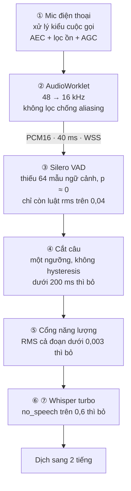

# 04 · Cải thiện thu âm từ xa (far-field) — Realtime Voice Translate

**Ngày:** 2026-10-11. **Đối chiếu với:** code nhánh `main` tại `e32ba78`, profile `balanced` đang deploy; thiết kế
[01 · Kế hoạch](01-ke-hoach-trien-khai.md) §6.1–6.3. **Phạm vi:** đường âm thanh từ micro điện thoại → AudioWorklet →
WebSocket → VAD → cắt câu → Whisper; phần dịch (MT) giữ nguyên. **Vấn đề cần giải:** người nói phải ở sát điện thoại;
ngồi cách khoảng 1 m trở lên thì hệ thống gần như không ghi nhận câu nói.

Số liệu ở mục 4 là **mô phỏng**, chạy bằng chính code VAD và cắt câu của dự án. Chưa có số đo trên điện thoại thật; mục 7
mô tả cách đo để chốt các giá trị mặc định. Các link tới dòng code trỏ vào commit `e32ba78`, tức trạng thái trước khi
sửa. **Đợt 1 đã được triển khai** — xem trạng thái ở mục 8.

## 1. Kết luận

1. **Nguyên nhân chính là lỗi phần mềm, không phải do micro điện thoại yếu.**
   [vad_silero.py](https://github.com/superken-python/ai-architecture/blob/e32ba786455c5d326a80acb342c1795a2e9a8dcd/projects/realtime-voice-translate/ai/src/rvt_ai/engines/vad_silero.py#L82-L107) gọi Silero VAD (v5 trở lên) với cửa sổ 512 mẫu nhưng
   **thiếu 64 mẫu ngữ cảnh** mà model yêu cầu. Với bản model đang tải từ nhánh `master` (v6.2), xác suất có tiếng nói
   luôn xấp xỉ 0: trên 60 s tiếng nói sạch, giá trị lớn nhất đo được chỉ 0,0077. VAD thực chất chỉ còn luật năng lượng
   `rms > 0.04`, tức mỗi khung 40 ms phải to hơn khoảng −28 dBFS. Chỉ tiếng nói sát máy mới đạt mức này.
2. **Các lần chỉnh ngưỡng gần đây đều là bù cho lỗi này.** Lịch sử commit đổi luật năng lượng từ `rms > 0.03` sang
   `0.02` rồi `0.04`. Lần cuối (f06d9f3, nhằm bớt bắt tiếng ồn) nâng ngưỡng thêm 6 dB, nên người dùng càng phải nói sát.
3. **Theo mô phỏng ở mục 4** (phòng họp, mức thu bình thường), tỉ lệ tiếng nói được ghi nhận là 98% ở 0,3 m, nhưng chỉ
   còn 24% ở 1 m và 5–9% ở 2–3 m. Chỉ cần sửa phần ngữ cảnh, tỉ lệ này đạt 100% tới 3 m. Thêm AGC số ở server thì vẫn
   giữ được ≥ 97% tới 3 m kể cả khi máy thu nhỏ. Bản sửa đầy đủ cũng không gửi đoạn nhiễu nào sang Whisper khi không ai
   nói; với 80 tiếng gõ bàn trong 60 s, code hiện tại gửi 17 đoạn.
4. **Lớp thứ hai: trình duyệt đang thu âm ở chế độ cuộc gọi.** Trên điện thoại có AEC phần cứng (phần lớn máy Android),
   `echoCancellation: true` khiến Chrome mở micro với preset `VOICE_COMMUNICATION`. Ở chế độ này, bộ lọc ồn và AGC của
   điện thoại được tối ưu cho người áp máy sát miệng. App ghi âm thì thu ở chế độ thường rồi tự chỉnh mức âm. Dự án cần
   thêm "chế độ thu xa" và đo trên máy thật.
5. **Lớp thứ ba:** khi VAD đã chạy đúng, các cổng chặn theo mức tuyệt đối ở phía sau sẽ thành nút thắt kế tiếp với giọng
   xa và nhỏ. Đó là cổng RMS < 0,003 trước Whisper và bộ lọc `no_speech_prob` (đang chặt hơn mặc định của faster-whisper).

### Việc nên làm, theo thứ tự

| # | Việc | Tầng | Công | Tác động |
|---|---|---|---|---|
| 1 | Sửa Silero (ghép 64 mẫu ngữ cảnh), bỏ luật RMS tuyệt đối, cắt câu có hysteresis | server | ~0,5 ngày | lớn nhất: ghi nhận ở 1 m tăng từ 24% lên ~100% (mô phỏng) |
| 2 | Cho segmenter dùng cấu hình VAD trong profile; thêm test VAD bằng tiếng nói thật; ghim phiên bản model | server | ~0,5 ngày | tránh lỗi tái phát |
| 3 | Lọc thông cao + AGC số (riêng cho mỗi phía A/B) trước VAD/ASR; thay cổng RMS tuyệt đối bằng SNR; sửa lọc `no_speech` | server | 1–2 ngày | giữ ≥ 97% tới 3 m khi máy thu nhỏ |
| 4 | Chế độ thu xa trên trình duyệt (tắt AEC/lọc ồn kiểu cuộc gọi); ghi lại `getSettings()` | web | ~1 ngày + đo | tùy từng máy, phải đo |
| 5 | Lọc chống aliasing khi hạ mẫu; đồng hồ mức âm; nhắc "nói to hơn / lại gần" | web | 1–2 ngày | nhiễu trong dải giảm 0,7–4,8 dB tùy loại nhiễu; người dùng tự điều chỉnh được |
| 6 | Bộ kiểm thử thu xa (khoảng cách × phía A/B × máy) và chỉ số theo dõi | eval | 2–3 ngày | quyết định dựa trên số đo |
| 7 | Phần cứng cho phòng ồn hoặc vang: loa-mic hội nghị USB-C hoặc 2 mic cài áo | vận hành | mua sắm | tốt nhất khi xa hơn 2 m hoặc phòng ồn |

Việc 1–3 chỉ sửa server: không phải cập nhật web, điện thoại không cần tải lại gì.

## 2. Đường âm thanh hiện tại và các cổng làm rơi tiếng nói



| # | Cổng | Code | Làm rơi tiếng nói khi | Ảnh hưởng tới giọng ở xa | Mức |
|---|---|---|---|---|---|
| ① | Xử lý âm thanh kiểu cuộc gọi | [ws_client.ts](https://github.com/superken-python/ai-architecture/blob/e32ba786455c5d326a80acb342c1795a2e9a8dcd/projects/realtime-voice-translate/web/src/net/ws_client.ts#L97-L104) | bộ lọc ồn của cuộc gọi coi giọng nhỏ, có vang là nhiễu | mất mức âm và SNR ngay từ máy | P1, cần đo |
| ② | Hạ mẫu 48 → 16 kHz | [audio-processor.js](https://github.com/superken-python/ai-architecture/blob/e32ba786455c5d326a80acb342c1795a2e9a8dcd/projects/realtime-voice-translate/web/public/audio-processor.js#L37-L60) | nhiễu 8–24 kHz bị gập vào dải tiếng nói | SNR giảm 0,7–4,8 dB | P2 |
| ③ | Silero VAD | [vad_silero.py](https://github.com/superken-python/ai-architecture/blob/e32ba786455c5d326a80acb342c1795a2e9a8dcd/projects/realtime-voice-translate/ai/src/rvt_ai/engines/vad_silero.py#L82-L107) | xác suất ≈ 0, chỉ còn `rms > 0.04` | khung nào nhỏ hơn −28 dBFS đều không được tính là tiếng nói | **P0** |
| ④ | Cắt câu | [segmenter.py](https://github.com/superken-python/ai-architecture/blob/e32ba786455c5d326a80acb342c1795a2e9a8dcd/projects/realtime-voice-translate/ai/src/rvt_ai/pipeline/segmenter.py#L45-L70) | dưới 200 ms "có tiếng" thì bỏ; 500 ms không vượt ngưỡng thì chốt câu | câu bị cắt vụn hoặc bị bỏ hẳn | P1 |
| ⑤ | Cổng năng lượng trước Whisper | [asr_whisper.py](https://github.com/superken-python/ai-architecture/blob/e32ba786455c5d326a80acb342c1795a2e9a8dcd/projects/realtime-voice-translate/ai/src/rvt_ai/engines/asr_whisper.py#L81-L85) | RMS của cả đoạn < 0,003 (≈ −50 dBFS); đoạn này gồm cả 800 ms preroll và 500 ms im lặng cuối | rơi khi máy thu nhỏ | P1 |
| ⑥ | Lọc `no_speech` | [asr_whisper.py](https://github.com/superken-python/ai-architecture/blob/e32ba786455c5d326a80acb342c1795a2e9a8dcd/projects/realtime-voice-translate/ai/src/rvt_ai/engines/asr_whisper.py#L99-L104) | `no_speech_prob > 0.6`, kể cả khi Whisper đọc ra chữ với độ tin cậy cao | giọng nhỏ, ở xa thường có `no_speech_prob` cao hơn | P1 |
| ⑦ | Lọc "thank you" | [asr_whisper.py](https://github.com/superken-python/ai-architecture/blob/e32ba786455c5d326a80acb342c1795a2e9a8dcd/projects/realtime-voice-translate/ai/src/rvt_ai/engines/asr_whisper.py#L111-L113) | `rms < 0.015` (ngưỡng tuyệt đối) | lời cảm ơn thật nói từ xa bị xóa | P2 |

## 3. Nguyên nhân chi tiết

### 3.1 [P0] Silero VAD bị vô hiệu vì thiếu 64 mẫu ngữ cảnh

**Bằng chứng**

- Vòng lặp ở [vad_silero.py#L82-L95](https://github.com/superken-python/ai-architecture/blob/e32ba786455c5d326a80acb342c1795a2e9a8dcd/projects/realtime-voice-translate/ai/src/rvt_ai/engines/vad_silero.py#L82-L95) mỗi lần chỉ đưa vào model đúng
  512 mẫu (`input_data = np.expand_dims(window, axis=0)  # [1, 512]`). Wrapper chính thức của silero-vad (`OnnxWrapper`
  trong `utils_vad.py`) ở 16 kHz thì ghép 64 mẫu cuối của cửa sổ trước vào đầu cửa sổ mới
  (`x = torch.cat([self._context, x], dim=1)`). Như vậy model nhận **576 mẫu** mỗi lần, và 64 mẫu cuối được giữ lại làm
  ngữ cảnh cho lần gọi sau.
- Đo với đúng file model mà [download_models.sh](https://github.com/superken-python/ai-architecture/blob/e32ba786455c5d326a80acb342c1795a2e9a8dcd/projects/realtime-voice-translate/scripts/download_models.sh#L18) tải về (nhánh `master` của
  silero-vad), trên 60 s tiếng nói sạch:

  | Cách gọi model | p trung bình | p lớn nhất | % cửa sổ có p > 0,25 |
  |---|---|---|---|
  | Như code hiện tại (512 mẫu) | 0,0006 | 0,0077 | 0% |
  | Có 64 mẫu ngữ cảnh (576 mẫu) | 0,78 | 1,00 | 79% |

- Mức hỏng phụ thuộc phiên bản model. File trên `master` hiện trùng SHA-256 với tag v6.2/v6.2.1. Trên cùng 60 s tiếng
  nói, tỉ lệ cửa sổ có p > 0,5 khi gọi thiếu và đủ ngữ cảnh như sau:

  | Bản model | Thiếu ngữ cảnh (như code hiện tại) | Đủ ngữ cảnh |
  |---|---|---|
  | v5.1.x | 77% | 78% |
  | v6.0 | 27% | 75% |
  | v6.2 / v6.2.1 (`master`) | 0% | 77% |

  Vì vậy cùng một đoạn code có thể chạy ổn với model cũ nhưng hỏng hẳn với bản v6.2 đang tải từ `master`. Kiểm tra
  SHA-256 của `models/silero_vad.onnx` trên máy chủ để biết đang chạy bản nào.

- Vì `prob` luôn xấp xỉ 0, hai vế đầu của điều kiện ở
  [dòng 107](https://github.com/superken-python/ai-architecture/blob/e32ba786455c5d326a80acb342c1795a2e9a8dcd/projects/realtime-voice-translate/ai/src/rvt_ai/engines/vad_silero.py#L107) không bao giờ đúng, nên VAD chỉ còn `rms > 0.04`. RMS 0,04
  (≈ −28 dBFS) trên cả khung 40 ms là mức của giọng nói to ở gần. Trong mô phỏng với mức nói sát −26 dBFS, chỉ khoảng 40%
  số khung có tiếng vượt được ngưỡng này, nên câu bị cắt vụn: ra 23 đoạn thay vì 8–9 câu tự nhiên.
- Lịch sử của [vad_silero.py](../ai/src/rvt_ai/engines/vad_silero.py):
  - b112c31 thêm `or rms > 0.03`;
  - 6fc9f74 đổi thành `(prob > 0.20 and rms > 0.01)`;
  - 3f28dc7 thêm `rms > 0.02`;
  - f06d9f3 nâng lên `rms > 0.04`.

  Profile `balanced` cũng hạ `threshold` từ 0,5 xuống 0,25 và tăng `preroll_ms` từ 300 lên 800. Tất cả đều là triệu
  chứng của một VAD "không nghe thấy gì".
- Test không phát hiện được lỗi: [test_vad_silero.py](https://github.com/superken-python/ai-architecture/blob/e32ba786455c5d326a80acb342c1795a2e9a8dcd/projects/realtime-voice-translate/ai/tests/unit/test_vad_silero.py#L18-L21) chỉ kiểm tra im lặng
  trả về `False`, không có ca nào kiểm tra tiếng nói thật trả về `True`.

**Cách sửa:** xem mục 6.1.

### 3.2 [P1] Trình duyệt đang thu âm ở chế độ cuộc gọi

[ws_client.ts#L97-L104](https://github.com/superken-python/ai-architecture/blob/e32ba786455c5d326a80acb342c1795a2e9a8dcd/projects/realtime-voice-translate/web/src/net/ws_client.ts#L97-L104) xin quyền micro với `echoCancellation`,
`noiseSuppression` và `autoGainControl` đều bằng `true`. Đây là cấu hình cho cuộc gọi video, khi người nói ở gần và loa
đang phát tiếng.

- **Chrome Android:** khi `echoCancellation` bật và máy có AEC phần cứng, Chrome ưu tiên AEC của nền tảng
  ([`GetPreferredAec`][cr-aec]). Phần lớn điện thoại Android có AEC phần cứng. Chrome lúc đó mở micro với preset
  `AAUDIO_INPUT_PRESET_VOICE_COMMUNICATION` ([aaudio_stream_wrapper.cc][cr-preset]) và chuyển máy sang
  `MODE_IN_COMMUNICATION` ([audio_manager_android.cc][cr-mode]). Ở preset này, hãng điện thoại bật lọc ồn và AGC cho
  cuộc gọi. Bộ lọc thường dùng nhiều mic để giữ giọng ở sát mic chính và nén các âm còn lại, kể cả giọng người ngồi xa.
  Khi `echoCancellation: false`, Chrome dùng preset `GENERIC`: đây là đường thu âm thông thường, và theo chú thích trong
  code Chromium thì preset này ưu tiên mic USB hoặc mic có dây.
- **Safari iOS:** `echoCancellation` mặc định bật và dùng bộ xử lý giọng nói cho cuộc gọi của Apple. Hành vi khi tắt khác
  nhau giữa các phiên bản iOS, nên phải đo trên máy.
- **Ứng dụng không phát âm thanh trong lúc thu** (chưa có tính năng đọc to bản dịch), nên không cần khử vọng (AEC).
- **Hướng đặt máy:** nửa B xoay 180°, nên người B ngồi ở **mép trên** điện thoại, xa mic chính (thường nằm ở mép dưới).
  Với bộ lọc ồn nhiều mic của chế độ cuộc gọi, giọng đến từ phía mic phụ dễ bị coi là nhiễu. Dự đoán phía B sẽ kém hơn
  phía A; bộ đo ở mục 7 tách riêng hai phía để kiểm chứng.

### 3.3 [P1] Các cổng chặn theo mức tuyệt đối trước và trong Whisper

- [asr_whisper.py#L81-L85](https://github.com/superken-python/ai-architecture/blob/e32ba786455c5d326a80acb342c1795a2e9a8dcd/projects/realtime-voice-translate/ai/src/rvt_ai/engines/asr_whisper.py#L81-L85) tính RMS của **cả đoạn** gửi sang Whisper,
  gồm 800 ms preroll, phần nói và 500 ms im lặng cuối, rồi bỏ đoạn nếu RMS < 0,003 (≈ −50 dBFS). Với giọng xa và máy thu
  nhỏ, phần im lặng kéo RMS trung bình xuống dưới ngưỡng dù phần nói vẫn nghe rõ. Hiện cổng này chưa lộ ra vì VAD (3.1)
  đã chặn từ trước. Sửa VAD xong thì cổng này thành nút thắt: kịch bản C ở mục 4 bị rơi 3–4 đoạn trong 60 s ở khoảng cách
  2–3 m.
- [asr_whisper.py#L99-L104](https://github.com/superken-python/ai-architecture/blob/e32ba786455c5d326a80acb342c1795a2e9a8dcd/projects/realtime-voice-translate/ai/src/rvt_ai/engines/asr_whisper.py#L99-L104) bỏ segment nếu `no_speech_prob > 0.6`.
  Bản thân faster-whisper **đã** bỏ segment khi `no_speech_prob > no_speech_threshold` **và**
  `avg_logprob < log_prob_threshold` ([transcribe.py][fw-skip]). Điều kiện riêng của dự án bỏ thêm những segment mà
  Whisper đọc ra chữ với độ tin cậy cao nhưng `no_speech_prob` vẫn cao, đúng là kiểu của giọng nhỏ hoặc ở xa.
- [asr_whisper.py#L111-L113](https://github.com/superken-python/ai-architecture/blob/e32ba786455c5d326a80acb342c1795a2e9a8dcd/projects/realtime-voice-translate/ai/src/rvt_ai/engines/asr_whisper.py#L111-L113): luật "thank you" chỉ giữ câu khi
  `rms >= 0.015` (≈ −36 dBFS). Một lời cảm ơn thật nói từ 1,5 m sẽ bị xóa.
- Các ngưỡng tuyệt đối phụ thuộc vào máy, ốp lưng và cấu hình xử lý âm thanh của trình duyệt. Ngưỡng nên so với **nền
  ồn đo được trong chính phiên đó** (tức SNR) thay vì một con số cố định.

### 3.4 [P1] Segmenter dùng một ngưỡng, không có hysteresis và bỏ qua cấu hình profile

- Quyết định "đang nói" dựa trên **một ngưỡng cho mỗi khung**
  ([segmenter.py#L45-L49](https://github.com/superken-python/ai-architecture/blob/e32ba786455c5d326a80acb342c1795a2e9a8dcd/projects/realtime-voice-translate/ai/src/rvt_ai/pipeline/segmenter.py#L45-L49)), không có hysteresis. Silero chuẩn vào trạng
  thái nói khi p ≥ `threshold` và chỉ coi là im lặng khi p < `threshold − 0,15`. Xác suất của giọng xa dao động quanh
  ngưỡng, nên câu bị chốt giữa chừng.
- Đoạn mà khung "có tiếng" đầu và cuối cách nhau dưới 200 ms bị bỏ
  ([segmenter.py#L61-L70](https://github.com/superken-python/ai-architecture/blob/e32ba786455c5d326a80acb342c1795a2e9a8dcd/projects/realtime-voice-translate/ai/src/rvt_ai/pipeline/segmenter.py#L61-L70)). Với VAD theo năng lượng, giọng xa chỉ lóe lên
  vài khung nên bị bỏ hẳn: mô phỏng ghi nhận 13–18 lần bỏ trong 60 s ở khoảng cách 0,6–1,5 m.
- Cấu hình profile không được áp dụng. [stream.py#L66](https://github.com/superken-python/ai-architecture/blob/e32ba786455c5d326a80acb342c1795a2e9a8dcd/projects/realtime-voice-translate/ai/src/rvt_ai/api/stream.py#L66) tạo `RVTSession` mà không
  truyền `segmenter_config`, nên [session.py#L46](https://github.com/superken-python/ai-architecture/blob/e32ba786455c5d326a80acb342c1795a2e9a8dcd/projects/realtime-voice-translate/ai/src/rvt_ai/pipeline/session.py#L46) dùng `SegmenterConfig()` mặc
  định. Profile chỉ truyền `threshold` vào VAD ([registry.py#L16](https://github.com/superken-python/ai-architecture/blob/e32ba786455c5d326a80acb342c1795a2e9a8dcd/projects/realtime-voice-translate/ai/src/rvt_ai/engines/registry.py#L16)). Do đó
  `min_speech_ms: 120` trong [balanced.yaml](https://github.com/superken-python/ai-architecture/blob/e32ba786455c5d326a80acb342c1795a2e9a8dcd/projects/realtime-voice-translate/packs/profiles/balanced.yaml#L3-L9) không có tác dụng, còn
  `speech_pad_ms` không được dùng ở đâu cả.

### 3.5 [P2] Hạ mẫu 48 → 16 kHz không lọc chống aliasing

- Ở [audio-processor.js#L22-L60](https://github.com/superken-python/ai-architecture/blob/e32ba786455c5d326a80acb342c1795a2e9a8dcd/projects/realtime-voice-translate/web/public/audio-processor.js#L22-L60), với 48 kHz (tần số mặc định của đa số điện
  thoại) thì `ratio = 3`. Vị trí đọc luôn là số nguyên, nên phép "nội suy tuyến tính" thực chất là **lấy 1 trong 3 mẫu,
  không lọc**. Mọi âm trong dải 8–24 kHz (tiếng xì của mic, quạt, máy lạnh) bị gập vào dải 0–8 kHz mà Whisper dùng.
  Thiết kế 01 §6.1 đã yêu cầu "lọc thông thấp + hạ mẫu".
- Nhiễu trong dải tăng thêm (tính bằng numpy): nhiễu trắng (tiếng xì, tự nhiễu của mic) **+4,8 dB**; nhiễu hồng (quạt,
  máy lạnh) +0,7 dB; tiếng ù trầm ~0 dB. Mức ảnh hưởng nhỏ hơn lỗi 3.1, nhưng đây chính là phần SNR mà giọng xa đang
  thiếu.

### 3.6 [P2] Người dùng không biết mình đang ở quá xa

Giao diện không có đồng hồ mức âm. Khi một câu bị bỏ vì rỗng hoặc chỉ có nhiễu, server chỉ ghi log `🔇 … skipping`
([session.py#L206-L208](https://github.com/superken-python/ai-architecture/blob/e32ba786455c5d326a80acb342c1795a2e9a8dcd/projects/realtime-voice-translate/ai/src/rvt_ai/pipeline/session.py#L206-L208)) và giao diện không báo gì. Người dùng chỉ thấy
"không ăn", và không biết nên nói to hơn hay ngồi lại gần.

## 4. Số đo mô phỏng

**Cách làm.** Một script Python chạy đúng `SileroVadEngine.process` của dự án (luật hiện tại, `threshold` 0,25 của profile
`balanced`), `Segmenter(SegmenterConfig())` (cấu hình đang chạy thật) và ngưỡng RMS 0,003 của ASR. Âm thanh được đưa vào
theo khung 40 ms, giống AudioWorklet. Script không chạy Whisper, nên chỉ đo các cổng **trước** ASR.

- Tiếng nói: file `tests/data/test.wav` trong repo silero-vad (60 s, 16 kHz).
- Mô hình khoảng cách:
  - tiếng trực tiếp giảm 20·log10(d / 0,3 m) dB;
  - đuôi vang có RT60 = 0,5 s và năng lượng không đổi theo khoảng cách (bằng tiếng trực tiếp tại khoảng cách tới hạn
    d_c);
  - nhiễu hồng có mức cố định.
- "Độ phủ" là tỉ lệ cửa sổ 32 ms có tiếng nằm trong một đoạn được gửi sang Whisper. Tham chiếu "có tiếng" lấy từ Silero
  gọi chuẩn trên file sạch.
- Mô phỏng không bao gồm xử lý âm thanh của điện thoại và trình duyệt (3.2). Phần đó phải đo trên máy thật.

Các phương án được so sánh:

- **V0:** code hiện tại.
- **V1:** chỉ thêm 64 mẫu ngữ cảnh, giữ ngưỡng 0,25 và các luật RMS.
- **V2:** thêm ngữ cảnh, cắt câu có hysteresis 0,5/0,35, bỏ luật RMS, và thay RMS tuyệt đối bằng cổng SNR ≥ 6 dB.
- **V3:** V2 cộng thêm AGC số ở server (mục 6.2).

**A. Chỉ giảm mức (không vang, không nhiễu): p trung bình trên các cửa sổ có tiếng**

| Mức hoạt động | Có ngữ cảnh (chuẩn) | Như code hiện tại |
|---|---|---|
| −26 dBFS | 0,99 | 0,001 |
| −36 dBFS | 0,97 | 0,001 |
| −46 dBFS | 0,95 | 0,001 |
| −56 dBFS | 0,85 | 0,001 |
| −66 dBFS | 0,47 | 0,001 |

**B. Phòng họp, điện thoại có AGC:** nói sát ở −26 dBFS, nhiễu nền −55 dBFS, d_c = 1,0 m. Ô trong bảng là độ phủ.

| Khoảng cách | Mức trực tiếp / tổng | V0 hiện tại | V1 | V2 | V3 |
|---|---|---|---|---|---|
| 0,3 m | −26 / −26 dBFS | **98%** | 100% | 100% | 100% |
| 0,6 m | −32 / −31 dBFS | **64%** | 100% | 100% | 100% |
| 1,0 m | −36 / −33 dBFS | **24%** | 100% | 99% | 100% |
| 1,5 m | −40 / −35 dBFS | **13%** | 100% | 99% | 100% |
| 2,0 m | −42 / −35 dBFS | **5%** | 100% | 99% | 99% |
| 3,0 m | −46 / −36 dBFS | **9%** | 100% | 99% | 99% |

**C. Mức thu thấp (không có AGC):** nói sát ở −36 dBFS, nhiễu nền −66 dBFS, d_c = 1,5 m.

| Khoảng cách | Mức trực tiếp / tổng | V0 hiện tại | V1 | V2 | V3 |
|---|---|---|---|---|---|
| 0,3 m | −36 / −36 dBFS | **6%** | 100% | 100% | 100% |
| 0,6 m | −42 / −41 dBFS | **0%** | 100% | 100% | 100% |
| 1,0 m | −46 / −45 dBFS | **0%** | 100% | 99% | 100% |
| 1,5 m | −50 / −47 dBFS | **0%** | 100% (1 đoạn rơi do RMS) | 87% | 99% |
| 2,0 m | −52 / −48 dBFS | **0%** | 87% (3 đoạn rơi do RMS) | 46% | 97% |
| 3,0 m | −56 / −49 dBFS | **0%** | 64% (4 đoạn rơi do RMS) | 30% | 97% |

**D. Chỉ có nhiễu (60 s, không ai nói): số đoạn bị gửi sang Whisper, tức số lần có nguy cơ "bịa chữ"**

| Nhiễu | V0 | V1 | V2 | V3 |
|---|---|---|---|---|
| Nhiễu hồng −50 dBFS | 0 | 0 | 0 | 0 |
| Nhiễu hồng −30 dBFS (quạt, máy lạnh to) | 0 | 0 | 0 | 0 |
| Nhiễu hồng −60 dBFS + 80 tiếng gõ bàn | **17** | **17** | 0 | 0 |

**Cách đọc kết quả**

- V0 khớp với triệu chứng thực tế: tốt khi nói sát, giảm mạnh sau 0,6 m. Nếu máy thu nhỏ thì kể cả nói sát cũng hỏng.
- V1 chỉ sửa một chỗ nhưng đã giải quyết phần lớn vấn đề. Tuy nhiên V1 vẫn giữ luật `rms > 0.04`, nên tiếng gõ bàn vẫn
  lọt sang Whisper. Khi máy thu nhỏ, cổng RMS 0,003 cũng bắt đầu bỏ câu ở khoảng cách 1,5–3 m.
- V2 chặn được hết nhiễu, nhưng ở mức rất thấp (≤ −47 dBFS) Silero kém tự tin hơn (xem bảng A). Vì vậy cần đưa mức âm
  về chuẩn trước khi chạy VAD.
- V3 giữ được ≥ 97% tới 3 m trong cả hai kịch bản và không để lọt đoạn nhiễu nào.
- Thử thay AGC tự viết bằng AGC của WebRTC ([webrtc-noise-gain][wng]):
  - tới 2 m, kết quả tương đương (≥ 99%);
  - ở 3 m trong kịch bản C, độ phủ còn 1% nếu chỉ bật AGC, và 90% nếu bật thêm lọc ồn mức 2.

  Như vậy, bộ AGC phải được chọn và chỉnh **cùng lúc** với VAD/ASR, có số đo đi kèm.

## 5. App ghi âm làm khác gì

App ghi âm không phải quyết định lúc nào là "một câu", vì nó ghi lại tất cả. App dịch hội thoại thì bắt buộc phải có VAD.
Những phần còn lại thì nên làm theo app ghi âm:

| | App ghi âm | RVT hiện tại | Nên làm |
|---|---|---|---|
| Đường thu | chế độ ghi âm thường | chế độ cuộc gọi (`echoCancellation: true`) | chế độ thu xa: tắt AEC/lọc ồn kiểu cuộc gọi (6.4) |
| Chỉnh mức âm | AGC chậm + limiter, có khi chuẩn hóa sau khi ghi | AGC cuộc gọi của hệ điều hành, không kiểm soát được | AGC số ở server, riêng cho mỗi phía (6.2) |
| Quyết định "có tiếng" | không cần, ghi hết | ngưỡng năng lượng tuyệt đối | VAD bằng model, gọi đúng cách, so với nền ồn (6.1, 6.3) |
| Lọc ồn | tùy chọn, nhẹ, thường xử lý sau | lọc ồn cuộc gọi mạnh, luôn bật | tắt mặc định; chỉ bật khi đo thấy WER giảm (6.7) |
| Băng thông | 44,1/48 kHz | hạ mẫu không lọc | lọc chống aliasing (6.4) |
| Phản hồi cho người dùng | luôn có đồng hồ mức âm | không có | đồng hồ mức âm + báo lý do bỏ câu (6.5) |
| Phần cứng | dùng được nhiều mic hoặc mic ngoài | mic điện thoại ở chế độ cuộc gọi | tùy chọn mic ngoài (6.6) |

## 6. Đề xuất chi tiết

### 6.1 VAD và cắt câu (server, làm ngay)

**a) Ghép ngữ cảnh và trả về xác suất** để segmenter tự quyết định:

```python
# ai/src/rvt_ai/engines/vad_silero.py
CONTEXT_SAMPLES = 64  # silero-vad v5 @16 kHz: 64 mẫu cuối của cửa sổ trước + 512 mẫu mới = 576


class SileroVadState:
    def reset(self) -> None:
        if self.is_v5:
            self.state = np.zeros((2, 1, 128), dtype=np.float32)
            self.context = np.zeros(CONTEXT_SAMPLES, dtype=np.float32)
        else:
            self.h = np.zeros((2, 1, 64), dtype=np.float32)
            self.c = np.zeros((2, 1, 64), dtype=np.float32)
        self.audio_remainder = np.empty(0, dtype=np.float32)


class SileroVadEngine(VadEngine):
    def process(self, chunk: bytes, state: SileroVadState) -> float:
        """Xác suất có tiếng nói lớn nhất trong chunk. Việc quyết định (hysteresis) do Segmenter làm."""
        audio = np.frombuffer(chunk, np.int16).astype(np.float32) / 32768.0
        if len(state.audio_remainder) > 0:
            audio = np.concatenate([state.audio_remainder, audio])

        max_prob = 0.0
        idx = 0
        while idx + self.window_size <= len(audio):
            window = audio[idx : idx + self.window_size]
            idx += self.window_size
            if self.is_v5:
                x = np.concatenate([state.context, window])[np.newaxis, :]  # [1, 576]
                out, state.state = self.session.run(
                    None, {"input": x, "state": state.state, "sr": np.array(16000, dtype=np.int64)}
                )
                state.context = x[0, -CONTEXT_SAMPLES:]
            else:
                ort_inputs = {"input": window[np.newaxis, :], "sr": np.array([16000], dtype=np.int64)}
                out, state.h, state.c = self.session.run(None, {**ort_inputs, "h": state.h, "c": state.c})
            max_prob = max(max_prob, float(out[0][0]))

        state.audio_remainder = audio[idx:]
        return max_prob
```

Đổi kiểu trả về của `VadEngine.process` trong [ports.py](https://github.com/superken-python/ai-architecture/blob/e32ba786455c5d326a80acb342c1795a2e9a8dcd/projects/realtime-voice-translate/ai/src/rvt_ai/engines/ports.py#L14-L16) thành `float`, và sửa
`FakeVadEngine` cho khớp (trả `1.0` hoặc `0.0`). **Bỏ hẳn** hai vế `rms` ở dòng 107: chúng là phần bù cho lỗi, và chính
chúng để lọt tiếng gõ bàn (bảng D).

**b) Cắt câu có hysteresis và dùng cấu hình profile:**

```python
# ai/src/rvt_ai/pipeline/segmenter.py
class SegmenterConfig(BaseModel):
    threshold: float = 0.5  # p >= threshold: bắt đầu câu
    neg_threshold: float = 0.35  # đang nói thì chỉ tính là im lặng khi p < neg_threshold (Silero: threshold - 0.15)
    ...  # các trường cũ giữ nguyên


class Segmenter:
    def add_chunk(self, chunk: bytes, speech_prob: float) -> tuple[bool, bool, bytes]:
        has_speech = speech_prob >= (self.config.neg_threshold if self.is_speaking else self.config.threshold)
        ...  # phần còn lại giữ nguyên


# ai/src/rvt_ai/api/stream.py — thay dòng 66
seg_cfg = SegmenterConfig(**app_state.profile.vad.model_dump(exclude={"engine"}))
session = RVTSession(
    session_id=session_id,
    vad=vad_engine,
    asr=asr_engine,
    mt=mt_engine,
    send_event_cb=send_event,
    segmenter_config=seg_cfg,
)
```

Trong `RVTSession.handle_audio_chunk`, gửi event `vad` theo `self.segmenter.is_speaking` (trạng thái đã có hysteresis)
thay cho kết quả thô của từng chunk. Thêm `neg_threshold` vào `VadConfig` trong
[loader.py](https://github.com/superken-python/ai-architecture/blob/e32ba786455c5d326a80acb342c1795a2e9a8dcd/projects/realtime-voice-translate/ai/src/rvt_ai/packs/loader.py#L11-L20), rồi đặt profile như sau (giá trị chốt sau khi đo ở mục 7):

```yaml
# packs/profiles/balanced.yaml
vad:
  engine: "silero"
  threshold: 0.4        # Silero mặc định 0.5/0.35; tạm 0.4/0.25 tới khi có AGC ở server (6.2)
  neg_threshold: 0.25
  min_speech_ms: 200    # đủ cho câu rất ngắn như "Dạ", "はい"
  min_silence_ms: 500
  speech_pad_ms: 200
  preroll_ms: 400       # VAD đúng thì không cần 800 ms; preroll dài chỉ đưa thêm nhiễu vào Whisper
```

Ngưỡng 0,4/0,25 được chọn bằng mô phỏng với chính code sau khi sửa. Ở mức thu bình thường (kịch bản B), mọi ngưỡng từ
0,35 tới 0,5 đều đạt 100% tới 3 m. Ở mức thu thấp (kịch bản C), tỉ lệ ghi nhận như sau:

| Ngưỡng vào/ra | 1,5 m | 2 m | 3 m |
|---|---|---|---|
| 0,5/0,35 | 87% | 48% | 32% |
| 0,4/0,25 | 97% | 69% | 52% |
| 0,35/0,2 | 98% | 86% | 56% |

Không ngưỡng nào bắt nhầm nhiễu hồng, nhiễu trắng hay tiếng gõ bàn. Trên nhạc tổng hợp, tỉ lệ khung vượt ngưỡng chỉ
0,5–0,9%. Ngưỡng thấp hơn nữa dễ bắt cả tiếng nói chuyện nhỏ ở bàn bên, nên tạm chọn mức giữa. Chỉnh lại sau khi có AGC
và bộ đo thu xa.

**c) Chống tái phát**

- Thêm test VAD bằng **tiếng nói thật**, ví dụ 1–2 câu FLEURS 16 kHz (CC-BY 4.0) đặt trong `ai/tests/fixtures/`. Test
  kiểm tra: hơn 50% số khung có tiếng có p > 0,5, và các khung im lặng hoặc chỉ có nhiễu hồng có p < 0,1. Với code hiện
  tại, test này báo đỏ ngay (0%).
- Ghim phiên bản model. Trước đợt 1, `download_models.sh` tải từ nhánh `master`, còn `config/models.yaml` có trường
  `sha256` nhưng giá trị chỉ dài 40 ký tự (không phải SHA-256) và không được kiểm tra ở đâu. Đợt 1 đã ghim tag
  **v6.2.1**, SHA-256 `1a153a22f4509e292a94e67d6f9b85e8deb25b4988682b7e174c65279d8788e3` (trùng file trên `master` ngày
  2026-10-11), và kiểm tra checksum khi tải.

### 6.2 Tiền xử lý ở server: lọc thông cao và AGC số

Mỗi phiên tạo **một bộ tiền xử lý cho mỗi phía A/B**, vì hai người ngồi ở hai khoảng cách và hai hướng khác nhau. Bộ này
xử lý từng chunk trước VAD; VAD và Whisper cùng nhận tín hiệu đã chuẩn hóa.

```python
# ai/src/rvt_ai/pipeline/frontend.py (mới) — cần thêm scipy vào ai/pyproject.toml
import numpy as np
from scipy.signal import butter, sosfilt


class AudioFrontEnd:
    """Lọc thông cao 80 Hz + AGC số chậm (chỉ học khi có tiếng nói rõ) + limiter. Khung PCM16 16 kHz."""

    def __init__(self, target_dbfs: float = -26.0, max_gain_db: float = 30.0, margin_db: float = 10.0):
        self.sos = butter(2, 80, btype="highpass", fs=16000, output="sos")
        self.zi = np.zeros((self.sos.shape[0], 2))
        self.target_dbfs, self.max_gain_db, self.margin_db = target_dbfs, max_gain_db, margin_db
        self.noise_db = -60.0  # nền ồn: bám theo mức thấp nhất, tăng chậm khoảng 3 dB/s
        self.speech_db = target_dbfs  # mức giọng nói ước lượng, đo TRƯỚC khi nhân gain
        self.gain_db = 0.0
        self.level_db = -120.0  # mức của chunk vừa xử lý (trước gain), segmenter dùng để tính SNR

    def process(self, chunk: bytes) -> bytes:
        x = np.frombuffer(chunk, np.int16).astype(np.float32) / 32768.0
        x, self.zi = sosfilt(self.sos, x, zi=self.zi)
        self.level_db = float(20 * np.log10(np.sqrt(np.mean(x**2)) + 1e-9))

        self.noise_db = self.level_db if self.level_db < self.noise_db else self.noise_db + 0.12
        if self.level_db > self.noise_db + self.margin_db:  # chỉ học mức giọng khi rõ ràng cao hơn nền
            self.speech_db += 0.1 * (self.level_db - self.speech_db)

        wanted = float(np.clip(self.target_dbfs - self.speech_db, 0.0, self.max_gain_db))
        self.gain_db += float(np.clip(wanted - self.gain_db, -3.0, 0.5))  # tăng chậm, giảm nhanh
        y = x * 10 ** (self.gain_db / 20)

        peak = float(np.max(np.abs(y)))
        if peak > 0.89:  # limiter đơn giản: không vượt -1 dBFS
            y *= 0.89 / peak
        return (y * 32767).astype(np.int16).tobytes()
```

- Đặt tham số trong profile, ví dụ `frontend: {hpf_hz: 80, target_dbfs: -26, max_gain_db: 30}`. Phần AGC tương tự V3
  trong mô phỏng, có thêm lọc thông cao. Chạy thử trên tiếng nói ở −48 dBFS: gain tự lên +23 dB, đưa mức ra về −27 dBFS,
  không bị cắt đỉnh.
- Gain chỉ học khi khung cao hơn nền ít nhất 10 dB. Nhờ vậy, trong khoảng lặng gain không tự tăng và nền ồn không bị
  "thở" lên xuống.
- SNR (mục 6.3) tính trên mức **trước** khi nhân gain, nên AGC không làm sai SNR.
- Cũng có thể dùng AGC/lọc ồn của WebRTC qua [webrtc-noise-gain][wng] (khung 10 ms, 16 kHz). Tuy vậy, mô phỏng cho thấy
  cấu hình của nó phải được đo cùng VAD (xem mục 4).

### 6.3 Cổng trước và trong Whisper

- **Bỏ cổng RMS tuyệt đối** ở [asr_whisper.py#L81-L85](https://github.com/superken-python/ai-architecture/blob/e32ba786455c5d326a80acb342c1795a2e9a8dcd/projects/realtime-voice-translate/ai/src/rvt_ai/engines/asr_whisper.py#L81-L85). Thay bằng cổng
  SNR ở session:
  - segmenter ghi lại `level_db` (trước gain) của các khung đang nói;
  - khi chốt câu, tính `snr_db = mức tiếng nói − frontend.noise_db`;
  - nếu SNR < 6 dB (cấu hình được) thì bỏ câu với lý do `low_snr`.
- **Lọc `no_speech` theo đúng quy tắc của Whisper.** Chỉ bỏ segment khi cả hai điều kiện cùng đúng. Vì faster-whisper đã
  tự áp dụng quy tắc này, cũng có thể xóa hẳn vòng lọc riêng.

  ```python
  # ai/src/rvt_ai/engines/asr_whisper.py — thay dòng 99–104
  valid_segments = []
  for s in segments:
      if s.no_speech_prob > 0.6 and s.avg_logprob < -1.0:
          continue
      valid_segments.append(s.text.strip())
  ```

- **Luật "thank you"** ([dòng 112](https://github.com/superken-python/ai-architecture/blob/e32ba786455c5d326a80acb342c1795a2e9a8dcd/projects/realtime-voice-translate/ai/src/rvt_ai/engines/asr_whisper.py#L112)): thay `rms >= 0.015` bằng
  `snr_db >= 15`. Có thể chuyển cả bộ lọc ảo giác lên pipeline (ví dụ `pipeline/hallucination.py`), là nơi đã có sẵn
  SNR, `no_speech_prob` và `avg_logprob`.
- Thêm event `utterance.dropped` (`side`, `reason`: `low_snr` | `no_speech` | `hallucination` | `too_short`,
  `level_dbfs`, `snr_db`) vào [messages.py](../ai/src/rvt_contracts/messages.py), rồi sinh lại kiểu TypeScript bằng
  `scripts/generate_ts.py`.
- Thử `beam_size=5` cho câu chốt (câu tạm vẫn dùng 1) trên bộ thu xa. Chỉ giữ nếu WER giảm và độ trễ tăng thêm chấp nhận
  được.

### 6.4 Thu âm trên trình duyệt

**a) Chế độ thu xa** (mặc định cho cách đặt máy giữa bàn; chốt sau khi đo):

```ts
// web/src/net/ws_client.ts
type CaptureMode = "far" | "near";

const CAPTURE: Record<CaptureMode, MediaTrackConstraints> = {
  // Thu xa: tắt xử lý kiểu cuộc gọi. App không phát tiếng khi thu nên không cần AEC.
  // autoGainControl: false khi đã có AGC ở server (6.2); nếu chưa có thì tạm để true.
  far: { channelCount: 1, echoCancellation: false, noiseSuppression: false, autoGainControl: false },
  // Thu gần (cầm máy, nơi rất ồn): giữ cấu hình hiện tại
  near: { channelCount: 1, echoCancellation: true, noiseSuppression: true, autoGainControl: true },
};

this.mediaStream = await navigator.mediaDevices.getUserMedia({ audio: { ...CAPTURE[mode], deviceId } });
// Trình duyệt có thể bỏ qua constraint → gửi cấu hình thực tế lên server để log và đối chiếu khi đo
const s = this.mediaStream.getAudioTracks()[0].getSettings();
this.send({
  type: "capture.info", mode, sampleRate: this.audioContext.sampleRate,
  echoCancellation: s.echoCancellation, noiseSuppression: s.noiseSuppression, autoGainControl: s.autoGainControl,
});
```

`capture.info` là message mới, cần thêm vào `ClientEvent`. Nếu không thêm, server sẽ trả lỗi `invalid_message`.

**b) Chọn micro:** dùng `enumerateDevices()` để hiện danh sách khi có từ hai micro trở lên, và nghe sự kiện
`devicechange` để bắt lúc cắm mic USB. Trên Android, preset `GENERIC` (khi `echoCancellation: false`) ưu tiên mic USB/có
dây hơn mic trong máy.

**c) Lọc chống aliasing trước khi hạ mẫu.** Chèn một bộ FIR thông thấp vào trước bước nội suy hiện có. Cách này chạy được
cho cả 48 kHz lẫn 44,1 kHz:

```js
// web/public/audio-processor.js
function designLowpass(fs, cutoffHz = 7000, taps = 63) {
  const h = new Float32Array(taps), m = (taps - 1) / 2, fc = cutoffHz / fs;
  let sum = 0;
  for (let n = 0; n < taps; n++) {
    const k = n - m;
    const sinc = k === 0 ? 2 * fc : Math.sin(2 * Math.PI * fc * k) / (Math.PI * k);
    h[n] = sinc * (0.54 - 0.46 * Math.cos((2 * Math.PI * n) / (taps - 1))); // cửa sổ Hamming
    sum += h[n];
  }
  return h.map((v) => v / sum); // độ lợi DC = 1
}

// constructor: this.h = designLowpass(sampleRate); this.hist = new Float32Array(this.h.length); this.pos = 0;
lowpass(s) {
  this.hist[this.pos] = s;
  let acc = 0;
  let p = this.pos;
  for (let j = 0; j < this.h.length; j++) {
    acc += this.h[j] * this.hist[p];
    p = p === 0 ? this.h.length - 1 : p - 1;
  }
  this.pos = (this.pos + 1) % this.h.length;
  return acc;
}
// process(): const filtered = channel.map((s) => this.lowpass(s)); rồi nội suy trên `filtered` thay cho `channel`
```

- Chi phí khoảng 3 triệu phép nhân mỗi giây, nhẹ với điện thoại.
- Test Vitest: đưa vào tín hiệu sin 10 kHz ở 48 kHz. Nếu không lọc, tín hiệu này hiện ở 6 kHz với nguyên biên độ; có lọc
  thì phải giảm ít nhất 40 dB.
- Một cách khác là `new AudioContext({ sampleRate: 16000 })` để trình duyệt tự hạ mẫu. Cách này phải thử trên từng trình
  duyệt; Firefox có thể báo lỗi khi nối nguồn micro khác tần số.

**d) Đồng hồ mức âm:** worklet tính RMS mỗi 100 ms rồi gửi `{type: "level", rms}` qua cùng `port`. Audio vẫn là
`ArrayBuffer`, nên `onmessage` phân biệt hai loại theo kiểu dữ liệu.

### 6.5 Giao diện

- **Đồng hồ mức âm** cạnh nút mic của nửa đang nói: xanh khi vượt nền ồn, xám khi im lặng.
- **Báo lý do khi bỏ câu**, theo `utterance.dropped`:
  - `low_snr` → "Tiếng nhỏ so với tiếng ồn — nói to hơn hoặc đưa máy lại gần";
  - `no_speech` → "Chưa nghe rõ, vui lòng nói lại";
  - `too_short` → không báo.
- **Cài đặt "Chế độ thu":** Thu xa (mặc định) / Thu gần.
- **Hướng dẫn đặt máy**, hiện ở lần dùng đầu:
  - đặt nằm giữa hai người, không úp;
  - ốp lưng không che lỗ mic;
  - để xa laptop và quạt;
  - nếu một người ngồi xa hơn, quay mép dưới máy về phía người đó;
  - nếu xa hơn 2 m hoặc phòng ồn, dùng mic ngoài (6.6).

### 6.6 Phần cứng

| Phương án | Tầm thu thực tế | Ưu điểm | Nhược điểm | Lưu ý tích hợp |
|---|---|---|---|---|
| Mic trong điện thoại (hiện tại) | ước tính 1,5–2 m sau khi sửa phần mềm, tùy độ ồn và độ vang (cần đo) | không tốn thêm | vang và ồn làm giảm chất lượng ở xa | là mức cơ sở để so sánh |
| Loa-mic hội nghị USB-C, thu 360° có DSP | cả bàn họp (theo thông số nhà sản xuất) | cắm là chạy, có beamforming/AGC phần cứng | cần cổng USB-C hoặc OTG; thêm một thiết bị | dùng chế độ thu xa để Android định tuyến sang USB |
| 2 mic cài áo không dây, một bộ thu | không phụ thuộc khoảng cách (mic sát miệng) | SNR tốt nhất, gần như không vang | phải đeo, phải sạc | chế độ stereo (trái = A, phải = B) cho phép tự biết ai đang nói (6.8) |
| Mảng mic USB 4–6 mic, nối máy tính cố định trong phòng họp | xa hơn mic điện thoại | biết hướng âm (DoA), tự xác định phía A/B | chỉ hợp với phòng cố định | máy tính gửi âm thanh lên backend thay cho điện thoại |

### 6.7 Khử ồn và khử vang bằng model (tùy chọn, phải đo)

Chỉ thử sau khi việc 1–5 đã xong, và chỉ giữ lại khi WER trên bộ thu xa giảm. Model khử ồn có thể làm Whisper nhận dạng
kém đi do tạo ra artifact.

| Kỹ thuật | Công cụ | Khi nào thử | Lưu ý |
|---|---|---|---|
| Lọc ồn bằng model | RNNoise (rất nhẹ), DeepFilterNet (chất lượng cao) | ồn đều: máy lạnh, quạt, quán | cả hai làm việc ở 48 kHz → chạy trên trình duyệt (bản WASM) trước bước hạ mẫu; có thể trộn lại một phần tín hiệu gốc để bớt artifact |
| Khử vang | WPE (`nara_wpe`) | phòng vang (kính, trần cao), người nói xa hơn 2 m | tốn CPU, cần đệm vài trăm ms; với một kênh, lợi ích thường khiêm tốn |
| AGC + lọc ồn của WebRTC | `webrtc-noise-gain` | muốn dùng bộ có sẵn | mô phỏng: chỉ bật AGC thì sụp ở 3 m; bật thêm lọc ồn mức 2 thì đạt 90% |

### 6.8 Mở rộng: tự biết ai đang nói

Dùng 2 mic cài áo ở chế độ stereo (`channelCount: 2`, mỗi kênh một người), hoặc mảng mic có hướng âm. Khi đó hệ thống tự
biết phía A hay B mà không cần chạm mic từng lượt, khớp với chế độ "rảnh tay" P5 trong kế hoạch 01. Cần kiểm tra trình duyệt
trên điện thoại có giữ được 2 kênh từ bộ thu USB hay không.

## 7. Đo lường và nghiệm thu

### 7.1 Bộ kiểm thử thu xa

| Chiều | Giá trị |
|---|---|
| Khoảng cách | 0,3 · 1 · 2 · 3 m |
| Vị trí | phía A (mép dưới máy) · phía B (mép trên) |
| Phòng | yên tĩnh · phòng họp có máy lạnh · nơi ồn (sảnh, quán) |
| Máy | ít nhất 1 iPhone (Safari) và 1 Android (Chrome) |
| Cấu hình thu | hiện tại (AEC + lọc ồn + AGC) · tắt AEC và lọc ồn, giữ AGC trình duyệt · tắt cả ba + AGC server · mic ngoài |
| Nội dung | 20 câu × 3 tiếng (có câu rất ngắn: "Dạ", "はい", "OK"), ít nhất 3 người nói; thêm 2 phút chỉ có tiếng ồn để đo bắt nhầm và bịa chữ |

- **Thu bằng chính app:** thêm "chế độ ghi kiểm thử" lưu đúng luồng PCM 16 kHz đang gửi lên server thành file WAV
  **trên máy người kiểm thử**. Không lưu ở server, để giữ nguyên tắc không lưu hội thoại. Các file WAV đặt trong
  `packs/evals/` (ngoài git), để chạy lại offline mỗi khi đổi ngưỡng.
- **Bộ mô phỏng chạy trong CI** (phần VAD và cắt câu không cần GPU): FLEURS (phần A của golden-v0) cộng RIR
  (pyroomacoustics, RT60 0,3–0,8 s, khoảng cách 0,5–3 m) và nhiễu ở SNR 0–20 dB → lệnh `make eval-farfield`. Script mô
  phỏng ở mục 4 là điểm xuất phát tốt; hiện chưa được đưa vào repo.

### 7.2 Chỉ số cần log

- **Theo từng câu** (log server, và Prometheus khi đã có `/metrics`):
  - mức tiếng nói trước và sau AGC (dBFS), nền ồn, SNR;
  - p VAD trung bình và lớn nhất, độ dài câu;
  - `no_speech_prob`, `avg_logprob`;
  - lý do bỏ câu, đếm bằng `rvt_utterance_dropped_total{reason}`.
- **Tổng hợp:**
  - tỉ lệ câu được ghi nhận;
  - số đoạn trên một câu (mức độ cắt vụn);
  - WER/CER, độ chính xác nhận dạng ngôn ngữ (LID);
  - số đoạn nhiễu gửi sang ASR mỗi 10 phút, số câu bịa trên đoạn chỉ có nhiễu;
  - độ trễ p50/p95.

### 7.3 Tiêu chí nghiệm thu đề xuất

| Chỉ số | Mục tiêu |
|---|---|
| Câu được ghi nhận ở 1,5 m, phòng họp, cả phía A và B | ≥ 95% |
| Câu được ghi nhận ở 3 m, phòng họp | ≥ 85% |
| Số đoạn trên một câu | ≤ 1,1 |
| WER/CER ở 1,5 m so với ở 0,3 m | tăng không quá 5 điểm |
| Đoạn nhiễu gửi sang Whisper khi không ai nói | ≤ 1 đoạn / 10 phút |
| Câu bịa trên 2 phút chỉ có nhiễu | 0 |
| Độ trễ từ lúc ngừng nói tới khi đủ 2 bản dịch (p50) | tăng không quá 50 ms |

Kết quả từng vòng ghi vào bảng "3 · CHÍNH XÁC — các vòng cải tiến" trong [README dự án](../README.md).

## 8. Lộ trình

| Đợt | Nội dung | Công | Xong khi |
|---|---|---|---|
| 1 · Sửa VAD (server) | toàn bộ 6.1; log theo câu (7.2) | 0,5–1 ngày | test VAD với tiếng nói thật xanh; phát lại bộ WAV thì câu ở 1 m được ghi nhận; số đoạn nhiễu không tăng |
| 2 · Tiền xử lý và cổng (server) | 6.2, 6.3; event `utterance.dropped`; đưa script mô phỏng vào `eval/` | 1–2 ngày | kịch bản C ≥ 95% tới 3 m; 0 câu bịa trên bộ chỉ có nhiễu |
| 3 · Trình duyệt và giao diện | 6.4, 6.5 | 1–2 ngày | `getSettings()` xác nhận đúng chế độ trên iPhone và Android; test sin 10 kHz bị chặn ≥ 40 dB |
| 4 · Đo trên máy thật, chốt mặc định | 7.1–7.3; chọn cấu hình thu cho từng nền tảng | 2–3 ngày | đạt bảng 7.3, hoặc ghi rõ khoảng cách khuyến nghị cho từng loại phòng |
| 5 · Tùy chọn | mic ngoài; khử ồn, khử vang bằng model; tự nhận phía A/B | theo nhu cầu | WER giảm có ý nghĩa trên bộ thu xa |

Đợt 1 là thay đổi nhỏ nhất nhưng có tác động lớn nhất. Nên deploy riêng đợt này trước, rồi thử ngay trên máy thật.

### Trạng thái (2026-10-11): đợt 1 đã xong

- **Code:**
  - VAD ghép 64 mẫu ngữ cảnh, trả về xác suất và bỏ hai luật RMS tuyệt đối;
  - segmenter có hysteresis; session dùng cấu hình VAD trong profile; event `vad` đi theo trạng thái của segmenter;
  - profile `balanced`, `quality`, `cpu-dev` dùng ngưỡng 0,4/0,25 và preroll 400 ms (lý do ở 6.1).
- **Model:** ghim Silero v6.2.1 kèm SHA-256 ở cả code tự tải lẫn `scripts/download_models.sh`. Khi khởi động, server log
  SHA-256 của model và cảnh báo nếu không phải bản đã ghim.
- **Log theo câu:** mỗi câu chốt có mức âm (dBFS), thời lượng tiếng nói và p VAD trung bình/lớn nhất. Lý do Whisper bỏ đoạn
  (RMS thấp, `no_speech_prob`) nay ghi ở mức INFO.
- **Test:** thêm 11 test, tổng 35/35 pass. Các test mới đều fail trên code cũ, gồm:
  - VAD với tiếng nói thật, giọng giảm 26 dB và nhiễu trắng;
  - hysteresis và thống kê câu;
  - cấu hình profile được áp dụng qua WebSocket;
  - session với VAD thật nhận được giọng ở xa.
- **Mô phỏng với code mới:** kịch bản B đạt 100% tới 3 m. Kịch bản C đạt 97% / 69% / 52% ở 1,5 / 2 / 3 m. Không gửi
  đoạn nhiễu nào sang Whisper.
- **Còn lại:** khi máy thu nhỏ, độ phủ ở 2–3 m vẫn thấp. Việc này cần đợt 2 (AGC server, cổng SNR) và đợt 3 (chế độ thu xa
  trên trình duyệt); cuối cùng đo trên máy thật ở đợt 4.

## 9. Rủi ro và đánh đổi

- **Nhạy hơn thì dễ bắt cả giọng người bàn bên hoặc tiếng TV.** VAD phân biệt được tiếng nói với tiếng ồn nhưng không
  biết ai đang nói. Cách giảm thiểu: vẫn chạm mic theo lượt, dùng cổng SNR, đưa ra khoảng cách khuyến nghị, và dùng mic
  cài áo khi môi trường đông người.
- **Gửi nhiều đoạn hơn sang Whisper làm tăng nguy cơ bịa chữ.** Mô phỏng D cho thấy VAD chạy đúng lại *giảm* số đoạn nhiễu
  (với tiếng gõ bàn: 17 → 0). Vẫn giữ bộ lọc ảo giác và theo dõi tỉ lệ bịa chữ trên đoạn chỉ có nhiễu.
- **Tắt AEC** an toàn vì app không phát tiếng khi đang thu. Khi thêm tính năng đọc to bản dịch (TTS), phải bật lại AEC
  cho chế độ đó, hoặc tắt mic trong lúc phát.
- **AGC khuếch đại cả nền ồn.** Gain chỉ học khi có tiếng nói rõ, tối đa +30 dB, và SNR được tính trên mức trước gain.
- **Máy không tôn trọng constraint** (nhất là iOS). Đọc lại bằng `getSettings()`, đo riêng cho từng nền tảng, và cho phép
  đổi chế độ thu trong cài đặt.
- **Chi phí tính toán:**
  - Silero dưới 1 ms cho mỗi cửa sổ 32 ms mỗi phiên (01 §5);
  - lọc thông cao và AGC không đáng kể;
  - FIR 63 tap khoảng 3 triệu phép nhân mỗi giây trên điện thoại.

## Phụ lục — nguồn tham khảo

- silero-vad, `OnnxWrapper` (ngữ cảnh 64 mẫu ở 16 kHz) và `VADIterator` (`neg_threshold = threshold − 0,15`):
  [utils_vad.py][silero]
- Chromium chọn AEC của nền tảng khi `echoCancellation: true`: [media_stream_audio_processor_options.cc][cr-aec]
- Chromium chọn preset `VOICE_COMMUNICATION` hoặc `GENERIC` cho micro Android: [aaudio_stream_wrapper.cc][cr-preset]
- Chromium bật `MODE_IN_COMMUNICATION` khi luồng thu có hiệu ứng nền tảng: [audio_manager_android.cc][cr-mode]
- faster-whisper bỏ segment khi `no_speech_prob` cao **và** `avg_logprob` thấp: [transcribe.py][fw-skip]
- WebRTC AGC và lọc ồn cho Python (16 kHz, khung 10 ms): [webrtc-noise-gain][wng]

[silero]: https://github.com/snakers4/silero-vad/blob/master/src/silero_vad/utils_vad.py
[cr-aec]: https://github.com/chromium/chromium/blob/main/third_party/blink/renderer/platform/mediastream/media_stream_audio_processor_options.cc
[cr-preset]: https://github.com/chromium/chromium/blob/main/media/audio/android/aaudio_stream_wrapper.cc
[cr-mode]: https://github.com/chromium/chromium/blob/main/media/audio/android/audio_manager_android.cc
[fw-skip]: https://github.com/SYSTRAN/faster-whisper/blob/master/faster_whisper/transcribe.py
[wng]: https://github.com/OHF-voice/webrtc-noise-gain
