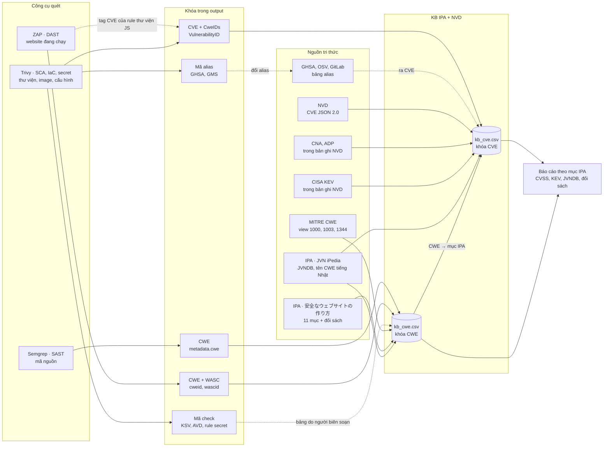
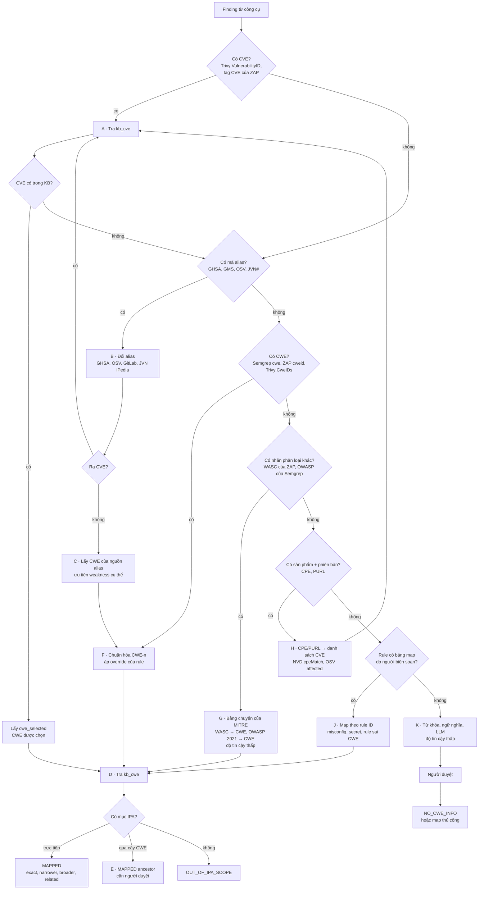
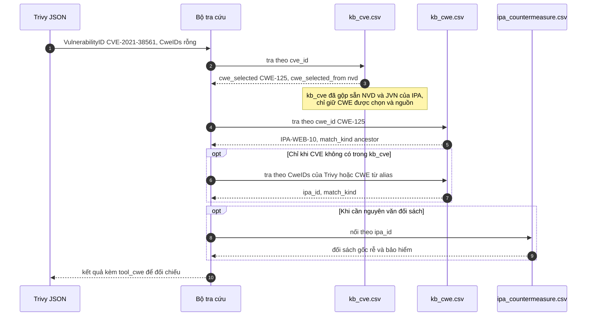
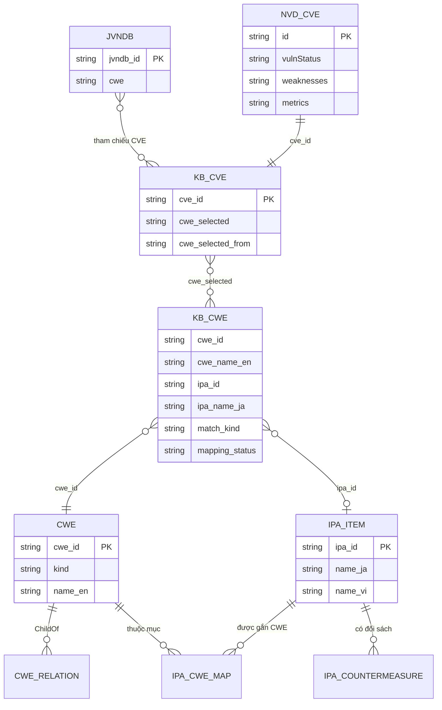
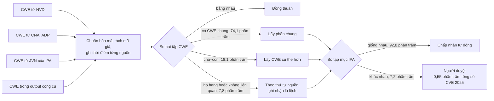
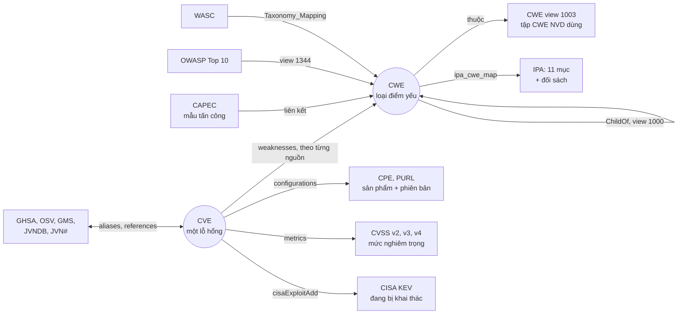

# 04 · Thuật ngữ, so sánh và các cách map (kèm sơ đồ Mermaid)

Ngày: 2026-10-27, cập nhật 2026-10-28 (KB tối giản; dữ liệu IPA bản 7) · Đọc cùng: [01](01-nghien-cuu-ipa-cwe-semgrep.md) (IPA, CWE, Semgrep), [02](02-mapping-semgrep-ipa-va-cap-nhat.md) (phía công cụ), [03](03-kb-ipa-nvd-cho-cong-cu.md) (KB IPA + NVD), [06](06-kb-field-reference.md) (ý nghĩa từng cột của KB, tiếng Anh).

Cột **"Tin cậy"** trong các bảng:

- **KC** — đã kiểm chứng trong dự án: đọc dữ liệu thật hoặc mã nguồn, chạy thử.
- **TK** — chỉ qua đoạn trích tìm kiếm web.
- **NỀN** — kiến thức nền của mình, chưa đối chiếu được trong phiên này. Cần kiểm tra lại trước khi dùng cho tài liệu chính thức.

---

## 1 · Trả lời nhanh ba câu hỏi

**1. Trivy được map vào cả NVD và IPA, vậy có phải tra hai KB không?** Không. "KB IPA + NVD" là **một bộ dữ liệu đã gộp sẵn lúc dựng**, không phải hai kho riêng của NVD và của IPA. Bản tối giản (từ 2026-10-28) có hai file nối với nhau qua CWE:

- `kb_cve.csv` (3 cột): CVE → CWE được chọn (từ NVD, CNA/ADP hoặc JVN iPedia của IPA) và nguồn của nó;
- `kb_cwe.csv` (6 cột): CWE → mục IPA (mã, tên tiếng Nhật), kiểu khớp, trạng thái duyệt.

Vì vậy mỗi lỗ hổng Trivy báo cần **một lần tra theo CVE rồi một lần tra theo CWE**, trong cùng một KB (một phép nối, không phải hai kho). Khi CVE không có trong KB thì tra thẳng `kb_cwe.csv` bằng CWE của Trivy. Muốn lấy nguyên văn đối sách thì nối `ipa_id` sang bảng nhỏ `ipa_countermeasure.csv` (47 đối sách của checklist bản 7; mục 5, sơ đồ 8.3).

**2. CWE/CVE khác nhau tùy nguồn, hoặc không khớp theo mã nào, thì map thế nào?** Đi theo **chuỗi phương án dự phòng**, từ chắc chắn nhất đến kém nhất:

1. Khớp CVE.
2. Đổi mã alias (GHSA, OSV, GitLab, JVN#) ra CVE.
3. Lấy CWE từ nguồn alias.
4. Khớp CWE trực tiếp.
5. Đi theo cây CWE.
6. Dùng bảng chuyển phân loại WASC/OWASP → CWE.
7. Đổi CPE/PURL ra CVE.
8. Dùng bảng map theo rule do người biên soạn.
9. Từ khóa hoặc mô hình ngôn ngữ, bắt buộc có người duyệt.

Mỗi bước đều ghi lại *đã khớp bằng cách nào* để người đọc biết độ tin cậy (mục 6, sơ đồ 7.2).

**3. So sánh thế nào mà biết các nguồn lệch nhau?** Lấy cùng một khóa (CVE) từ từng nguồn, chuẩn hóa mã, **ghi thời điểm dữ liệu**, so tập CWE trên cây CWE, rồi so tiếp **tập mục IPA** mà mỗi bên dẫn tới (mục 7, sơ đồ 7.5). Trên toàn bộ CVE năm 2025:

- 3.335 CVE có CWE của NVD và CNA/ADP khác nhau.
- Chỉ **241 CVE (0,55%)** lệch tới mức đổi mục IPA.

Một ví dụ "lệch" mình nêu trước đây hóa ra là **lệch theo thời điểm** chứ không phải theo nguồn: jquery trong DB kiểm thử của Trivy (2021) ghi CWE-79, NVD hiện tại ghi CWE-1321.

---

## 2 · Thuật ngữ

### 2.1 Tổ chức, chương trình và cơ sở dữ liệu

| Thuật ngữ | Là gì | Nhiệm vụ / chức năng | Vai trò trong dự án | Tin cậy |
|---|---|---|---|---|
| **IPA** (情報処理推進機構) | Cơ quan hành chính độc lập của Nhật về CNTT | Ra hướng dẫn bảo mật (ví dụ "安全なウェブサイトの作り方"), vận hành JVN iPedia, thống kê lỗ hổng theo quý | Nguồn **phân loại** (11 mục) và **đối sách**; tên CWE tiếng Nhật | NỀN (vai trò), KC (dữ liệu JVN) |
| **JPCERT/CC** | Trung tâm điều phối ứng cứu sự cố của Nhật | Điều phối công bố lỗ hổng với nhà sản xuất; cùng IPA vận hành JVN | Gián tiếp (nguồn mã JVN#) | TK |
| **JVN** (Japan Vulnerability Notes) | Cổng công bố lỗ hổng của Nhật, mã `JVN#64806328` | Công bố khuyến cáo cho sản phẩm (chủ yếu sản phẩm Nhật) | Mã alias có thể đổi ra CVE | KC (mã), TK (vai trò) |
| **JVN iPedia** | Cơ sở dữ liệu lỗ hổng của IPA, mã `JVNDB-YYYY-NNNNNN` | Lưu lỗ hổng trong và ngoài nước (lấy cả từ NVD), dịch sang tiếng Nhật, gán CWE, tự chấm CVSS, ghi đối sách | Nguồn **CWE theo IPA** cho `kb_cve` (khi NVD và CNA/ADP không có CWE thật) | KC (cấu trúc feed), TK (phạm vi) |
| **MyJVN** | Bộ API/công cụ của JVN iPedia | `getVulnOverviewList`, `getVulnDetailInfo`, `getStatistics`… | Cách lấy dữ liệu JVN tự động | TK |
| **NIST / NVD** | National Vulnerability Database của Viện Tiêu chuẩn Mỹ | Phân tích CVE: gắn CWE, CVSS, CPE; API 2.0; trạng thái `Analyzed`, `Deferred`… | Nguồn **CVE → CWE** trong `kb_cve` (CVSS, KEV có trong bản ghi NVD, KB tối giản không lưu) | KC (bản ghi), TK (API) |
| **CVE Program** (MITRE) | Chương trình cấp mã CVE | Quản lý danh sách CVE, ủy quyền cho CNA | Khóa CVE dùng chung | NỀN |
| **CNA** | CVE Numbering Authority, ví dụ `security@apache.org`, GitHub | Cấp CVE cho sản phẩm thuộc phạm vi của mình, thường kèm CWE/CVSS | Nguồn CWE thứ hai sau NVD (`cwe_selected_from = cna_adp`) | KC (có trong `weaknesses.source`), NỀN (định nghĩa) |
| **ADP** | Authorized Data Publisher, bổ sung dữ liệu vào bản ghi CVE | Thêm CWE, CVSS, SSVC cho CVE thiếu dữ liệu | Cùng nhóm với CNA trong KB; nguồn UUID `134c704f-…` (theo mình là CISA ADP) | KC (có dữ liệu), NỀN (danh tính) |
| **CISA KEV** | Danh mục *Known Exploited Vulnerabilities* của CISA | Liệt kê CVE đang bị khai thác thật, có hạn xử lý | Dùng để ưu tiên xử lý; KB tối giản không lưu (lấy từ NVD hoặc CISA) | KC (trường trong NVD) |
| **MITRE CWE** | Danh mục điểm yếu phần mềm | Định nghĩa CWE, cây quan hệ, các view (1000, 699, 1003, Top 25, OWASP) | **Cầu nối** giữa công cụ và IPA | KC (XML 4.14) |
| **MITRE CAPEC** | Danh mục mẫu tấn công | Mô tả cách tấn công, liên kết tới CWE | Phương án dự phòng hiếm dùng | KC (336 weakness có liên kết) |
| **OWASP** | Cộng đồng bảo mật ứng dụng web | OWASP Top 10, ASVS…; ZAP trước đây là dự án OWASP | Nhãn `owasp` trong rule Semgrep | KC (nhãn 2017/2021/2025 trong rule) |
| **WASC** | Web Application Security Consortium | Bảng phân loại mối đe dọa web (`WASC-8` = XSS…) | Trường `wascid` của ZAP; MITRE có bảng chuyển WASC → CWE | KC |
| **GitHub Advisory Database (GHSA)** | Cơ sở dữ liệu khuyến cáo của GitHub, mã `GHSA-xxxx-xxxx-xxxx` | Lỗ hổng theo gói (npm, PyPI, Go…), có `aliases` (CVE) và `cwe_ids` | Đổi alias, nguồn CWE thứ ba | KC |
| **OSV** | Định dạng và cơ sở dữ liệu mở về lỗ hổng mã nguồn mở | Gom nhiều nguồn, mỗi bản ghi có `aliases` | Đổi alias (ví dụ GHSA ↔ CVE ↔ PYSEC ↔ SNYK) | KC (bản ghi qua bucket), NỀN (đơn vị vận hành) |
| **GitLab Advisory Database** | Khuyến cáo của GitLab, mã `GMS-YYYY-N` | Lỗ hổng theo gói, có `identifiers` và `cwe_ids` | Mã `GMS-2022-20` trong output Trivy | KC |
| **Advisory của distro** (Red Hat, Debian, Ubuntu, Alpine…) | Thông báo lỗ hổng của từng bản phân phối | Bản vá, mức nghiêm trọng theo distro | Trivy dùng sau NVD khi chọn CWE | KC (thứ tự nguồn trong `trivy-db`) |
| **FIRST** | Diễn đàn các đội ứng cứu sự cố | Quản lý chuẩn CVSS và EPSS | Bối cảnh của CVSS/EPSS | NỀN |
| **Mirror fkie-cad** | Bản dựng lại feed NVD của Fraunhofer FKIE | Đồng bộ NVD mỗi 2 giờ, release mỗi ngày kèm sha256 | Nguồn NVD dùng trong dự án (host chính bị chặn) | KC |

### 2.2 Mã định danh và chuẩn dữ liệu

| Thuật ngữ | Định danh cái gì | Dạng / ví dụ thật | Ai quản lý | Dùng để | Tin cậy |
|---|---|---|---|---|---|
| **CVE** | **Một lỗ hổng cụ thể** trong một sản phẩm cụ thể | `CVE-2021-44228` (Log4Shell) | CVE Program, CNA | Khóa chung giữa NVD, JVN, GHSA, Trivy | KC |
| **CWE** | **Một loại điểm yếu** (nguyên nhân gốc) | `CWE-79` (XSS) | MITRE | Phân loại; cầu nối sang mục IPA | KC |
| **Mã giả CWE** | "Không xác định được CWE" | `NVD-CWE-noinfo`, `NVD-CWE-Other` (NVD); `CWE-noinfo` (JVN) | NVD, JVN | Phân biệt "không có thông tin" với "không map được" | KC |
| **Weakness / Category / View** | Ba loại mục trong CWE | Weakness CWE-89; Category CWE-399; View 1003 | MITRE | Chỉ Weakness mới là điểm yếu cụ thể; Category là nhóm; View là cách nhìn | KC |
| **Pillar / Class / Base / Variant / Compound** | Mức trừu tượng của Weakness | CWE-284 Pillar; CWE-119 Class; CWE-89 Base; CWE-113 Variant | MITRE | Base/Variant cụ thể hơn, nên ưu tiên khi các nguồn lệch | KC |
| **View 1000** | Cây cha–con đầy đủ (`ChildOf`) | CWE-113 → 93 → 74 | MITRE | Khớp qua tổ tiên/hậu duệ | KC |
| **View 1003** | Tập CWE mà NVD dùng để gắn cho CVE | 130 CWE (CWE 4.14) | MITRE / NVD | KB tối giản không dùng (bản rộng cũ có cột `nvd_slice`) | KC |
| **View 1344** | CWE thuộc OWASP Top 10 2021 | A03 Injection: 32 CWE | MITRE | Chuyển nhãn OWASP → CWE (dự phòng) | KC |
| **CWE Top 25** | 25 điểm yếu nguy hiểm nhất (xếp từ dữ liệu CVE) | View 1425 (bản 2023) | MITRE | Ưu tiên; không dùng để map | KC (view), NỀN (cách xếp) |
| **CAPEC** | Một **mẫu tấn công** | `CAPEC-66` (SQLi) | MITRE | Liên kết tấn công ↔ CWE | KC (liên kết), NỀN (ví dụ mã) |
| **CPE** | Tên **sản phẩm + phiên bản** | NVD: `cpe:2.3:a:jquery:jquery:*…` (2.3); JVN: `cpe:/o:google:android` (2.2) | NIST | Từ sản phẩm tìm ra danh sách CVE | KC |
| **PURL** | Tên gói theo hệ sinh thái | `pkg:npm/jquery@3.3.9` | Cộng đồng package-url | SBOM; OSV/GHSA dùng tên gói | NỀN |
| **JVNDB ID / JVN#** | Bản ghi JVN iPedia / khuyến cáo JVN | `JVNDB-2022-000001`, `JVN#64806328` | IPA, JPCERT/CC | Liên kết tới CVE, CWE và CVSS do IPA gán | KC |
| **GHSA ID / GMS ID / OSV ID** | Khuyến cáo của GitHub / GitLab / các DB mở | `GHSA-6c3j-c64m-qhgq`, `GMS-2022-20`, `PYSEC-…`, `SNYK-JS-JQUERY-174006` | GitHub, GitLab, OSV | Đổi alias khi công cụ không báo CVE | KC |
| **WASC ID** | Lớp mối đe dọa web | `WASC-8` (XSS), `WASC-9` (CSRF) | WASC | Trường `wascid` của ZAP | KC |
| **Mã OWASP Top 10** | Nhóm rủi ro web | `A03:2021 - Injection`, `A05:2025 - Injection` | OWASP | Nhãn `owasp` của Semgrep | KC |
| **CVSS v2 / v3.0 / v3.1 / v4.0** | **Mức nghiêm trọng kỹ thuật** của một CVE | `CVSS:3.1/AV:N/AC:L/…` → 10.0 Critical | FIRST (chuẩn); NVD, CNA, IPA chấm | Ưu tiên xử lý; KB lưu v3 và v4 | KC (dữ liệu), NỀN (chuẩn) |
| **SSVC** | Mô hình ra quyết định xử lý lỗ hổng | `ssvcV203` trong bản ghi NVD | CISA | Ưu tiên (chưa đưa vào KB) | KC (có mặt), NỀN (nội dung) |
| **KEV** | CVE đang bị khai thác | `cisaExploitAdd: 2021-12-10` (Log4Shell) | CISA | Không lưu trong KB tối giản | KC |
| **EPSS** | Xác suất bị khai thác trong 30 ngày tới | điểm 0–1 | FIRST | Ưu tiên (chưa có trong KB) | NỀN |

### 2.3 Định dạng dữ liệu

| Định dạng | Ai dùng | CWE/CVE nằm ở đâu | Tin cậy |
|---|---|---|---|
| **NVD CVE JSON 2.0** | NVD API, mirror | `weaknesses[].description[].value`, `id`, `metrics`, `configurations` | KC |
| **JVNRSS 2.0** (RSS 1.0 + `sec:`) | JVN iPedia (feed RSS) | `sec:references source="CVE"|"NVD"` (CVE), `sec:references id="CWE-…" title="…"` (CWE) | KC |
| **VULDEF 3.2** | JVN iPedia (feed chi tiết, `getVulnDetailInfo`) | `RelatedItem type="advisory"` (CVE), `RelatedItem type="cwe"`, `Solution` | KC |
| **OSV JSON** | GHSA, OSV | `aliases`, `database_specific.cwe_ids` | KC |
| **GitLab advisory YAML** | GitLab Advisory DB | `identifiers`, `cwe_ids` | KC |
| **Semgrep JSON / SARIF** | Semgrep | `extra.metadata.cwe` (JSON); `rules[].properties.tags` (SARIF) | KC |
| **ZAP traditional-json / -plus** | ZAP | `cweid`, `wascid`; **chỉ bản `-plus` có `tags`** (chứa mã CVE của rule thư viện JS) | KC |
| **Trivy JSON** | Trivy | `Results[].Vulnerabilities[].VulnerabilityID`, `CweIDs`; misconfig/secret không có CWE | KC |
| **CycloneDX / SPDX (SBOM), VEX** | Trivy và nhiều công cụ | CycloneDX: `vulnerabilities[].cwes` (số nguyên) | KC (CycloneDX của Trivy), NỀN (chuẩn) |

### 2.4 Loại công cụ và thuật ngữ khi quét

| Thuật ngữ | Nghĩa | Ví dụ trong dự án | Tin cậy |
|---|---|---|---|
| **SAST** | Phân tích tĩnh mã nguồn, không chạy ứng dụng | Semgrep | NỀN |
| **DAST** | Kiểm thử động: gửi request vào ứng dụng đang chạy | ZAP | NỀN |
| **SCA** | Phân tích thành phần: thư viện/gói có CVE đã biết | Trivy `vuln` | NỀN |
| **IaC / misconfiguration scan** | Kiểm tra cấu hình hạ tầng (Kubernetes, Terraform, Dockerfile…) | Trivy `misconfig`, mã `KSV-0001`, `AWS-0154` | KC |
| **Secret scan** | Tìm khóa/mật khẩu trong mã, image | Trivy `secret`, rule `aws-access-key-id` | KC |
| **SBOM** | Danh mục thành phần phần mềm | Trivy xuất CycloneDX/SPDX | KC |
| **Rule / check** | Một mẫu phát hiện | Semgrep rule `tainted-sql-string`; Trivy check `KSV-0001` | KC |
| **Scan rule / plugin, alert, instance** | Rule của ZAP (`pluginid`), cảnh báo (`alert`), từng lần xuất hiện theo URL (`instance`) | `pluginid 40018` (SQLi) | KC |
| **Passive / active scan** | Chỉ quan sát traffic / chủ động gửi payload tấn công | `zap-baseline.py` (passive), `zap-full-scan.py` (active) | KC |
| **Taint analysis** | Theo dõi dữ liệu không tin cậy từ nguồn tới chỗ nguy hiểm | Rule Semgrep chế độ taint | NỀN |
| **Finding** | Một kết quả quét (chung cho mọi công cụ) | 58 finding trong demo | KC |
| **False positive / false negative** | Báo nhầm / bỏ sót | `yaml.load(cfg)` không bị báo (tài liệu 01) | KC (ví dụ) |
| **Vulnerability DB của công cụ** | Dữ liệu lỗ hổng công cụ tự đóng gói | `trivy-db`, chọn CWE theo thứ tự NVD → Red Hat → … → GHSA | KC |

### 2.5 Thuật ngữ của IPA

| Thuật ngữ | Nghĩa | Tin cậy |
|---|---|---|
| **安全なウェブサイトの作り方** | Hướng dẫn xây website an toàn; 11 loại lỗ hổng (SQLi, OS command injection, path traversal, quản lý phiên, XSS, CSRF, HTTP header injection, mail header injection, clickjacking, buffer overflow, thiếu kiểm soát truy cập) | KC (checklist Excel 改訂第7版 của IPA: 11 mục, 47 đối sách) |
| **根本的解決** | Đối sách giải quyết tận gốc (ví dụ dùng placeholder cho SQL); `root_cause` | KC (32 đối sách trong checklist) |
| **保険的対策** | Đối sách bảo hiểm, phòng thủ thêm một lớp (ví dụ không hiện lỗi thô ra trình duyệt); `defense_in_depth` | KC (15 đối sách trong checklist) |
| **CWE 概説** | Trang giới thiệu CWE bằng tiếng Nhật của IPA | TK |
| **Tên CWE tiếng Nhật** | Ví dụ `クロスサイトスクリプティング`, `情報不足` (= CWE-noinfo); KB tối giản không lưu | KC (feed JVN) |
| **CVSS do IPA chấm** | Điểm v2/v3 của JVN iPedia, có thể khác NVD | KC |
| **Solution (対策)** | Đối sách cho từng lỗ hổng trong feed chi tiết JVN | KC |

### 2.6 Thuật ngữ của KB trong dự án

| Thuật ngữ | Nghĩa |
|---|---|
| `kb_cwe.csv` | KB khóa CWE (6 cột): mỗi dòng (CWE, mục IPA); có cả CWE ngoài IPA và mã giả |
| `kb_cve.csv` | KB khóa CVE (3 cột): CWE được chọn và nguồn của nó; mục IPA tra tiếp qua `kb_cwe` |
| `cwe_selected`, `cwe_selected_from` | CWE được chọn cho một CVE và nguồn của nó (`nvd`, `cna_adp`, `jvn`, `pseudo`, `none`, `rejected`) |
| `ipa_status` | Tính lúc tra, không lưu trong KB: `MAPPED`, `OUT_OF_IPA_SCOPE` (có CWE nhưng ngoài 11 mục), `NO_CWE_INFO` (không có hoặc chỉ có mã giả), `UNKNOWN_CWE` (KB không có mã đó), `REJECTED` (CVE bị NVD loại) |
| `match_kind` | `exact`, `narrower`, `broader`, `related` (khớp trực tiếp), `ancestor` (khớp qua cây) |
| `mapping_status` | Trạng thái duyệt của dòng mapping IPA↔CWE (hiện `seed_unverified`) |
| Cột đã bỏ | `cwe_conflict`, `ipa_ids_any_source`, `nvd_slice`, CVSS, KEV, JVNDB… có trong bản KB rộng trước 2026-10-28; danh sách và chỗ lấy lại: [tài liệu 06](06-kb-field-reference.md) mục 6 |
| `tool_side/`, override | Dữ liệu phía công cụ: catalog rule, sửa CWE sai của rule; **không** thuộc KB |
| `source_version.csv` | Phiên bản/sha256 của từng nguồn để phát hiện thay đổi |

---

## 3 · So sánh chi tiết

### 3.1 CVE, CWE, CAPEC, CPE, CVSS: mỗi mã trả lời câu hỏi gì

| | CVE | CWE | CAPEC | CPE / PURL | CVSS |
|---|---|---|---|---|---|
| Trả lời câu hỏi | *Lỗ hổng nào?* | *Loại điểm yếu nào?* | *Tấn công thế nào?* | *Sản phẩm/phiên bản nào?* | *Nghiêm trọng mức nào?* |
| Độ chi tiết | Một lỗi ở một sản phẩm | Một lớp lỗi dùng chung cho mọi sản phẩm | Một kiểu tấn công | Một sản phẩm/gói | Một điểm số + vector |
| Ví dụ | `CVE-2019-11358` | `CWE-1321` | `CAPEC-66` | `cpe:2.3:a:jquery:jquery` | 6.1 Medium |
| Quan hệ | Một CVE có 0..n CWE (tùy nguồn) | Một CWE có rất nhiều CVE | Liên kết tới CWE | Một CVE ảnh hưởng nhiều CPE | Một CVE có nhiều CVSS (nhiều nguồn, nhiều phiên bản) |
| Công cụ nào báo | Trivy; ZAP (tag của rule thư viện JS) | Semgrep, ZAP, Trivy | (không công cụ nào trong dự án) | Trivy dùng nội bộ | Trivy, NVD |
| Khóa của KB | `kb_cve` | `kb_cwe` | — | — | — (KB tối giản không lưu CVSS) |

Điểm mấu chốt: **CWE là thứ duy nhất cả ba công cụ và IPA cùng nói được**, nên nó là cầu nối. **CVE chính xác hơn** nhưng chỉ có ở lỗ hổng đã công bố (thư viện, sản phẩm), không có ở lỗi trong mã bạn tự viết.

### 3.2 Các cơ sở dữ liệu lỗ hổng

| | NVD | JVN iPedia (IPA) | GHSA | OSV | GitLab Advisory | Advisory của distro |
|---|---|---|---|---|---|---|
| Mã chính | CVE | JVNDB (kèm CVE) | GHSA (kèm alias CVE) | nhiều (alias) | GMS (kèm GHSA/CVE) | DSA, RHSA… |
| Ngôn ngữ | Anh (thêm Tây Ban Nha ở mô tả) | **Nhật** (bản tiếng Anh nhỏ hơn) | Anh | Anh | Anh | Anh |
| Ai gắn CWE | NVD, CNA, ADP: **mỗi nguồn một dòng** | IPA, **theo cả bản ghi** (nhiều CVE) | GitHub, `cwe_ids` | tùy nguồn | GitLab, có khi chỉ là category | thường không dùng CWE |
| CVSS | v2/v3/v4, nhiều nguồn | **IPA tự chấm** v2/v3 | có | tùy nguồn | có | theo distro |
| Khớp sản phẩm | CPE 2.3 | CPE 2.2 | tên gói + khoảng phiên bản | như GHSA | `package_slug`, `affected_range` | gói của distro |
| Lấy dữ liệu | API 2.0 (giới hạn tốc độ), mirror | feed RSS/chi tiết + `checksum.txt`, MyJVN API | repo git | bucket/API | repo git | — |
| Trong KB của dự án | **Có** (`kb_cve`) | **Có** (CWE trong `kb_cve`) | Đề xuất cho bước đổi alias | Đề xuất cho bước đổi alias | Đề xuất cho bước đổi alias | Không |
| Trivy có dùng | Có, **ưu tiên số 1** | Không | Có | Có | Có (`glad`) | Có (sau NVD) |
| Tin cậy | KC | KC | KC | KC | KC | KC (Trivy), NỀN (đặc điểm) |

### 3.3 Các bộ phân loại

| | IPA 11 mục | OWASP Top 10 | CWE Top 25 | WASC | CWE view 1003 |
|---|---|---|---|---|---|
| Mục đích | Hướng dẫn **xây website an toàn** cho người Nhật | Nâng nhận thức về rủi ro web lớn nhất | Xếp hạng điểm yếu nguy hiểm nhất | Phân loại mối đe dọa web | Tập CWE để **gắn cho CVE** |
| Độ chi tiết | 11 mục + đối sách | 10 nhóm (mỗi nhóm 1–40 CWE) | 25 CWE | khoảng vài chục lớp | 130 CWE |
| Quan hệ với CWE | Bảng mapping do dự án biên soạn (seed) | MITRE có view (1344 cho bản 2021) | Chính là CWE | MITRE có bảng chuyển (54 cặp) | Chính là CWE |
| Có đối sách? | **Có** (gốc rễ / bảo hiểm) | Hướng dẫn chung | Có (mitigation từng CWE) | Không | Không |
| Ai dùng trong dự án | **Đích phân loại** | Nhãn `owasp` của Semgrep (dự phòng) | — | `wascid` của ZAP (dự phòng) | — |
| Tin cậy | NỀN (nội dung), KC (seed) | KC | KC (view), NỀN | KC | KC |

### 3.4 Semgrep, ZAP, Trivy

| | Semgrep | ZAP | Trivy |
|---|---|---|---|
| Loại | SAST | DAST | SCA + IaC + secret + license + SBOM |
| Đầu vào | Mã nguồn | URL/API của ứng dụng **đang chạy** | Image, filesystem, repo, Kubernetes, SBOM |
| Giai đoạn | Khi viết mã, mỗi PR | Môi trường test/staging | Lúc build, trong registry, khi chạy |
| Tìm được | Lỗi trong **mã tự viết** (injection, API nguy hiểm) | Lỗi **khi chạy** (injection, header, cookie, CSRF, clickjacking) | **CVE đã biết** trong thư viện/OS, cấu hình sai, secret |
| Khóa trong output | CWE (metadata của rule), nhãn OWASP | `cweid`, `wascid`; CVE trong `tags` (rule thư viện JS) | CVE (+ `CweIDs`); mã check (KSV/AVD), rule secret |
| Có CWE | Mọi rule `security` | Hầu hết scan rule | Chỉ lỗ hổng gói |
| Phủ 11 mục IPA (theo rule) | Cả 11 mục (1.9 chỉ có 1 rule và rule đó gắn sai tag) | 10/11 (thiếu 1.8) | Gián tiếp qua CWE của CVE |
| Sai lệch thường gặp | Gắn sai CWE cho rule | Passive bỏ sót; không có CWE ở alert thông tin | **DB cũ** so với NVD hiện tại; misconfig/secret không có CWE |
| Tra KB bằng | `kb_cwe` | `kb_cwe` (+ `kb_cve` nếu có tag CVE) | `kb_cve` rồi `kb_cwe` (dự phòng: `kb_cwe` bằng CWE của Trivy) |
| Giấy phép | Engine mở (NỀN); rule: Semgrep Rules License v1.0 (KC) | Apache-2.0 (KC) | Apache-2.0; `trivy-checks` MIT (KC) |

### 3.5 Tín hiệu để ưu tiên xử lý

| Tín hiệu | Đo cái gì | Ai cung cấp | Có trong KB | Tin cậy |
|---|---|---|---|---|
| CVSS v3.1 / v4.0 | Mức nghiêm trọng kỹ thuật | NVD, CNA, ADP | Không (Trivy và NVD có sẵn) | KC |
| CVSS của IPA | Như trên, do IPA chấm | JVN iPedia | Không | KC |
| KEV | Đang bị khai thác thật | CISA (qua NVD) | Không | KC |
| SSVC | Quyết định xử lý theo bối cảnh | CISA ADP (qua NVD) | Chưa | KC (có mặt) |
| EPSS | Xác suất bị khai thác | FIRST | Chưa | NỀN |
| Mục IPA | *Loại* lỗ hổng theo IPA, kèm đối sách | IPA (checklist bản 7) + dự án (bảng IPA↔CWE seed) | `kb_cwe.ipa_id` (qua `cwe_selected`) | KC (cách tính) |

---

## 4 · Mối liên hệ giữa các thành phần

- **Công cụ** chỉ đưa ra *khóa*: CWE (Semgrep, ZAP, Trivy), CVE (Trivy, ZAP), mã alias (Trivy), mã check (Trivy misconfig/secret).
- **KB** được dựng trước từ MITRE CWE, NVD (gồm CWE của CNA/ADP và KEV), IPA (JVN iPedia và tài liệu hướng dẫn).
- **CWE** là trục chính: CVE → CWE → mục IPA. Cây CWE (view 1000) cho phép khớp gần đúng; view 1003 cho biết NVD có dùng mã đó không.
- **CVE** là trục chính xác cho lỗ hổng đã công bố: CVE → (NVD, JVN) → CWE → mục IPA, kèm CVSS, KEV.
- **Mã alias** (GHSA, OSV, GitLab, JVN#) là cầu phụ để quay về CVE hoặc lấy CWE khi công cụ không báo CVE.
- **Bảng chuyển phân loại** (WASC, OWASP, CAPEC → CWE) là cầu phụ khi không có CWE.

Sơ đồ ở mục 8.1 và 8.6.

---

## 5 · Trivy có phải tra cả hai KB?

**Không.** Lý do và cách làm:

1. **Gộp lúc dựng, không gộp lúc tra.** `build_kb_cve.py` đã ghép NVD với JVN iPedia theo CVE và chọn CWE theo chính sách. Khi tra, mỗi lỗ hổng Trivy cần **một lần tra theo `cve_id`** trong `kb_cve` rồi **một lần tra theo `cwe_id`** trong `kb_cwe` (cùng một KB, một phép nối). Mục IPA chỉ lưu ở `kb_cwe`, nên sửa mapping IPA không phải dựng lại `kb_cve`.
2. **Chỉ dùng CWE của Trivy khi CVE vắng mặt trong KB**: ví dụ mã không phải CVE (`GMS-2022-20`), hoặc CVE quá mới chưa vào bản KB. Khi đó dùng `CweIDs` của Trivy, hoặc tốt hơn là đổi alias trước (mục 6).
3. **Muốn đối sách chi tiết**: nối `ipa_id` sang `ipa_countermeasure.csv` (47 đối sách của checklist bản 7). Bước này không phải "tra KB thứ hai".
4. **Vì sao không dùng luôn CWE của Trivy?** Trivy cũng lấy CWE từ NVD trước (rồi Red Hat, distro, GHSA…). Nhưng:
   - DB của Trivy là một bản chụp, có thể cũ hơn KB.
   - Trivy không có dữ liệu JVN/IPA và tên tiếng Nhật.
   - KB áp **cùng một chính sách** cho mọi công cụ.

   Vẫn nên giữ CWE của Trivy (`tool_cwe`) để đối chiếu: khi khác KB thì gắn ghi chú.
5. **Chi phí**: hai lần tra theo khóa trong bảng băm hoặc chỉ mục DB, O(1) mỗi finding. Toàn bộ NVD khoảng 415.000 dòng (12 MB) vừa sức một bảng DB thường.

---

## 6 · Khi mã không khớp: các cách map thay thế

### 6.1 Chuỗi phương án (từ chắc chắn tới kém chắc chắn)

| # | Phương án | Khi nào dùng | Từ → tới | Độ tin cậy | Kiểm chứng trong dự án |
|---|---|---|---|---|---|
| A | **Khớp CVE** | Công cụ báo CVE | CVE → `kb_cve` → `kb_cwe` | Cao nhất | KC: 23 CVE mẫu, toàn bộ năm 2025 |
| B | **Đổi alias ra CVE** | Công cụ báo GHSA/GMS/OSV/JVN# | alias → CVE → `kb_cve` | Cao | KC: `GHSA-6c3j-c64m-qhgq` → `CVE-2019-11358` |
| C | **Lấy CWE của nguồn alias** | Alias không dẫn tới CVE | alias → `cwe_ids` → `kb_cwe` | Trung bình–cao | KC: `GMS-2022-20` → `GHSA-qq97-vm5h-rrhg` (không có CVE) → CWE-843 |
| D | **Khớp CWE trực tiếp** | Có CWE | CWE → `kb_cwe` (`exact`/`narrower`/`broader`/`related`) | Cao (`exact`) đến thấp (`related`) | KC |
| E | **Đi theo cây CWE** | CWE không có trong bảng IPA↔CWE | CWE → tổ tiên ≤ 4 cấp → mục IPA (`ancestor`) | Trung bình, cần duyệt | KC: CWE-787 → 119 → IPA-WEB-10 |
| F | **Chuẩn hóa mã** | Mã viết khác nhau | `"CWE-89: …"`, `"89"`, `89` → `CWE-89`; bỏ `-1`/`0`; tách mã giả | — (bắt buộc trước mọi bước) | KC |
| G | **Bảng chuyển phân loại** | Chỉ có WASC/OWASP/CAPEC | WASC → CWE (bảng của MITRE); OWASP 2021 → CWE (view 1344); CAPEC → CWE | Thấp: một nhãn ra nhiều CWE | KC: chỉ 39/78 rule ZAP có CWE nằm trong tập WASC→CWE của MITRE |
| H | **Sản phẩm/phiên bản ra CVE** | Có tên gói/sản phẩm và phiên bản, không có mã | CPE/PURL → danh sách CVE (NVD `cpeMatch`, JVN `sec:cpe`, OSV `affected`) → `kb_cve` | Trung bình (dễ dương tính giả do khớp tên) | KC (trường dữ liệu có thật); Trivy tự làm bước này |
| I | **Rút mã từ văn bản output** | Mã nằm trong message/tag | regex `CVE-\d{4}-\d+` trong `tags`/`otherinfo` của ZAP | Cao nếu có | KC: rule thư viện JS của ZAP gắn tag CVE (chỉ có trong report `-plus`) |
| J | **Bảng map theo rule do người biên soạn** | Check không có CWE (misconfig, secret) hoặc rule gắn sai CWE | rule ID → CWE (`tool_side/`), ví dụ secret → CWE-798 | Tùy người duyệt | KC: 4 override đề xuất |
| K | **Từ khóa / ngữ nghĩa / mô hình ngôn ngữ** | Không còn cách nào | tiêu đề, mô tả → mục IPA (từ khóa Nhật/Anh/Việt hoặc LLM) | Thấp, **bắt buộc người duyệt** | Chưa làm |
| L | **Giữ nguyên trạng thái** | Không map được | `OUT_OF_IPA_SCOPE`, `NO_CWE_INFO`, `UNKNOWN_CWE`, `REJECTED` | — | KC |

Mỗi kết quả nên ghi cột *khớp bằng cách nào* (A…K) để báo cáo thể hiện được độ tin cậy. Không ép một finding vào mục IPA khi chỉ có phương án G hoặc K.

### 6.2 Khi các nguồn cho CWE khác nhau: quy tắc chọn

1. **Cùng thời điểm trước đã.** So hai nguồn chụp ở hai thời điểm khác nhau sẽ ra "lệch" giả. jquery: DB kiểm thử của Trivy (dữ liệu NVD 2021) ghi CWE-79, NVD 2026 ghi CWE-1321, GHSA (sửa 2024-11) ghi cả hai.
2. **CWE thật hơn mã giả**: CWE-787 của ADP thắng `NVD-CWE-noinfo`.
3. **Weakness hơn Category**: CWE-843 của GHSA thắng category CWE-1035/937 của GitLab.
4. **Cụ thể hơn chung chung**: khi hai CWE là cha–con, chọn con (Base/Variant), mục IPA vẫn tìm được qua cây.
5. **Hai tập có phần chung**: phần chung là CWE chắc chắn. KB tối giản chỉ lưu CWE của nguồn được chọn (bản rộng trước 2026-10-28 có cột `ipa_ids_any_source` để thấy phần lệch).
6. **Không liên quan**: đánh giá ở **mức mục IPA**. Nếu cùng mục IPA thì chấp nhận, khác thì đưa người duyệt. `build_kb_cve.py` in số CVE có nguồn lệch nhau mỗi lần dựng (17.897 trên toàn bộ lịch sử NVD ngày 2026-10-28).
7. **Thứ tự nguồn mặc định** cho một CVE: NVD → CNA/ADP → JVN. JVN đứng cuối vì gắn CWE theo cả bản ghi JVNDB nhiều CVE (tài liệu 03 mục 3.4). Đổi bằng `--prefer jvn` nếu tổ chức muốn theo IPA.

---

## 7 · Mình so sánh thế nào mà biết các nguồn lệch nhau

### 7.1 Các bước

1. **Lấy cùng khóa từ mọi nguồn**: bản ghi NVD (`weaknesses[]` theo `source`), JVN (`sec:references` CWE theo bản ghi JVNDB), output Trivy (`CweIDs`), GHSA/OSV (`cwe_ids`).
2. **Chuẩn hóa**: CVE viết hoa; CWE về dạng `CWE-n`; tách mã giả (`NVD-CWE-*`, `CWE-noinfo`); đánh dấu Category.
3. **Ghi thời điểm của từng nguồn**: NVD `lastModified`, feed JVN `dcterms:modified`, ngày tạo DB của công cụ. Không so hai bản chụp lệch thời gian mà không ghi chú.
4. **So tập CWE** của từng cặp nguồn, xếp vào một trong năm loại: bằng nhau / có CWE chung / cha–con trên cây (≤ 4 cấp, view 1000) / họ hàng (cùng tổ tiên) / không liên quan.
5. **Đẩy lên mức mục IPA**: tra mỗi tập CWE qua `kb_cwe`, so hai tập mục IPA.
6. **Đếm và lấy ví dụ thật** cho từng loại.

### 7.2 Kết quả trên dữ liệu thật

**NVD so với CNA/ADP**: toàn bộ CVE năm 2025 có ít nhất hai nguồn ghi CWE khác nhau (không tính Rejected), tổng **3.335 CVE**.

| Quan hệ giữa hai tập CWE | Số CVE | Tỉ lệ | Ví dụ thật |
|---|---|---|---|
| Có CWE chung | 2.470 | 74,1% | CVE-2025-0168: NVD {89}, CNA {74, 89} |
| Cha–con trên cây | 603 | 18,1% | CVE-2025-0111: NVD {610}, CNA {73} |
| Họ hàng (cùng tổ tiên) | 125 | 3,7% | CVE-2025-0472: NVD {434}, CNA {200} |
| Không liên quan (trong 4 cấp) | 137 | 4,1% | CVE-2025-0928: NVD {434}, CNA {285} |

| Ảnh hưởng tới mục IPA | Số CVE | Tỉ lệ | Ví dụ thật |
|---|---|---|---|
| Cùng mục IPA (đều map được) | 2.523 | 75,7% | CVE-2025-0168 → cả hai IPA-WEB-01 |
| Cả hai cùng ngoài 11 mục | 571 | 17,1% | CVE-2025-0111 |
| Một bên ngoài 11 mục | 177 | 5,3% | CVE-2025-0660: NVD CWE-79 → IPA-WEB-05; CNA CWE-20 → ngoài IPA |
| Khác mục IPA | 64 | 1,9% | CVE-2025-1084: NVD {352} → IPA-WEB-06; CNA {352, 862} → thêm IPA-WEB-11 |

→ Chỉ **241 CVE (0,55% trong 43.640 CVE năm 2025)** có chênh lệch CWE làm đổi kết quả theo IPA. Đây là phần cần người xem lại; phần còn lại xử lý tự động được.

**NVD so với JVN (IPA)**: 16 CVE có trong fixture JVN (tài liệu 03 mục 2.4).

- **6 CVE trùng** (cùng CWE thật).
- **3 CVE lệch vì JVN gắn CWE theo cả bản ghi JVNDB**: `CVE-2022-0180/0181/0182`, JVN {79, 352}, NVD lần lượt 352/79/79.
- **6 CVE có ít nhất một bên để trống hoặc chỉ có mã giả**. Trong đó JVN bổ sung được CWE thật cho 3 CVE: `CVE-2022-47318` (94), `CVE-2023-0078` (79), `CVE-2013-10019` (89).
- **1 CVE khác hẳn**: Log4Shell, JVN 20, NVD 917.

**Output Trivy so với KB**: `CVE-2019-11358` (79 so với 1321) và `CVE-2019-1551` (200 so với 190) lệch vì output mẫu của Trivy sinh từ DB kiểm thử chứa dữ liệu NVD năm 2021 (`LastModifiedDate` lần lượt 2021-10-20 và 2021-07-21). Kiểm tra mã nguồn `trivy-db` cho thấy Trivy ưu tiên NVD, nên đây là **lệch theo thời điểm**, không phải theo nguồn.

**Ba nguồn của một CVE** (jquery, `CVE-2019-11358`):

| Nguồn | CWE | Thời điểm dữ liệu |
|---|---|---|
| DB kiểm thử của Trivy (bản sao NVD) | CWE-79 | `LastModifiedDate` 2021-10-20 |
| NVD qua mirror | CWE-1321 | `lastModified` 2026-06-17 |
| GitHub Advisory (GHSA-6c3j-c64m-qhgq) | CWE-1321, CWE-79 | sửa 2024-11-05 |

### 7.3 Cách kiểm chứng phương án dự phòng (WASC → CWE)

Với 78 scan rule của ZAP có cả CWE và WASC, mình tra bảng WASC → CWE của MITRE (54 cặp trong CWE 4.14). Chỉ **39 rule (50%)** có CWE nằm trong tập mà WASC của rule đó dẫn tới. Ví dụ `CodeInjectionScanRule` gắn CWE-94 nhưng WASC-20 thì MITRE chuyển thành CWE-20. Vì vậy phương án G chỉ dùng khi không còn CWE, và phải ghi độ tin cậy thấp.

---

## 8 · Sơ đồ Mermaid

### 8.1 Bản đồ quan hệ tổng quát

### 8.2 Luồng map và các phương án thay thế

### 8.3 Trivy tra KB: theo CVE rồi theo CWE, dự phòng bằng CWE của Trivy

### 8.4 Mô hình dữ liệu của KB

### 8.5 So sánh nguồn và quyết định khi lệch

### 8.6 Quan hệ giữa các mã định danh

---

## 9 · Nguồn

Đã kiểm chứng trong dự án (đọc dữ liệu/mã nguồn thật):

- `trivy-db` (thứ tự nguồn `AllSourceIDs`), DB kiểm thử của Trivy (`integration/testdata/fixtures/db/vulnerability.yaml`).
- ZAP `zap-extensions`: add-on *retire* (CWE-1395, tag CVE), template report `traditional-json-plus` (có `tags`).
- [GitHub Advisory Database](https://github.com/github/advisory-database): `GHSA-6c3j-c64m-qhgq`, `GHSA-qq97-vm5h-rrhg`.
- Bucket dữ liệu OSV: bản ghi `GHSA-6c3j-c64m-qhgq` (`aliases`).
- [GitLab Advisory Database](https://gitlab.com/gitlab-org/advisories-community): `GMS-2022-20`.
- CWE 4.14 (bảng WASC → CWE, view 1344, liên kết CAPEC), mirror NVD và fixture JVN như tài liệu 03.

Tìm kiếm web và kiến thức nền: như tài liệu [01](01-nghien-cuu-ipa-cwe-semgrep.md) và [03](03-kb-ipa-nvd-cho-cong-cu.md) mục Nguồn. Các dòng gắn **NỀN** trong bảng chưa đối chiếu được bản gốc trong phiên này.
