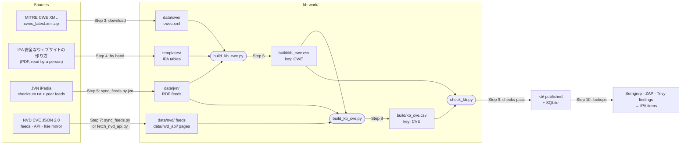

# 05 · Building the IPA + NVD knowledge base (CVE + CWE): what was done and how to rebuild it

**Date:** 2026-10-28 · **Language:** English (documents 01–04 are in Vietnamese) · **Read with:** [03 · KB design and builder code](03-kb-ipa-nvd-cho-cong-cu.md), [04 · Glossary and mapping methods](04-thuat-ngu-so-sanh-va-cach-map.md)

This runbook records how the knowledge base (KB) in [`../kb/`](../kb/) was put together from MITRE CWE, IPA, JVN iPedia and NVD data, and lists the steps to rebuild it and keep it current yourself. Commands carry one of three labels:

- **[tested live]**: run in this session against the real source.
- **[tested offline]**: run on real files (project fixtures, or a local server that serves them) because the real host was blocked here.
- **[not tested]**: written from documentation, source code or web search only.

> **Before you use the KB in a real report:** the IPA part (11 IPA items, 18 IPA↔CWE rows and 4 countermeasures in [`../templates/`](../templates/)) is a seed written from memory and marked `seed_unverified`. [Step 4](#step-4--verify-and-curate-the-ipa-tables-by-hand) explains how to check it against IPA's own document.

## Contents

1. [What you build](#1--what-you-build)
2. [Sources](#2--sources)
3. [What I did in this session](#3--what-i-did-in-this-session)
4. [Rebuild it yourself, step by step](#4--rebuild-it-yourself-step-by-step)
5. [Design decisions to keep](#5--design-decisions-to-keep)
6. [Pitfalls met, with real examples](#6--pitfalls-met-with-real-examples)
7. [Reference numbers](#7--reference-numbers)
8. [Troubleshooting](#8--troubleshooting)
9. [Checklists](#9--checklists)
10. [Sources and evidence](#10--sources-and-evidence)
11. [Appendix A · Scripts](#appendix-a--scripts)

## 1 · What you build

Two CSV files, one per lookup key. Scanners only send a key (a CWE or a CVE); the mapping to IPA lives in the KB, not in the scanners.

| File | Key | One row per | Who looks it up | Built from |
|---|---|---|---|---|
| `kb_cwe.csv` (23 columns) | `cwe_id` | (CWE, IPA item) pair: 1,376 rows for CWE 4.14 | Semgrep and ZAP findings (they carry a CWE); Trivy when the CVE is not in `kb_cve` | MITRE CWE XML, the IPA tables in `templates/`, JVN iPedia (Japanese CWE names) |
| `kb_cve.csv` (35 columns) | `cve_id` | CVE: 415,469 rows on 2026-10-28 | Trivy vulnerability findings (they carry a CVE) | NVD CVE data, JVN iPedia, `kb_cwe.csv` |

Column meanings are in doc 03 §3.2 (`kb_cwe`) and §3.3 (`kb_cve`). How one CWE is chosen for a CVE when sources disagree (default NVD → CNA/ADP → JVN; `--prefer jvn` puts JVN first) is in doc 03 §3.4. How each scanner looks things up is in doc 03 §4.



## 2 · Sources

| Source | Owner | What the KB takes | Where | Format | How often it changes | How to detect a change |
|---|---|---|---|---|---|---|
| CWE list | MITRE | names; Weakness or Category; abstraction; parents in view 1000 (and which parent is Primary); the CWE subset NVD uses (view 1003) | `https://cwe.mitre.org/data/xml/cwec_latest.xml.zip` | XML, namespace `http://cwe.mitre.org/cwe-7` | a few releases a year | `Version` and `Date` attributes of the root element |
| 安全なウェブサイトの作り方 ("How to Secure Your Website") | IPA | the 11 vulnerability types of chapter 1, their countermeasures, and the IPA→CWE judgement (made by a person) | PDF linked from `https://www.ipa.go.jp/security/vuln/websecurity/about.html` | PDF | new editions are rare | edition number; sha256 of the PDF |
| JVN iPedia | IPA with JPCERT/CC | JVNDB id, Japanese title, the CWE that JVN gives each JVNDB record (with the Japanese CWE name), IPA's CVSS, link | `https://jvndb.jvn.jp/ja/feed/checksum.txt` lists every feed: `ja/rss/years/jvndb_YYYY.rdf` (from 1998), `ja/feed/detail/jvndb_detail_YYYY.rdf`, `ja/rss/jvndb.rdf` (recently changed), `ja/rss/jvndb_new.rdf` (new) | RDF/XML (RSS 1.0 with `sec:` elements; VULDEF for detail feeds) | often: `jvndb_new.rdf` and `jvndb.rdf` carry the latest changes; year files are regenerated (Step 5) | `checksum.txt`: `sha256`, `size`, `lastModified` per file |
| NVD CVE data | NIST | CWE per source (NVD, the CNA, ADPs), `vulnStatus`, CVSS v3.x and v4.0, CISA KEV fields, English description | JSON 2.0 feeds `https://nvd.nist.gov/feeds/json/cve/2.0/nvdcve-2.0-{YYYY,modified,recent}.json.gz` with `.meta`; or the API `https://services.nvd.nist.gov/rest/json/cves/2.0`; or the GitHub mirror `fkie-cad/nvd-json-data-feeds` | JSON in the API 2.0 schema | `modified`/`recent` feeds every 2 hours, year feeds daily (NVD page); mirror release daily at 00:00 UTC | `.meta` (`lastModifiedDate`, `size`, `sha256` of the uncompressed JSON); for the API, `lastModStartDate`/`lastModEndDate` |

## 3 · What I did in this session

### 3.1 Constraints

- The session ran in a cloud container. Its proxy blocked `www.ipa.go.jp`, `jvndb.jvn.jp`, `nvd.nist.gov`, `services.nvd.nist.gov` and `cwe.mitre.org`. GitHub, PyPI and GitLab were reachable.
- So I learned the official formats from the source code and test fixtures of open-source tools that read them: [`vuls-data-update`](https://github.com/MaineK00n/vuls-data-update) (commit `969aa0a`, 2026-10-26), [`go-cve-dictionary`](https://github.com/vulsio/go-cve-dictionary) and `trivy-db`, plus web search for NVD's pages.
- Trivy and ZAP were not run as scanners; their output formats come from their source code and test data (doc 02).
- My first design went the wrong way (scanner rules → IPA template). You corrected it: IPA and NVD are the reference data, and the scanners look things up in a KB built from them. Keep that direction.

### 3.2 Steps

| # | Step | How it was done here | Result |
|---|---|---|---|
| 1 | Learn the source formats | read the NVD and JVN fetchers and fixtures of `vuls-data-update` (`pkg/fetch/nvd`, `pkg/fetch/jvn`) and `go-cve-dictionary` (`fetcher/jvn`, `db/rdb.go`); NVD documentation via web search | URLs, fields and limits in §2 and doc 03 §2 |
| 2 | Get the CWE list | `cwec_v4.14.xml` (2024-02-29) bundled in the PyPI package `cwe2` 3.0.0 (`cwe2/database_v49/`), because `cwe.mitre.org` was blocked | 963 weaknesses, 409 categories |
| 3 | Write the IPA tables | typed 11 items, 18 IPA↔CWE rows and 4 countermeasures from memory into `templates/`, all `seed_unverified` | still needs [Step 4](#step-4--verify-and-curate-the-ipa-tables-by-hand) |
| 4 | Get JVN iPedia data | 13 real JVNDB records from the `vuls-data-update` fixtures (RSS and detail feeds, snapshot 2023-11-02) | Japanese names for CWE-20, 79, 89, 94, 352, 399, 476, 640 and `CWE-noinfo` |
| 5 | Get NVD data | mirror `fkie-cad/nvd-json-data-feeds`: 23 single-CVE files, then `CVE-Recent` and `CVE-2025` (2026-10-27), then every year 1999–2026 plus `CVE-Modified` (2026-10-28); every file checked against the sha256 in its `.meta` | 415,469 CVE records |
| 6 | Design the KB | two files with two keys; CWE kept per source plus a selection rule; IPA items spread down the CWE tree | doc 03 §3 |
| 7 | Write the builders | `build_kb_cwe.py`, `build_kb_cve.py`, `map_findings_to_kb.py` (doc 03 §6) | [`kb/kb_cwe.csv`](../kb/kb_cwe.csv), [`kb/kb_cve.sample.csv`](../kb/kb_cve.sample.csv) |
| 8 | Measure | the 2025 feed, then the whole history | [§7](#7--reference-numbers) |
| 9 | Compare sources | CWE from NVD, the CNA/ADPs, JVN, GHSA/OSV on real CVEs | doc 04 §7 |
| 10 | Make it repeatable (this document) | wrote `sync_feeds.py`, `fetch_nvd_api.py`, `check_kb.py`, `load_kb_sqlite.py`, `update_kb.sh` ([Appendix A](#appendix-a--scripts)); changed `build_kb_cve.py` to keep the newest copy of a CVE found in several files | the whole pipeline ran end to end |

### 3.3 What is tested and what is not

| Script or command | Label | What was run |
|---|---|---|
| `build_kb_cwe.py` | [tested live] with CWE 4.14 | code extracted from doc 03 rebuilds `kb/kb_cwe.csv` byte for byte |
| `build_kb_cve.py` | [tested live] | 23 samples (byte-identical to `kb/kb_cve.sample.csv`); the 2025 feed; the whole history (415,469 CVEs); a CVE present in two folders keeps the newer copy in either argument order |
| `map_findings_to_kb.py` | [tested offline] | a real Semgrep scan; ZAP and Trivy outputs taken from those projects' test data |
| `sync_feeds.py fkie` | [tested live] | 29 files (1999–2026 and `Modified`), 3.3 GB, 59 s; a second run found all 29 unchanged in 12 s |
| `sync_feeds.py nvd` | [tested offline] | local server with the real NVD 2.0 fixture files from `vuls-data-update`: upper-case sha256 accepted, a wrong sha256 rejected and no file kept |
| `sync_feeds.py jvn` | [tested offline] | local server with the real JVN fixture files: wrong sha256 rejected, an entry pointing to another host refused, unchanged files skipped |
| `fetch_nvd_api.py` | [tested offline] | local imitation of the API: a 429 with `Retry-After`, a short page, a record that changes while pages are read, windows split at 120 days, the `apiKey` header. **Never run against the real API.** |
| `check_kb.py` | [tested live] | sample, 2025 and full builds; stops a broken build (examples in Step 9) |
| `load_kb_sqlite.py` and the SQL in Step 10 | [tested live] | the full KB loaded in 14 s |
| `update_kb.sh` | [tested offline] | three runs: NVD from the mirror (live), JVN from the local server; the run with a broken CWE file stopped and left `kb/` untouched |
| Official URLs of IPA, JVN, NVD and CWE | [not tested] | blocked here; taken from source code, fixtures and web search |

## 4 · Rebuild it yourself, step by step

### Step 0 · Prerequisites

- Python 3.9 or newer, standard library only (tested with 3.13). Bash for `update_kb.sh` (Linux or macOS).
- Network access to `cwe.mitre.org`, `www.ipa.go.jp` and `jvndb.jvn.jp`, plus either `nvd.nist.gov` (feeds) or `services.nvd.nist.gov` (API). For the mirror instead: `github.com` and the host its release downloads redirect to (`release-assets.githubusercontent.com` on 2026-10-28).
- Disk: 3.3 GB for the uncompressed NVD feeds, about 300 MB for `kb_cve.csv`, plus the JVN feeds (the 2022 RSS year file was 35 MB and the 2022 detail file 72 MB in the 2023 listing).
- Memory: 4 GB free for the full build (peak measured: 3.0 GB).
- Optional: a free NVD API key (https://nvd.nist.gov/developers/request-an-api-key) if you use the API.

### Step 1 · Get the scripts [tested live]

All code lives in the documents: the three builders in doc 03 §6, the rest in [Appendix A](#appendix-a--scripts). Extract it:

```bash
REPO=~/ai-architecture                 # where you cloned this repository
mkdir -p ~/kb-work/scripts && cd ~/kb-work
python3 - "$REPO/projects/security_scan/docs/03-kb-ipa-nvd-cho-cong-cu.md" \
          "$REPO/projects/security_scan/docs/05-kb-build-runbook.md" <<'EOF'
import pathlib, re, sys
for doc in sys.argv[1:]:
    md = pathlib.Path(doc).read_text(encoding="utf-8")
    for name, code in re.findall(r"<summary><code>([\w.]+)</code>.*?</summary>\s*```(?:python|bash)\n(.*?)```", md, re.S):
        pathlib.Path("scripts", name).write_text(code, encoding="utf-8")
        print("scripts/" + name)
EOF
chmod +x scripts/update_kb.sh
```

You should get 8 files: `build_kb_cwe.py`, `build_kb_cve.py`, `map_findings_to_kb.py`, `sync_feeds.py`, `fetch_nvd_api.py`, `check_kb.py`, `load_kb_sqlite.py`, `update_kb.sh`.

### Step 2 · Lay out a working folder

```
kb-work/
├── scripts/      the 8 scripts
├── templates/    your copy of projects/security_scan/templates/ (the IPA tables you curate)
├── data/         downloads only; treat them as untrusted input
│   ├── cwe/      cwec.xml
│   ├── jvn/      jvndb_YYYY.rdf + checksum.txt
│   ├── nvd/      year feeds + modified feed, each with its .meta
│   └── nvd_api/  optional: API pages + state.json
├── build/        output of the latest run
├── kb/           the published KB; replaced only when the checks pass
└── logs/
```

```bash
cp -r "$REPO/projects/security_scan/templates" templates
mkdir -p data/cwe data/jvn data/nvd build kb logs
```

Run Python with `-I` (as all commands here do): Python then imports nothing from the current folder or the script's folder and ignores `PYTHON*` environment variables, so a stray `.py` file in a download folder cannot be imported by mistake.

### Step 3 · Download the CWE list [not tested: host blocked here]

```bash
curl -fsSL -o data/cwe/cwec_latest.xml.zip https://cwe.mitre.org/data/xml/cwec_latest.xml.zip
unzip -o -d data/cwe data/cwe/cwec_latest.xml.zip        # gives cwec_vX.Y.xml
mv data/cwe/cwec_v*.xml data/cwe/cwec.xml                 # the builder reads the version from inside the file
head -c 300 data/cwe/cwec.xml                             # expect Version="…" and xmlns="http://cwe.mitre.org/cwe-7"
```

Write the version and the file's sha256 into the `mitre_cwe_catalog` row of `templates/source_version.csv`. If MITRE ever moves to a new schema namespace (for example `cwe-8`), change `NS` at the top of `build_kb_cwe.py`. If you forget, the build yields only 3 CWE ids and `check_kb.py` stops the publish (tested with a file edited to `cwe-8`).

### Step 4 · Verify and curate the IPA tables by hand

This is the one step no script can do, and the KB is only as right as these rows. Files in `templates/`:

| File | One row is | Key columns | What the builder does with it |
|---|---|---|---|
| `ipa_item.csv` | one IPA vulnerability type | `ipa_id` (`IPA-WEB-01`…), `edition`, `section_no`, `name_ja`, `name_en`, `name_vi` | every `ipa_id` used in the other files must exist here, or the build stops with `KeyError` |
| `ipa_cwe_map.csv` | one judgement "IPA item ↔ CWE" | `ipa_id`; `cwe_id` as a **number** (`89`, not `CWE-89`); `relation` = `exact`, `narrower`, `broader` or `related`; `confidence`; `verification_status`; `evidence_url`; `verified_by`; `verified_at` | uses **every** row whatever its status (the status is copied to `mapping_status`), so delete a wrong row instead of marking it. Only `exact` rows spread to child CWEs, at most 4 levels down view 1000, and only to CWEs that have no row of their own |
| `ipa_countermeasure.csv` | one countermeasure | `measure_id`, `ipa_id`, `measure_type` (`root_cause` or `defense_in_depth`; `root_cause` is listed first), `measure_no`, `text_ja` | ids listed in `kb_cwe.ipa_measure_ids` |
| `source_version.csv` | one source | `current_version`, `content_sha256`, `last_checked_at`, `status` | not read by the builders; it is your record of what was used |

The files are read as UTF-8 with or without a BOM, so saving from Excel as "CSV UTF-8" works.

Procedure:

1. Download the current PDF of 安全なウェブサイトの作り方 from the IPA page in §2. Write its edition and sha256 in the `ipa_secure_website` row of `source_version.csv`.
2. `ipa_item.csv`: for each vulnerability type in chapter 1, copy `section_no` and `name_ja` exactly as printed and set `edition`. Then set `verification_status=verified` and `last_verified_at`.
3. `ipa_countermeasure.csv`: copy `text_ja` word for word from the PDF. IPA separates fundamental solutions (根本的解決) from safety-net measures (保険的対策); the template calls them `root_cause` and `defense_in_depth` (check the exact wording in the edition you have). `text_en` and `text_vi` are your own paraphrase.
4. `ipa_cwe_map.csv`: decide which CWE(s) each item covers. Evidence, strongest first: (a) a CWE number printed by IPA itself; (b) the CWE that JVN iPedia gives to vulnerabilities of that type (JVN's CWE pages, for example `https://jvndb.jvn.jp/ja/cwe/CWE-79.html`); (c) MITRE's definition. Put the link in `evidence_url`, then fill `relation`, `confidence`, `verification_status=verified`, `verified_by`, `verified_at`.
   - `exact`: the CWE is this IPA type (SQL injection ↔ CWE-89). Children inherit the item: CWE-564 (Hibernate SQL injection) gets `IPA-WEB-01` with `match_kind=ancestor`, `via_cwe_id=CWE-89`.
   - `narrower` / `broader`: the CWE is a part of / larger than the IPA type. No inheritance.
   - `related`: same area, different flaw (CWE-384 session fixation for 1.4 session management). No inheritance.
5. Rebuild `kb_cwe.csv` (Step 6) and read the diff before publishing (`diff` or `git diff --stat`, then the rows whose `ipa_id` changed). One new `exact` row on a broad Class CWE can pull dozens of child CWEs into an IPA item.

### Step 5 · Download the JVN iPedia feeds [tested offline]

```bash
python3 -I scripts/sync_feeds.py jvn data/jvn                          # year RSS feeds jvndb_YYYY.rdf (default)
python3 -I scripts/sync_feeds.py jvn data/jvn 'jvndb_detail_*.rdf'     # optional: VULDEF detail feeds
```

- The script reads `checksum.txt`, downloads only files whose sha256 changed, checks sha256 and size, and only then replaces the old copy. It refuses an entry whose URL points to a host other than the one serving `checksum.txt`. It keeps a copy of `checksum.txt` as a record of what was used.
- Pass the year feeds only. `jvndb.rdf` and `jvndb_new.rdf` repeat records that are also in the year feeds, and `build_kb_cve.py` merges every copy of a JVNDB record it is given: if an old and a new version of a record disagree on the CWE, both CWEs end up in `cwe_jvn`. In the 2023-11-02 fixture listing, all year files carried a 2023-10-29 timestamp while `jvndb.rdf` carried 2023-11-02, which suggests the year files are regenerated about once a week (an inference from one listing, not confirmed).
- `go-cve-dictionary` drops RSS items whose description contains `** 未確定 **`, `** サポート外 **` or `** 削除 **` (unconfirmed, unsupported, deleted). `build_kb_cve.py` does not; none appeared in the fixtures. Check your feeds with `grep -c '\*\* 削除 \*\*' data/jvn/*.rdf` and decide whether to filter.
- Only CWEs that appear in the JVN records you pass get a Japanese name in `kb_cwe`. With the 13 fixture records that was 9 ids; with all year feeds you get every CWE that JVN has used.

### Step 6 · Build `kb_cwe.csv` [tested live with CWE 4.14]

```bash
python3 -I scripts/build_kb_cwe.py --cwe-xml data/cwe/cwec.xml --ipa-dir templates \
        --jvn data/jvn/*.rdf --out build/kb_cwe.csv
```

Expect 1,376 rows with CWE 4.14 (a newer CWE list gives more). JVN feeds only add `cwe_name_ja` and `jvn_cwe_url`; everything else comes from the XML and `templates/`.

### Step 7 · Download NVD data: choose one option

| Option | Command | Label | Use it when |
|---|---|---|---|
| A. Official JSON 2.0 feeds | `python3 -I scripts/sync_feeds.py nvd data/nvd 2002-2026 modified` | [tested offline] | default: official, no key, whole history |
| B. GitHub mirror `fkie-cad/nvd-json-data-feeds` | `python3 -I scripts/sync_feeds.py fkie data/nvd 1999-2026 Modified` | [tested live] | `nvd.nist.gov` is unreachable; this is what the session used |
| C. NVD CVE API 2.0 | `NVD_API_KEY=… python3 -I scripts/fetch_nvd_api.py data/nvd_api --since 2026-10-01T00:00:00Z` | [tested offline] | changes between two daily runs; or if the feeds are ever retired |

Replace `2026` with the current year.

- **A.** The 2002 feed also holds the CVEs of 1999–2001 (seen in the fixture: `CVE-1999-0095`, `CVE-2000-0388`, `CVE-2001-0679` sit in `nvdcve-2.0-2002`), so the range starts at 2002. A `.meta` file gives `lastModifiedDate`, `size` and the sha256 of the **uncompressed** JSON; NVD may write the sha256 in upper case, which the script accepts. NVD calls the API the preferred way to stay current; the feeds are its bulk alternative.
- **B.** One file per CVE year from 1999 (`CVE-1999` … `CVE-2026`), plus `CVE-Modified`, `CVE-Recent` and a single `CVE-all`. The mirror syncs NVD every 2 hours and publishes release files daily at 00:00 UTC. Its README says it is not endorsed by NIST, and the repository had no `LICENSE` file on 2026-10-27: check the terms before you redistribute data from it.
- **C.** Pass `--since` on the first run only; later runs continue from `state.json`, starting 2 hours before the previous end (duplicates are harmless, see below). Windows longer than 120 days are split; pages hold up to 2,000 records; the script waits 6 s between requests without a key and 1 s with one (the public limits are 5 requests per 30 s without a key and 50 with one, per NVD's documentation read via web search); it retries 403, 408, 429 and 5xx answers, honouring `Retry-After`. If `totalResults` changes while it reads the pages of a window (a record was modified meanwhile), it reads that window again. Pages use the same schema as the feeds.
- **Mixing is safe.** The same CVE can arrive in a year feed, the modified feed and API pages. `build_kb_cve.py` keeps the copy with the newest `lastModified`, whatever the order of files and folders. A typical setup is A or B for the daily full build plus C during the day: `--nvd data/nvd data/nvd_api`.

### Step 8 · Build `kb_cve.csv` [tested live]

```bash
python3 -I scripts/build_kb_cve.py --nvd data/nvd --jvn data/jvn/*.rdf \
        --kb-cwe build/kb_cwe.csv --out build/kb_cve.csv        # add data/nvd_api after data/nvd if you use option C
                                                                 # add --prefer jvn to rank JVN's CWE first
```

On the 2026-10-28 data: 415,469 rows, 271 MB, 85 s, peak memory 3.0 GB (4-core container). The output is sorted and carries no timestamps, so two runs on the same input give identical files and a `diff` shows only real changes.

### Step 9 · Check before publishing [tested live]

```bash
python3 -I scripts/check_kb.py build/kb_cwe.csv build/kb_cve.csv kb/kb_cve.csv   # last argument: the previous published build
```

On the very first build there is no previous build: leave out the last argument.

| Level | Check | Usual cause |
|---|---|---|
| FAIL | `kb_cwe` has fewer than 1,000 CWE ids | the CWE XML namespace changed, or the wrong file |
| FAIL | pseudo ids missing, or no CWE mapped to an IPA item | wrong `templates/` folder |
| FAIL | duplicate or malformed `cve_id`; unknown `ipa_status`; `MAPPED` without `ipa_ids` | broken input or builder |
| FAIL | a CVE of the previous build is gone | a year feed failed to download or was cut short |
| WARN | a CVE uses a CWE id that `kb_cwe` lacks | the CWE list is newer than your XML, or a CNA used a View id (on 2026-10-28: CWE-701 nine times, CWE-702 and CWE-1026 once each) |
| WARN | the `MAPPED` share moved by more than 2 percentage points | an IPA mapping change, or a source problem |
| WARN | new `cwe_conflict=Y` rows | sources now disagree; look at a few |
| WARN | `kb_cwe` mixes CWE versions | files from two CWE releases |

The exit code is 1 on any FAIL (with `--strict`, also on WARN). Two real examples from this session: a build from the 8-day `CVE-Recent` feed checked against the 2025 build gave `FAIL: 45378 CVE disappeared since the previous build`; a build with a CWE file edited to namespace `cwe-8` gave `FAIL: kb_cwe has only 3 CWE ids`. Both stopped the publish. The full check takes about 16 s.

### Step 10 · Publish and use [tested live]

Publishing means copying the two files to `kb/` (or to your storage). To query them, load them into SQLite (415,469 rows in 14 s, a 316 MB file):

```bash
cp build/kb_cwe.csv build/kb_cve.csv kb/
python3 -I scripts/load_kb_sqlite.py kb.db kb/kb_cwe.csv kb/kb_cve.csv
```

The two lookups the scanners need:

```sql
-- Trivy: by CVE first
SELECT cve_id, cwe_selected, cwe_selected_from, ipa_status, ipa_ids, cvss_v3_score, kev_date_added
FROM kb_cve WHERE cve_id = 'CVE-2021-44228';
-- CVE-2021-44228 | CWE-917 | nvd | OUT_OF_IPA_SCOPE | (empty) | 10.0 | 2021-12-10

-- Semgrep, ZAP, and Trivy when the CVE is missing: by CWE
SELECT cwe_id, ipa_status, ipa_id, ipa_name_ja, match_kind, via_cwe_id
FROM kb_cwe WHERE cwe_id = 'CWE-564';
-- CWE-564 | MAPPED | IPA-WEB-01 | SQLインジェクション | ancestor | CWE-89
```

To map whole scan reports in one go, use `map_findings_to_kb.py` (doc 03 §6.3):

```bash
python3 -I scripts/map_findings_to_kb.py kb/kb_cwe.csv kb/kb_cve.csv \
        semgrep=semgrep.json zap=zap.json trivy=trivy.json out=mapped.csv
```

For PostgreSQL, create the two tables with `TEXT` columns named after the CSV headers, then `\copy kb_cve FROM 'kb/kb_cve.csv' WITH (FORMAT csv, HEADER true)` [not tested].

### Step 11 · Keep it current [tested offline]

`update_kb.sh` chains Steps 5 to 10 and replaces `kb/` only when `check_kb.py` passes. One run took 177 s here with the NVD files already up to date (download checks, both builds, the check, the copy).

```bash
NVD_SOURCE=nvd scripts/update_kb.sh       # or NVD_SOURCE=fkie; STRICT=1 also stops on WARN
# crontab: every day at 01:30 (any hour works; the year feeds change once a day)
30 1 * * *  cd "$HOME/kb-work" && NVD_SOURCE=nvd scripts/update_kb.sh > /dev/null 2>&1
```

Each run writes `logs/update-<time>.log` and `build/check.txt`; a successful run also copies `check.txt` to `kb/`. To pull API changes during the day as well, run `fetch_nvd_api.py data/nvd_api` before `update_kb.sh`; the script passes `data/nvd_api` to the builder when the folder exists.

| When | What to do | Who |
|---|---|---|
| Every day | `update_kb.sh`; read the WARN lines in `kb/check.txt` (or `build/check.txt` when the run stopped) | cron, then a person for WARN |
| Every week | look at a few new `cwe_conflict=Y` CVEs; delete old `logs/` | a person |
| New CWE release | replace `data/cwe/cwec.xml`, rebuild, review the `kb_cwe.csv` diff (new CWEs under an `exact` parent join that IPA item automatically) | a person |
| New edition of IPA's document | redo Step 4 and update `edition` | a person |
| Scanner upgrade | re-check the CWE tags of the scanner's rules (doc 02, `tool_side/`) | a person |

## 5 · Design decisions to keep

| Decision | Why | Where |
|---|---|---|
| Two files with two keys (CWE, CVE) | scanners emit one key or the other; `kb_cwe` is small and stable, `kb_cve` is large and changes every day | doc 03 §3.1 |
| Keep the CWE of every source, then choose with a fixed rule (NVD → CNA/ADP → JVN) | sources disagree for 4.5% of CVEs; NVD itself gave a real CWE to only 12.5% of 2025 CVEs | doc 03 §3.4, doc 04 §6.2 |
| JVN's CWE last by default | JVN gives one CWE set to a whole JVNDB record, and one record can cover several CVEs | doc 03 §2.2 |
| Spread only `exact` IPA mappings, at most 4 levels down view 1000 | children of CWE-89 get the SQL injection item without pulling whole classes in | doc 03 §3.2 |
| Pseudo ids are rows (`NO_CWE_INFO`) | "no information" stays visible in reports instead of disappearing | doc 03 §3.2 |
| Scanners send keys only; the mapping lives in the KB | one place to fix a mapping, for every scanner | doc 03 §4 |
| Newest `lastModified` wins | the same CVE comes from year feeds, the modified feed and API pages | `build_kb_cve.py` |
| Deterministic output, no timestamps | a diff between two runs shows only real changes | doc 03 §6 |
| Download → check sha256 → replace in one move; publish only after `check_kb.py` | a cut download or a bad build never reaches users | Appendix A |

## 6 · Pitfalls met, with real examples

1. **The CWE of a CVE depends on the source.** Log4Shell `CVE-2021-44228`: NVD says CWE-917; Apache, the CNA, says CWE-20, 400 and 502; JVN says CWE-20. The default rule picks CWE-917, which is outside the 11 IPA items.
2. **The CWE of a CVE changes over time.** jquery `CVE-2019-11358`: NVD gave CWE-79 in 2021 (the value still in Trivy's test database), and gives CWE-1321 now. Rebuild often and keep `nvd_last_modified`.
3. **NVD analysts assign few CWEs today.** For 2025 CVEs, 12.5% of chosen CWEs came from NVD and 83.6% from CNAs/ADPs. The 17,278 `Deferred` CVEs of 2025 had no NVD CWE at all. A KB that only reads CWEs whose source is `nvd@nist.gov` loses most of the data.
4. **"No CWE" has many spellings:** `NVD-CWE-Other` and `NVD-CWE-noinfo` (NVD), `CWE-noinfo` (JVN), an empty list, `-1` or `0` in ZAP. Across all years, 13.5% of non-rejected CVEs carry only a pseudo id and 2.1% carry nothing.
5. **Categories and Views show up where a weakness is expected.** JVN uses CWE-399 (a Category); GitLab advisories list CWE-1035 and CWE-937 (OWASP categories); 11 NVD records use View ids 701, 702 and 1026. `kb_cwe` has Category rows; View ids end as `OUT_OF_IPA_SCOPE`, and `check_kb.py` warns about them.
6. **Year ranges differ.** The official 2002 feed contains 1999–2001; the mirror splits by CVE year from 1999.
7. **Upper-case sha256** may appear in NVD `.meta` files: compare without regard to case.
8. **NVD API limits:** windows of at most 120 days with both dates given, 2,000 records per page, about 6 s between requests without a key. Results can shift while you page through them.
9. **Multi-line descriptions** break simple CSV readers; the builder writes each cell on one line.
10. **Memory:** the largest year file (`CVE-2026`, 554 MB) is parsed whole; the full build peaked at 3.0 GB.
11. **Scanner rules carry wrong CWEs sometimes** (the Python Django and Flask variants of Semgrep's `tainted-sql-string` are tagged CWE-915 and CWE-704 instead of CWE-89; only 39 of 78 ZAP rules carry a CWE that agrees with MITRE's WASC→CWE mapping). Fix those on the scanner side (`tool_side/`, doc 02), not in the KB.
12. **A mirror is only as good as its last sync.** The sha256 check proves the file is the one the mirror published, not that the mirror is current. Prefer the official feeds when you can reach them.
13. **Unconfirmed or deleted JVN records** may be in the feeds: see Step 5.

## 7 · Reference numbers

Use these to sanity-check your build. The same inputs give the same numbers; a later date gives similar proportions.

`kb_cwe.csv` (CWE 4.14 with the seed IPA tables):

| Item | Value |
|---|---|
| Rows / CWE ids | 1,376 / 1,375 (963 weaknesses, 409 categories, 3 pseudo ids) |
| CWE ids mapped to an IPA item | 102 (103 rows: one CWE maps to two items) |
| CWE ids in the NVD subset (view 1003) | 130 |

`kb_cve.csv`, whole history (mirror release of 2026-10-28):

| Item | Value |
|---|---|
| CVE records | 415,469; 18,671 Rejected, 396,798 others |
| `vulnStatus` | Modified 244,872 · Analyzed 77,291 · Deferred 59,146 · Rejected 18,671 · Awaiting Analysis 9,228 · Received 4,916 · Undergoing Analysis 1,345 |
| Source of the chosen CWE (non-rejected) | NVD 44.4% · CNA/ADP 40.0% · pseudo id only 13.5% · none 2.1% |
| `ipa_status` (non-rejected) | MAPPED 46.8% · OUT_OF_IPA_SCOPE 37.6% · NO_CWE_INFO 15.6%; of the CVEs with a real CWE, 55.5% are MAPPED |
| How MAPPED rows matched | exact 113,357 · ancestor 52,910 · narrower 15,118 · broader 3,157 · related 1,166 |
| Sources disagree (`cwe_conflict=Y`) | 17,897 (4.5%); the IPA items change with the source for 1,373 (0.35%) |
| With KEV / CVSS v3 / CVSS v4 (non-rejected) | 1,758 / 312,207 / 43,868 |
| Most common CWEs outside the IPA items | CWE-20, 200, 284, 94, 476, 264, 287, 434, 918, 400 |

CVEs per IPA item (non-rejected; a CVE can count for two items):

| IPA item | CVEs |
|---|---|
| 1.10 Buffer overflow (`IPA-WEB-10`) | 57,860 |
| 1.5 Cross-site scripting (`IPA-WEB-05`) | 49,067 |
| 1.11 Missing access or authorization control (`IPA-WEB-11`) | 24,597 |
| 1.1 SQL injection (`IPA-WEB-01`) | 21,433 |
| 1.3 Path traversal (`IPA-WEB-03`) | 11,465 |
| 1.2 OS command injection (`IPA-WEB-02`) | 10,116 |
| 1.6 CSRF (`IPA-WEB-06`) | 9,826 |
| 1.4 Session management (`IPA-WEB-04`) | 1,184 |
| 1.9 Clickjacking (`IPA-WEB-09`) | 425 |
| 1.7 HTTP header injection (`IPA-WEB-07`) | 341 |
| 1.8 Mail header injection (`IPA-WEB-08`) | 256 |

The 2025 feed alone (doc 03 §5): 45,429 CVEs (43,640 non-rejected), MAPPED 58.8%, chosen CWE from CNA/ADP 83.6% and NVD 12.5%. JVN columns are nearly empty in these numbers because only 13 JVN fixture records were available; with the real JVN feeds, expect `jvn_*` columns filled for the CVEs JVN covers (how many was not measurable here).

Time and size (4-core container, 15 GB RAM):

| Step | Time | Size or memory |
|---|---|---|
| NVD download via the mirror, first run | 59 s | 3.3 GB uncompressed |
| Same, nothing changed | 12 s | |
| `build_kb_cve.py`, whole history | 85 s | 271 MB CSV; peak 3.0 GB RAM |
| `check_kb.py` against the previous build | 16 s | |
| `update_kb.sh`, NVD files already up to date | 177 s | |
| `load_kb_sqlite.py` | 14 s | 316 MB database |

## 8 · Troubleshooting

| Symptom | Likely cause | Fix |
|---|---|---|
| `check_kb.py`: `kb_cwe has only 3 CWE ids` | new CWE XML namespace | update `NS` in `build_kb_cwe.py` |
| `KeyError: 'IPA-WEB-12'` from `build_kb_cwe.py` | `ipa_cwe_map.csv` names an item that `ipa_item.csv` lacks | add the item or fix the id |
| `ValueError: invalid literal for int()` from `build_kb_cwe.py` | `cwe_id` written as `CWE-89` in `ipa_cwe_map.csv` | write the number only |
| `sync_feeds.py`: `FAILED: … sha256/size does not match` | cut download, or the feed changed during the download (the script already retried once) | run again later; the previous copy is still in place |
| `FAILED: unexpected filename or host in checksum.txt` | `checksum.txt` points outside its own host | find out why before trusting the feed |
| HTTP 403 from your own proxy or firewall | host not allowed | allow the hosts in Step 0 |
| `fetch_nvd_api.py` waits a long time | rate limited | get an API key; raise `--pause` |
| `first run: pass --since` | no `state.json` yet | pass `--since` once |
| process killed, or `MemoryError` | less than 4 GB free | use a larger machine; for a quick test, pass fewer year files |
| many `UNKNOWN_CWE` in `map_findings_to_kb.py` output | the scanner's CWE is newer than your CWE XML, or a typo in rule metadata | update the CWE XML; add a `tool_side/` override |
| no Japanese CWE names in `kb_cwe` | no JVN feeds given, or JVN never used that CWE | expected for most CWEs |

## 9 · Checklists

**First build**

- [ ] Python 3.9+, the hosts of Step 0 reachable, 4 GB RAM, 5 GB disk
- [ ] 8 scripts extracted (Step 1)
- [ ] `data/cwe/cwec.xml` downloaded; version and sha256 in `source_version.csv`
- [ ] IPA tables verified (Step 4); no row left `seed_unverified`
- [ ] JVN year feeds downloaded
- [ ] NVD option chosen and downloaded
- [ ] `kb_cwe.csv` built and its diff read
- [ ] `kb_cve.csv` built; `check_kb.py` passes
- [ ] published and loaded; five lookups compared by hand with the NVD and JVN web pages
- [ ] `update_kb.sh` scheduled

**Every day:** the scheduled run; read WARN lines. **Every week, on a new CWE release, on a new IPA edition, after a scanner upgrade:** see the table in Step 11.

## 10 · Sources and evidence

- NVD: [data feeds page](https://nvd.nist.gov/vuln/data-feeds) (read via web search; host blocked here), [CVE API documentation](https://nvd.nist.gov/developers/vulnerabilities), [API key request](https://nvd.nist.gov/developers/request-an-api-key).
- [`vuls-data-update`](https://github.com/MaineK00n/vuls-data-update) commit `969aa0a` (2026-10-26): `pkg/fetch/nvd/feed/cve/v2/v2.go` (feed URLs, oldest year 2002), `pkg/fetch/nvd/api/cve/cve.go` and `pkg/fetch/nvd/api/util/util.go` (API URL, `apiKey` header, 2,000 per page, 120-day limit, date format, 6 s wait, retry rules), `pkg/fetch/jvn/feed/{rss,detail}` (`checksum.txt` format and fixtures).
- [`go-cve-dictionary`](https://github.com/vulsio/go-cve-dictionary): `fetcher/jvn/jvn.go` (JVN feed URLs, items it drops), `db/rdb.go` (JVN years from 1998), `commands/fetchnvd.go` (it takes NVD data from its own mirror on GHCR).
- [`fkie-cad/nvd-json-data-feeds`](https://github.com/fkie-cad/nvd-json-data-feeds): README (schedule, non-endorsement clause) and release files.
- MITRE CWE: [downloads](https://cwe.mitre.org/data/downloads.html); `cwec_latest.xml.zip` URL confirmed by web search.
- IPA: [安全なウェブサイトの作り方](https://www.ipa.go.jp/security/vuln/websecurity/about.html), [IPA page on CWE](https://www.ipa.go.jp/en/security/vulnerabilities/cwe.html). JVN iPedia: https://jvndb.jvn.jp/
- This project: doc 03 (design, builder code, 2025 numbers), doc 04 (glossary, source comparison), [`templates/`](../templates/), [`kb/`](../kb/).

## Appendix A · Scripts

Standard library only. Step 1 extracts them from this page.

<details>
<summary><code>sync_feeds.py</code>: download NVD, mirror or JVN feeds only when they changed, keep a file only if its sha256 matches</summary>

```python
#!/usr/bin/env python3
"""Download NVD / JVN iPedia feeds only when they changed; keep a file only if its sha256 matches.

  python sync_feeds.py nvd  data/nvd 2002-2026 modified   # official NVD CVE JSON 2.0 feeds (+ .meta)
  python sync_feeds.py fkie data/nvd 1999-2026 Modified   # GitHub mirror fkie-cad/nvd-json-data-feeds
  python sync_feeds.py jvn  data/jvn                      # JVN iPedia year RSS feeds listed in checksum.txt
  python sync_feeds.py jvn  data/jvn 'jvndb_detail_*.rdf' # other files from checksum.txt (fnmatch patterns)
Options: --base URL (another mirror, or a local test server).
Exit code 1 if any file failed; the previous good copy is left in place.
"""
import argparse, fnmatch, gzip, hashlib, json, lzma, os, re, shutil, sys, tempfile, time, urllib.parse, urllib.request

FEEDS = {  # base URL, meta file, data file, decompressor
    "nvd": ("https://nvd.nist.gov/feeds/json/cve/2.0/", "nvdcve-2.0-{}.meta", "nvdcve-2.0-{}.json.gz", gzip.open),
    "fkie": ("https://github.com/fkie-cad/nvd-json-data-feeds/releases/latest/download/",
             "CVE-{}.meta", "CVE-{}.json.xz", lzma.open),
    "jvn": ("https://jvndb.jvn.jp/ja/feed/", "checksum.txt", None, None),
}

def get(url, dest=None, tries=4):
    """GET with retries; returns bytes, or streams into the file object `dest`."""
    for n in range(tries):
        try:
            req = urllib.request.Request(url, headers={"User-Agent": "kb-sync/1.0"})
            with urllib.request.urlopen(req, timeout=120) as r:
                if dest is None:
                    return r.read()
                dest.seek(0), dest.truncate()
                shutil.copyfileobj(r, dest, 1 << 20)
                return None
        except Exception as e:  # HTTP 4xx/5xx, timeouts, cut connections
            if n == tries - 1 or getattr(e, "code", 500) in (400, 401, 403, 404):
                raise
            time.sleep(5 * 2 ** n)

def sha256_file(path):
    h = hashlib.sha256()
    with open(path, "rb") as f:
        for b in iter(lambda: f.read(1 << 20), b""):
            h.update(b)
    return h.hexdigest()

def parse_meta(text):  # "lastModifiedDate:...\nsize:...\nsha256:..." -> dict (sha256 lower-cased)
    m = dict(line.split(":", 1) for line in text.splitlines() if ":" in line)
    m["sha256"] = m.get("sha256", "").strip().lower()
    return m

def sync_meta_feed(base, meta_tpl, data_tpl, opener, out, name):
    meta_name, json_name = meta_tpl.format(name), data_tpl.format(name).rsplit(".", 1)[0]
    meta_path, json_path = os.path.join(out, meta_name), os.path.join(out, json_name)
    for _ in range(2):  # a feed can change between reading .meta and the data: re-check once
        raw = get(base + meta_name)
        meta = parse_meta(raw.decode())
        if not re.fullmatch(r"[0-9a-f]{64}", meta["sha256"]):
            raise ValueError(f"{meta_name}: no sha256 in .meta")
        if os.path.exists(json_path) and os.path.exists(meta_path):
            with open(meta_path, encoding="utf-8") as f:
                if parse_meta(f.read())["sha256"] == meta["sha256"]:
                    return "unchanged"
        tmp = json_path + ".part"
        try:
            with tempfile.TemporaryFile() as packed, open(tmp, "wb") as dst:
                get(base + data_tpl.format(name), packed)
                packed.seek(0)
                h, size = hashlib.sha256(), 0
                with opener(packed) as src:  # decompress as a stream; hash what is written
                    for b in iter(lambda: src.read(1 << 20), b""):
                        h.update(b), dst.write(b)
                        size += len(b)
            if h.hexdigest() == meta["sha256"] and str(size) == meta.get("size", str(size)).strip():
                os.replace(tmp, json_path)
                with open(meta_path, "wb") as f:
                    f.write(raw)
                return f"updated ({size:,} bytes, lastModifiedDate {meta.get('lastModifiedDate', '?').strip()})"
        finally:
            if os.path.exists(tmp):
                os.unlink(tmp)
    raise ValueError(f"{json_name}: sha256/size does not match {meta_name}")

def sync_jvn(base, out, patterns):
    checksum_url = base + "checksum.txt"
    entries = json.loads(get(checksum_url))
    host = urllib.parse.urlsplit(checksum_url).netloc
    results = {}
    for e in entries:
        fn = e["filename"]
        if not any(fnmatch.fnmatch(fn, p) for p in patterns):
            continue
        if fn != os.path.basename(fn) or urllib.parse.urlsplit(e["url"]).netloc != host:
            results[fn] = "FAILED: unexpected filename or host in checksum.txt"
            continue
        path, want = os.path.join(out, fn), e["sha256"].lower()
        if os.path.exists(path) and sha256_file(path) == want:
            results[fn] = "unchanged"
            continue
        tmp = path + ".part"
        try:
            with open(tmp, "wb") as f:
                get(e["url"], f)
            if sha256_file(tmp) != want or os.path.getsize(tmp) != int(e["size"]):
                raise ValueError("sha256/size does not match checksum.txt")
            os.replace(tmp, path)
            results[fn] = f"updated ({int(e['size']):,} bytes, lastModified {e['lastModified']})"
        except Exception as ex:
            results[fn] = f"FAILED: {ex}"
        finally:
            if os.path.exists(tmp):
                os.unlink(tmp)
    with open(os.path.join(out, "checksum.txt"), "w", encoding="utf-8") as f:
        json.dump(entries, f, ensure_ascii=False, indent=1)  # provenance of this sync
    return results

def expand(names):  # "2002-2026" -> 2002 ... 2026
    for n in names:
        a, _, b = n.partition("-")
        yield from (map(str, range(int(a), int(b) + 1)) if a.isdigit() and b.isdigit() else [n])

ap = argparse.ArgumentParser(description=__doc__, formatter_class=argparse.RawDescriptionHelpFormatter)
ap.add_argument("source", choices=FEEDS)
ap.add_argument("out")
ap.add_argument("names", nargs="*", help="nvd/fkie: years, ranges, modified/recent; jvn: filename patterns")
ap.add_argument("--base", help="override the base URL")
a = ap.parse_args()
os.makedirs(a.out, exist_ok=True)
base, meta_tpl, data_tpl, opener = FEEDS[a.source]
base = a.base or base
if a.source == "jvn":
    results = sync_jvn(base, a.out, a.names or ["jvndb_[0-9][0-9][0-9][0-9].rdf"])
else:
    results = {}
    for name in expand(a.names):
        try:
            results[name] = sync_meta_feed(base, meta_tpl, data_tpl, opener, a.out, name)
        except Exception as ex:
            results[name] = f"FAILED: {ex}"
for name, status in results.items():
    print(f"{name}\t{status}")
failed = sum(s.startswith("FAILED") for s in results.values())
print(f"# {len(results)} files: {sum(s.startswith('updated') for s in results.values())} updated, "
      f"{sum(s == 'unchanged' for s in results.values())} unchanged, {failed} failed")
sys.exit(1 if failed or not results else 0)
```

</details>

<details>
<summary><code>fetch_nvd_api.py</code>: read the CVE records changed in a time window from the NVD API 2.0</summary>

```python
#!/usr/bin/env python3
"""Fetch the CVE records that changed in a time window from the NVD CVE API 2.0; save each page as JSON.

  export NVD_API_KEY=...                                              # optional, raises the rate limit 10x
  python fetch_nvd_api.py data/nvd_api --since 2026-10-01T00:00:00Z   # first run: changes since a date
  python fetch_nvd_api.py data/nvd_api                                # later runs: continue from state.json
Pages are saved as <out>/<window start>-<startIndex>.json in API 2.0 format; build_kb_cve.py reads them.
Windows longer than 120 days are split (API limit). state.json only moves forward after every page was saved.
"""
import argparse, datetime as dt, json, os, sys, time, urllib.error, urllib.parse, urllib.request

API = "https://services.nvd.nist.gov/rest/json/cves/2.0"
FMT = "%Y-%m-%dT%H:%M:%S.000+00:00"

def call(url, key, tries=8):
    for n in range(tries):
        try:
            headers = {"User-Agent": "kb-sync/1.0", **({"apiKey": key} if key else {})}
            with urllib.request.urlopen(urllib.request.Request(url, headers=headers), timeout=120) as r:
                return json.load(r)
        except urllib.error.HTTPError as e:  # NVD answers 403/429/503 when requests come too fast
            if e.code not in (403, 408, 429, 500, 502, 503, 504) or n == tries - 1:
                raise
            ra = e.headers.get("Retry-After", "")
            wait = int(ra) if ra.isdigit() else 30
        except (urllib.error.URLError, TimeoutError, ValueError):  # cut connection, truncated JSON
            if n == tries - 1:
                raise
            wait = 30
        time.sleep(wait)

def fetch_window(base, key, start, end, out, size, pause):
    """All pages of one <=120-day window. Restart if totalResults moves (a record changed during paging)."""
    for attempt in range(3):
        index, total, files, short = 0, None, [], 0
        while total is None or index < total:
            q = dict(lastModStartDate=start.strftime(FMT), lastModEndDate=end.strftime(FMT),
                     resultsPerPage=size, startIndex=index)
            page = call(base + "?" + urllib.parse.urlencode(q).replace("%3A", ":"), key)
            time.sleep(pause)
            if total is not None and page["totalResults"] != total:
                break
            total = page["totalResults"]
            if len(page["vulnerabilities"]) < min(size, total - index):
                short += 1  # short page: ask for the same page again
                if short > 5:
                    raise RuntimeError(f"page {index} keeps coming back short")
                continue
            path = os.path.join(out, f"{start:%Y%m%dT%H%M%S}-{index:07d}.json")
            with open(path + ".part", "w", encoding="utf-8") as f:
                json.dump(page, f, ensure_ascii=False)
            os.replace(path + ".part", path)
            files.append(path)
            index += size
        else:
            return total, files
        print(f"  totalResults changed while paging {start:%Y-%m-%d}..{end:%Y-%m-%d}; restarting", file=sys.stderr)
    raise RuntimeError("window kept changing; run again later")

ap = argparse.ArgumentParser(description=__doc__, formatter_class=argparse.RawDescriptionHelpFormatter)
ap.add_argument("out")
ap.add_argument("--since", help="ISO time, e.g. 2026-10-01T00:00:00Z (default: state.json minus --overlap-hours)")
ap.add_argument("--until", help="ISO time (default: now)")
ap.add_argument("--overlap-hours", type=float, default=2, help="re-read this much before the last run's end")
ap.add_argument("--page-size", type=int, default=2000, help="resultsPerPage, max 2000")
ap.add_argument("--pause", type=float, help="seconds between requests (default 6 without key, 1 with key)")
ap.add_argument("--base", default=API)
a = ap.parse_args()
key = os.environ.get("NVD_API_KEY", "")
pause = a.pause if a.pause is not None else (1 if key else 6)  # public limit: 5 req/30 s, 50 with a key
os.makedirs(a.out, exist_ok=True)
state = os.path.join(a.out, "state.json")
when = lambda s: dt.datetime.fromisoformat(s.replace("Z", "+00:00")).astimezone(dt.timezone.utc)
if a.since:
    since = when(a.since)
elif os.path.exists(state):
    with open(state, encoding="utf-8") as f:
        since = when(json.load(f)["until"]) - dt.timedelta(hours=a.overlap_hours)
else:
    sys.exit("first run: pass --since")
until = when(a.until) if a.until else dt.datetime.now(dt.timezone.utc).replace(microsecond=0)
start, records, pages = since, 0, 0
while start < until:
    end = min(start + dt.timedelta(days=120), until)
    total, files = fetch_window(a.base, key, start, end, a.out, a.page_size, pause)
    print(f"{start:%Y-%m-%dT%H:%M:%SZ} .. {end:%Y-%m-%dT%H:%M:%SZ}\t{total} CVE records\t{len(files)} pages")
    records, pages, start = records + total, pages + len(files), end
with open(state, "w", encoding="utf-8") as f:
    json.dump({"until": until.strftime("%Y-%m-%dT%H:%M:%SZ")}, f)
print(f"# {records} records in {pages} pages; next run starts from {until:%Y-%m-%dT%H:%M:%SZ} "
      f"minus {a.overlap_hours} h")
```

</details>

<details>
<summary><code>check_kb.py</code>: checks before publishing, and comparison with the previous build</summary>

```python
#!/usr/bin/env python3
"""Check a freshly built KB before publishing it; compare with the previous build when given.

  python check_kb.py build/kb_cwe.csv build/kb_cve.csv [kb/kb_cve.csv] [--strict]
FAIL: do not publish. WARN: a person should look. Exit code 1 on any FAIL (with --strict, also on WARN).
"""
import csv, re, sys
from collections import Counter

def load(path):
    with open(path, encoding="utf-8", newline="") as f:
        return list(csv.DictReader(f))

problems = []
def check(ok, level, msg):
    if not ok:
        problems.append(f"{level}: {msg}")

STRICT = "--strict" in sys.argv  # also exit 1 on WARN
args = [x for x in sys.argv[1:] if x != "--strict"]
kb_cwe, kb_cve = load(args[0]), load(args[1])
cwe_ids = {r["cwe_id"] for r in kb_cwe}
check(len(cwe_ids) >= 1000, "FAIL", f"kb_cwe has only {len(cwe_ids)} CWE ids (did the CWE XML namespace change?)")
check({"NVD-CWE-Other", "NVD-CWE-noinfo", "CWE-noinfo"} <= cwe_ids, "FAIL", "kb_cwe lacks the pseudo CWE ids")
check(any(r["ipa_status"] == "MAPPED" for r in kb_cwe), "FAIL", "no CWE is mapped to an IPA item (templates missing?)")
check(len({r["cwe_version"] for r in kb_cwe}) == 1, "WARN", "kb_cwe mixes CWE versions")

ids = [r["cve_id"] for r in kb_cve]
dup = [i for i, n in Counter(ids).items() if n > 1]
check(not dup, "FAIL", f"{len(dup)} duplicate cve_id, e.g. {dup[:3]}")
bad = [i for i in ids if not re.fullmatch(r"CVE-\d{4}-\d{4,}", i)]
check(not bad, "FAIL", f"{len(bad)} malformed cve_id, e.g. {bad[:3]}")
status = Counter(r["ipa_status"] for r in kb_cve)
check(set(status) <= {"MAPPED", "OUT_OF_IPA_SCOPE", "NO_CWE_INFO"}, "FAIL", f"unexpected ipa_status {sorted(status)}")
check(all(r["ipa_ids"] for r in kb_cve if r["ipa_status"] == "MAPPED"), "FAIL", "MAPPED rows without ipa_ids")
unknown = Counter(c for r in kb_cve for c in r["cwe_selected"].split("|") if c and c not in cwe_ids)
check(not unknown, "WARN", f"{sum(unknown.values())} CVE rows use {len(unknown)} CWE ids that kb_cwe does not know "
      f"(newer than your CWE XML, or View ids used by mistake): {unknown.most_common(5)}")

print(f"kb_cwe: {len(kb_cwe)} rows, {len(cwe_ids)} CWE ids, CWE version {sorted({r['cwe_version'] for r in kb_cwe})}")
print(f"kb_cve: {len(kb_cve)} CVE; ipa_status {dict(status.most_common())}; "
      f"cwe_selected_from {dict(Counter(r['cwe_selected_from'] for r in kb_cve).most_common())}; "
      f"cwe_conflict=Y {sum(r['cwe_conflict'] == 'Y' for r in kb_cve)}")
if len(args) > 2:
    old = load(args[2])
    old_by = {r["cve_id"]: r for r in old}
    gone = sorted(set(old_by) - set(ids))
    check(not gone, "FAIL", f"{len(gone)} CVE disappeared since the previous build, e.g. {gone[:5]}")
    share = lambda rows: sum(r["ipa_status"] == "MAPPED" for r in rows) / max(len(rows), 1)
    moved = share(kb_cve) - share(old)
    check(abs(moved) <= 0.02, "WARN", f"MAPPED share moved {moved:+.1%} since the previous build")
    new_conflicts = sorted(r["cve_id"] for r in kb_cve
                           if r["cwe_conflict"] == "Y" and old_by.get(r["cve_id"], {}).get("cwe_conflict") != "Y")
    check(not new_conflicts, "WARN", f"{len(new_conflicts)} new cwe_conflict=Y to review, e.g. {new_conflicts[:10]}")
    ipa_changed = sum(1 for r in kb_cve if r["cve_id"] in old_by and r["ipa_ids"] != old_by[r["cve_id"]]["ipa_ids"])
    print(f"vs previous: +{len(set(ids) - set(old_by))} new CVE, {len(gone)} gone, {ipa_changed} changed ipa_ids")
print("\n".join(problems) or "OK: no problems found")
sys.exit(1 if any(p.startswith("FAIL") or (STRICT and p.startswith("WARN")) for p in problems) else 0)
```

</details>

<details>
<summary><code>load_kb_sqlite.py</code>: load both CSV files into SQLite</summary>

```python
#!/usr/bin/env python3
"""Load kb_cwe.csv and kb_cve.csv into SQLite (all columns TEXT, CSV header = column names).

  python load_kb_sqlite.py kb.db kb/kb_cwe.csv kb/kb_cve.csv
"""
import csv, sqlite3, sys

db = sqlite3.connect(sys.argv[1])
for table, path in (("kb_cwe", sys.argv[2]), ("kb_cve", sys.argv[3])):
    with open(path, encoding="utf-8", newline="") as f:
        rows = csv.reader(f)
        cols = next(rows)
        db.execute(f"DROP TABLE IF EXISTS {table}")
        db.execute(f"CREATE TABLE {table} ({', '.join(c + ' TEXT' for c in cols)})")
        db.executemany(f"INSERT INTO {table} VALUES ({', '.join('?' * len(cols))})", rows)
db.execute("CREATE INDEX kb_cwe_cwe_id ON kb_cwe(cwe_id)")
db.execute("CREATE UNIQUE INDEX kb_cve_cve_id ON kb_cve(cve_id)")
db.commit()
print({t: db.execute(f"SELECT COUNT(*) FROM {t}").fetchone()[0] for t in ("kb_cwe", "kb_cve")})
```

</details>

<details>
<summary><code>update_kb.sh</code>: daily refresh, from download to publish</summary>

```bash
#!/usr/bin/env bash
# Daily KB refresh: sync sources -> rebuild -> check -> publish. The published KB only changes if checks pass.
#   NVD_SOURCE=nvd|fkie (default nvd)   JVN_BASE / NVD_BASE: other mirror or test server   STRICT=1: WARN blocks too
#   CWE_XML: the unzipped MITRE file (default data/cwe/cwec.xml; the version is read from inside the XML)
set -euo pipefail
cd "$(dirname "$0")/.."                                   # the kb-work directory
PY="python3 -I"
Y=$(date -u +%Y)
mkdir -p data/nvd data/jvn build kb logs
LOG=logs/update-$(date -u +%Y%m%dT%H%M%SZ).log
exec > >(tee -a "$LOG") 2>&1

$PY scripts/sync_feeds.py jvn data/jvn ${JVN_BASE:+--base "$JVN_BASE"}
case "${NVD_SOURCE:-nvd}" in
  nvd)  $PY scripts/sync_feeds.py nvd  data/nvd "2002-$Y" modified ${NVD_BASE:+--base "$NVD_BASE"} ;;
  fkie) $PY scripts/sync_feeds.py fkie data/nvd "1999-$Y" Modified ${NVD_BASE:+--base "$NVD_BASE"} ;;
esac

$PY scripts/build_kb_cwe.py --cwe-xml "${CWE_XML:-data/cwe/cwec.xml}" --ipa-dir templates --jvn data/jvn/*.rdf --out build/kb_cwe.csv
$PY scripts/build_kb_cve.py --nvd data/nvd $( [ -d data/nvd_api ] && echo data/nvd_api ) \
    --jvn data/jvn/*.rdf --kb-cwe build/kb_cwe.csv --out build/kb_cve.csv
$PY scripts/check_kb.py build/kb_cwe.csv build/kb_cve.csv $( [ -f kb/kb_cve.csv ] && echo kb/kb_cve.csv ) \
    ${STRICT:+--strict} | tee build/check.txt

cp build/kb_cwe.csv build/kb_cve.csv build/check.txt kb/  # publish (replace with your upload / DB load step)
echo "published $(date -u +%FT%TZ): $(wc -l < kb/kb_cve.csv) lines in kb/kb_cve.csv"
```

</details>
