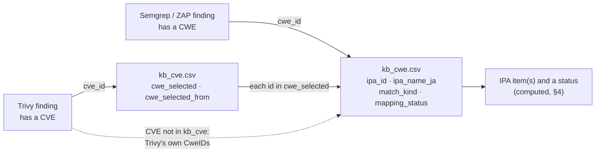

# 06 · KB field reference: every column of `kb_cwe.csv` and `kb_cve.csv`

**Date:** 2026-10-28 · **Language:** English · **Read with:** [05 · Build runbook](05-kb-build-runbook.md), [03 · KB design](03-kb-ipa-nvd-cho-cong-cu.md) (Vietnamese)

On 2026-10-28 the two KB files were cut down to the columns a lookup needs: `kb_cwe.csv` from 23 to **6** columns, `kb_cve.csv` from 35 to **3**. This page explains every remaining field, the statuses you compute from them, and where each removed field can still be found.

Two rules decided what stays:

1. **A column stays only if a scanner lookup or an IPA report needs it, and no other KB column already gives it.**
2. **Each fact is stored once.** `kb_cve.csv` says which CWE a CVE has; `kb_cwe.csv` says which IPA item a CWE belongs to. A Trivy finding therefore goes CVE → CWE → IPA item, and a change to the IPA mapping only changes `kb_cwe.csv`.

The minimal files give the same answers as the old wide ones: on the whole NVD history (415,469 CVEs, 2026-10-28) the chosen CWE, the IPA items and the best match kind were identical for every non-rejected CVE ([§8](#8--how-the-change-was-checked)).

## Contents

1. [The two files at a glance](#1--the-two-files-at-a-glance)
2. [`kb_cwe.csv`](#2--kb_cwecsv-one-row-per-cwe-ipa-item-pair)
3. [`kb_cve.csv`](#3--kb_cvecsv-one-row-per-cve)
4. [Statuses you compute at lookup time](#4--statuses-you-compute-at-lookup-time)
5. [Output of `map_findings_to_kb.py`](#5--output-of-map_findings_to_kbpy)
6. [Removed fields and where to find them](#6--removed-fields-and-where-to-find-them)
7. [IPA tables behind the KB](#7--ipa-tables-behind-the-kb)
8. [How the change was checked](#8--how-the-change-was-checked)

## 1 · The two files at a glance

| File | Key | Rows | Columns | Size |
|---|---|---|---|---|
| `kb_cwe.csv` | `cwe_id` (plus `ipa_id` when one CWE belongs to two IPA items) | 1,376 with CWE 4.14 | `cwe_id`, `cwe_name_en`, `ipa_id`, `ipa_name_ja`, `match_kind`, `mapping_status` | 91 KB |
| `kb_cve.csv` | `cve_id` | 415,469 for the whole NVD history on 2026-10-28 | `cve_id`, `cwe_selected`, `cwe_selected_from` | 12 MB (the old 35-column file: 271 MB) |

Both files are UTF-8 CSV with a header row, `\n` line ends and one value per cell; lists inside a cell are joined with `|`. Rows are sorted (`kb_cwe` by CWE number with the pseudo ids last, `kb_cve` by CVE year and number) and carry no timestamps, so two builds from the same input are identical byte for byte.



## 2 · `kb_cwe.csv`: one row per (CWE, IPA item) pair

Every CWE of MITRE's list (Weaknesses and Categories) has at least one row, plus three pseudo ids. A CWE that belongs to no IPA item has one row with the last four columns empty. A CWE that belongs to two IPA items has two rows; with the current mapping only CWE-93 does.

| # | Field | Format and allowed values | Meaning | Comes from | Empty when |
|---|---|---|---|---|---|
| 1 | `cwe_id` | `CWE-<number>`, or one of the pseudo ids `NVD-CWE-Other`, `NVD-CWE-noinfo`, `CWE-noinfo` | The CWE this row is about. Lookup key for Semgrep and ZAP findings and for every id in `kb_cve.cwe_selected`. | MITRE CWE XML; the pseudo ids are added by the builder | never |
| 2 | `cwe_name_en` | text | MITRE's English name of the CWE. For a pseudo id: what that pseudo id means. Names starting with `DEPRECATED:` are CWEs that MITRE retired. | MITRE CWE XML | never |
| 3 | `ipa_id` | `IPA-WEB-01` … `IPA-WEB-11` | The vulnerability type of IPA's 安全なウェブサイトの作り方 (chapter 1) that this CWE belongs to. `IPA-WEB-NN` is item No NN of the guide's checklist. | `templates/ipa_cwe_map.csv`, or inherited from an ancestor CWE (`match_kind = ancestor`) | the CWE belongs to no IPA item |
| 4 | `ipa_name_ja` | Japanese text | IPA's name of that type, exactly as printed in the 改訂第7版 checklist, e.g. `SQLインジェクション`. | `templates/ipa_item.csv` (checked against IPA's checklist workbook) | `ipa_id` is empty |
| 5 | `match_kind` | `exact`, `narrower`, `broader`, `related`, `ancestor` | How the CWE relates to the IPA type. **exact**: the CWE is that type (CWE-89 ↔ SQL injection). **narrower**: the CWE is one part of the type (CWE-862 for 1.11 access control). **broader**: the CWE is larger than the type (CWE-93 CRLF injection for 1.7 HTTP header injection). **related**: same area, different flaw (CWE-384 session fixation for 1.4 session management). **ancestor**: the CWE has no row of its own in the mapping table and inherits the type from an ancestor up to 4 levels higher in MITRE's tree (view 1000) whose relation is `exact` (CWE-564 Hibernate SQL injection → via CWE-89 → SQL injection). | `ipa_cwe_map.relation`; `ancestor` is set by the builder | `ipa_id` is empty |
| 6 | `mapping_status` | `seed_unverified` or `verified` (the value of the mapping row) | Whether a person has checked this IPA↔CWE judgement against a source. **`seed_unverified` means draft: do not present it as IPA's own mapping.** For an `ancestor` row, the status of the ancestor's mapping row. | `ipa_cwe_map.verification_status` | `ipa_id` is empty |

Real rows:

```csv
cwe_id,cwe_name_en,ipa_id,ipa_name_ja,match_kind,mapping_status
CWE-89,Improper Neutralization of Special Elements used in an SQL Command ('SQL Injection'),IPA-WEB-01,SQLインジェクション,exact,seed_unverified
CWE-93,Improper Neutralization of CRLF Sequences ('CRLF Injection'),IPA-WEB-07,HTTPヘッダ・インジェクション,broader,seed_unverified
CWE-93,Improper Neutralization of CRLF Sequences ('CRLF Injection'),IPA-WEB-08,メールヘッダ・インジェクション,exact,seed_unverified
CWE-384,Session Fixation,IPA-WEB-04,セッション管理の不備,related,seed_unverified
CWE-564,SQL Injection: Hibernate,IPA-WEB-01,SQLインジェクション,ancestor,seed_unverified
CWE-917,Improper Neutralization of Special Elements used in an Expression Language Statement ('Expression Language Injection'),,,,
NVD-CWE-noinfo,NVD pseudo-CWE: insufficient information,,,,
```

Today all 103 mapped rows are `seed_unverified`: IPA's checklist workbook has no CWE numbers, so the IPA↔CWE judgement still needs a person ([§7](#7--ipa-tables-behind-the-kb)). `check_kb.py` prints a WARN until every mapped row is `verified`.

## 3 · `kb_cve.csv`: one row per CVE

Every CVE in the NVD data you build from has a row, plus CVEs that only JVN iPedia cites. Rejected CVEs stay in the file (marked), so a CVE never disappears between two builds.

| # | Field | Format and allowed values | Meaning | Comes from | Empty when |
|---|---|---|---|---|---|
| 1 | `cve_id` | `CVE-YYYY-NNNN…` | The CVE. Lookup key for Trivy vulnerability findings. | NVD records; CVE ids cited by JVN iPedia records | never |
| 2 | `cwe_selected` | one or more `CWE-<number>` joined by `\|` (e.g. `CWE-787\|CWE-125`), or a single pseudo id | The CWE(s) this KB uses for the CVE. The builder takes the first source, in priority order NVD → CNA/ADP → JVN (`--prefer jvn` puts JVN first), that gives at least one real `CWE-<number>`, and keeps all real ids of that source. If no source gives a real id but one gives a pseudo id, that pseudo id. When the same CVE appears in several input files (year feed, modified feed, API pages), only the copy with the newest `lastModified` is used. | the `weaknesses` of the NVD record (split by who wrote them); the CWE of JVN iPedia records that cite the CVE | `cwe_selected_from` is `none` or `rejected` |
| 3 | `cwe_selected_from` | `nvd`, `cna_adp`, `jvn`, `pseudo`, `none`, `rejected` | Where `cwe_selected` came from, or why it is empty. **nvd**: NVD analysts (`nvd@nist.gov`). **cna_adp**: the CNA that published the CVE, or an ADP such as CISA. **jvn**: JVN iPedia (IPA); JVN gives one CWE set to a whole JVNDB record, which can cover several CVEs. **pseudo**: sources only say "no information" (`NVD-CWE-noinfo`, `NVD-CWE-Other`, `CWE-noinfo`). **none**: no source gives any CWE. **rejected**: NVD marks the CVE `Rejected`; ignore findings for it. | `build_kb_cve.py` | never |

Real rows (from [`kb/kb_cve.sample.csv`](../kb/kb_cve.sample.csv)):

```csv
cve_id,cwe_selected,cwe_selected_from
CVE-2007-0851,NVD-CWE-Other,pseudo
CVE-2013-10019,CWE-89,cna_adp
CVE-2021-44228,CWE-917,nvd
CVE-2023-0078,CWE-79,jvn
```

Share of each value on the whole history (2026-10-28, all 415,469 rows): `nvd` 176,257 · `cna_adp` 158,578 · `pseudo` 53,516 · `rejected` 18,671 · `none` 8,446 · `jvn` 1 (only 13 JVN records were available here; with the real JVN feeds expect more `jvn` rows).

## 4 · Statuses you compute at lookup time

The KB stores no status column; a status follows from the fields above. `map_findings_to_kb.py` applies these rules in this order:

| Status | Rule | What to do in a report |
|---|---|---|
| `REJECTED` | Trivy CVE found in `kb_cve` with `cwe_selected_from = rejected` | drop the finding, or list it as rejected |
| `NO_CWE_INFO` | no CWE at all, or only pseudo ids | list as "not classifiable"; not a pass |
| `UNKNOWN_CWE` | none of the CWE ids exists in `kb_cwe` (a CWE newer than your CWE XML, a typo in a rule, or a View id such as CWE-701) | update the CWE XML or fix the scanner rule |
| `MAPPED` | at least one CWE id has a `kb_cwe` row with an `ipa_id` | report under those IPA items; show `match_kind` and `mapping_status` |
| `OUT_OF_IPA_SCOPE` | known real CWE ids, none of them in an IPA item | report outside the 11 IPA items |

With several CWE ids, the IPA items are the union of their rows, and the reported `match_kind` is the strongest one: exact > narrower > broader > ancestor > related.

The same lookup in SQL, after `load_kb_sqlite.py` (doc 05, Step 10):

```sql
-- Trivy: CVE -> CWE -> IPA item (a LEFT JOIN keeps CVEs whose CWE is outside IPA)
SELECT v.cve_id, v.cwe_selected, v.cwe_selected_from, w.ipa_id, w.ipa_name_ja, w.match_kind, w.mapping_status
FROM kb_cve v
LEFT JOIN kb_cwe w ON instr('|' || v.cwe_selected || '|', '|' || w.cwe_id || '|') > 0
WHERE v.cve_id = 'CVE-2023-0078';
-- CVE-2023-0078 | CWE-79 | jvn | IPA-WEB-05 | クロスサイト・スクリプティング | exact | seed_unverified

-- Semgrep / ZAP: CWE -> IPA item
SELECT ipa_id, ipa_name_ja, match_kind, mapping_status FROM kb_cwe WHERE cwe_id = 'CWE-564';
-- IPA-WEB-01 | SQLインジェクション | ancestor | seed_unverified
```

## 5 · Output of `map_findings_to_kb.py`

One row per finding (per alert instance for ZAP). This is the file a report is built from.

| Field | Meaning |
|---|---|
| `tool` | `semgrep`, `zap` or `trivy` |
| `check_id` | Semgrep rule id (last part), ZAP plugin id, or Trivy vulnerability / misconfiguration / secret id |
| `location` | `file:line` for Semgrep; the URI for ZAP; `target :: package@version` for Trivy |
| `lookup` | `CVE` (looked up in `kb_cve`), `CWE` (looked up in `kb_cwe` only), or `-` (nothing to look up: Trivy misconfiguration or secret) |
| `cwe_used` | the CWE id(s) used for the IPA lookup |
| `cwe_from` | `tool` (the scanner's own CWE), or `kb:<cwe_selected_from>` when the CWE came from `kb_cve` |
| `tool_cwe` | the CWE(s) the scanner itself reported, normalised to `CWE-<number>`; compare with `cwe_used` |
| `ipa_status` | one of the statuses in [§4](#4--statuses-you-compute-at-lookup-time) |
| `ipa_ids` | IPA items joined by `\|` when `MAPPED` |
| `match_kind` | the strongest match kind among the hits when `MAPPED` |
| `mapping_status` | the mapping status(es) of the hits, joined by `\|` |
| `note` | free text, in Vietnamese in the current script: `CWE của Trivy khác KB` (Trivy's CWE differs from the KB's), `CVE không có trong KB` (CVE not in the KB, Trivy's CWE used), `NVD đã đánh dấu CVE này Rejected` (CVE rejected by NVD), `misconfig: không có CWE/CVE` / `secret: không có CWE/CVE` (no CWE or CVE to look up) |

## 6 · Removed fields and where to find them

`kb_cwe.csv`: 17 of 23 columns removed.

| Removed field | Why | Where to get it if you need it |
|---|---|---|
| `cwe_number` | same as the number in `cwe_id` | strip `CWE-` from `cwe_id` |
| `cwe_kind`, `cwe_abstraction`, `cwe_status`, `cwe_parent_ids` | MITRE catalogue details; a lookup does not need them | MITRE CWE XML (`Weakness` / `Category` elements); `cwe_name_en` already shows `DEPRECATED:` |
| `nvd_slice`, `nvd_slice_cwe_id` | which CWEs NVD analysts use (view 1003); not needed for IPA | MITRE CWE XML, view 1003 |
| `cwe_name_ja`, `jvn_cwe_url` | Japanese CWE names from JVN; JVN is no longer needed to build `kb_cwe` | JVN iPedia CWE pages, e.g. `https://jvndb.jvn.jp/ja/cwe/CWE-79.html` |
| `ipa_status` | follows from `ipa_id` and `cwe_id` ([§4](#4--statuses-you-compute-at-lookup-time)) | compute it |
| `ipa_section_no`, `ipa_name_en`, `ipa_name_vi` | properties of the IPA item, not of the CWE | `templates/ipa_item.csv`, join on `ipa_id` |
| `via_cwe_id` | which ancestor gave an `ancestor` match | walk up MITRE's view 1000 from `cwe_id`, at most 4 levels, to a CWE with an `exact` row in `templates/ipa_cwe_map.csv` |
| `confidence` | overlaps with `match_kind` and `mapping_status` | `templates/ipa_cwe_map.csv` |
| `ipa_measure_ids` | countermeasures belong to the IPA item | `templates/ipa_countermeasure.csv`, join on `ipa_id` |
| `cwe_version` | the same value on every row | printed by `build_kb_cwe.py`; recorded in `templates/source_version.csv` (row `mitre_cwe_catalog`) |

`kb_cve.csv`: 32 of 35 columns removed.

| Removed field | Why | Where to get it if you need it |
|---|---|---|
| `nvd_url` | same for every CVE | `https://nvd.nist.gov/vuln/detail/<cve_id>` |
| `nvd_vuln_status` | only `Rejected` matters for a lookup | `cwe_selected_from = rejected`; other statuses: the NVD record (`vulnStatus`) |
| `nvd_published`, `nvd_last_modified`, `nvd_source_identifier`, `nvd_description_en` | descriptive; scanners already show them | the NVD record (`published`, `lastModified`, `sourceIdentifier`, `descriptions`) |
| `cwe_nvd`, `cwe_cna_adp`, `cwe_cna_adp_sources`, `cwe_jvn`, `cwe_conflict` | the CWE of each source; only the chosen one is needed for a lookup | the NVD record (`weaknesses`, with `source`) and JVN iPedia; `build_kb_cve.py` prints how many CVEs have sources that disagree (17,897 on 2026-10-28) |
| `ipa_status`, `ipa_ids`, `ipa_best_match` | IPA facts live in `kb_cwe` now | join `cwe_selected` with `kb_cwe` ([§4](#4--statuses-you-compute-at-lookup-time)) |
| `ipa_ids_any_source` | depended on the per-source CWEs | not kept |
| `cvss_v3_score`, `cvss_v3_severity`, `cvss_v3_vector`, `cvss_v3_source`, `cvss_v4_score`, `cvss_v4_severity`, `cvss_v4_vector`, `cvss_v4_source` | severity is not part of the IPA mapping; Trivy reports CVSS itself | the NVD record (`metrics`), or Trivy's own output |
| `kev_date_added`, `kev_due_date`, `kev_name` | prioritisation, not mapping | CISA's Known Exploited Vulnerabilities catalogue, or the NVD record (`cisaExploitAdd`, `cisaActionDue`, `cisaVulnerabilityName`) |
| `jvndb_ids`, `jvn_title_ja`, `jvn_cvss_v3_score`, `jvn_cvss_v3_severity`, `jvn_last_updated`, `jvn_url` | JVN details; only JVN's CWE is used | JVN iPedia: search by CVE id at https://jvndb.jvn.jp/ |

The wide builders are in this repository's history (commit `d7cae4f`, doc 03 §6) if you ever need those columns back.

## 7 · IPA tables behind the KB

`ipa_id`, `ipa_name_ja`, `match_kind` and `mapping_status` come from three hand-kept tables in [`../templates/`](../templates/). Since 2026-10-28 two of them are checked against IPA's own **改訂第7版 checklist workbook** ([000044403.xlsx](https://www.ipa.go.jp/security/vuln/websecurity/ug65p900000196e2-att/000044403.xlsx), sha256 `07df4d1718514d6b66cb96e7c3e7ce6270497516363278ecfd0868e8f3cb7a75`, recorded in `source_version.csv`):

| Table | Rows | State |
|---|---|---|
| `ipa_item.csv` | 11 vulnerability types | **verified**: No 1–11 and every `name_ja` match the checklist; `name_en`, `name_vi` and `summary_vi` are our wording |
| `ipa_countermeasure.csv` | 47 countermeasures (32 根本的解決 `root_cause`, 15 保険的対策 `defense_in_depth`) | **verified**: imported from the checklist with `import_ipa_checklist.py` (doc 05); `text_ja` is IPA's text, `text_en` and `text_vi` are our translation |
| `ipa_cwe_map.csv` | 18 IPA↔CWE judgements | **still `seed_unverified`**: the checklist has no CWE numbers, so a person must still confirm each row (doc 05, Step 4) |

Columns of `ipa_countermeasure.csv`, since a report usually lists countermeasures next to the IPA item:

| Field | Meaning |
|---|---|
| `measure_id` | `IPA-WEB-NN-<code>`, e.g. `IPA-WEB-01-(i)-a` |
| `ipa_id` | the IPA item; join with `kb_cwe.ipa_id` |
| `measure_type` | `root_cause` (根本的解決, fundamental solution) or `defense_in_depth` (保険的対策, safety-net measure) |
| `measure_no` | IPA's own code, e.g. `1-(i)-a` (item 1, measure (i), alternative a) |
| `text_ja` | IPA's text, word for word |
| `text_en`, `text_vi` | our translation |
| `source_url` | the checklist workbook |
| `verification_status` | `verified` (taken from IPA's file) |
| `note` | for XSS, which group the measure belongs to (input without HTML / with HTML / every application); for alternatives a, b, c: "any one of … is enough" (IPA's ※ rule) |

## 8 · How the change was checked

| Check | Result |
|---|---|
| New `kb_cwe.csv` vs the 6 kept columns of the old file | identical, 1,376 rows |
| New `kb/kb_cve.sample.csv` vs the 3 kept columns of the old sample | identical, 23 rows |
| `map_findings_to_kb.py` on the demo scans (Semgrep, ZAP, Trivy; 58 findings) | same `ipa_status`, `ipa_ids`, CWE and notes for every finding |
| Whole NVD history (415,469 CVEs) | 0 differences in `cwe_selected`, IPA items and best match for the 396,798 non-rejected CVEs; all 18,671 rejected CVEs marked `rejected` |
| Reference numbers recomputed from the minimal files | unchanged: 46.8% of non-rejected CVEs in an IPA item (55.5% of those with a real CWE); exact 113,357 · ancestor 52,910 · narrower 15,118 · broader 3,157 · related 1,166 |
| `import_ipa_checklist.py` (standard library) vs `openpyxl` reading the same workbook | same 47 codes, texts and types |
